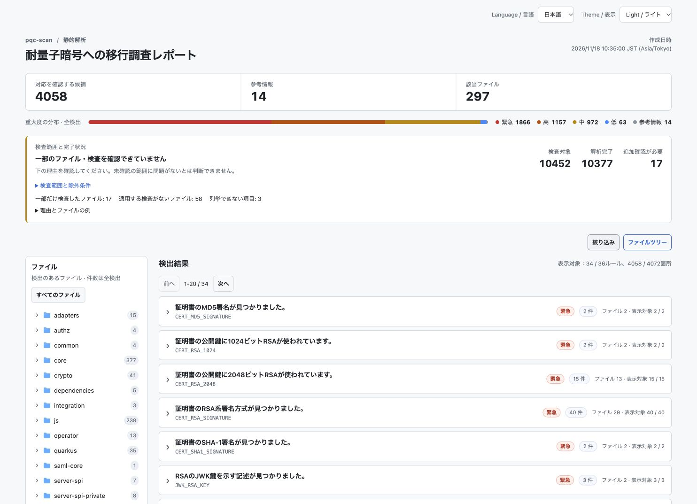
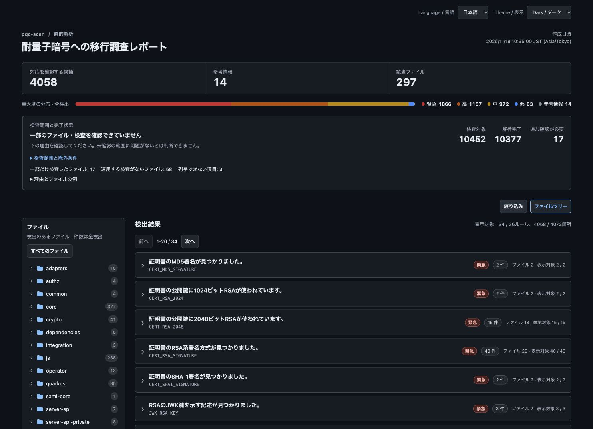

# pqc-scan

このチェックアウトでは、macOS Apple Silicon（`aarch64-apple-darwin`）向け静的スキャン・オフライン移行確認の **v0.4.0** を準備しています。変更点、互換性、評価範囲は[リリースノート](docs/releases/v0.4.0.md)を参照してください。公開には最終ソースの配布検証と、維持者による範囲を限定した製品受入・公開承認が必要です。

公開済みの配布物は[GitHub Releases](https://github.com/wakaken/pqc-scan/releases)で確認してください。ローカルの準備物やActions成果物は、公開済みReleaseとは別です。過去の[v0.2.0のノート](docs/releases/v0.2.0.ja.md)も保持しています。正式対象は静的スキャンです。TLS・SSH診断は実験的機能とし、ネットワーク診断のバイナリ公開は引き続き保留します。

[English](README.md)

`pqc-scan` は、耐量子暗号（PQC）への移行調査に使うRust製のコマンドラインツールです。
ローカルのプロジェクトを読み、暗号方式やライブラリへの参照、その位置、確認すべき点をレポートにまとめます。
JWT、TLS、PKI、SSHなどの暗号処理を変更する前に、調査する箇所を絞り込むために使います。

スキャンからレポート生成まで、ローカルのルールと構文解析で完結します。LLMやAIサービスへの接続は不要で、これらの処理中に外部通信や、ソースコード・検出結果の外部送信を行いません。AIサービスのAPIキーや契約も必要ありません。

ビルド・インストール時の依存パッケージ取得、利用者が設定するCIでのレポート送信、外部の参考リンクの閲覧は別の通信です。ツールとルールが手元に揃えば、オフラインでスキャンできます。

レポートでは、検出内容・場所・次に確認することを表示します。検査が完了していない箇所や追加確認が必要なファイルは、「検査範囲と完了状況」で確認できます。

## 目次

- [スキャンできる成果物](#targets)
- [ツールの主な機能](#features)
- [使い始める](#quick-start)
- [ブラウザでスキャンする](#web-scan)
- [レポートの画面](#report-preview)
- [結果を確認する](#results)
- [利用ガイド](#guides)
- [制約と秘密情報の扱い](#limits)
- [リポジトリのCI](#repository-ci)
- [ライセンス](#license)

<a id="targets"></a>

一部のソースルールでは、JS/TSの相対import先の定数と単純なJWT署名関数を上限付きで追跡します。エラー文の方式名は参考情報として残し、解析未完了の診断には分かる範囲の原因と次の確認方法を表示します。[解析範囲](docs/user/COVERAGE.ja.md#source-facts)を参照してください。

## スキャンできる成果物

ローカルのリポジトリを指定して、次の成果物を検査します。形式ごとに対応するパターンや解析範囲があります。

| 成果物 | 対象言語・ファイルの例 | 確認する内容 |
|---|---|---|
| ソースコード | Java、Go、JavaScript、TypeScript／TSX、Python、Rust、Ruby | 暗号API、方式名、関連する利用パターン。TypeScript・TSXはそれぞれ専用の文法で解析します |
| 設定ファイル | Kubernetes／Ingress、nginx、Apache httpd、Envoy、Istio、HAProxy、Traefik | TLS、暗号スイート、鍵交換グループなどの設定 |
| 公開証明書 | `.pem`、`.crt`、`.cer`、`.der` | 署名方式と公開鍵の方式、対応する鍵長・曲線、有効期間、公開情報の指紋 |
| 秘密鍵のマーカー | RSA、汎用PKCS#8、OpenSSHの秘密鍵ヘッダー | 対応するヘッダーの存在。復号や秘密鍵の妥当性確認は行いません |
| 依存関係の定義・ロックファイル | `Cargo.toml`、`Cargo.lock`、`package.json`、npm／pnpmのロック、Python・Ruby・Java・Goの依存関係ファイル | 関連ライブラリ、指定されたバージョン条件、対応する解決済みレコード |
| 既存のSBOM | CycloneDX JSON、SPDX JSON | 申告された依存コンポーネントやパッケージ。インストール状態の確認ではありません |

一部のソース規則では、同じファイル内の変数や呼び出しを限定的に追跡します。 JOSEのES384・ES512・EdDSAやRSA・Ed25519のモジュール名・型名を方式情報として保持し、jsonwebtokenの署名オプションとRubyの既定引数も限定的に追跡します。RubyのOpenSSL暗号APIでは同一クラスのAES-GCM／CBCの候補、Rustでは明示import・別名を使ったOpenSSLのTLS構築を検出します。配備済み設定や交渉済みの方式を示すものではありません。[局所解析の制約](docs/user/COVERAGE.ja.md#source-facts)も確認してください。

PKCS#12（`.p12`／`.pfx`）では、非暗号化の公開証明書を取り出して検査できます。暗号化された内容と秘密鍵のbagは対象外で、パスワード入力・復号・完全性や信頼性の検証は行いません。
詳しいファイル一覧、対応するバージョン、解析の制約は[対応する入力と検査範囲](docs/user/COVERAGE.ja.md)に記載しています。
稼働中の接続先は、別途有効にして明示実行する[TLS・SSH診断](docs/user/PROBING.ja.md)で調べます。
リポジトリのスキャン対象にはなりません。任意のプログラミング言語への対応も保証しません。

ファイルのサイズ上限は既定で2MiBです。`scan --max-file-size-mib 16` またはフォルダ選択画面のサイズ欄で1〜64MiBに変更できます。[解析内部の上限は別に維持します](docs/user/SCANNING.ja.md#ファイルサイズの上限)。

<a id="features"></a>

## ツールの主な機能

- 暗号利用の手掛かりを探し、重大度・リスク・ソースの位置を示します。
- 言語や実行環境に応じた移行の確認事項を提示します。
- 調査用のHTML・Markdownと、自動処理用のJSON・SARIFを出力します。
- 暗号利用の所見とソフトウェアの依存関係を、別々の一覧にまとめます。
- 必要に応じて、詳しい観測記録、ローカル方針による評価、検査状況の診断を追加できます。
- 明示的に呼び出す`assess`コマンドで[保存済みの証拠をオフラインで再評価](docs/user/SAVED-EVIDENCE.ja.md)し、技術的役割、適用範囲を定めた申告、移行判断を分けて扱えます。
- 同じ目印を持つソースの記録でも、保存済みの入力内で記録と位置が一意なら用途を入力できます。位置の衝突・欠落は引き続き除外し、スキャン間の曖昧さの印と入力ファイル単位の対応付けは維持します。

PQC方式の名前が見つかっても、アプリケーションで正しく使われているとは限りません。
このような所見の意味は、[結果の読み方](docs/user/REPORTS.ja.md#pqc-findings)で例を使って説明しています。

<a id="quick-start"></a>

RustのRSA/JWT依存規則は、Cargoのパッケージ名が`rsa`または`jsonwebtoken`の場合に一致します。`universal-hash`などの名前は対象外です。依存が存在するだけではRSAの実利用は確認できません。

## 使い始める

[`rust-toolchain.toml`](rust-toolchain.toml)で指定したRust（現在は1.93.1）を使い、このリポジトリのソースからインストールします。

```bash
cd /path/to/pqc-scan
cargo install --locked --path crates/pqc_scan_cli
```

この開発版で準備する配布物は、`static`（ローカルの静的スキャン）と`network`（静的スキャン＋TLS・SSHの接続先診断）の2構成です。`network`は実験的機能を含む未公開の構成です。内部の機能スイッチは、個別ビルド用に残しています。

アーカイブの検証と導入方法は[インストールガイド](docs/user/DISTRIBUTION.ja.md)を参照してください。macOS Apple Silicon向け静的版の公開物は[GitHub Releases](https://github.com/wakaken/pqc-scan/releases)で確認してください。probe同梱版は公開前の確認が残っています。

インストール後も、このリポジトリの `rules` ディレクトリを参照できる場所に残してください。
バイナリにルールディレクトリは含まれないため、別のプロジェクトを調べるときは `--rules-dir` を絶対パスで指定します。
コマンドが見つからない場合は、`~/.cargo/bin` が `PATH` に含まれているか確認してください。
`pqc-scan --help`・`pqc-scan --version` で導入したコマンドを確認できます。どちらもスキャンや通信を行わず、正常終了します。

```bash
pqc-scan scan /path/to/your-product --format all --out-dir /path/to/reports/product-scan --rules-dir /path/to/pqc-scan/rules
```

実行結果を比較するときは、検査対象のリポジトリの外に新しい出力先を用意します。
過去のレポートを入力として読み込んだり、今回の出力と取り違えたりするのを避けるためです。
出力先の経路やファイル位置にあるシンボリックリンクは拒否します。通常の既存レポートは上書きできます。詳しくは[出力先の安全性](docs/user/SCANNING.ja.md#出力先の安全性)を参照してください。
HTML・Markdownを日本語にするには `--lang ja` を加えます。[インストールせずにソースから実行する方法](docs/user/SCANNING.ja.md#from-source)もあります。

<a id="web-scan"></a>

## ブラウザでスキャンする

上の手順でCLIをインストールしたら、簡易Webサーバーを起動します。

```bash
pqc-scan serve --root /path/to/projects --rules-dir /path/to/pqc-scan/rules
```

1. 既定のブラウザでトップ画面が開きます。開かない場合は、ターミナルに表示された `http://127.0.0.1:8787/<session>/` の完全なURLを開きます。
2. `--root` 内の一覧やチェックボックスで対象フォルダを複数選び、**選択したフォルダをスキャン**を押します。ダブルクリックで開き、「戻る」「進む」や一覧上のパスで階層を移動できます。指定したルートの外へは移動できず、シンボリックリンクも表示しません。
3. 進捗モーダルで他の画面操作を止め、選択した順にスキャンします。結果はフォルダごとに残ります。複数の場合は結果一覧の各フォルダから、そのフォルダのスキャンレポートを開くか、利用できる場合は移行の確認へ進めます。スキャン履歴のカードにも同じ操作があります。通常モードで1フォルダだけの場合は、HTMLレポートが自動で開きます。検出結果とともに、検査が完了した範囲を確認してください。ブラウザで戻ると、別のフォルダもスキャンできます。
4. 終了時は **Ctrl+C** でサーバーを停止します。レポートはターミナルに表示された非公開の `pqc-scan-web-*` ディレクトリに残ります。オフラインで読む場合は `report.html` と `report.rules.html` を一緒に保管してください。

サーバーは `127.0.0.1` だけで待ち受け、CLIと同じ静的スキャンを実行します。ソースやレポートの外部送信は行いません。ポートが使用中なら `--port 0`、ブラウザを自動で開かない場合は `--no-open` を指定します。配布物を展開して使う場合は、コマンドを `/path/to/bundle/bin/pqc-scan`、ルールを `/path/to/bundle/rules/default` に置き換えます。詳しい制約とオプションは[ローカルWebスキャン](docs/user/SCANNING.ja.md#ローカルwebスキャン)を参照してください。

<a id="report-preview"></a>

`serve` に `--migration` を加えると、スキャン結果から用途・利用状況を入力し、
「確認事項を作成」で移行確認へ進めます。複数フォルダや履歴では、対象名の付いたカードから
「スキャンレポートを開く ↗」で検出結果、「移行の確認へ進む」でその対象の入力・結果を開きます。
移行確認は判断ごとに「やること」と「次に進める条件」を示します。評価日時、日程、早急な
調査から確認し、検出箇所で根拠を調べてください。

詳しくは[入力と再評価](docs/user/SCANNING.ja.md#移行情報の任意入力と再評価)、
[移行確認の読み方](docs/user/REPORTS.ja.md#saved-assessment)、
[保存済み入力と申告](docs/user/SAVED-EVIDENCE.ja.md)を参照してください。入力JSONは対応する
棚卸しと一緒に保存します。「評価データを保存」は評価結果の保存であり、再利用する入力
contextの保存とは別です。

## レポートの画面

スキャンのHTMLレポートでは、重大度の分布、ルールごとの一覧、検索・絞り込み、検出件数付きのファイルツリーを表示します。所見を展開すると場所・コードの根拠・推奨する確認事項を読め、ルールの意味は解説ページで確認できます。絞り込みとツリーは個別に表示・非表示を切り替えられます。日本語・Englishの選択、ライト・ダーク表示、閲覧環境のタイムゾーンでの時刻表示もオフラインで利用できます。



<details>
<summary>ダークモード</summary>



</details>

2026年11月18日に実際のKeycloakをスキャンした画面です。既定の対応候補を表示し、絞り込みパネルを非表示にしています。件数はテスト用のデータを含むこの時点の参照の検出数で、確定した脆弱性の数ではありません。検査が未完了の範囲も画面に示しています。[撮影元と設定](docs/images/README.md)。

<a id="results"></a>

## 結果を確認する

HTMLでは検出件数、検査範囲、未完了の確認をまとめて表示します。観測・資産ごとの詳しい記録はJSON・Markdownに残します。
評価方針による参考判定はHTMLに表示せず、明示的に求めたJSON・Markdownに残します。

まず `report.html` を開きます。所見ごとのファイル位置、周辺のコード、確認事項を読み、実際に修正が必要か判断してください。
同じ種類の所見が多い場合は検索・絞り込みを使えます。テキストで共有・保管する場合は `report.md` を使います。
Markdownでは、CR・LFを含む複数行のソース断片やコード例もコード表示の中に収めます。
どちらにも検査状態を表示します。ローカル評価の参考判定はMarkdownと明示的に指定したJSONに出力し、HTMLには表示しません。

フォルダ選択からレポート生成まで画面上で操作するには、[ブラウザでスキャンする](#web-scan)を参照してください。

`--format all` では、`report.html`、`report.md`、`report.json`、`report.sarif`、`cbom.json`、`dependency-sbom.json` の従来の6ファイルに、ルール解説の `report.rules.html` を加えて出力します。
`cbom.json` と `dependency-sbom.json` は、それぞれ暗号利用の所見とソフトウェアの依存関係の一覧です。
用途や関係は[用途に合うレポートを選ぶ](docs/user/REPORTS.ja.md#choose-report)で説明しています。
詳しい棚卸し、評価、診断情報を加えるには、それぞれのオプションが必要です。
CycloneDX 1.7形式には `--cyclonedx-17`、同じリポジトリ範囲の棚卸し比較には `diff` を使います。
指定方法と制約は[結果の読み方](docs/user/REPORTS.ja.md)を参照してください。

所見IDは、長さ付きの各項目とリポジトリ相対パスから作る`finding-v1-<SHA-256>`です。同じバイナリ・ルール・選択入力・設定で同じ所見を得た場合は、チェックアウト先によらず同じIDになります。バージョンをまたぐ位置・根拠の補正では、該当IDや件数が変わる場合があります。[バージョンとIDの扱い](docs/user/REPORTS.ja.md#versions-and-identity)も参照してください。

HTML・Markdownは同じ位置・方式・指摘内容を1件にまとめ、一致したルールを詳細に残します。検査対象はファイル数、指摘は統合後の件数です。JSONなどの機械向け出力は元のルール別記録を保持します。

テストは既定で含みます。CLIの `--exclude-tests` またはブラウザの「選択をすべて解除」の下にある「テストコードを除外」で、一般的なテスト用パス・ファイル名を任意に除外できます。条件と限界は[スキャン方法](docs/user/SCANNING.ja.md)を参照してください。 `.pqcignore` で独自の除外パスも指定でき、Rustでテスト専用と確認できた部分の検出も除外します。

<a id="guides"></a>

## 利用ガイド

| ガイド | 確認できること |
|---|---|
| [リポジトリのスキャン方法](docs/user/SCANNING.ja.md) | 出力の選択、CIの終了判定、不完全な検査の確認、ソースからの実行 |
| [結果の読み方](docs/user/REPORTS.ja.md) | リスク・PQC所見の意味、棚卸しの選び方、CBOM・SBOM、ローカル評価 |
| [対応する入力と検査範囲](docs/user/COVERAGE.ja.md) | 対象言語・ファイル、証明書、ルール集、除外範囲、秘密情報の扱い |
| [TLS・SSH接続先の明示的な診断](docs/user/PROBING.ja.md) | 任意の機能を有効にして、許可済みの接続先を1つ調べる |
| [インストールとローカル配布物](docs/user/DISTRIBUTION.ja.md) | ルールの配置、配布物の検証、更新方法、サポート範囲 |

脆弱性の報告方法は[SECURITY.md](SECURITY.ja.md)を参照してください。

一部の組込ルールでは、import・別名・ファイル内の限定した参照関係を調べます。Nodeでは、固定配列の`for...of`や、局所的に生成したRSA鍵を使う署名・検証も追跡します。詳しくは[解析範囲と制約](docs/user/COVERAGE.ja.md#source-facts)を参照してください。参照の検出だけで、実行やPQC機能の有効化が確認できるわけではありません。

候補の対象ソース・測定結果・残る制約は、[静的版候補の評価記録](https://github.com/wakaken/pqc-scan/blob/d20a1f1872d8527d90dc3832a0d8b1b2284405b7/docs/releases/static-candidate-20261117/AUDIT-FIXES.md)と[ルール・分岐の個別評価](https://github.com/wakaken/pqc-scan/blob/d20a1f1872d8527d90dc3832a0d8b1b2284405b7/docs/releases/static-candidate-20261117/QUALITY-COMPLETION.md)で確認できます。有限の入力と条件による評価であり、全ルール・全製品の精度を保証するものではありません。[2026年11月11日のPQS-QAM評価](tasks/041/QUALITY-ASSESSMENT.md)は過去の記録で、現在の候補への品質判定とは区別します。オフライン評価では、別途[JSON・Markdownの品質レポート](tests/quality/README.md)を出力します。

各ガイドの冒頭から英語版へ移れます。

<a id="limits"></a>

## 制約と秘密情報の扱い

静的な調査のため、誤検出や見逃しがあります。所見は実際に稼働している証拠ではなく、検出がゼロでも検査の完了や安全性は保証しません。
リポジトリのスキャンでは、接続先との通信、証明書の信頼チェーンの検証、依存関係のインストール、PQC移行完了の認定は行いません。
実験的な `probe ssh-kex`（`probe-ssh-kex` 機能）は、指定した信頼済みEd25519ホスト公開鍵と照合し、ML-KEM768＋X25519のハイブリッド鍵交換を確認します。ユーザー認証・ログインは行いません。独立した `probe.ssh-kex.v1.json` と日本語・英語のHTML／Markdownを出力し、従来の出力形式は維持します。詳細は[診断ガイド](docs/user/PROBING.ja.md)を参照してください。

任意の `probe` コマンドは、明示した接続先へ通信します。TLSは通常の証明書・名前検証、`probe ssh` は未認証の提示方式の収集を行います。

対応する秘密鍵・認証情報の構文をマスクし、プレビューも保守的に扱います。
あらゆる秘密情報を見つける機能ではなく、未知・難読化された内容や、パス・識別子に含まれる秘密は対象外になる場合があります。
レポートを共有する前に[秘密情報の扱いと除外範囲](docs/user/COVERAGE.ja.md#privacy)を確認してください。

読み取るのは、指定したサイズ上限内の通常ファイルです。Gitのignore設定、除外ディレクトリ、既知のバイナリ形式は検査範囲に含めません。解析を完了できなくても、読み取れた部分の所見は残します。
理由を確認するには `--diagnostics`、未完了の検査でCIを失敗させるには `--require-complete` を使ってください。[検査状態の読み方](docs/user/SCANNING.ja.md#diagnostics)と[対応範囲・上限](docs/user/COVERAGE.ja.md)に詳しい説明があります。

<a id="repository-ci"></a>

## リポジトリのCI

`pqc-scan`ワークフローの自動実行は、PRと`develop`へのpushを対象とします。
作業ブランチやタグへのpushでは起動しません。公開済みPRを更新した場合はPR側の検証が起動します。

| イベント | 実行するジョブ |
|---|---|
| PR | `quality` |
| `develop`へのpush | `baseline`、`scan` |
| 手動実行 | `quality`、`baseline`、`scan` |

`develop`では`baseline`と`scan`を`quality`に依存せず実行し、マージ前の品質確認はPR側で行います。
手動実行では、有効な3ジョブをまとめて実行できます。

CIの自己走査では、製品ファイルだけを別の入力先へコピーして検査します。
対象は`crates/*/src/**`、Cargoの依存定義とルートのロックファイル、存在する場合のビルドスクリプト、`rules/default/*.yml`です。
独立した試験データ、サンプル、タスクの評価資料、CI用スクリプト、文書は、この走査の対象に含めません。
元の内容とリポジトリ内の相対パスを保つため、Rustソースに同居する単体テストは残します。この限定はリポジトリCIに適用します。

集計では「要確認の検出結果」と、内容が完全一致する「確認済みの参照」を分けます。
`pqc-self-scan-evidence`成果物には、入力一覧とハッシュ、対象内の参照の照合条件、その範囲の全検出結果、送信用の結果、検査状況、集計を保存します。
新規・変更された検出結果は、引き続き確認対象です。件数は参照の検出数であり、確定した脆弱性の数ではありません。
詳しくは[製品ファイルの走査範囲](docs/quality/self-scan/CI-SELF-SCAN.md#product-scope-20261116)を参照してください。

既存の`quality`と`baseline`ジョブでは、記録済みの証拠から6つの品質軸をオフラインで集約します。
未確認事項や古い測定は明示し、集約時に高コストの測定を起動したり、リリースを承認したりはしません。
集約レポートは途中のステップが失敗した場合もアップロードし、保存期間は30日です。
詳しくは[測定と保存の計画](docs/quality/CI-MEASUREMENT-PLAN.md)を参照してください。

PRとdevelopへのpushでは、変更パスがすべて文書用の一覧に一致する場合は自動実行しません。
対象はルートのREADMEファイル、`AGENTS.md`、`SECURITY.md`、`docs/`と`prompts/`配下のMarkdown、`tasks/README.md`です。
対象イベントでコードと文書の混在、ルール、ワークフロー、`docs/`配下のJSONなどを変更した場合はCIを実行します。
正確な一覧は[ワークフロー](.github/workflows/pqc-scan.yml)で管理します。
スキップ対象の変更でも検証が必要な場合は、GitHub Actionsから手動実行できます。

`protocols`ジョブは、手動実行を含む全トリガーで停止しています。workflowの`if: ${{ false }}`も残っています。汎用隔離suiteが読取り専用の出力先への書込みで停止する問題は修正済みで、[候補の検証](https://github.com/wakaken/pqc-scan/blob/d20a1f1872d8527d90dc3832a0d8b1b2284405b7/docs/releases/static-candidate-20261117/AUDIT-FIXES.md)ではテスト・Clippy・プレビュー・SSH KEXまで成功しています。専用のprotocol049経路とは別の証拠であり、ホスト型ジョブの再開を意味しません。再開には維持者の判断と、現在の入力・環境・資源制限での確認が必要です。稼働中の3ジョブの成功だけでは、プロトコル検証の成功とは扱いません。

GitHubのパス判定には変更ファイル数の上限があるため、
大量のファイルを変更してCIが起動しなかった場合は手動実行してください。

将来これらのチェックをマージの必須条件にする場合は、文書のみの変更で必須チェックが待機状態にならないよう、
ワークフロー全体のパスフィルターからジョブ単位の実行判定へ変更してください。

<a id="license"></a>

## ライセンス

[MIT](LICENSE)。同梱する依存パッケージにはそれぞれのライセンスが適用されます。配布物の `DEPENDENCY-LICENSES.json` と `licenses/` を参照してください。
