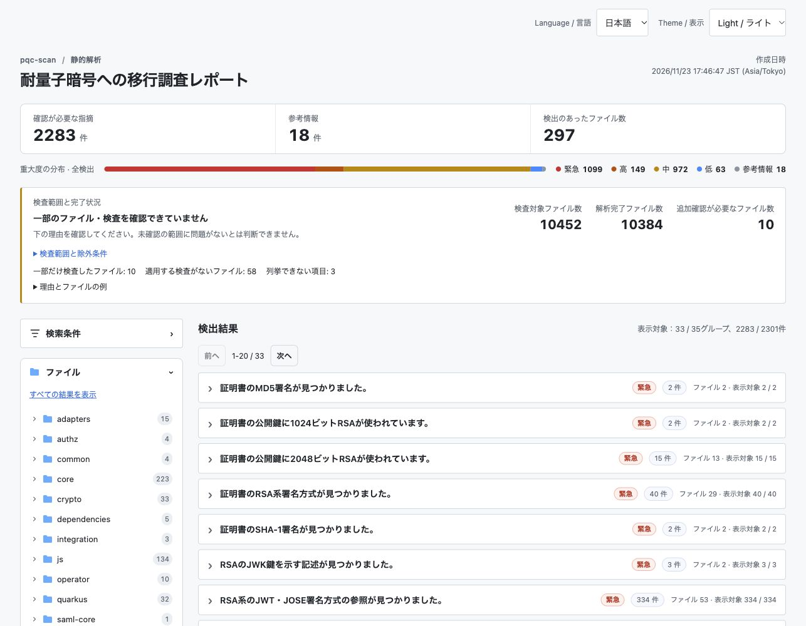
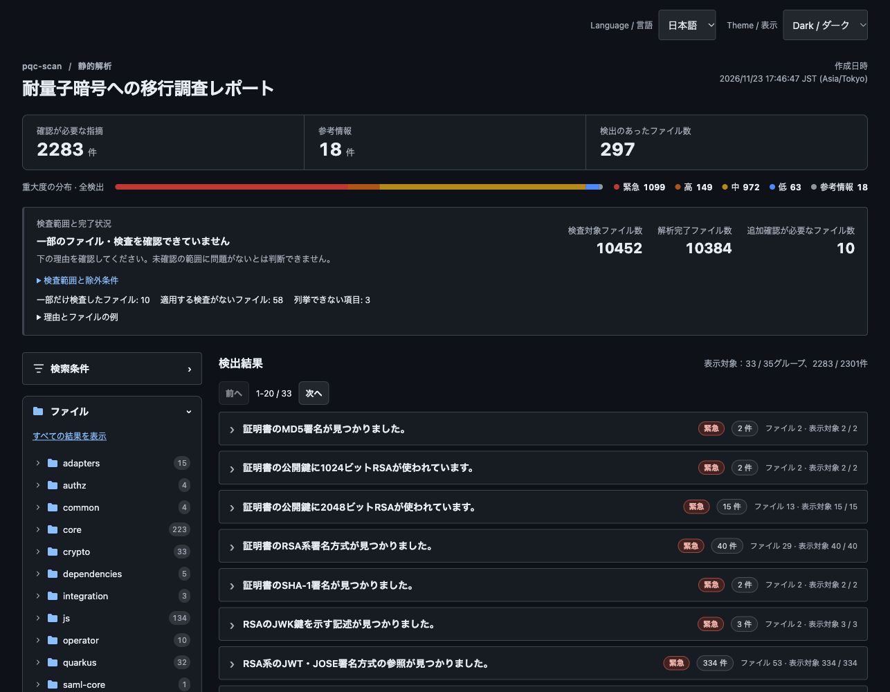

<!-- README hero -->
<p align="center">
  
</p>

<p align="center">
  <a href="https://github.com/wakaken/pqc-scan/actions/workflows/pqc-scan.yml"></a>
  <a href="https://github.com/wakaken/pqc-scan/releases"></a>
  <a href="LICENSE"></a>
  
</p>

<p align="center"><strong>暗号利用の手掛かりを発見し、移行リスクを調査し、耐量子暗号時代に備える。</strong></p>

<p align="center">
  <a href="#quick-start">クイックスタート</a> ·
  <a href="#report-preview">レポート画面</a> ·
  <a href="docs/user/COVERAGE.ja.md">対応範囲と制約</a> ·
  <a href="README.md">English</a>
</p>

| 発見 | 調査 | レポート |
| :--- | :--- | :--- |
| 対応するソースコード・設定・証明書・依存ファイル内の暗号利用を調査。 | 検出場所・移行時の確認事項・検査の完了状況を確認。 | HTML・Markdownで結果を読み、JSON・SARIFで他のツールと連携。 |

<!-- /README hero -->

# pqc-scan

[English](README.md)

`pqc-scan` は、耐量子暗号（PQC）への移行調査に使うRust製のコマンドラインツールです。  
ローカルのプロジェクトを読み、暗号方式やライブラリへの参照、その位置、確認すべき点をレポートにまとめます。  
JWT、TLS、PKI、SSHなどの暗号処理を変更する前に、調査する箇所を絞り込むために使います。  

`pqc-scan`はローカルファーストであり、スキャンからレポート生成までローカル環境で完結します。  
これらの処理中に、インターネット経由で外部サービスへ接続することはありません。  
外部のAIサービスやLLMへ自動的に接続することもなく、スキャン対象のソースコードを外部へ送信しません。

## 目次

- [スキャンできる成果物](#targets)
- [ツールの主な機能](#features)
- [使い始める](#quick-start)
- [ブラウザでスキャンする](#web-scan)
- [レポートの画面](#report-preview)
- [結果を確認する](#results)
- [移行確認機能を使う](#migration-review)
- [TLS・SSH接続先を診断する](#endpoint-probing)
- [利用ガイド](#guides)
- [制約と秘密情報の扱い](#limits)
- [ライセンス](#license)

<a id="targets"></a>

## スキャンできる成果物

ローカルのリポジトリを指定して、次の成果物を検査します。  
形式ごとに対応するパターンや解析範囲があります。

| 成果物 | 対象言語・ファイルの例 | 確認する内容 |
|---|---|---|
| ソースコード | Java、Go、JavaScript、TypeScript／TSX、Python、Rust、Ruby | 暗号API、方式名、関連する利用パターン |
| 各種ミドルウェアの設定ファイル | Kubernetes／Ingress、nginx、Apache httpd、Envoy、Istio、HAProxy、Traefik | TLS、暗号スイート、鍵交換グループなどの設定 |
| 証明書ファイル | `.pem`、`.crt`、`.cer`、`.der` | 署名方式と公開鍵の方式、対応する鍵長・曲線、有効期間、公開情報の指紋 |
| 秘密鍵ヘッダー | RSA、汎用PKCS#8、OpenSSHの秘密鍵ヘッダー | 対応するヘッダーの存在（復号や秘密鍵の妥当性確認は行いません） |
| 依存関係の定義・ロックファイル | `Cargo.toml`、`Cargo.lock`、`package.json`、npm／pnpmのロック、Python・Ruby・Java・Goの依存関係ファイル | 関連ライブラリ、指定されたバージョン条件、対応する解決済みレコード |
| SBOM | CycloneDX JSON、SPDX JSON | スキャン対象の成果物で利用しているSBOM（依存コンポーネントやパッケージ） |

ファイルのサイズ上限はデフォルトで2MiBです。詳しくは[ファイルサイズの上限](docs/user/SCANNING.ja.md#ファイルサイズの上限)を参照してください。

<a id="features"></a>

## ツールの主な機能

- 暗号利用の手掛かりを探し、重大度・リスク・ソースの位置を示します。
- 耐量子暗号（PQC）への移行に向け、言語や実行環境に応じた確認事項を提示します。
- 調査用のHTML・Markdownと、他のツールとの連携に使えるJSON・SARIFを出力します。
- 暗号利用の検出結果とソフトウェアの依存関係を、別々の一覧にまとめます。
- 暗号の用途・利用状況を入力し、PQCへの移行に必要な確認事項を整理できます。

なお、スキャン時にPQC方式の名前が見つかっても、アプリケーションで正しく使われているとは限りません。
このような検出結果は、[結果の読み方](docs/user/REPORTS.ja.md#pqc-findings)で例を使って説明しています。

<a id="quick-start"></a>

## 使い始める

利用方法は次の3つです。

| 利用方法 | 必要なもの・手順 |
|---|---|
| ソースからインストールする | Rust環境を用意し、以下の手順でインストール・実行します |
| macOS Apple Silicon向けのバイナリ版を使う | Rust環境は不要です。[インストールガイド](docs/user/DISTRIBUTION.ja.md)に沿って、公開アーカイブを取得・展開して使います |
| インストールせずにソースから実行する | Rust環境が必要です。`cargo install`の代わりに、`cargo run`でビルド・実行します。[実行手順](docs/user/SCANNING.ja.md#from-source)を参照してください |

以下は、**ソースからインストールしてスキャンする場合**の手順です。

### 1. インストールする

このリポジトリを取得し、以下のコマンドでインストールします。

```bash
cd /path/to/pqc-scan
cargo install --locked --path crates/pqc_scan_cli
```

インストール後も、このリポジトリの `rules` ディレクトリを残してください。スキャン時に使います。
`pqc-scan --help` または `pqc-scan --version` で導入を確認できます。
コマンドが見つからない場合は、`~/.cargo/bin` が `PATH` に含まれているか確認してください。

### 2. スキャンする

上でインストールした `pqc-scan` を使います。次のパスを自分の環境に合わせて置き換えてください。

- `/path/to/your-product`：調べたいプロジェクトのフォルダ
- `/path/to/pqc-scan/rules`：手元に残したルールディレクトリの絶対パス
- `/path/to/reports/product-scan`：レポートの保存先。スキャン対象の外に新しいフォルダを指定します

スキャンは以下のコマンドで実行します。

```bash
pqc-scan scan /path/to/your-product --format all --out-dir /path/to/reports/product-scan --rules-dir /path/to/pqc-scan/rules
```

なお、HTML・Markdownを日本語で出力する場合は、コマンドに `--lang ja` を加えます。

### 3. レポートを開く

指定した保存先にある `report.html` をブラウザで開き、検出結果を確認します。
HTMLを別の場所に移して読む場合は、`report.rules.html` も一緒に保管してください。
テキストで読む・共有する場合は `report.md` を使えます。

出力形式や対象・保存先の詳しい指定方法は[スキャン手順](docs/user/SCANNING.ja.md)、
結果の意味は[結果の読み方](docs/user/REPORTS.ja.md)を参照してください。
ブラウザでフォルダを選んでスキャンする場合は、次の手順へ進みます。

<a id="web-scan"></a>

## ブラウザでスキャンする

ソースからインストールした場合は、次のコマンドで簡易Webサーバーを起動します。バイナリ版の起動例は[インストールガイド](docs/user/DISTRIBUTION.ja.md#ブラウザで使う)を参照してください。

```bash
pqc-scan serve --root /path/to/projects --rules-dir /path/to/pqc-scan/rules
```

1. 既定のブラウザでトップ画面が開きます。開かない場合は、ターミナルに表示された `http://127.0.0.1:8787/<session>/` のURLをブラウザにコピーして開いてください。
2. `--root` 内の一覧やチェックボックスで対象フォルダを複数選び、**選択したフォルダをスキャン**を押します。ダブルクリックで開き、「戻る」「進む」や一覧上のパスで階層を移動できます。指定したルートの外へは移動できず、シンボリックリンクも表示しません。
3. 対象フォルダを選択した順にスキャンします。結果はフォルダごとに残ります。複数の場合は結果一覧の各フォルダから、そのフォルダのスキャンレポートを開くか、利用できる場合は移行の確認へ進めます。ブラウザで戻ると、別のフォルダもスキャンできます。
4. 終了時は コマンドを実行したターミナルにて **Ctrl+C** でサーバーを停止します。レポートはターミナルに表示された `pqc-scan-web-*` ディレクトリに残ります。オフラインで読む場合は `report.html` と `report.rules.html` を一緒に保管してください。

サーバーは `127.0.0.1` だけで待ち受け、CLIと同じ静的スキャンを実行します。  
サーバーを実行している環境内部でスキャンを完結し、ソースコードやレポートの外部サービスへの送信は行いません。  
詳しい制約オプションは[ローカルWebスキャン](docs/user/SCANNING.ja.md#ローカルwebスキャン)を参照してください。  

<a id="report-preview"></a>

## レポートの画面

スキャンのHTMLレポートでは、重大度の分布、ルールごとの一覧、検索・絞り込み、検出件数付きのファイルツリーを表示します。  
検出結果を展開すると場所・コードの根拠・推奨する確認事項を読め、ルールの意味は解説ページで確認できます。  
日本語・Englishの選択、ライト・ダーク表示、閲覧環境のタイムゾーンでの時刻表示もオフラインで利用できます。  



<details>
<summary>ダークモード</summary>



</details>

上記のレポートは実際の [Keycloak](https://github.com/keycloak/keycloak) をスキャンした画面です。

<a id="results"></a>

## 結果を確認する

`report.html` をブラウザで開き、次の順に確認します。

1. 「検査範囲と完了状況」で、どこまで検査できたか、追加の確認が必要なファイルがあるかを確かめます。
2. 検出結果を開き、ファイル位置、周辺のコード、推奨する確認事項を読みます。実際の用途を調べてから、修正が必要か判断してください。
3. 同じ種類の結果が多ければ、検索・絞り込みを使います。検出したルールの意味は、レポート内のルール解説で確認できます。

CLIで `--format all` を指定すると、次のファイルを保存します。

| ファイル | 用途 |
|---|---|
| `report.html` | ブラウザで検出結果と検査状況を確認する |
| `report.rules.html` | 検出したルールの解説を読む。`report.html` と一緒に保管する |
| `report.md` | 検査状況と検出結果をテキストで確認・共有する。複数行のソース断片やコード例もコード表示に収める |
| `report.json` | 検出結果を他のツールで扱う |
| `report.sarif` | SARIF対応ツールへ検出結果を渡す |
| `cbom.json` | 暗号利用の検出結果を一覧で確認する |
| `dependency-sbom.json` | ソフトウェアの依存関係を一覧で確認する |

HTML・Markdownは、同じ箇所の同等な検出を1件にまとめ、詳細に一致したルールを残します。検査対象の件数はファイル数です。

詳しい棚卸し・評価・診断の追加、CycloneDX 1.7出力（`--cyclonedx-17`）、棚卸しの比較（`diff`）は
[結果の読み方](docs/user/REPORTS.ja.md)を参照してください。

テストコードはデフォルトでスキャン対象となります。`--exclude-tests` や画面の「テストコードを除外」、独自の除外パスを
指定する `.pqcignore` の使い方は、[スキャン手順](docs/user/SCANNING.ja.md#テストコードを除外する)で説明しています。

<a id="migration-review"></a>

## 移行確認機能を使う

スキャンで見つかった暗号の用途・利用状況を入力すると、PQCへの移行に向けた「やること」と
「次に進める条件」を確認できます。  
ソースからインストールした場合は、次のコマンドで起動します。

```bash
pqc-scan serve --migration --root /path/to/projects --rules-dir /path/to/pqc-scan/rules
```

1. 開いた画面で対象フォルダを選び、スキャンします。結果の「移行の確認へ進む」を押してください。
   複数フォルダや履歴では、対象名を確認して選びます。「スキャンレポートを開く ↗」では元の検出結果を確認できます。
2. 暗号の用途・利用状況を入力し、「確認事項を作成」を押します。
3. 移行確認で評価日時と日程を確かめ、早急な調査項目から読みます。各判断の「やること」と
   「次に進める条件」を確認し、「検出箇所を見る」で根拠を調べてください。

保存する内容に応じて、操作を選びます。

| 操作 | 保存する内容 |
|---|---|
| レポートを保存（HTML） | 後から閲覧するための移行確認レポート |
| 入力内容を保存（JSON） | 用途・利用状況など、再評価に使う入力内容 |
| 評価データを保存 | 全件の評価結果。再評価用の入力JSONとは別のファイルです。 |

操作は[画面付きの8ステップ](docs/user/SCANNING.ja.md#web-migration-walkthrough)、判断の意味は[移行確認の読み方](docs/user/REPORTS.ja.md#saved-assessment)で説明しています。
保存した入力の使い方は、[入力と再評価](docs/user/SCANNING.ja.md#移行情報の任意入力と再評価)と[保存済み入力と申告](docs/user/SAVED-EVIDENCE.ja.md)を参照してください。

<a id="endpoint-probing"></a>

## TLS・SSH接続先を診断する

`probe` は、許可された接続先と通信し、TLS・SSHで使われる暗号方式を確認します。
v0.4では、macOS Apple Silicon向けの `network` 版で正式機能として提供します。`static` 版には含まれません。

### 1. 診断コマンドを用意する

バイナリ版を使う場合は、[インストールガイド](docs/user/DISTRIBUTION.ja.md)から `network` 版を選びます。
以下の `pqc-scan` は、展開先の `bin/pqc-scan` のパスに置き換えてください。

ソースからインストールする場合は、リポジトリのルートで次を実行します。

```bash
cargo install --locked --path crates/pqc_scan_cli --features probe-tls,probe-ssh,probe-ssh-kex
```

### 2. 許可された接続先を診断する

`service.example` とポート番号を、管理者から検査の許可を得た接続先に置き換えます。
レポートの保存先には、診断ごとに新しいフォルダを指定してください。

TLSの接続を確立し、選ばれたバージョン・暗号方式と公開証明書を確認します。

```bash
pqc-scan probe tls service.example --port 443 --lang ja --out-dir /path/to/reports/tls
```

SSHサーバーが提示する暗号方式を調べます。このコマンドでは鍵交換やログインは行いません。

```bash
pqc-scan probe ssh service.example --port 22 --lang ja --out-dir /path/to/reports/ssh
```

SSHのML-KEM768＋X25519ハイブリッド鍵交換を確認する場合は、信頼済みのEd25519ホスト公開鍵を指定します。
公開鍵は管理者などから別の信頼できる経路で入手してください。秘密鍵は指定しません。

```bash
pqc-scan probe ssh-kex service.example --port 22 --host-key-file /path/to/trusted-host.pub --lang ja --out-dir /path/to/reports/ssh-kex
```

`ssh-kex` はホスト公開鍵と鍵交換を確認して切断し、ユーザー認証・ログインは行いません。

### 3. レポートを開く

指定した保存先の `report.html` で、結果と失敗・未完了の理由を確認します。
テキストで読む場合は `report.md`、他のツールで扱う場合は同じフォルダのJSONを使います。

TLSは証明書と接続先の名前を検証します。`probe ssh` の結果は未認証の提示情報です。
いずれも、サーバー全体の安全性やPQC移行完了を保証するものではありません。
社内・ローカルの接続先を許可する方法、公開CAの指定、対応方式と診断の上限は
[TLS・SSH診断ガイド](docs/user/PROBING.ja.md)を参照してください。

<a id="guides"></a>

## 利用ガイド

| ガイド | 確認できること |
|---|---|
| [インストールとローカル配布物](docs/user/DISTRIBUTION.ja.md) | バイナリ版・ソースからの導入、更新、以前のバージョンに戻す方法 |
| [リポジトリのスキャン方法](docs/user/SCANNING.ja.md) | 対象フォルダの選択、スキャンの実行、保存先の指定、検査できなかった箇所の確認 |
| [結果の読み方](docs/user/REPORTS.ja.md) | 検出結果と移行判断の読み方、出力ファイルの使い分け |
| [対応する入力と検査範囲](docs/user/COVERAGE.ja.md) | 対応する言語・ファイル、検査対象から外れるもの、レポートを共有する際の注意点 |
| [保存済み入力と申告](docs/user/SAVED-EVIDENCE.ja.md) | 用途・利用状況の入力を保存・再利用する方法、有効期限の設定、保存した検出結果の再評価 |
| [TLS・SSH接続先の明示的な診断](docs/user/PROBING.ja.md) | `network` 版を使い、許可された接続先をTLS・SSHで調べる方法 |

<a id="limits"></a>

## 制約と秘密情報の扱い

### 検出結果を判断するとき

検出結果は、暗号方式への参照や確認が必要な箇所を示します。実際に稼働している証拠ではありません。
誤検出や見逃しもあるため、見つかった箇所の用途を確かめてから対応を決めてください。
検出がゼロでも、安全性やPQC移行完了は保証しません。

成果物のスキャンでは、接続先との通信や依存関係のインストール、証明書の信頼チェーンの検証は行いません。
接続先の診断には、上記の `probe` を明示的に実行します。

### スキャン対象を選ぶとき

読み取るのは、指定したサイズ上限内の通常ファイルです。Gitのignore設定、除外ディレクトリ、既知のバイナリ形式などは検査範囲から外れます。
解析が途中で止まった場合も、読み取れた部分の検出結果は残します。検査できなかった箇所はレポートの「検査範囲と完了状況」で確認してください。

対応する言語・ファイルと上限は[対応する入力と検査範囲](docs/user/COVERAGE.ja.md)、
未完了の理由の調べ方は[検査状態の読み方](docs/user/SCANNING.ja.md#diagnostics)で説明しています。

### レポートを共有するとき

対応する秘密鍵・認証情報の構文はマスクしますが、すべての秘密情報を検出する機能ではありません。
未知・難読化された内容や、パス・識別子に含まれる情報が残る場合があります。
共有前にレポートの内容を確認し、[秘密情報の扱いと除外範囲](docs/user/COVERAGE.ja.md#privacy)も参照してください。

<a id="license"></a>

## ライセンス

[MIT](LICENSE)  
同梱する依存パッケージにはそれぞれのライセンスが適用されます。  
配布物の `DEPENDENCY-LICENSES.json` と `licenses/` を参照してください。  
