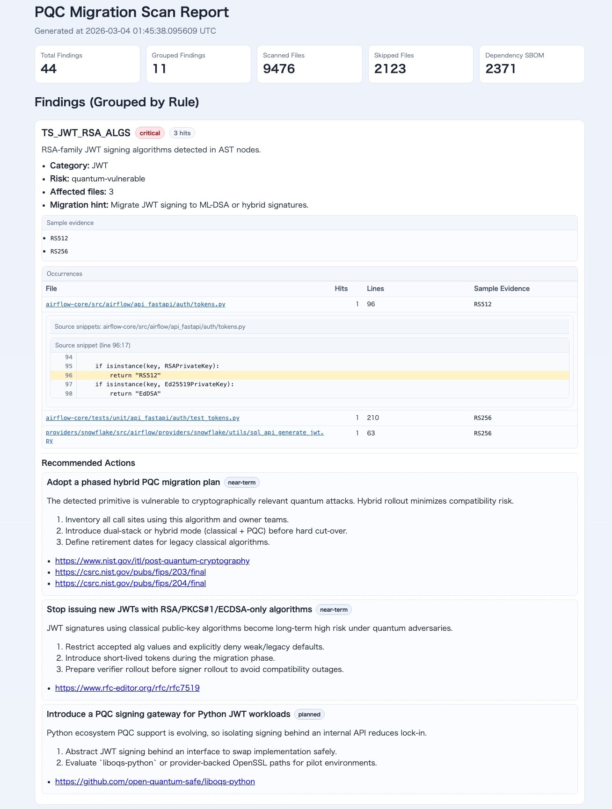

# pqc-scan - 耐量子暗号（PQC）スキャンツール

English version: [README.md](README.md)

`pqc-scan` は、耐量子暗号（PQC）への移行調査に使うRust製CLIです。
ローカルのソースコード、設定、公開証明書、依存関係のファイルを読み、暗号方式への参照と確認すべき箇所をレポートにまとめます。
接続先への通信、実際の稼働状況の確認、製品全体の安全性の認定は行いません。

## このツールの目的

依存ライブラリの一覧だけでは、コードや設定に書かれた暗号利用を把握できません。
JWT、TLS、PKI、SSHなどの移行を調べる際に、検出箇所と対処案を手掛かりとして使ってください。
任意で出力する棚卸しとローカル評価では、観測した事実と判断を分けて記録します。

## 実装状況

タスク018〜029は、[OSSロードマップ](docs/roadmap/OSS-ROADMAP.md)のPhase 0・1に対応します。2026年11月10日時点の状態は次のとおりです。

| Phase | タスク | 状態 |
|---|---|---|
| 0：検査の正確さと品質の基準作り | 018〜024、028、029 | 8件が`done`。023は測定手順と精度・性能の数値基準の承認待ちで`review` |
| 1：観測記録・棚卸し・評価 | 025〜027 | 3件とも`done`。ローカル検証済みで、対応範囲と制約を記録 |

Phaseの割り当てと実装記録は一致しています。ただし、Phase 0全体の完了や1.0リリースの品質認定を意味しません。
023の評価入力と測定基盤は後続タスクでも使っていますが、利用したことと数値基準の承認は別です。
[タスク別の照合結果と残る承認事項](docs/quality/PHASE-0-1-ALIGNMENT.md)を参照してください。

接続先の安全制御、TLSの接続検査、SSHの対応方式調査、CycloneDX出力、スキャン結果の差分、評価情報の英日表示拡張、配布・リリース検証は今後の対象です。
CycloneDXの読み込みには対応していますが、規格に準拠したCycloneDX形式のCBOM出力は未実装です。

## クイックスタート

調査するプロダクトのリポジトリを指定します。

```bash
pqc-scan scan /path/to/your-product --format all --out-dir /path/to/your-product/pqc-report --rules-dir /path/to/pqc-scan/rules
```

生成されるファイル:

- `/path/to/your-product/pqc-report/report.json`
- `/path/to/your-product/pqc-report/report.html`
- `/path/to/your-product/pqc-report/report.md`
- `/path/to/your-product/pqc-report/report.sarif`
- `/path/to/your-product/pqc-report/cbom.json`
- `/path/to/your-product/pqc-report/dependency-sbom.json`

## インストール

Rustは `rust-toolchain.toml` に指定した版と構成を使います。現在の指定はRust 1.93.1、rustfmt、clippyです。
このリポジトリのソースからビルドしてください。ルールディレクトリは実行時にも必要なので、バイナリのインストール後も同じ版のルールを参照できる場所に残します。


### コマンドとしてインストールする（推奨）

```bash
cd /path/to/pqc-scan
cargo install --locked --path crates/pqc_scan_cli
```

その後、プロダクトリポジトリ側で実行します。

```bash
pqc-scan scan . --format all --out-dir ./pqc-report --rules-dir /path/to/pqc-scan/rules
```

インストール後に `pqc-scan: command not found` が表示される場合は、`~/.cargo/bin` が `PATH` に含まれているか確認してください。

### インストールせずにソースから実行する

インストールせず試す場合は、ソースから直接実行できます。

```bash
cargo run --manifest-path /path/to/pqc-scan/crates/pqc_scan_cli/Cargo.toml --bin pqc-scan -- scan /path/to/your-product --format all --out-dir /path/to/your-product/pqc-report --rules-dir /path/to/pqc-scan/rules
```

## ツールの主な機能

- `tree-sitter` と正規表現を使った検出
- 重大度、信頼度、量子リスクを付けた所見
- 検出項目ごとの対処案（言語や実行環境に応じた移行手順）
- 検出行を示すソース抜粋（HTML・JSON）
- CBOMの出力（`cbom.json`）
- 依存関係の棚卸し（`dependency-sbom.json`）
- GitHub Code Scanning向けのSARIF 2.1.0出力
- 検査範囲・失敗・上限を確認する診断情報と、任意の完全性チェック
- 観測記録と所見を対応付けた暗号資産・検出根拠レポート
- 量子リスクと従来型の弱点、移行の前提条件を分けるオフライン評価

## PQC方式への参照

7言語のML-KEM・ML-DSA参照、NodeのSLH-DSA鍵生成、PQC対応候補の依存関係、
旧Kyber・Dilithium名、Java・Rubyの古典方式限定TLS設定、Goの
`GODEBUG=tlsmlkem=0` を検出します。静的な手掛かりであり、実際の通信方式の確認ではありません。
証明書のML-DSA・SLH-DSA署名OIDと公開鍵OIDは別々に照合し、ファイル名では判定しません。
署名・信頼チェーンの検証は行いません。既存の出力フィールド名とルールIDを維持し、
追加の情報レベルの検出もCBOM・SARIFに含めます。

`quantum-safe` は参照された暗号方式の分類であり、製品全体の安全性や移行完了の保証ではありません。
依存関係は `quantum-uncertain` とし、解決済みバージョン・provider・features・接続相手を確認します。
Node cryptoとWebCryptoでは必要なマイナーバージョンが異なります。
ブラウザやTypeScriptの実行環境は別途確認し、JWT署名の変更前にJOSE・ライブラリ・検証側の互換性を確認してください。
[静的検証例と公式資料](examples/pqc-readiness/README.md)も参照してください。

## CBOMとSBOMの違い

| 成果物 | 目的 | 問い |
|---|---|---|
| `dependency-sbom.json` | ソフトウェア依存関係の棚卸し | 「どのパッケージ/ライブラリが含まれているか？」 |
| `cbom.json` | 暗号利用の棚卸し | 「どのアルゴリズム/暗号利用があり、量子リスクは何か？」 |

実務での使い分け:

- SBOMデータでコンポーネント/パッケージの露出を追跡する。
- CBOMデータで暗号移行作業（JWT/TLS/PKI/SSHなど）の優先度を決める。
- SBOMとCBOMを併用し、PQC移行計画を進める。

## ルールの検証と判断根拠

空白だけのID、有限でない信頼度、`0〜1` の範囲外の信頼度、ルール探索中の失敗を検出し、
一部のルールだけを読み込んで成功したように扱うことを防ぎます。不正なルール集には既存の実行エラー終了コード1を返します。
既存CLI・出力項目と有効なカスタムscopeの動作は維持し、新しい既定の警告は加えません。
不正な数値や空のIDを使っている場合は更新時に修正してください。
未知のscope文字列は引き続き受け付けます。検出器ごとに動作が異なるため、[読み込み・scopeの互換仕様](docs/architecture/RULE-VALIDATION.md)を参照してください。

組み込み119件について、用途・暗号方式・量子リスク・従来型の弱点、参照資料の版、検査の限界、
正例・負例をまとめた[開発用の品質資料](docs/quality/RULE-QUALITY.md)があります。
244件のパターン検証例に、現在も残る8件の誤検出例を含めています。
既知の誤検出も記録しますが、検出パターン・Risk・重大度・レポート形式は変更しません。
正規表現の検証例は、実稼働や網羅的な精度、品質目標の承認を意味しません。

## 検出カバレッジ

### 検出器

- `tree_sitter_detector`
- `regex_detector`
- `dependency_detector`
- `certificate_detector`
- `key_detector`

### Tree-sitterの対象言語

- Java
- Go
- JavaScript
- TypeScript／TSX（JavaScript用文法を使用。型構文では部分解析になる場合あり）
- Python
- Rust
- Ruby

### 依存関係・マニフェスト


- `Cargo.toml`, `Cargo.lock`
- `Gemfile`, `Gemfile.lock`, `gems.rb`, `gems.locked`, `*.gemspec`
- `pom.xml`, `build.gradle`, `build.gradle.kts`, `gradle.lockfile`
- `go.mod`
- `package.json`, `package-lock.json`, `pnpm-lock.yaml`
- `requirements.txt`, `Pipfile.lock`, `poetry.lock`

### SBOMの読み込み


- CycloneDX JSON（`*.cdx.json`, `*bom*.json`）
- SPDX JSON（`*.spdx.json`, `*sbom*.json`）

対応範囲はCycloneDX 1.4〜1.7、SPDX 2.2〜2.3のコンポーネント・パッケージ情報です。
入力の全項目の規格検証や、インストール済みであることの確認は行いません。規格に沿った出力とは別の機能です。
構造化データの解析、簡易解析、対応する版と上限は[依存関係の確認根拠](docs/architecture/DEPENDENCY-PROVENANCE.md)に記載しています。

### 証明書・鍵ファイル
次の拡張子を証明書・鍵の検査候補として扱います。

- 証明書候補: `.pem`, `.crt`, `.cer`, `.der`。内容からPEM／DERを判別します。
- `.p12`／`.pfx`はコンテナーの存在のみ検出し、内部の解析は未対応です。
- 秘密鍵のマーカー:
  - `BEGIN RSA PRIVATE KEY`
  - `BEGIN PRIVATE KEY`
  - `BEGIN OPENSSH PRIVATE KEY`

証明書の署名方式と、証明書に含まれる公開鍵の方式を分けて解析します。
RSA鍵長はmodulusの実ビット長、ECは対応する名前付き曲線（P-256／P-384／P-521）の
フィールドサイズです。公開鍵のエンコード長を鍵長として扱いません。
Ed25519／Ed448／X25519／X448はエンコード長を別に記録し、RSA鍵長や安全性強度を推測しません。
未知・PQCの公開鍵形式はOIDと公開オブジェクトのフィンガープリントを保持し、意味上の鍵長は不明とします。
PQCのOIDがあるだけでは、有効なPQC鍵とは判断できません。

既存の証明書所見のmetadataに、証明書・SPKIのSHA-256、各エンコードのバイト長、
鍵の方式・パラメーター、判明した鍵長・曲線、有効期間のタイムスタンプ、オブジェクト位置を記録します。
PEMバンドルでは実際の行・列とブロック番号を保持し、同じ公開鍵を持つ別の証明書も残します。
DERの行・列は互換性のため従来の1:1を維持し、`byte_offset: "0"`を記録します。
これはソースコード上の位置を意味しません。不正・未対応ブロックが混在しても解析できた証明書を残し、
`--diagnostics`で検査が不完全だったことを報告します。
署名・信頼チェーン・鍵や曲線上の点の数学的な正当性は検証しません。
PKCS#12の復号と、単独の公開鍵ファイルの検出は対象外です。

組み込みの証明書署名ルールは、解析したOIDと完全一致で照合します。RSA鍵長のルールは
RSA／PSSの公開鍵modulusを対象とし、ファイル名やECのエンコード長では成立しません。
ECDSA・DSAは `quantum-vulnerable` として扱います。既存のPKI昇格処理を適用すると、
最終深刻度はそれぞれhigh・criticalです。SHA-1・MD5・弱いRSA鍵の問題は別の所見で示します。
DSAは、署名の置き換えと過去の署名の検証を分けて移行を検討します。

`CERT_EXPIRED` と `CERT_NOT_YET_VALID` は、解析したUTC時刻と明示的な判定時刻を使います。
有効期間の両端は含みます。既存ID `CERT_EXPIRY_2026_OR_BEFORE` は、2027年1月1日UTCより前に
期限を迎えるかという固定基準を維持し、従来の基準であることを明記します。現在の期限切れとは別の判定です。
期間の前後が逆、または判定時刻が取得できない場合は、静的な検出を残して不完全な検査として報告します。
時刻判定の所見には、既存のmetadataへ `assessment_time_unix` と `validity_status` を記録します。

CLIはスキャンごとに検出器セットを作ります。ライブラリの `default_detectors()` は構築時の判定時刻を
保持するため、同じセットの再利用では同じ時刻を使います。新しい時刻で調べる場合は作り直してください。
`CertificateDetector::at(unix_seconds)` で判定時刻を指定できます。既存の単位構造体とAPIも維持します。

カスタムルールの `certificate` など、従来のscopeは複合文字列の照合を維持します。
新たな予約名 `rsa_modulus_bits`・`certificate_validity`・`legacy_not_after_2026` は例外です。
外部ルールがこれらを独自ラベルとして使っていた場合は、更新前に別名や `certificate` へ変更してください。
`signature_oid`・`public_key_oid` は引き続き識別子のみを対象とします。
証拠の分離や分類修正により、対象の証明書の検出結果・ID・従来CBOMの方式文字列は意図的に変わります。
CLIオプション、出力構造・列挙値、ID生成・深刻度昇格の処理は維持します。
署名・信頼チェーン・実際の利用状況は保証しません。PSSのダイジェストパラメーターや未収載OIDの評価には
制限があり、ハッシュの所見がないだけで安全とは判断できません。
[分類仕様](docs/roadmap/TASK-021-IMPLEMENTATION.md)と[証明書限定の比較結果](docs/quality/CERTIFICATE-BASELINE-021.md)を参照してください。
EC・DSA・暗号化秘密鍵のPEMマーカーを含むファイルも、ソース抜粋全体をマスクします。
新たな秘密鍵検出ルールの追加や、鍵の復号は行いません。

### 各種ミドルウェア設定
下記ミドルウェアの設定ファイルをスキャンします。

- Kubernetes / Ingress
- nginx
- Apache httpd
- Envoy
- Istio
- HAProxy
- Traefik

### 組み込みルールセット

- デフォルトルールは `rules/default/` 配下にあります。
- 現在の組み込みルール数: 119件

## CLI

CLIツールは以下の通り実行します。

```bash
pqc-scan scan <path> [--format json|html|md|sarif|all] [--lang en|ja] [--out-dir ./pqc-report] [--rules-dir ./rules] [--fail-on high|critical] [--threads N] [--diagnostics] [--require-complete] [--inventory-json] [--repository-scope ID] [--policy-profile migration-review-v1] [--assessment-context PATH]
pqc-scan rules list [--rules-dir ./rules]
pqc-scan rules show <rule-id> [--rules-dir ./rules]
```

既定値は `--format all`、`--lang en`、`--out-dir ./pqc-report`、`--rules-dir ./rules`、`--threads 0`（自動選択）です。
所見の重大度や検査の完全性による終了判定は、明示しない限り有効になりません。相対パスは実行時の作業ディレクトリを基準にします。

`--repository-scope` と `--policy-profile` には `--inventory-json` が必要です。
`--assessment-context` は評価方針を指定したときだけ使えます。全オプションは `pqc-scan scan --help` で確認できます。

### プロダクトリポジトリでの推奨実行方法

`pqc-scan` を自分のプロダクトリポジトリ内（`pqc-scan` リポジトリ外）で実行する場合は、`--rules-dir` に **絶対パス** を指定してください。

```bash
pqc-scan scan . --format all --out-dir ./pqc-report --rules-dir /path/to/pqc-scan/rules
```

### よく使うコマンド

```bash
# すべてのレポート形式を出力
pqc-scan scan . --format all --out-dir ./pqc-report --rules-dir /path/to/pqc-scan/rules

# SARIFのみ出力（GitHub Code Scanning向け）
pqc-scan scan . --format sarif --out-dir ./pqc-report --rules-dir /path/to/pqc-scan/rules

# CI失敗ゲート
pqc-scan scan . --fail-on high --rules-dir /path/to/pqc-scan/rules

# 1つのルール詳細を確認
pqc-scan rules show JWT_RS256 --rules-dir /path/to/pqc-scan/rules
```

### 暗号資産・検出根拠レポート

`--inventory-json` を付けると、観測方法ごとの記録、アルゴリズム・公開鍵・証明書・依存関係の
棚卸し、従来の検出結果との対応を含む `scan.inventory.v1.json` を追加します。
これはpqc-scan独自のJSON形式です。`--format all` だけでは追加されず、従来レポートとIDは維持します。
`--repository-scope team/project` はこのオプションと併用し、スキャン間でソース位置を
対応付ける弱い手掛かりを付与します。秘密情報や絶対パスは指定しないでください。
実際の稼働、証明書の信頼性、PQC対応判定を保証するものではありません。
詳細は[形式・識別方法・制約](docs/architecture/INVENTORY-REPORT-V1.md)を参照してください。

```bash
pqc-scan scan . --inventory-json --repository-scope team/project --rules-dir ./rules
```

このレポートのCLI指定は `--inventory-json` です。旧指定 `--native-json` は廃止したため、
`--inventory-json` へ置き換え、読み込むファイルも `scan.native.v1.json` から
`scan.inventory.v1.json` へ変更してください。JSONの項目・スキーマの版・ID生成は変更しません。

依存関係では、`^1.2.3` のような指定条件、ロックファイルで確認できたバージョン、情報の出所を分けて記録します。
指定条件やSBOMの申告だけから、バージョン付きpurlを生成しません。path・git・workspaceの参照先は未解決のままとし、
依存グラフの推測やパッケージのダウンロードは行いません。従来の `dependency-sbom.json` は同じ項目の配列を維持します。
purlと検査状況の値は、誤った断定を避けるため修正しています。従来形式で統合される出所も、棚卸しJSONでは別の記録として残します。

### ローカル方針の評価

`--inventory-json --policy-profile migration-review-v1` を明示すると、量子リスク・従来型の弱点・
検出の確かさ・用途・対応候補の前提条件を分けた `scan.assessment.v1.json` を追加します。
既存レポートと棚卸しJSONは維持し、評価によって従来の重大度や終了コードは変えません。
この方針は移行検討用で、規制適合や実稼働の安全性を保証するものではありません。期限も設けません。
検査不完全・情報不足は合格にせず、現在の棚卸しでは全体のPassを出しません。

```bash
pqc-scan scan . --inventory-json --policy-profile migration-review-v1 --rules-dir ./rules
```

任意の `--assessment-context ./context.json` で、用途や実行環境の対応状況を指定できます。
例は `{"version":1,"use_case":"jwt"}` です。省略値は不明のままとし、指定値も利用者の申告として記録します。
依存ライブラリの存在だけで、PQCを利用できるとは判定しません。
用途・前提条件・入力項目・制約は[評価仕様](docs/architecture/LOCAL-ASSESSMENT-V1.md)を参照してください。

### 検査の完全性と診断情報

ファイルの読み込みや検出器の実行に失敗しても、ほかの検出結果は保持します。
検査が部分成功・失敗・不明の場合、CLIは標準エラーへ警告を1回表示します。
既定の終了コードは従来どおり、成功が0、実行エラーが1、`--fail-on` の到達が2です。
検出がゼロでも、検査できたとは限りません。

`--diagnostics` を付けると、`--out-dir` に `diagnostics.json` を追加出力します。
別ファイルとして `schema_version: "1"`、生成時刻、検査範囲、集計値、理由コードを記録します。
検出器・I/Oのエラー本文やファイル内容は含めません。
既存6形式のファイル名と機械出力スキーマは維持し、`--format all` だけでは追加しません。
`--lang` の対象も従来どおりHTMLとMarkdownです。

```bash
pqc-scan scan . --diagnostics --require-complete --out-dir ./pqc-report --rules-dir /path/to/pqc-scan/rules
```

`--require-complete` は、検査の完了を確認できない場合に、要求されたレポートを出力してから
終了コード**3**を返します。優先順位は、実行エラーの1、完全性を確認できない場合の3、
検出しきい値到達の2です。2つのオプションは単独でも使えます。
有効な検査範囲に対象ファイルがなければ完了扱いになりますが、範囲外に暗号がないという意味ではありません。

正規表現・AST・秘密鍵マーカーの検出器は、適用可否と検査上限を報告します。
採用する検出件数の上限は、1ルール・1ファイル当たり**32件・32件・8件**のままです。
正規表現は既存のコメント除外後に件数を数えるため、コメントだけで検出枠を使い切りません。
言語ごとのコメント判定は変更していません。この修正により、以前は見逃していたコードの検出が増える場合があります。

上限ちょうどの件数だけでは打ち切りと判定せず、有限の処理量で残りの候補を確認します。
追加の有効な検出が見つかった場合や、処理量の上限で探索が終わらなかった場合は
`detector_truncated` とし、それまでの検出を保持して部分成功として扱います。
省略された検出件数は推測しません。正規表現・ASTは1ルール・1ファイル当たり最大4096候補と
残りを確認する1候補を扱います。ASTには、保持する意味ノード4096件、探索に積むノード100000件の上限も設けています。
既存の2000文字での候補切り詰めも通知します。これらは処理量を抑えるための上限であり、性能測定の目標値ではありません。
ASTに構文エラーがあれば取得できた検出を残し、`detector_partial` として報告します。
パーサーの初期化失敗・解析木を取得できない場合は検出器エラーです。
バイナリ入力、未対応のソース言語、適用ルールがない場合は、その検出器の対象外です。
完了判定は既存のパターン・マーカー検査の範囲に限り、名前解決、実際の実行、全鍵形式の網羅を保証しません。

証明書検出器も、適用可否と解析・属性取得の完全性を報告します。
不正な形式、未知の鍵属性、未対応ブロックの混在は `detector_partial`、
未対応コンテナーは `detector_unsupported` として通知します。
コンテナーの検出は、内部の検査成功を意味しません。解析できてもルールに一致しない証明書は所見を出しません。

依存関係の検査では、有効な空データ・対応形式の不正データ・部分成功・未対応の版・上限到達を区別します。
対応する構造化データの範囲では完了を報告し、関係のないファイルは対象外とします。
Ruby・Gradle・XML・requirements・Goの簡易解析では、引き続き `detector_not_reported` を返します。
完了は対応する解析範囲内の意味で、パッケージ管理ツールと同じ検証やインストール状態の保証ではありません。
`--require-complete` の終了コードの規約は維持しますが、検査状況の修正により実際のコードは変わり得ます。
詳しくは[依存関係の指定と確認根拠](docs/architecture/DEPENDENCY-PROVENANCE.md)を参照してください。

従来の `scanned_files` は、引き続きwalkerが選択したファイル数です。
新しい集計では、選択・読み込み成功／失敗・解析完了・部分成功・解析失敗・未対応・対象外・不明を区別します。
列挙できたポリシー除外と列挙失敗は別に集計し、ignoreで見えない件数は不明として明示します。
完了の判定は、既存のignore設定・既定の除外・サイズ制限を含む検査範囲内に限ります。

ライブラリでは `scan_repository_detailed` と、アクセサーで参照する `ScanDocument` を使えます。
既存の `scan_repository`、`ScanResult`、レポートAPI、`Detector::detect` 実装は維持します。
検出器は `detect_detailed` と `DetectorOutcome` で検査結果を報告できます。
`Complete` は検査の完了を表し、安全性の保証ではありません。

## レポート出力

| ファイル | 出力条件 | 内容 |
|---|---|---|
| `report.json` | `--format json` または `all` | 所見・検出根拠・対処案・集計 |
| `report.html` | `--format html` または `all` | 検索・絞り込みできるHTML |
| `report.md` | `--format md` または `all` | 保管・共有用のテキスト |
| `report.sarif` | `--format sarif` または `all` | SARIF 2.1.0の所見 |
| `cbom.json` | どの出力形式でも出力 | 従来の暗号利用一覧。CycloneDX形式ではない |
| `dependency-sbom.json` | どの出力形式でも出力 | 従来の依存関係一覧。CycloneDX／SPDX形式ではない |
| `diagnostics.json` | `--diagnostics` | 検査範囲・集計・安全な理由コード |
| `scan.inventory.v1.json` | `--inventory-json` | 観測記録・暗号資産・従来の所見との対応 |
| `scan.assessment.v1.json` | `--inventory-json --policy-profile migration-review-v1` | 別ファイルのローカル評価 |

`--format all` の出力は従来の6ファイルです。残る3ファイルはそれぞれの指定が必要です。
`--lang` が変えるのはHTML・Markdownの文面だけで、任意の機械出力を加えても変わりません。
実行結果を比較するときは新しい出力先を使ってください。以前のファイルが残っていても、今回その出力を指定したとは限りません。


### HTML・Markdownの読み方と日本語表示

HTMLでは、重大度順の短いルール一覧から確認を始めます。ルール名・説明・ファイル名の検索と、
重大度・リスクの絞り込みに対応し、「対応候補」とPQC参照などの「参考情報」を切り替えられます。
ルールと検出箇所はそれぞれ20件ずつ表示します。
ルール、検出箇所の順に開くと、その箇所のコードと対応を確認できます。
同じ共通手順は繰り返さず参照リンクにまとめ、IDが同じでも内容の異なる対応案は残します。
JavaScriptが無効な場合は全件を表示し、標準の折りたたみで確認できます。
外部スクリプトや通信は不要です。Markdownにもルール・検出箇所への索引を設けています。

TLSの推奨は1.3を優先し、1.2は互換性が必要な場合に限って安全な設定で残す方針です。
PQCの上書き設定にはその設定の確認手順を示し、RSA利用を断定しません。
検出結果と機械出力の構造は維持しますが、推奨文とその適用対象は改善しています。

`--lang ja` を付けると、HTMLとMarkdownを日本語で出力します。
既定は英語で、`--lang en` でも指定できます。

```bash
pqc-scan scan . --lang ja --format all --out-dir ./pqc-report-ja --rules-dir /path/to/pqc-scan/rules
```

見出し、組み込みルールの説明、確認事項、推奨アクションを日本語で記載します。
「参考情報」は問題の指摘ではなく、暗号利用の棚卸しです。
PQCの記述が見つかっても、実際の通信や製品全体の対応完了を保証するものではありません。

JSON・SARIF・CBOM・依存関係SBOMは、言語指定によらず従来の内容を維持します。
検出ID、ファイル名、ソースコード、方式名、参考URLも書き換えません。
独自ルールや対応案に日本語文面がない場合は、その旨を明示して原文を残します。
訳文はプログラムに含まれており、翻訳サービスへコードを送信することはありません。

文章の推敲には[humanizer-jp](https://github.com/tqkqt0/humanizer-jp)を使用しています。
スキルは開発時の編集方針として使い、CLIの実行には必要ありません。

### `report.json`

機械出力したJSON形式のレポートです。検出結果、メタデータ、推奨アクション、ソーススニペットを含みます。

### `report.html`

調査担当者が確認するHTMLレポートです。

- 重大度の表示
- 所見のメタデータ
- 検出行を示すソース抜粋
- 移行の対処案

#### HTMLレポートのサンプル

保存済みの画像は以前の出力例です。現在は上記のルール・検出箇所を順に開く表示を使います。
この画像は、最新版をブラウザーで検証した証跡ではありません。



### `report.md`

監査メモ、Pull Request、成果物保管に適したポータブルなテキスト形式のレポートです。

### `report.sarif`

コードスキャンプラットフォーム（GitHub Code Scanning 含む）向けのSARIF形式のレポートです。

### `cbom.json`

アルゴリズム/位置/リスク/移行方針を含むCBOM(Cryptographic Bill of Materials)です。

### `dependency-sbom.json`

マニフェストとSBOMファイルから抽出した依存関係インベントリです。

### SARIFの位置情報

SARIFのバージョンは2.1.0を維持します。ファイルパスはUTF-8のURI参照として
パーセント符号化します（`%`、空白、`#`、`?`も符号化）。絶対パスはfile URIにします。
Windowsではネイティブの区切り文字を正規化し、Unixのバックスラッシュは文字として扱います。
行が不明（既存JSONでは`0`）の場合はファイル位置だけを出力します。行が既知で列が不明なら
`startColumn`を省略し、パスが空なら`locations`を省略します。
列は1始まりのUnicodeコードポイント単位（`columnKind: unicodeCodePoints`）です。
絵文字・結合文字の各コードポイント・タブはそれぞれ1列と数え、表示幅やUTF-16単位とは区別します。
既存AST検出器の列はバイト数と文字数を混在させているため、既存のマスクされていない
スニペットでASCIIの接頭部を確認できる場合だけ列を出力し、それ以外は行までを保持します。
接頭部が欠落・マスク・切り詰めされている場合は列を推測しません。
既存JSONの位置・ID、他のレポート、CLIオプション、出力ファイル名は維持します。
不正確なSARIF位置や未符号化パスに依存する処理には、この修正による差分が生じます。
詳細は[契約と検証記録](docs/quality/SARIF-LOCATION-CONTRACT-022.md)を参照してください。

## セキュリティとプライバシー

認識できる秘密鍵ブロックや認証情報は、出力する検出根拠でマスクします。
RSA、汎用PKCS#8、OpenSSH、EC、DSA、暗号化秘密鍵のマーカー、単一行の名前付きパスワード・トークン・鍵の値、
Bearer／Basicトークン、HTTP(S) URLの認証部分と名前付き認証クエリーが対象です。秘密鍵の解析や復号に対応するという意味ではありません。

検出器を呼ぶ前に元のソースから位置を記録し、所見のIDと棚卸しの対応付けを確定してから出力値をマスクします。
認証情報や秘密鍵を認識したファイルでは、短縮済みのプレビューに断片が残らないよう保守的に置き換えます。
ライブラリに渡した結果も、呼び出し側の値を変えずにレポート出力時に処理します。
メタデータの値、対処案とコード例、CBOM、依存関係の自由文にもマスク処理を適用します。
型を限定した棚卸しや診断情報には、元の本文や任意のエラー本文を含めません。

あらゆる秘密情報を見つける機能ではありません。未知・難読化された構文、任意の認証項目名、複数行の認証情報の位置追跡、構造を表す項目に埋め込まれた秘密は対象外です。
パス、ID、repository scope、独自メタデータのキーには秘密情報を入れないでください。
公開証明書の指紋・subjectなど、残す情報にも共有先に応じた確認が必要です。保守的な処理で公開テキストのプレビューも省略する場合があります。
[対応構文・項目ごとの方針・制約](docs/architecture/EVIDENCE-PRIVACY.md)と[ダミー値による検証](docs/quality/TASK-029-EVIDENCE-PRIVACY.md)に詳細を記載しています。

走査ではGitのignore設定を尊重し、既定で `.git`、`node_modules`、`target`、`dist`、`docs` とMarkdownファイルを除外します。
2 MiBを超えるファイルも対象外です。テストディレクトリ全体を除外する動作はありません。
スキャンに成功しても、除外したファイルや未対応形式に暗号利用がないとは判断できません。

## 精度と免責事項

ルールとパターンに基づく静的解析のため、誤検出も見逃しもあります。検出精度100%や形式的な証明を提供するものではありません。
本番運用や規制適合の判断に使う前に、それぞれの環境で結果を確認してください。
移行調査の手掛かりとして、専門家のレビュー、システムの構成、実行時の挙動やセキュリティ試験と併せて評価します。

## 既知の制約

- 静的スキャンのみでは、実行時の暗号ネゴシエーション経路を完全には推定できません。
- ライブラリ固有の挙動はバージョンや設定で変わる場合があります。
- 構文解析を使わない形式ではパターンによる推定に制約があり、独自ルールが必要になる場合があります。

所見はコードが実行される証拠ではありません。別名や同名の関数、文法の制約で誤検出・見逃しが起きます。
依存関係の記録や証明書の解析だけでは、配備状態、証明書の信頼性、実装の品質は確認できません。
検査の`Complete`と移行評価の合格は別の判断で、現在の評価方針は全体のPassを出しません。

## アーキテクチャ

ワークスペースクレート:

- `pqc_scan_cli`: CLIの引数解析とコマンド処理
- `pqc_scan_core`: スキャンパイプライン、リスクエンジン、重複排除、推奨アクション付与
- `pqc_scan_rules`: YAMLルールの読み込みと正規表現のコンパイル
- `pqc_scan_detectors`: 検出器の実装
- `pqc_scan_report`: JSON/HTML/Markdown/SARIF/CBOMライター

詳細は [docs/architecture.md](docs/architecture.md) を参照してください。

## GitHub Actions

[ワークフロー](.github/workflows/pqc-scan.yml)はRustのfmt・テスト・clippy、Nodeのレポート・CIポリシーテスト、Pythonの評価器テストを実行します。
別のジョブでrelease版をビルドして固定の評価入力を測定し、`pqc-quality-baseline` に結果とレポートを保存します。
未承認の精度・性能基準による失敗判定は行いません。

自己スキャンでは、品質チェック後に通常の検査範囲全体をスキャンします。送信準備の処理で、検出ルール・重大度や元の `report.sarif` は変更しません。

このリポジトリからCode Scanningへ送るコピーに限り、
[`SELF-SCAN-EXPECTATIONS.json`](docs/quality/SELF-SCAN-EXPECTATIONS.json) に登録された
検証済みのテスト入力と固定のルール・分類・説明用データの所見を取り除きます。ファイル全体のSHA-256、所見全体のダイジェスト、
ルール・位置・件数がすべて一致した場合だけ適用します。
ファイルの変更・欠落、新しい所見、想定を超えた重複、未登録の製品コードの所見は送信対象に残します。
テストディレクトリやルールを一括で除外せず、GitHubの失敗基準も引き下げません。

`pqc-self-scan-evidence` artifactには、生のSARIF、送信用の `code-scanning.sarif`、
除外理由と件数を示す `code-scanning-audit.json`、適用した台帳を保存します。
準備やアップロードが失敗しても保存を試みます。
依存関係SBOMの保存も設定しています。スキャンは `--format sarif` で実行し、SARIFと2種類の一覧を出力します。
この扱いは本リポジトリのCIに限り、
通常のスキャンや利用者向け出力形式には影響しません。
検出ルールの定義、暗号名・OIDの一覧、翻訳や対処説明、実行しないサンプル文字列は、
暗号処理の実行ではありませんが、利用を検出するパターンに一致する場合があります。
これらも個別に確認した所見だけを登録します。新しいテスト入力や分類用データは、ソースと所見をレビューしてから
台帳へ登録します。CIによる自動登録は行いません。
詳しくは[ポリシーと更新手順](docs/quality/CI-SELF-SCAN.md)を参照してください。

## ASTによる出現箇所の保持

同じ行に同じ呼び出しが複数あっても、ソース上の位置が異なれば別々の所見として保持します。
親子のASTノードが同じ一致箇所を表している場合は1件にまとめます。
既存のルール・ファイル単位の32件上限と、作業上限に達した場合の診断は維持します。
表示用に付けた省略記号をソースの一致として扱いません。
CLI・出力形式・ファイル名・既存の出現箇所のIDは維持しますが、保持される所見数と
新しい出現箇所のIDは意図した修正として増える場合があります。AST列のUnicodeに関する
既知の制約は引き続き適用されます（上記SARIFの位置情報を参照してください）。

TypeScript/TSXは引き続きJavaScript用文法で解析します。JavaScript/JSXの範囲は解析できても、
型構文では部分解析やAPIの見逃しが生じます。別名importの見逃し、同名のローカル関数や
表示用文字列の誤検出、祖先ノード内のコメントの扱いにも制約があります。
専用文法・シンボル解決・データフロー解析は追加していません。
詳細は[タスク024の測定・互換性記録](docs/quality/TASK-024-AST-OCCURRENCES.md)を参照してください。

## 開発者向け品質ベースライン

開発用の品質測定には、正解ラベル付きの評価入力とPython標準ライブラリだけで動く測定基盤を使います。
入力は41ファイル・57評価単位で、正例30、負例20、曖昧2、未対応5に分かれます。
独立したラベル付けと、調整用・評価専用の分離を記録しています。測定のために検出ルールや出力形式を変更することはありません。
`cargo build --workspace --release --locked` の後、以下を実行します。

```bash
python3 -m unittest discover -s tests/quality -p 'test_*.py'
python3 tests/quality/run.py --binary target/release/pqc-scan --build-profile release --out-dir target/quality-baseline
```

実行ごとに新しい出力ディレクトリを指定してください。入力はビルド除外ディレクトリの外に
一時配置し、生成レポートは `target/` 以下に保存します。CIでも測定結果と全レポートを保存します。
精度・性能の予算は未承認の提案です。小規模な合成評価入力の結果を実際の製品全体の精度と
同一視しないでください。[評価手順](tests/quality/PROTOCOL.md)と
[測定結果](docs/quality/TASK-023-BASELINE.md)に対象範囲と制約を記録しています。

## 開発と互換仕様

```bash
cargo build --workspace --locked
cargo fmt --all --check
cargo test --workspace --locked
cargo clippy --workspace --all-targets -- -D warnings
node --test shell/*.test.cjs
python3 -m unittest discover -s tests/quality -p 'test_*.py'
```

詳しい仕様は[アーキテクチャ](docs/architecture.md)、[ルール一覧](docs/rules-reference.md)、[棚卸しv1](docs/architecture/INVENTORY-REPORT-V1.md)、[ローカル評価](docs/architecture/LOCAL-ASSESSMENT-V1.md)、[品質確認の基準](docs/quality/QUALITY-GATES.md)を参照してください。
ライブラリの `scan_repository`、`ScanResult`、既存の検出器実装とレポート関数は、詳細・棚卸し用APIと併せて利用できます。
内部の `Native*` 型名と `schemas/native-scan-v1.schema.json` は互換性のため残しています。廃止したCLI指定が使えるという意味ではありません。

互換性の維持は、過去の誤った値まで固定するものではありません。
証明書の判定修正、ASTの出現箇所の保持、依存関係の確認根拠の修正によって、所見・位置・purlや、それらから計算するIDが変わる場合があります。
公開する構造とID計算法は維持し、秘密情報のマスクで自由文は変わります。版を比較するときは各契約の意図した差分も確認してください。

## ライセンス

MIT
