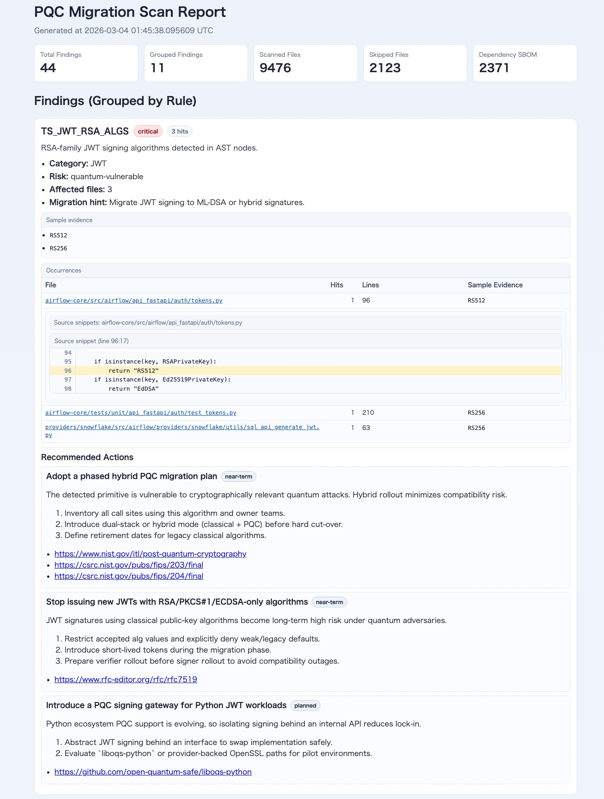

# pqc-scan - Post Quantum Cryptography Scan Tool

Japanese version: [README.ja.md](README.ja.md)

`pqc-scan` is a Rust CLI that helps teams prepare for post-quantum cryptography (PQC) migration.
It scans repositories for cryptographic usage patterns, identifies quantum-relevant risk signals, and generates actionable migration reports for engineering and security teams.

## Why This Tool

Many organizations already use SBOMs for software supply-chain visibility, but PQC migration also requires visibility into **cryptographic usage in code and configuration**.
`pqc-scan` provides that visibility with practical outputs for triage, planning, and CI automation.

## Quick Start

Scan your product repository (recommended real-world usage):

```bash
pqc-scan scan /path/to/your-product --format all --out-dir /path/to/your-product/pqc-report --rules-dir /path/to/pqc-scan/rules
```

Generated files:

- `/path/to/your-product/pqc-report/report.json`
- `/path/to/your-product/pqc-report/report.html`
- `/path/to/your-product/pqc-report/report.md`
- `/path/to/your-product/pqc-report/report.sarif`
- `/path/to/your-product/pqc-report/cbom.json`
- `/path/to/your-product/pqc-report/dependency-sbom.json`

## Installation

### Option A: Install as `pqc-scan` command (recommended)

```bash
cd /path/to/pqc-scan
cargo install --path crates/pqc_scan_cli
```

Then run from your product repository:

```bash
pqc-scan scan . --format all --out-dir ./pqc-report --rules-dir /path/to/pqc-scan/rules
```

If `pqc-scan: command not found` appears after installation, ensure `~/.cargo/bin` is in your `PATH`.

### Option B: Run without installing (source checkout)

If you do not want to install yet, you can run directly from source:

```bash
cargo run --manifest-path /path/to/pqc-scan/crates/pqc_scan_cli/Cargo.toml --bin pqc-scan -- scan /path/to/your-product --format all --out-dir /path/to/your-product/pqc-report --rules-dir /path/to/pqc-scan/rules
```

## Core Capabilities

- Hybrid detection pipeline: `tree-sitter` + `regex`
- Rule-driven findings with severity, confidence, and quantum risk tags
- Migration guidance per finding (runtime/language-aware recommended actions)
- Rule and severity reference: [docs/rules-reference.md](docs/rules-reference.md)
- Source snippet extraction with highlighted matched line (HTML + JSON)
- CBOM export (`cbom.json`)
- Dependency inventory export (`dependency-sbom.json`)
- CI/CD-friendly outputs including SARIF for GitHub Code Scanning

## CBOM vs SBOM

### PQC readiness inventory (2026-11-09)

The scanner inventories ML-KEM/ML-DSA references across the seven languages,
Node SLH-DSA key generation, selected PQC-capable dependencies, draft Kyber/Dilithium
names, and explicit classical-only Java/Ruby TLS group settings or Go
`GODEBUG=tlsmlkem=0`. These are static signals, not negotiated-state checks.
Certificate ML-DSA/SLH-DSA signature and subject public-key OIDs are matched
independently; filenames cannot establish PQC certificate support. Signatures and
trust chains are not verified. Existing output field names and rule IDs remain
unchanged; new informational findings also appear in CBOM and SARIF.

`quantum-safe` on a finding describes the referenced primitive only, not the
security or migration completeness of the product. Dependency findings remain
`quantum-uncertain`: resolved version, provider, features and peer support must be
checked. Node crypto and WebCrypto have different minimum minor versions; browser
and TypeScript environments must be checked independently. JWT guidance requires
JOSE/library/verifier compatibility before changing signatures. See
[static fixtures and official references](examples/pqc-readiness/README.md).

| Artifact | Purpose | Main Question |
|---|---|---|
| `dependency-sbom.json` | Software dependency inventory | "What packages/libraries are present?" |
| `cbom.json` | Cryptographic usage inventory | "What algorithms and crypto usages are present, and what is their quantum risk?" |

In practice:

- Use SBOM data to track component and package exposure.
- Use CBOM data to prioritize cryptographic migration work (JWT/TLS/PKI/SSH/etc.).
- Use both together for end-to-end PQC migration planning.

## Rule validation and provenance

Rule packs reject blank IDs, non-finite/out-of-range confidence (inclusive `0..1`),
and traversal failures instead of returning a partially loaded pack. Existing CLI
flags/report fields and valid custom scopes remain unchanged; malformed packs use
the existing operational error exit code1. Review invalid custom metadata before
upgrading. Unknown scope strings remain accepted with their existing per-detector
semantics; no new default warnings are emitted. See [loading/scope compatibility](docs/architecture/RULE-VALIDATION.md).

All119 built-in rules have a [development-only quality companion](docs/quality/RULE-QUALITY.md)
with separate purpose/algorithm/quantum/classical annotations, source editions,
method limits and positive/negative pattern controls. It records known gaps without
changing detection patterns, Risk/severity or report formats. These controls do not
establish runtime use, universal accuracy or approved quality budgets.

## Detection Coverage

### Detector Modules

- `tree_sitter_detector`
- `regex_detector`
- `dependency_detector`
- `certificate_detector`
- `key_detector`

### Tree-sitter Language Support

- Java
- Go
- JavaScript
- TypeScript
- Python
- Rust
- Ruby

### Dependency and Manifest Support

- `Cargo.toml`, `Cargo.lock`
- `Gemfile`, `Gemfile.lock`, `gems.rb`, `gems.locked`, `*.gemspec`
- `pom.xml`, `build.gradle`, `build.gradle.kts`, `gradle.lockfile`
- `go.mod`
- `package.json`, `package-lock.json`, `pnpm-lock.yaml`
- `requirements.txt`, `Pipfile.lock`, `poetry.lock`

### SBOM Ingestion Support

- CycloneDX JSON (`*.cdx.json`, `*bom*.json`)
- SPDX JSON (`*.spdx.json`, `*sbom*.json`)

### Certificate and Key Support

- Certificate candidates: `.pem`, `.crt`, `.cer`, `.der` (PEM or DER selected by
  content). `.p12`/`.pfx` produce container signals only; their contents are unsupported.
- Private key markers:
  - `BEGIN RSA PRIVATE KEY`
  - `BEGIN PRIVATE KEY`
  - `BEGIN OPENSSH PRIVATE KEY`

Certificate parsing separates the signature algorithm from the subject public key.
RSA key size is the modulus bit length; EC size comes from supported named curves
(P-256/P-384/P-521), not encoded point length. Ed25519/Ed448/X25519/X448 encoded
lengths are recorded separately, without inventing RSA key size or security strength.
Unknown/PQC subject-key encodings retain their OID and public fingerprints with
unknown semantic size; a PQC OID is not proof of a valid PQC key.

Existing certificate evidence metadata now includes public certificate/SPKI SHA-256
fingerprints, explicitly named encoded byte lengths, key type/parameters, known
semantic size/curve, validity timestamps and object positions. PEM bundles preserve
each certificate's real line/column and block index, including distinct certificates
sharing one public key. DER retains the legacy 1:1 location; `byte_offset: "0"`
identifies the object, not a source-code position. Malformed/unsupported blocks retain
other parsed certificates and report incomplete inspection through `--diagnostics`.
No certificate signatures, chains or mathematical key/point validity are verified;
PKCS#12 decryption and standalone public-key file detection are not implemented.

Built-in certificate signature rules use exact parsed OIDs. RSA-size rules require
an RSA/PSS subject modulus, so filenames or EC point sizes cannot satisfy them.
ECDSA and DSA are classified `quantum-vulnerable`; under the unchanged PKI promotion
policy their final severities are high and critical respectively. SHA-1/MD5 and
weak-RSA findings express separate classical concerns. DSA migration guidance
separates replacement of signing from legacy signature verification.

`CERT_EXPIRED` and `CERT_NOT_YET_VALID` use parsed UTC timestamps and an explicit
Unix-second assessment clock; both validity endpoints are inclusive. The old
`CERT_EXPIRY_2026_OR_BEFORE` ID retains its fixed parsed cutoff before 2027-01-01
UTC and is labeled legacy; it is not an alias for current expiry. Reversed ranges
or unavailable assessment clocks prevent a complete validity verdict while
retaining static facts. Time findings record `assessment_time_unix` and
`validity_status` in the existing evidence metadata map.

The CLI creates a fresh detector registry per scan. `default_detectors()` captures
its certificate assessment time at construction; library callers reusing that
registry reuse that time and should recreate it for a fresh-time assessment.
`CertificateDetector::at(unix_seconds)` provides an explicit fixed-time detector;
the public unit detector and legacy entrypoints remain available.

Existing custom `certificate` and other legacy scopes keep composite-text matching,
except the newly reserved opt-in scopes `rsa_modulus_bits`, `certificate_validity`
and `legacy_not_after_2026`. External packs previously using those exact strings as
opaque legacy labels should rename them (or use `certificate`) before upgrading.
Existing `signature_oid`/`public_key_oid` scopes remain exact identifier inputs.
Corrected facts, typed evidence and risk tags intentionally change affected
certificate findings, IDs and legacy CBOM algorithm strings; CLI options, report
structures/enums and core ID/scoring algorithms remain unchanged. No signature,
chain or runtime-use guarantee follows. PSS digest parameters and unlisted
signature OIDs are not fully assessed; absence of a hash finding does not prove a
safe digest. See [classification specification](docs/roadmap/TASK-021-IMPLEMENTATION.md)
and [focused baseline](docs/quality/CERTIFICATE-BASELINE-021.md).
Files containing EC/DSA/encrypted private-key PEM markers also receive file-wide source
snippet masking; this does not add new private-key detection rules or decrypt keys.

### Middleware/Config Coverage

- Kubernetes / Ingress
- nginx
- Apache httpd
- Envoy
- Istio
- HAProxy
- Traefik

### Built-in Rule Set

- Default rules live under `rules/default/`
- Current built-in rules: **100+**
- Full reference (all rule IDs + severity definitions): [docs/rules-reference.md](docs/rules-reference.md)

## CLI

```bash
pqc-scan scan <path> [--format json|html|md|sarif|all] [--lang en|ja] [--out-dir ./pqc-report] [--rules-dir ./rules] [--fail-on high|critical] [--threads N] [--diagnostics] [--require-complete] [--inventory-json] [--repository-scope ID] [--policy-profile migration-review-v1] [--assessment-context PATH]
pqc-scan rules list [--rules-dir ./rules]
pqc-scan rules show <rule-id> [--rules-dir ./rules]
```

### Recommended usage from your product repository

When running `pqc-scan` inside your own product repository (not inside the `pqc-scan` repo), use an **absolute path** for `--rules-dir`.

```bash
pqc-scan scan . --format all --out-dir ./pqc-report --rules-dir /path/to/pqc-scan/rules
```

### Common Commands

```bash
# Full report set
pqc-scan scan . --format all --out-dir ./pqc-report --rules-dir /path/to/pqc-scan/rules

# SARIF only (for GitHub Code Scanning)
pqc-scan scan . --format sarif --out-dir ./pqc-report --rules-dir /path/to/pqc-scan/rules

# CI failure gate
pqc-scan scan . --fail-on high --rules-dir /path/to/pqc-scan/rules

# Inspect one rule in detail
pqc-scan rules show JWT_RS256 --rules-dir /path/to/pqc-scan/rules
```

### Cryptographic Inventory and Evidence Report

`--inventory-json` adds `scan.inventory.v1.json` with method-specific observations,
normalized algorithm/public-key/certificate/dependency assets, and links to legacy
findings. This is pqc-scan's own JSON format. It is opt-in even with `--format all`;
existing reports and IDs remain unchanged. Use `--repository-scope team/project`
with inventory capture to enable weak cross-scan source correlation. Omit secret
or absolute identifiers. The report does not assert active use, trust or a PQC
assessment. See the [contract and limitations](docs/architecture/INVENTORY-REPORT-V1.md).

```bash
pqc-scan scan . --inventory-json --repository-scope team/project --rules-dir ./rules
```

`--inventory-json` is the only CLI option for this report. The former `--native-json`
option has been removed; replace it with `--inventory-json` and read
`scan.inventory.v1.json` instead of `scan.native.v1.json`. JSON fields, schema
version and ID generation are unchanged.

Dependency assets preserve declared constraints (for example `^1.2.3`), optional
lock-record resolved versions and source provenance separately. A declaration or
SBOM claim alone never creates a versioned purl. Path/git/workspace locators stay
unresolved; no dependency graph or package download is inferred. The legacy
`dependency-sbom.json` remains a flat array with the same fields; corrected purls
and inspection diagnostics are intentional semantic changes. Source origins remain
separate in inventory even when the legacy projection collapses them.

### Explicit local policy assessment

`--inventory-json --policy-profile migration-review-v1` adds a separate
`scan.assessment.v1.json` with quantum/classical concerns, observation certainty,
usage, priority and purpose-specific candidate prerequisites. Existing reports,
inventory JSON, severity and exit codes remain unchanged. This is local advisory
migration review, not compliance or deployed-security assurance, with no deadlines.
Unknown/incomplete inspection cannot yield a clean pass; current inventory v1
cannot yield aggregate Pass.

```bash
pqc-scan scan . --inventory-json --policy-profile migration-review-v1 --rules-dir ./rules
```

Optional `--assessment-context ./context.json` supplies typed local context, e.g.
`{"version":1,"use_case":"jwt"}`. Missing support stays unknown; provided values are
unverified operator claims. Dependency presence does not prove PQC readiness.
See [scope, prerequisites and context fields](docs/architecture/LOCAL-ASSESSMENT-V1.md).

### Inspection diagnostics

Read failures and detector errors retain other findings and produce typed inspection
diagnostics. The CLI prints one completeness warning to stderr when inspection is
partial, failed or unknown. Default exit codes remain unchanged: 0 for success,
1 for an operational error and 2 when `--fail-on` is reached. No findings does not
prove that inspection completed.

Use `--diagnostics` to additionally write `diagnostics.json` in `--out-dir`.
This separate artifact has `schema_version: "1"`, generation time, declared scope,
coverage counters and safe reason codes. Arbitrary detector/I/O error contents and
file contents are not included. The six existing report filenames and machine
schemas remain unchanged; `--format all` does not implicitly enable diagnostics.
`--lang` continues to affect HTML/Markdown only.

```bash
pqc-scan scan . --diagnostics --require-complete --out-dir ./pqc-report --rules-dir /path/to/pqc-scan/rules
```

`--require-complete` returns **3** when inspection is not known to be complete,
after writing the requested reports. Exit precedence is operational error (1),
requested completeness failure (3), then finding threshold (2). Neither option
requires the other. A valid empty scope can complete, but this says nothing about
cryptography outside that scope.

Regex, AST and key-marker detectors report applicability and bounded inspection
outcomes. Accepted-hit limits remain **32 / 32 / 8 per rule and file**. Regex
counts accepted hits after the existing comment filter, so comment-only matches
no longer consume the accepted-hit quota. Existing language/comment policy is
unchanged. Recovered source hits are an intentional detection correction.

Exactly 32 (or 8) hits does not by itself prove truncation: the detector checks
remaining candidates within a finite work budget. An additional eligible hit or
an unfinished search at a work limit yields `detector_truncated`, retaining earlier
hits and making inspection partial. No omitted-hit count is inferred. Regex/AST
inspect at most 4096 match candidates per rule/file, plus one look-ahead. AST also
retains at most 4096 semantic candidates and schedules at most 100000 tree nodes;
its existing 2000-character candidate clipping now reports truncation. These are
engineering safety bounds, not measured performance targets. AST parsing with
error nodes retains available hits and reports `detector_partial`; initialization
or no-tree failures are detector errors. Binary input, unsupported source
languages and no applicable rules are outside the corresponding detector scope.
`Complete` refers only to the supported pattern/marker strategy, not general
symbol resolution, runtime use or discovery of every key format.

Certificate detection also reports applicability and parsing/attribute completeness.
Malformed or mixed/unknown-attribute certificates yield `detector_partial`; unsupported
containers yield `detector_unsupported`. A container finding does not prove that its
contents were inspected. Unmatched but parsed certificates need not produce a finding.

Dependency inspection now distinguishes valid empty input, malformed supported input,
usable partial records, unsupported versions and resource limits. Supported structured
subsets can report completion; unrelated files are not applicable. Ruby/Gradle/XML,
requirements and Go lexical fallbacks remain `detector_not_reported`. Completion is
within the supported subset, not package-manager validation or installed-state proof.
`--require-complete` keeps its exit-code contract, but corrected coverage can change
which code a scan returns. See [dependency provenance](docs/architecture/DEPENDENCY-PROVENANCE.md).

The legacy `scanned_files` count still means files selected by the walker. New
counters distinguish selected, read-ok, read-failed, analyzed, partial,
analysis-failed, unsupported, not-applicable and unknown files. Enumerated policy
exclusions and enumeration failures are separate; ignore-filtered populations are
not counted and are explicitly unknown. Completeness is only within declared
scope, including the existing ignore rules, default exclusions and size limit.

Library users can call `scan_repository_detailed` and inspect the private-field
`ScanDocument` through accessors. `scan_repository`, `ScanResult`, existing report
writers and required `Detector::detect` implementations remain compatible.
Detectors may opt into `detect_detailed` with an explicit `DetectorOutcome`;
`Complete` is a statement about inspection, never a security verdict.

## Report Outputs

### Japanese Reports

HTML reports start with a compact, severity-sorted rule list. Search by rule or
file, filter severity/risk, and switch between risk candidates and informational
inventory. Rules and their occurrences are paginated in groups of 20. Expand a
rule, then a location, to see its source context and applicable actions. Identical
shared guidance is linked instead of repeating it at every location. Different
recommendations sharing an action ID remain distinct. Without JavaScript, all
records remain available through native expandable details. No external scripts
or network connection are required. Markdown provides a linked rule/location index.

TLS guidance prefers TLS 1.3, retaining securely configured TLS 1.2 only for an
identified interoperability need. PQC override settings receive setting-specific
checks rather than an assertion of RSA usage. Machine schemas and detection
results remain stable; recommendation text and applicability intentionally improve.

Use `--lang ja` for Japanese HTML and Markdown reports. English remains the default
(`--lang en`). JSON, SARIF, CBOM and dependency SBOM retain their existing content
regardless of this option. Finding IDs, paths, evidence, code and reference URLs
are never translated. Japanese reports explain the findings and next steps using
a built-in catalog; no repository data is sent to a translation service.

```bash
pqc-scan scan . --lang ja --format all --out-dir ./pqc-report-ja --rules-dir /path/to/pqc-scan/rules
```

Built-in rule descriptions and recommended actions have Japanese copy. Custom
rules or actions without a translation show an explicit notice and retain the
original text. `quantum-safe` is displayed as a PQC reference, not a declaration
that the product is safe or migration is complete. Japanese wording was reviewed
using [humanizer-jp](https://github.com/tqkqt0/humanizer-jp); that skill is an
authoring aid, not a runtime dependency.

### `report.json`

Machine-readable full scan result including findings, metadata, recommended actions, and source snippets.

### `report.html`

Human-friendly triage report with:

- severity badges
- finding metadata
- highlighted source snippets
- recommended migration actions

#### HTML Report Preview

The screenshot below shows a real `report.html` example with grouped findings, an occurrences table, highlighted source snippets, and recommended actions.



### `report.md`

Portable text report for audit notes, pull requests, and artifact storage.

### `report.sarif`

SARIF output for code scanning platforms (including GitHub Code Scanning).

### `cbom.json`

Cryptographic Bill of Materials with algorithm/location/risk/migration inventory.

### `dependency-sbom.json`

Dependency inventory extracted from manifests and SBOM files.

### SARIF locations

SARIF remains version 2.1.0. File paths are percent-encoded UTF-8 URI references
(literal `%`, spaces, `#` and `?` are encoded); absolute paths become file URIs.
Windows native separators are normalized on Windows; Unix backslashes are literal.
An unknown line (`0` in `report.json`) produces an artifact-only location. A known
line with unknown column omits `startColumn`; an empty path omits `locations`.
Columns are one-based Unicode code points (`columnKind: unicodeCodePoints`),
including one column per emoji, combining code point or tab, rather than visual
width or UTF-16 units. Legacy AST columns mix byte and character offsets: SARIF
keeps a column only when the existing unmasked snippet proves an ASCII prefix;
otherwise it retains the line only. Missing, masked or clipped prefixes cannot
prove a column. `report.json` locations/IDs, other reports, CLI flags and filenames
are unchanged. These corrections intentionally replace invalid/misleading SARIF
positions and unescaped paths. See the [contract and validation record](docs/quality/SARIF-LOCATION-CONTRACT-022.md).

## Security and Privacy Controls

- Full private key material is never emitted.
- Sensitive snippet output is masked.
- `.gitignore` is respected during repository walking.
- Default excludes: `.git`, `node_modules`, `target`, `dist`, `docs/`, `*.md`.
- Files larger than 2 MB are skipped.

## Accuracy and Disclaimer

`pqc-scan` performs **best-effort static analysis** using rules and heuristics.
It is designed to accelerate triage and migration planning, but it is **not a formal proof tool** and does **not guarantee 100% detection accuracy**.

Please assume the following:

- False positives can occur.
- False negatives can occur.
- Findings should be validated in your environment before making production or compliance decisions.

By using this tool, you acknowledge that scan results are advisory and must be combined with expert review, architecture context, and runtime/security testing.

## Known Limitations

- Static scanning cannot fully infer runtime crypto negotiation paths.
- Library-specific behavior may differ by version and configuration.
- Some parser-less formats are detected heuristically and may require custom rules.

## Architecture

Workspace crates:

- `pqc_scan_cli`: CLI parsing and command dispatch
- `pqc_scan_core`: scan pipeline, risk engine, deduplication, recommendation enrichment
- `pqc_scan_rules`: YAML rule loading and regex compilation
- `pqc_scan_detectors`: detector implementations
- `pqc_scan_report`: JSON/HTML/Markdown/SARIF/CBOM writers

See [docs/architecture.md](docs/architecture.md) for details.

## GitHub Actions

Example workflow:

- `.github/workflows/pqc-scan.yml`

This repository's workflow runs Rust quality checks and all `shell/*.test.cjs`
checks, then scans the full normal repository scope. Detection rules, severity and
the scanner's raw `report.sarif` stay unchanged.

For this repository's Code Scanning upload only, a preparation step omits exact
reviewed test observations and fixed rule/catalog/guidance references listed in
[`SELF-SCAN-EXPECTATIONS.json`](docs/quality/SELF-SCAN-EXPECTATIONS.json). Each entry
binds the complete source-file SHA-256, the full result digest, rule/location and
exact occurrence count. Changed/missing sources, new results, excess duplicates
and unregistered production observations remain in the upload. No test directory
or rule is broadly excluded, and GitHub's failure thresholds are not lowered.

The `pqc-self-scan-evidence` artifact preserves raw SARIF, the separate
`code-scanning.sarif` upload copy, `code-scanning-audit.json` and the exact expectation
policy, even if preparation
or upload fails. The existing dependency SBOM artifact is retained. This is CI-only
policy; normal scans and user report formats are unaffected. Rule definitions, algorithm-name vocabularies, OID labels, translated guidance and
nonexecuted example strings can match usage patterns without performing
cryptographic operations; only individually reviewed exact results are registered.
New intentional test inputs or classification references require review of their
source/result bindings before registration; CI does
not automatically learn or accept findings. See the
[policy and maintenance guide](docs/quality/CI-SELF-SCAN.md).

## AST occurrence precision

AST findings distinguish source spans per rule: repeated uses on the same line
remain separate, while parent/child representations of the same lexical match
produce one observation. The existing 32-hit rule/file cap and bounded-work
truncation diagnostics remain. A display-only clipping ellipsis is never treated
as source. CLI flags, report schemas/filenames and IDs for unchanged occurrences
are preserved; finding counts and new occurrence IDs may increase intentionally.
Legacy AST Unicode column limitations still apply (see SARIF locations above).

TypeScript/TSX still use the pinned JavaScript grammar: plain JavaScript/JSX
subsets may parse completely, while type syntax can produce partial inspection
and missed API matches. Matching remains nominal and rule-based: imported aliases
may be missed, local namesakes and display strings may be false positives, and
comments inside matched ancestor text are not a full semantic comment analysis.
No new grammar, symbol resolver or dataflow engine was added. See the
[task 024 measurements and compatibility record](docs/quality/TASK-024-AST-OCCURRENCES.md).

## Developer quality baseline

Task 023 adds a source-labeled, offline evaluation corpus and a Python standard-
library harness. It measures the existing CLI without changing scan rules or
report formats. Build with `cargo build --workspace --release --locked`, then run:

```bash
python3 -m unittest discover -s tests/quality -p 'test_*.py'
python3 tests/quality/run.py --binary target/release/pqc-scan --build-profile release --out-dir target/quality-baseline
```

Use a new output directory for each run. Fixtures are materialized into a temporary
root outside ignored build directories; generated reports remain under `target/`.
CI preserves the measurements and full reports. Accuracy and performance budgets
remain unapproved proposals; the small synthetic holdout does not represent
real-world accuracy. See the [protocol](tests/quality/PROTOCOL.md) and
[measured baseline](docs/quality/TASK-023-BASELINE.md).

## License

MIT
