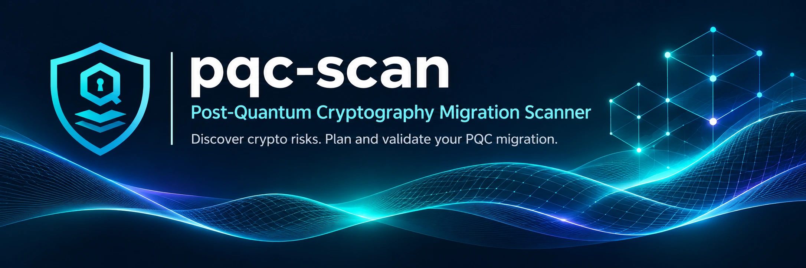
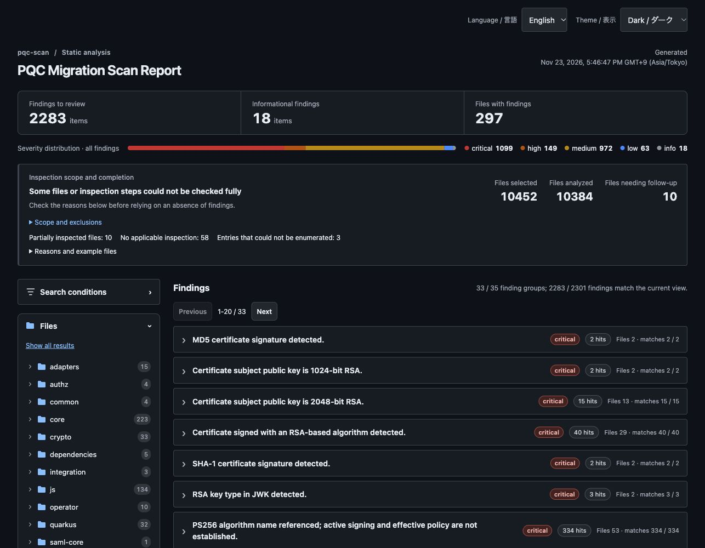

<!-- README hero -->
<p align="center">
  
</p>

<p align="center">
  <a href="https://github.com/wakaken/pqc-scan/actions/workflows/pqc-scan.yml"></a>
  <a href="https://github.com/wakaken/pqc-scan/releases"></a>
  <a href="LICENSE"></a>
  
</p>

<p align="center"><strong>Discover cryptographic references. Investigate migration risks. Prepare for the post-quantum era.</strong></p>

<p align="center">
  <a href="#quick-start">Quick start</a> ·
  <a href="#report-preview">Report preview</a> ·
  <a href="docs/user/COVERAGE.md">Coverage & limits</a> ·
  <a href="README.ja.md">日本語</a>
</p>

| Discover | Investigate | Report |
| :--- | :--- | :--- |
| Identify supported cryptographic references in local source, config, certificates, and manifests. | Review locations, migration guidance, and inspection completeness. | Read results in HTML/Markdown and share JSON/SARIF with other tools. |

<!-- /README hero -->

# pqc-scan

[日本語](README.ja.md)

`pqc-scan` is a Rust command-line tool for investigating migration to post-quantum cryptography (PQC).
It reads local project files, finds references to cryptographic algorithms and libraries, and reports the locations and suggested follow-up work.
Use it to decide what to investigate before changing JWT, TLS, PKI, SSH or other cryptographic components.

`pqc-scan` is local-first: scanning and report generation run entirely in your local environment. During these operations, it does not connect to external services over the internet. It does not automatically connect to external AI services or LLMs, and it does not send the scanned source code to external services.

## Contents

- [What can I scan?](#targets)
- [What does it do?](#features)
- [Run your first scan](#quick-start)
- [Scan in your browser](#web-scan)
- [Report preview](#report-preview)
- [Read the results](#results)
- [Use migration review](#migration-review)
- [Inspect TLS/SSH endpoints](#endpoint-probing)
- [User guides](#guides)
- [Limits and privacy](#limits)
- [License](#license)

<a id="targets"></a>

## What can I scan?

Point the scanner at a local repository. It inspects the following artifacts within its supported patterns and formats:

| Artifact | Languages or file examples | What the scanner looks for |
|---|---|---|
| Source code | Java, Go, JavaScript, TypeScript/TSX, Python, Rust, Ruby | Cryptographic APIs, algorithm names and related usage patterns |
| Middleware configuration files | Kubernetes/Ingress, nginx, Apache httpd, Envoy, Istio, HAProxy, Traefik | TLS/cipher/group settings and other cryptographic configuration signals |
| Certificate files | `.pem`, `.crt`, `.cer`, `.der` | Signature and subject-key algorithms, supported key sizes/curves, validity periods and public fingerprints |
| Private-key headers | RSA, generic PKCS#8 and OpenSSH private-key headers | The presence of supported headers; no decryption or private-key validation |
| Dependency manifests and locks | `Cargo.toml`, `Cargo.lock`, `package.json`, npm/pnpm locks, Python/Ruby/Java/Go dependency files | Relevant libraries, declared version constraints and supported resolution records |
| SBOM files | CycloneDX JSON and SPDX JSON | SBOMs used for the scanned project, describing its dependency components and packages |

File selection defaults to 2 MiB per file. See [file-size limits](docs/user/SCANNING.md#file-size-limit).

<a id="features"></a>

## What does it do?

- Locates cryptographic references and attaches severity, risk labels and source context.
- Provides checks for migration to post-quantum cryptography (PQC), tailored to the language and runtime.
- Writes HTML/Markdown for investigation and JSON/SARIF for integration with other tools.
- Lists cryptographic scan results and software dependencies separately.
- Lets you enter the purpose and usage of cryptography to organize the checks needed for migration to PQC.

A reference to a PQC algorithm is useful evidence, but it does not establish that the application uses it successfully. The [report guide](docs/user/REPORTS.md#pqc-findings) explains these findings with examples.

<a id="quick-start"></a>

## Run your first scan

Choose one of three ways to run the tool.

| Method | Requirements and instructions |
|---|---|
| Install from source | Requires Rust. Follow the installation and scan steps below |
| Use a macOS Apple Silicon binary | No Rust installation is required. Follow the [installation guide](docs/user/DISTRIBUTION.md) to download and extract a published archive |
| Run from source without installing | Requires Rust. Use `cargo run` to build and run instead of `cargo install`. See the [instructions](docs/user/SCANNING.md#from-source) |

The following steps cover **installing from source and running a scan**.

### 1. Install

Obtain this repository and install with the following commands:

```bash
cd /path/to/pqc-scan
cargo install --locked --path crates/pqc_scan_cli
```

Keep this checkout's `rules` directory after installation; the scan needs it.
Check the installation with `pqc-scan --help` or `pqc-scan --version`.
If the command is not found, check that `~/.cargo/bin` is in `PATH`.

### 2. Scan

Use the `pqc-scan` command installed above. Replace these paths for your environment:

- `/path/to/your-product`: the project folder to inspect
- `/path/to/pqc-scan/rules`: the absolute path to the rules directory you retained
- `/path/to/reports/product-scan`: a new report directory outside the scanned project

```bash
pqc-scan scan /path/to/your-product --format all --out-dir /path/to/reports/product-scan --rules-dir /path/to/pqc-scan/rules
```

Add `--lang ja` to produce Japanese HTML and Markdown.

### 3. Open the report

Open `report.html` from the output directory in your browser to review the results.
Keep `report.rules.html` alongside it when moving the HTML report elsewhere.
Use `report.md` to read or share a text version.

See the [scanning guide](docs/user/SCANNING.md) for output formats, input selection
and output paths, and the [report guide](docs/user/REPORTS.md) for interpretation.
To select folders and scan in your browser, continue with the next section.

<a id="web-scan"></a>

## Scan in your browser

After installing from source, start the local server with the command below. For a binary archive, see the [installation guide](docs/user/DISTRIBUTION.md#use-the-browser-interface).

```bash
pqc-scan serve --root /path/to/projects --rules-dir /path/to/pqc-scan/rules
```

1. The default browser opens the start page. If it does not, copy the complete `http://127.0.0.1:8787/<session>/` URL printed in the terminal into your browser.
2. Select one or more folders within `--root` using the rows or checkboxes, then choose **Scan selected folders**. Double-click to open a folder; use Back/Forward or the path above the list to navigate. You cannot move outside the root, and symbolic links are not shown.
3. Folders are scanned in selection order, and each keeps its own results. For multiple folders, use each folder's result to open its scan report or continue to migration review when available. Browser Back lets you scan another folder.
4. Stop the server with **Ctrl+C** in the terminal where you started it. Reports remain in the printed `pqc-scan-web-*` directory. Keep `report.html` and `report.rules.html` together for offline reading.

The server listens only on `127.0.0.1` and runs the same static scan as the CLI.
Scanning stays on the machine running the server, without sending source code or
reports to external services. See [local web scanning](docs/user/SCANNING.md#local-web-scanning)
for constraints and options.

<a id="report-preview"></a>

## Report preview

The scan HTML report includes a severity summary, rule groups, search/filters, and a file tree with finding counts. Expand findings for locations, source evidence and recommended checks; follow the rule guide for explanations. Language (English/Japanese), light/dark theme and browser-local time display work offline.


<details>
<summary>Dark theme</summary>



</details>

The screenshots above show a scan of [Keycloak](https://github.com/keycloak/keycloak).

<a id="results"></a>

## Read the results

Open `report.html` in your browser and review it in this order:

1. Check **Inspection scope and completion** to see what was inspected and which files need follow-up.
2. Open a finding and review its file location, surrounding code and suggested checks. Investigate its actual use before deciding whether to make a change.
3. Use search and filters for repeated findings. Follow the report's rule explanations to understand a matched rule.

With `--format all`, the CLI saves these files:

| File | Purpose |
|---|---|
| `report.html` | Review findings and inspection status in a browser |
| `report.rules.html` | Read matched rule explanations; keep it alongside `report.html` |
| `report.md` | Read or share findings and inspection status as text, with multiline source excerpts and code examples kept inside code blocks |
| `report.json` | Use findings with other tools |
| `report.sarif` | Pass findings to SARIF-compatible tools |
| `cbom.json` | Review the cryptographic findings inventory |
| `dependency-sbom.json` | Review the software dependency inventory |

HTML and Markdown combine equivalent findings at the same location and retain
matched rules in the details. Inspection totals count files.

See the [report guide](docs/user/REPORTS.md) for additional inventory, assessment
and diagnostic output, CycloneDX 1.7 exports (`--cyclonedx-17`) and inventory
comparison (`diff`).

Test code is included by default. See [scanning](docs/user/SCANNING.md#exclude-test-code)
for `--exclude-tests`, the **Exclude test code** option and custom `.pqcignore` paths.

<a id="migration-review"></a>

## Use migration review

Enter the purpose and usage of detected cryptography to see what to do for
migration to PQC and when to proceed. After installing from source, start it with:

```bash
pqc-scan serve --migration --root /path/to/projects --rules-dir /path/to/pqc-scan/rules
```

1. Select folders in the opened page and scan them, then choose **Review migration**.
   For multiple folders or history, check the target name before selecting its card.
   **Open scan report ↗** opens the original findings.
2. Enter the purpose and usage of cryptography, then choose **Prepare review items**.
3. Check the evaluation time and schedule, starting with urgent investigations.
   Read each decision's **What to do** and **When to proceed**, then use
   **View detection locations** to inspect its evidence.

Choose the save action for the content you need:

| Action | Saved content |
|---|---|
| Save report (HTML) | The migration review report for later reading |
| Save input (JSON) | Purpose, usage and other input for reassessment |
| Save assessment data | The complete evaluation; separate from the input JSON used for reassessment |

Follow the [eight illustrated steps](docs/user/SCANNING.md#web-migration-walkthrough)
for the workflow and [reading the migration report](docs/user/REPORTS.md#saved-assessment)
for decision meanings. See [input and reassessment](docs/user/SCANNING.md#optional-migration-context-and-reassessment)
and [saved evidence and declarations](docs/user/SAVED-EVIDENCE.md) to reuse saved input.

<a id="endpoint-probing"></a>

## Inspect TLS/SSH endpoints

`probe` connects to an authorized endpoint to inspect the cryptographic algorithms used by TLS or SSH.
In v0.4, these diagnostics are supported features in the macOS Apple Silicon `network` variant. The `static` variant does not include it.

### 1. Get the diagnostic commands

For a binary installation, choose `network` in the [installation guide](docs/user/DISTRIBUTION.md).
Replace `pqc-scan` below with the path to `bin/pqc-scan` in the extracted bundle.

For a source installation, run this from the repository root:

```bash
cargo install --locked --path crates/pqc_scan_cli --features probe-tls,probe-ssh,probe-ssh-kex
```

### 2. Inspect an authorized endpoint

Replace `service.example` and the port with an endpoint whose administrator has authorized the inspection.
Use a new report directory for each diagnostic run.

Establish a TLS connection and inspect the selected version, algorithms and public certificates:

```bash
pqc-scan probe tls service.example --port 443 --out-dir /path/to/reports/tls
```

Collect the algorithms advertised by an SSH server. This command performs no key exchange or login:

```bash
pqc-scan probe ssh service.example --port 22 --out-dir /path/to/reports/ssh
```

To check SSH hybrid ML-KEM768+X25519 key exchange, supply a trusted Ed25519 public host key.
Obtain it from the administrator or another independently trusted channel. Do not supply a private key.

```bash
pqc-scan probe ssh-kex service.example --port 22 --host-key-file /path/to/trusted-host.pub --out-dir /path/to/reports/ssh-kex
```

`ssh-kex` verifies the public host key and key exchange, then disconnects without user authentication or login.

### 3. Open the report

Open `report.html` in the chosen output directory to inspect the result and reasons for failure or incomplete inspection.
Use `report.md` for text, or the JSON in the same directory for other tools.

TLS verifies the certificate and endpoint name. `probe ssh` records unauthenticated advertisements.
None of these checks certifies the safety or completed PQC migration of the entire server.
See the [TLS/SSH guide](docs/user/PROBING.md) for internal/local endpoint authorization, public CA selection, supported algorithms and diagnostic limits.

<a id="guides"></a>

## User guides

| Guide | What you can learn |
|---|---|
| [Installation and local packages](docs/user/DISTRIBUTION.md) | Install a binary or build from source, upgrade, and return to an earlier version |
| [Scanning repositories](docs/user/SCANNING.md) | Select folders, run scans, choose an output directory, and check files that could not be fully inspected |
| [Understanding reports](docs/user/REPORTS.md) | Interpret findings and migration decisions, and choose the right output files |
| [Supported inputs and inspection limits](docs/user/COVERAGE.md) | Check supported languages and files, excluded inputs, and what to review before sharing reports |
| [Saved evidence and declarations](docs/user/SAVED-EVIDENCE.md) | Save and reuse purpose and usage input, set its expiry, and reassess saved findings |
| [Explicit TLS/SSH diagnostics](docs/user/PROBING.md) | Use the `network` variant to inspect an authorized endpoint over TLS or SSH |

<a id="limits"></a>

## Limits and privacy

### When interpreting findings

Findings identify algorithm references and places to investigate; they do not establish runtime use.
False positives and missed references are possible, so check the actual purpose before deciding what to change.
Zero findings do not establish safety or completed PQC migration.

Artifact scans do not contact endpoints, install dependencies or validate certificate trust chains.
Invoke `probe` explicitly for endpoint diagnostics as shown above.

### When choosing scan inputs

The scanner reads regular files within the configured size limit. Git-ignore rules, excluded directories and known binary formats limit the selected scope.
If parsing stops partway through a file, available findings are retained. Check **Inspection scope and completion** in the report for unfinished inspection.

See [supported inputs and inspection limits](docs/user/COVERAGE.md) for languages, formats and bounds,
and [inspection status](docs/user/SCANNING.md#diagnostics) for ways to investigate incomplete checks.

### Before sharing reports

Supported private-key and credential syntax is masked, but this is not a universal secret detector.
Unknown or obfuscated content, and information in paths or identifiers, can remain visible.
Inspect the report before sharing and review the [privacy and scan-scope limits](docs/user/COVERAGE.md#privacy).

<a id="license"></a>

## License

[MIT](LICENSE). Bundled dependencies have their own licenses; see the archive’s
`DEPENDENCY-LICENSES.json` and `licenses/` directory.
