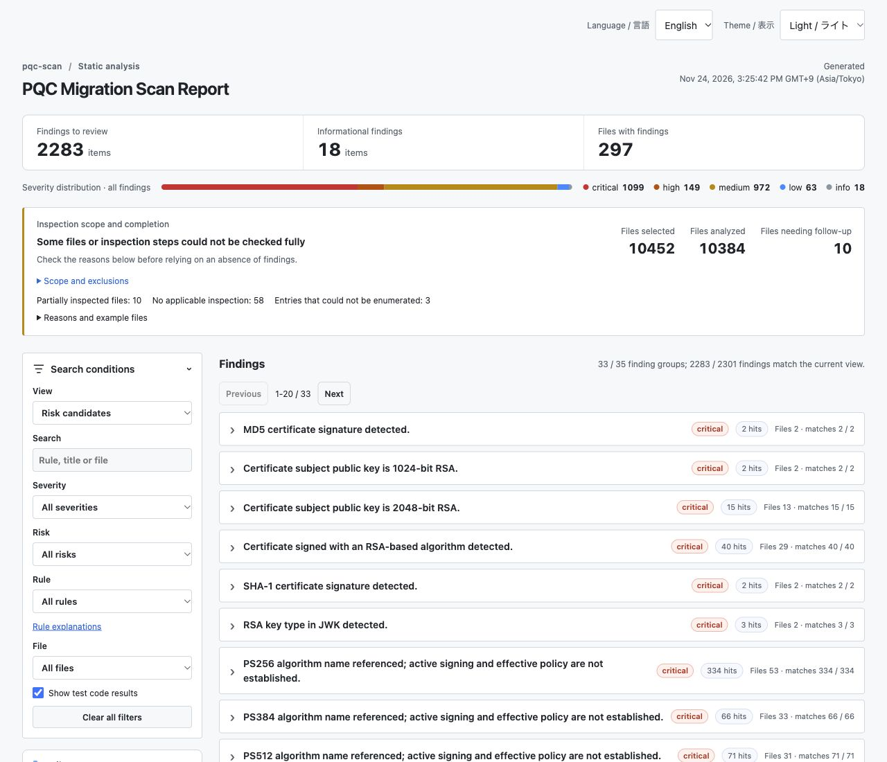

# pqc-scan

[日本語](README.ja.md)

`pqc-scan` is a Rust command-line tool for investigating migration to post-quantum cryptography (PQC).
It reads local project files, finds references to cryptographic algorithms and libraries, and reports the locations and suggested follow-up work.
Use it to decide what to investigate before changing JWT, TLS, PKI, SSH or other cryptographic components.

Scanning and report generation run entirely on your machine using local rules and parsers. No LLM or AI service is required: pqc-scan makes no outbound connections during these operations and does not send source code or scan results to external services. No AI-service API key or subscription is needed.

Downloading build/install dependencies, uploading reports through CI you configure, and opening external reference links are separate network activities. Once the tool and rules are available locally, scanning works offline.

Reports show findings, locations and suggested next steps. The inspection overview separately identifies incomplete checks and files needing follow-up.

## Contents

- [What can I scan?](#targets)
- [What does it do?](#features)
- [Run your first scan](#quick-start)
- [Scan in your browser](#web-scan)
- [Review migration](#migration-review)
- [Report preview](#report-preview)
- [Read the results](#results)
- [User guides](#guides)
- [Limits and privacy](#limits)
- [Repository CI](#repository-ci)
- [License](#license)

<a id="targets"></a>

Selected source rules now follow bounded relative JS/TS constant imports and simple JWT forwarding functions. Error-message algorithm references remain visible as informational entries; inspection diagnostics show known causes and next checks. See [coverage](docs/user/COVERAGE.md#source-facts).

## What can I scan?

Point the scanner at a local repository. It inspects the following artifacts within its supported patterns and formats:

| Artifact | Languages or file examples | What the scanner looks for |
|---|---|---|
| Source code | Java, Go, JavaScript, TypeScript/TSX, Python, Rust, Ruby | Cryptographic APIs, algorithm names and related usage patterns, with dedicated TypeScript and TSX grammars |
| Configuration files | Kubernetes/Ingress, nginx, Apache httpd, Envoy, Istio, HAProxy, Traefik | TLS/cipher/group settings and other cryptographic configuration signals |
| Public certificates | `.pem`, `.crt`, `.cer`, `.der` | Signature and subject-key algorithms, supported key sizes/curves, validity periods and public fingerprints |
| Private-key markers | RSA, generic PKCS#8 and OpenSSH private-key headers | The presence of supported headers; no decryption or private-key validation |
| Dependency manifests and locks | `Cargo.toml`, `Cargo.lock`, `package.json`, npm/pnpm locks, Python/Ruby/Java/Go dependency files | Relevant libraries, declared version constraints and supported resolution records |
| Existing SBOM files | CycloneDX JSON and SPDX JSON | Reported dependency components/packages; not proof of installation |

Selected source rules follow bounded local bindings. Explicit JOSE ES384/ES512/EdDSA references and RSA/Ed25519 module/type names retain algorithm facts; jsonwebtoken signing options and Ruby optional defaults are followed within the documented bounds. Ruby OpenSSL cipher calls can retain same-class AES-GCM/CBC candidates; Rust OpenSSL TLS construction is recognized through explicit imports and aliases. These are source references, not deployed configuration or negotiated algorithms. See [source analysis limits](docs/user/COVERAGE.md#source-facts).

PKCS#12 (`.p12`/`.pfx`) supports unencrypted public-certificate extraction. Encrypted contents and private-key bags remain unsupported; no password, decryption or integrity/trust verification is performed.
See [supported inputs and inspection limits](docs/user/COVERAGE.md) for the full file list, supported versions and parser boundaries.
Live endpoints are inspected only through separately enabled, explicit [TLS/SSH probes](docs/user/PROBING.md).
They are not repository scan targets. Arbitrary programming languages are not supported.

File selection defaults to 2 MiB per file. Use `scan --max-file-size-mib 16` or the folder picker’s size field to change it (1–64 MiB); [other inspection budgets remain](docs/user/SCANNING.md#file-size-limit).

<a id="features"></a>

## What does it do?

- Locates cryptographic references and attaches severity, risk labels and source context.
- Provides migration guidance for the affected language or runtime.
- Writes HTML/Markdown for investigation and JSON/SARIF for automation.
- Lists cryptographic findings and software dependencies in separate inventory files.
- Optionally records richer observations, local advisory assessments and inspection diagnostics.
- The explicit `assess` command can [reassess saved evidence offline](docs/user/SAVED-EVIDENCE.md), keeping technical roles, scoped claims and migration decisions separate.
- Repeated source references can receive explicit use declarations when records and saved locations are unique within the same input. Collisions and missing positions remain excluded; cross-scan ambiguity and exact-input binding are preserved.

A reference to a PQC algorithm is useful evidence, but it does not establish that the application uses it successfully. The [report guide](docs/user/REPORTS.md#pqc-findings) explains these findings with examples.

<a id="quick-start"></a>

The Rust RSA/JWT dependency rule matches the exact Cargo package names `rsa` and `jsonwebtoken`; names such as `universal-hash` are excluded. Package presence does not prove use of RSA.

## Run your first scan

Use the Rust toolchain pinned in [`rust-toolchain.toml`](rust-toolchain.toml) (currently Rust 1.93.1) and install from this checkout:

```bash
cd /path/to/pqc-scan
cargo install --locked --path crates/pqc_scan_cli
```

This development checkout prepares two archive configurations: `static` (local scanning) and `network` (static scanning plus TLS/SSH diagnostics). `network` remains experimental and unpublished. Internal feature switches remain available for custom source builds.

For archive verification and installation, see the [installation guide](docs/user/DISTRIBUTION.md). Static macOS Apple Silicon binaries are distributed through [GitHub Releases](https://github.com/wakaken/pqc-scan/releases); probe bundles are not cleared for public distribution.

Keep the checkout's `rules` directory available after installation. The binary does not bundle that directory; use an absolute `--rules-dir` path when scanning another project.
If the command is not found, check that `~/.cargo/bin` is in `PATH`.
Use `pqc-scan --help` or `pqc-scan --version` to check the installed command; both exit successfully without scanning or networking.

```bash
pqc-scan scan /path/to/your-product --format all --out-dir /path/to/reports/product-scan --rules-dir /path/to/pqc-scan/rules
```

Use a new output directory outside the scanned repository when comparing scans, so old/generated reports do not become part of the input or get confused with current output.
Output paths containing symbolic links are rejected; existing regular reports remain replaceable. See [output destination safety](docs/user/SCANNING.md#output-destination-safety).
To produce Japanese HTML/Markdown, add `--lang ja`. [Running from source](docs/user/SCANNING.md#from-source) is also supported.

<a id="web-scan"></a>

## Scan in your browser

After installing the CLI above, start the local server:

```bash
pqc-scan serve --root /path/to/projects --rules-dir /path/to/pqc-scan/rules
```

1. The default browser opens the local start page. If it does not, open the complete `http://127.0.0.1:8787/<session>/` URL printed in the terminal.
2. Select one or more project folders within `--root` using the rows or checkboxes, then **Scan selected folders**. Double-click to open a folder; use Back/Forward or the path above the list to navigate. The picker stays within this root and skips symbolic links.
3. The progress dialog blocks other page actions while folders scan in selection order. Each folder keeps its own result. For multiple folders, use each folder’s card to open its scan report or start migration review when available. Scan history offers the same direct actions. A single default-mode scan opens its HTML report automatically. Review inspection completion as well as findings. Browser Back returns to the start page for another scan.
4. Stop the server with **Ctrl+C**. Reports remain in the private `pqc-scan-web-*` directory printed in the terminal. Keep `report.html` and `report.rules.html` together for offline reading.

The server listens only on `127.0.0.1` and runs the same static scanner as the CLI, without uploading source or reports. Use `--port 0` if the default port is occupied, or `--no-open` to open the printed URL yourself. With an extracted distribution, replace the command and rules paths with `/path/to/bundle/bin/pqc-scan` and `/path/to/bundle/rules/default`. See [local web scanning](docs/user/SCANNING.md#local-web-scanning) for limits and options.

<a id="migration-review"></a>

## Review migration

Add `--migration` to `serve` to move from scan results to optional purpose and
usage input, then **Prepare review items**. For multiple folders or history, choose
the named folder card: **Open scan report ↗** opens its detections and **Review migration**
opens its saved input/result. The migration report groups decisions and shows what
to do and when to proceed. Review the evaluation date, schedule and urgent
investigations first; inspect locations for the underlying evidence.

Follow the [eight illustrated steps](docs/user/SCANNING.md#web-migration-walkthrough).
See [migration input and reassessment](docs/user/SCANNING.md#optional-migration-context-and-reassessment),
[reading the migration report](docs/user/REPORTS.md#saved-assessment), and
[saved evidence and declarations](docs/user/SAVED-EVIDENCE.md). Save input JSON with
the exact inventory used to create it; **Save assessment data** saves the evaluation,
not a reusable context file.

<a id="report-preview"></a>

## Report preview

The scan HTML report includes a severity summary, rule groups, search/filters, and a file tree with finding counts. Expand findings for locations, source evidence and recommended checks; follow the rule guide for explanations. Filters and the tree can be hidden independently. Language (English/Japanese), light/dark theme and browser-local time display work offline.



<details>
<summary>Dark theme</summary>


</details>

Actual Keycloak scan with v0.4.0, captured on 2026-11-23 with the default risk-candidate view and filters hidden. Counts describe that scan snapshot, including test fixtures; they are references requiring investigation, not confirmed vulnerability counts. The incomplete-inspection notice remains visible. [Capture source and settings](docs/images/README.md).

<a id="results"></a>

## Read the results

HTML summarizes findings, inspection scope and unfinished checks; detailed observation and asset ledgers remain in JSON/Markdown.
Advisory policy decisions are kept in explicitly requested JSON/Markdown exports.

Open `report.html` first. Review a finding's file location, source context and suggested checks before deciding on a change.
Search and filters help you work through repeated findings; `report.md` provides a portable text version.
Markdown keeps multiline source excerpts and code examples inside code blocks, including CR/LF input.
Both show inspection status. Local assessment decisions appear only in Markdown and explicitly requested JSON; HTML does not display them.

See [browser scanning](#web-scan) to select a folder and generate reports from the local web interface.

`--format all` writes six original files: `report.html`, `report.md`, `report.json`, `report.sarif`, `cbom.json` and `dependency-sbom.json`, plus the local rule guide `report.rules.html`.
`cbom.json` and `dependency-sbom.json` list cryptographic findings and software dependencies respectively. Their purpose and relationship are explained in [choosing a report](docs/user/REPORTS.md#choose-report).
Additional inventory, assessment and diagnostic files require explicit options.
Use `--cyclonedx-17` for separate CycloneDX 1.7 exports, or `diff` to compare
inventories with the same explicit repository scope. See the [report guide](docs/user/REPORTS.md).

Finding IDs use `finding-v1-<SHA-256>` with length-prefixed fields and repository-relative paths. With the same binary, rules, selected input and scan settings, identical findings keep their IDs across checkout locations. Position/evidence corrections between versions can change affected IDs and counts; see [versions and identity](docs/user/REPORTS.md#versions-and-identity).

HTML and Markdown merge equivalent findings at the same position and algorithm, retaining matched rules in details. Inspection totals count files; finding totals count merged items. Machine exports such as JSON retain original rule-level records.

Tests remain included by default. Use `--exclude-tests` or the browser’s “Exclude test code” option below “Clear selection” to omit conventional test paths and filenames. See [scanning](docs/user/SCANNING.md) for matching conventions and limits. Custom exclusions can be configured with `.pqcignore`; syntax-proven Rust test-only findings can also be omitted.

<a id="guides"></a>

## User guides

| Guide | Use it when you need to… |
|---|---|
| [Scanning repositories](docs/user/SCANNING.md) | Select outputs, configure CI exit codes, inspect incomplete scans or run from source |
| [Understanding reports](docs/user/REPORTS.md) | Interpret risk/PQC findings, choose an inventory, understand CBOM/SBOM or use local policy assessment |
| [Supported inputs and inspection limits](docs/user/COVERAGE.md) | Check languages, file formats, certificate handling, rule packs, exclusions and privacy boundaries |
| [Explicit TLS/SSH diagnostics](docs/user/PROBING.md) | Inspect one authorized endpoint with optional protocol commands |
| [Installation and local packages](docs/user/DISTRIBUTION.md) | Rule assets, package verification, updates and support scope |
| [Saved evidence and declarations](docs/user/SAVED-EVIDENCE.md) | Exact-input/context binding, claim expiry and offline reassessment |

For reporting a suspected vulnerability, see [SECURITY.md](SECURITY.md).

Selected built-in source rules follow imports, aliases and bounded local bindings. Node checks also follow literal `for...of` algorithm lists and locally generated RSA keys into signing/verification. See [source analysis and its limits](docs/user/COVERAGE.md#source-facts); these observations do not prove execution or enabled PQC support.

For the current candidate's source versions, measurements and remaining limits, start with the [static candidate evaluation](https://github.com/wakaken/pqc-scan/blob/d20a1f1872d8527d90dc3832a0d8b1b2284405b7/docs/releases/static-candidate-20261117/AUDIT-FIXES.md) and [individual rule/branch assessments](https://github.com/wakaken/pqc-scan/blob/d20a1f1872d8527d90dc3832a0d8b1b2284405b7/docs/releases/static-candidate-20261117/QUALITY-COMPLETION.md). These are bounded evaluations, not a guarantee of accuracy for every rule or product. The [2026-11-11 PQS-QAM assessment](tasks/041/QUALITY-ASSESSMENT.md) is historical; it is not the current candidate's quality verdict. The offline benchmark produces separate [JSON/Markdown quality reports](tests/quality/README.md).

Each guide has a Japanese version linked at the top.

<a id="limits"></a>

## Limits and privacy

This is static, advisory analysis. False positives and missed references are possible; a finding does not prove runtime use, and zero findings does not prove complete inspection or safety.
Repository scans do not contact endpoints, validate certificate trust chains, install dependencies or certify PQC migration completion.
Optional experimental `probe ssh-kex` (`probe-ssh-kex` feature) verifies hybrid ML-KEM768+X25519 key exchange against an explicitly supplied trusted Ed25519 public host key, then disconnects without user authentication/login. It writes separate `probe.ssh-kex.v1.json` and bilingual HTML/Markdown; existing outputs remain unchanged. See the [probe guide](docs/user/PROBING.md).

Optional `probe` commands contact only the explicitly selected endpoint; TLS uses
ordinary certificate/name validation, while `probe ssh` collects unauthenticated offers.

Recognized private-key/credential syntax is masked, with deliberately conservative previews. This is not universal secret detection: unknown/obfuscated content and secrets placed in paths or identifiers can remain outside the policy.
Review the [privacy and scan-scope limits](docs/user/COVERAGE.md#privacy) before sharing reports.

Only regular files are read, within the configured file-size limit. Git-ignore rules,
excluded directories and known binary formats limit the selected scope. Incomplete
parsing retains available findings; it does not make the rest of a file disappear.
Use `--diagnostics` to see the reasons, and `--require-complete` if incomplete
inspection should fail CI. See [inspection status](docs/user/SCANNING.md#diagnostics)
and [supported inputs and limits](docs/user/COVERAGE.md).

<a id="repository-ci"></a>

## Repository CI

The `pqc-scan` workflow runs automatically for pull requests and pushes to
`develop`. Working-branch and tag pushes do not start it; updating an open PR
still triggers PR validation.

| Event | Jobs |
|---|---|
| Pull request | `quality` |
| Push to `develop` | `baseline`, `scan` |
| Manual execution | `quality`, `baseline`, `scan` |

On `develop`, `baseline` and `scan` run independently of `quality`; PR validation
provides the pre-merge quality check. Manual execution remains available for
running all three enabled jobs together.

The CI self-scan reads a separate product input: `crates/*/src/**`, Cargo manifests
and the root lockfile, build scripts when present, and `rules/default/*.yml`.
Standalone tests, examples, task evidence, CI scripts and documentation are outside
this scan. Source bytes and repository-relative locations are preserved; colocated
Rust unit tests remain in their source files. This scope applies to repository CI.

The summary separates results requiring review from exact reviewed references.
The `pqc-self-scan-evidence` artifact contains the input inventory/hashes, scoped
expectations, all results for that scope, upload results, diagnostics and summary.
New or changed results still appear for review. These counts describe detected
references, not confirmed vulnerabilities. See [the product scan scope](docs/quality/self-scan/CI-SELF-SCAN.md#product-scope-20261116).

The existing `quality` and `baseline` jobs also aggregate all six quality axes
offline from recorded evidence. Missing facts and stale measurements remain
visible; aggregation does not run the high-cost studies or grant release acceptance.
Integrated reports are uploaded even after a failed step, with 30-day retention.
See the [measurement and retention plan](docs/quality/CI-MEASUREMENT-PLAN.md).

It skips eligible pushes and pull requests whose changed paths all
match its documentation list: the root README files, `AGENTS.md`, `SECURITY.md`,
Markdown under `docs/` and `prompts/`, and `tasks/README.md`.
Other changes in eligible events, including mixed documentation/code changes,
rules, workflow files and JSON data under `docs/`, still run CI. The exact list is maintained in
[the workflow](.github/workflows/pqc-scan.yml). Run it manually from GitHub Actions
when validation is needed for an otherwise skipped change.

The `protocols` job is disabled for every trigger, including manual runs. Its
`if: ${{ false }}` condition remains in place. The generic isolated suite's
read-only-target write failure has been corrected and its tests, Clippy, previews
and SSH KEX completed in the [candidate validation](https://github.com/wakaken/pqc-scan/blob/d20a1f1872d8527d90dc3832a0d8b1b2284405b7/docs/releases/static-candidate-20261117/AUDIT-FIXES.md). This is separate evidence from the dedicated protocol049 path and does not resume the hosted job. Re-enabling it requires a maintainer decision and validation of its current inputs, environment and resource limits; the three enabled jobs do not establish a protocol pass.

GitHub limits the number of changed files considered
by path filtering; for large changes, manually run CI if it was omitted.

Before making these checks required for merging, replace workflow-level path
filtering with job-level gating so skipped documentation changes do not leave
required checks pending.

<a id="license"></a>

## License

[MIT](LICENSE). Bundled dependencies have their own licenses; see the archive’s
`DEPENDENCY-LICENSES.json` and `licenses/` directory.
