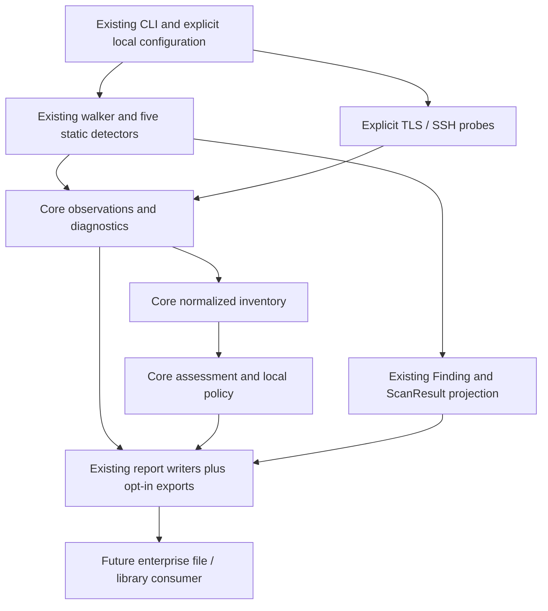

# Incremental product architecture

Naming update: the user-facing report is now **Cryptographic Inventory and Evidence
Report** (暗号資産・検出根拠レポート), selected by `--inventory-json` and written to
`scan.inventory.v1.json`. Earlier native naming below is historical/internal;
`--native-json` has been removed from the CLI. The
[current contract](INVENTORY-REPORT-V1.md) specifies compatibility.

Design date: 2026-11-09. Status: recommended design for review, not permission to implement breaking changes. Existing architecture: [../architecture.md](../architecture.md). Evidence baseline: [CURRENT-GAP-ANALYSIS.md](../quality/CURRENT-GAP-ANALYSIS.md).

## Decision

Retain the five-crate workspace. Tasks 018–029 have implemented the diagnostic result path, precise certificate semantics and core modules for observations/inventory/assessment; task 023 retains its maintainer approval gate. See the [current alignment](../quality/PHASE-0-1-ALIGNMENT.md). Add TLS and SSH as opt-in modules with independent network dependencies. No rewrite, framework migration, service layer or generic dynamic extension system is justified.

The legacy path is retained while new observations are introduced. The diagram is logical flow, not a dependency on an enterprise service or a requirement to materialize every intermediate graph. Reports render decisions; they do not infer cryptography. A detector observes; it does not decide organization-wide migration deadlines.

## Alternatives considered

| Approach | Benefit | Cost / decision |
|---|---|---|
| Extend core and existing detector/report boundaries | Small reviewable changes, no initial dependency churn, current tests reused | Recommended; keep module APIs narrow and avoid turning pipeline.rs into every feature's implementation |
| Extract inventory/assessment crates immediately | Potentially smaller future consumer dependencies | Deferred: no demonstrated second independent consumer; creates model and public API migration before semantics are stable |
| Replace scanner with a new engine/platform | Freedom to redesign all types | Rejected: destroys working behavior, increases compatibility/security burden and contradicts product intent |

No replacement is proposed. If an extension cannot meet a measured requirement, its PR must compare a minimal retained-architecture option before requesting a replacement decision.

## Responsibilities and dependencies

Current dependencies remain: CLI -> core/detectors/report/rules; detectors -> core/rules; report -> core/rules; core -> rules. The small rule-owned `Risk`/`Severity` enums remain compatibility inputs; no need to invert the workspace merely to relocate them.

| Component | Responsibility / proposed API | Dependency direction | Existing code / migration | Condition to add or extract |
|---|---|---|---|---|
| `pqc_scan_cli` | Existing commands; new explicit probe and export options; compose typed configs | Imports core, detectors, report; probe crates only through explicit build features | `src/main.rs`; retain `scan`, `rules list/show`, English default, output filenames and threshold semantics | Extend now only in selected tasks |
| `pqc_scan_rules` | Existing YAML/regex loader; improved validation and optional standard provenance | No network/probe dependencies | `src/lib.rs`, existing `rules/default`; preserve custom rule compatibility | No new rules framework |
| `pqc_scan_detectors` | Static parsing/matching and sanitized observation drafts | core/rules only | All five modules retained; `detect_detailed` default adapter | Extend for demonstrated correctness/recall gaps |
| `pqc_scan_core` | Orchestration, diagnostics, identity, normalization, inventory, assessment/policy | rules plus current utilities; no rustls/russh dependencies | Keep `pipeline`, `risk`, `recommendation`, `model`; add focused modules | Default home for shared semantics |
| `pqc_scan_report` | Legacy formats and new versioned exporters, bilingual presentation | core/rules; no networking | Keep grouping, catalogs, sanitization, current writer wrappers | Add exporter only with contract/schema tests |
| Candidate `pqc_scan_inventory` | `build_inventory`, identity/canonicalization and read-only inventory types | Would depend on a deliberately small model owner; never CLI/report/probes | Future extraction of `core::inventory/identity`, with reexports; not duplicate models | A real second consumer or measured dependency/build-isolation need; choose type ownership and avoid core<->inventory cycles first |
| Candidate `pqc_scan_assessment` | `evaluate`, `evaluate_policy`, migration applicability and source catalog | Inventory/model owner, not report/CLI/probes | Future extraction of core assessment/risk/recommendation internals; compatibility wrappers retained | Independently versioned policy consumer or proven separation benefit; not merely enterprise anticipation |
| Candidate `pqc_scan_probe_tls` | `probe_tls(&TlsProbeConfig) -> Result<ObservationBatch, ProbeSetupError>` | core, rustls/provider and shared core target-policy types | New implementation; reuse certificate parser helpers by narrowly exposing them from detectors initially, if needed; no moving all static detection | Phase 2 spike proves API visibility, Rust 1.93.1 build and isolated safety; network deps stay outside core |
| Candidate `pqc_scan_probe_ssh` | `discover_ssh(&SshProbeConfig) -> Result<ObservationBatch, ProbeSetupError>` | core plus bounded transport/parser dependencies | New discovery only; reuse core network policy; do not move existing SSH static rules | Phase 3 bounded parser review passes; add full SSH library only if required |

`ObservationBatch` is a concrete collection of observation drafts, diagnostics, attempt metadata and coverage. Do not introduce an abstract Probe plugin trait for two commands without a specific need. A TLS failure is an outcome in a batch; malformed configuration is a setup error. Core's small transport-independent endpoint/allowlist types and socket authorization helpers are added with Phase 2, not during Phase 0.

Potential inventory extraction cannot simply depend on core while core depends back on inventory. If it becomes necessary, an ADR must select one model owner and a one-way dependency graph, preserving reexports. Until then, do nothing. Likewise, no separate common-model crate is currently approved.

## Minimal migration path

1. Characterize existing outputs/IDs and accurate failure behavior in new fixtures. Add diagnostics through an additive detailed API while keeping existing `ScanResult` serialization.
2. Correct certificate parsing, exact algorithm matching and unknown SARIF locations in isolated PRs. Explicitly review intended detection/classification changes. These do not require a shared inventory engine first.
3. Add core observation/inventory modules and versioned native output in parallel with legacy normalization. Compare old and new associations and redact at collection and serialization boundaries.
4. Add pure multi-axis assessment/local policy without changing legacy severity automatically. Use source-versioned migration prerequisites; unknown context yields indeterminate policy results.
5. Add explicit probes after the observation and diagnostic contract is usable. Independently build/test them; default static builds should not acquire networking dependencies through core.
6. Add CycloneDX, diffing and diagnostic localization; freeze supported schemas and release contracts only after measured quality evidence.

Categories: steps 1-4 are **existing implementation corrections/extensions** plus the opt-in native/policy **new features**; steps 5-6 are **new feature additions/extensions**. Existing implementation replacement: **none**.

## Export contracts and mapping

Retain `report.json`, `cbom.json`, `dependency-sbom.json` and existing SARIF as compatibility surfaces. `--format all` continues to mean its current format set. Implemented opt-ins are `--inventory-json` (`scan.inventory.v1.json`), `--diagnostics` (`diagnostics.json`) and `--inventory-json --policy-profile migration-review-v1` (`scan.assessment.v1.json`). The old `--native-json` name is removed. CycloneDX export remains proposed work; suggested `--cyclonedx`, `cbom.cdx-1.7.json` and `dependency-sbom.cdx-1.7.json` are not current CLI contracts.

| Internal information | Native JSON | CycloneDX 1.7 design mapping | Legacy/SARIF treatment |
|---|---|---|---|
| Algorithm definition | Exact family, parameters, namespace, provenance | `components[]` type `cryptographic-asset`, `cryptoProperties.assetType=algorithm`, known `algorithmProperties` only | Existing CBOM remains finding text; no rebranding |
| Public key | Public SPKI fingerprint, known size/curve, refs | `assetType=related-crypto-material`, public-key type, size/fingerprint; relationship to algorithm | Never include private key value; legacy projection is lossy |
| Certificate | DER fingerprint, validity, signature/SPKI refs | `assetType=certificate`, `certificateProperties` and 1.7 `relatedCryptographicAssets` refs with exact schema types | Parsing is not trust verification; unknown source region omitted in SARIF |
| Protocol / endpoint session | Protocol identity, attempt-scoped observations | Protocol asset and applicable protocol properties; endpoint/provenance extensions only when schema-valid | No fake source-code location for an endpoint |
| Source/config usage | Every target/span and method | Occurrence evidence and namespaced properties where justified; keep rich semantics native | SARIF physical location + versioned partial fingerprint for code observations |
| Software dependency | Declared constraint vs resolved version, ecosystem, source | `library` components; version/purl only when justified; relationships only if observed | Existing flat array retained, including documented legacy limitations |
| Assessment/policy | Complete rationale, applicability, uncertainty | Namespaced properties or annotations as appropriate; do not invent a CVE or standard vulnerability from migration exposure | Legacy risk/severity are explicit projection; SARIF rule result with limitations |
| Diagnostics/completeness | Full per-stage outcomes and counters | Composition/properties only when their scope matches; export-loss notes remain native | Proposed SARIF invocation notifications and `executionSuccessful` semantics; never count a failure as zero risk |

Use the [official 1.7 schema and samples](../product/STANDARDS-REGISTER.md). Envelope includes `bomFormat`, `specVersion`, version, tool metadata, unique `bom-ref` values and generation metadata. Algorithm/cert/key/protocol components are separate and linked. In 1.7 prefer non-deprecated relationship fields after checking schema descriptions; do not blindly copy older examples. Sample placeholders and unresolved refs must not be copied into production output.

Do not infer `classicalSecurityLevel`, `nistQuantumSecurityLevel`, active key/certificate state, FIPS certification, execution environment or a dependency graph without evidence. Unknowns are omitted with native uncertainty, not guessed. Related-material `value` is never populated with private keys or session secrets, even if a schema permits it. Public DER/SPKI is not exported by default either; retain fingerprints and approved metadata.

Pin the official schema and referenced schemas with digests/license metadata in a future implementation task; validate offline. In addition to JSON schema validation, check unique/resolving refs, semantic types, no secret fields, round-trip supported information and explicit losses. Current arrays are known structurally different; this document does not claim they passed a validator.

SARIF correction retains 2.1.0: encode paths as valid URIs, specify column units, emit positive regions only when known, use artifact-only locations otherwise, and preserve rule IDs. Runtime evidence stays in native JSON; an optional notification may link to it without inventing a file region. Human reports reuse existing grouping/catalogs and add diagnostics/uncertainty text without translating IDs, evidence, numbers, risk facts or paths.

## Operational and compatibility rules

- Collection uses typed safe fields; redact before report rendering and before logs. User-controlled metadata is not trusted markup.
- A malformed or unsupported target cannot become a successful empty observation. Bounded limits are visible in diagnostics.
- Existing library APIs remain wrappers. New constructors keep internal schema development from repeatedly breaking public literals.
- Fixes to cryptographic classifications/rule matching require specified expected deltas and human review under AGENTS.md; preserving schemas alone is not enough.
- Any storage-format replacement, high-risk architecture change or incompatible CLI/rules contract triggers a stop before implementation, with alternatives and migration effects. Writing this plan does not cross that implementation gate.

## Open decisions for maintainers

Approve opt-in artifact/CLI names and exit-3 policy; scope of corrective rule-result changes; default probe address policy and safety budgets; initial supported targets/platforms; and the eventual 1.0 support/deprecation window. Library selections remain conditional on spikes. Model extraction, enterprise services and dynamic plugins are explicitly deferred. [QUALITY-GATES.md](../quality/QUALITY-GATES.md) and [OSS-ROADMAP.md](../roadmap/OSS-ROADMAP.md) specify the evidence required to proceed.
