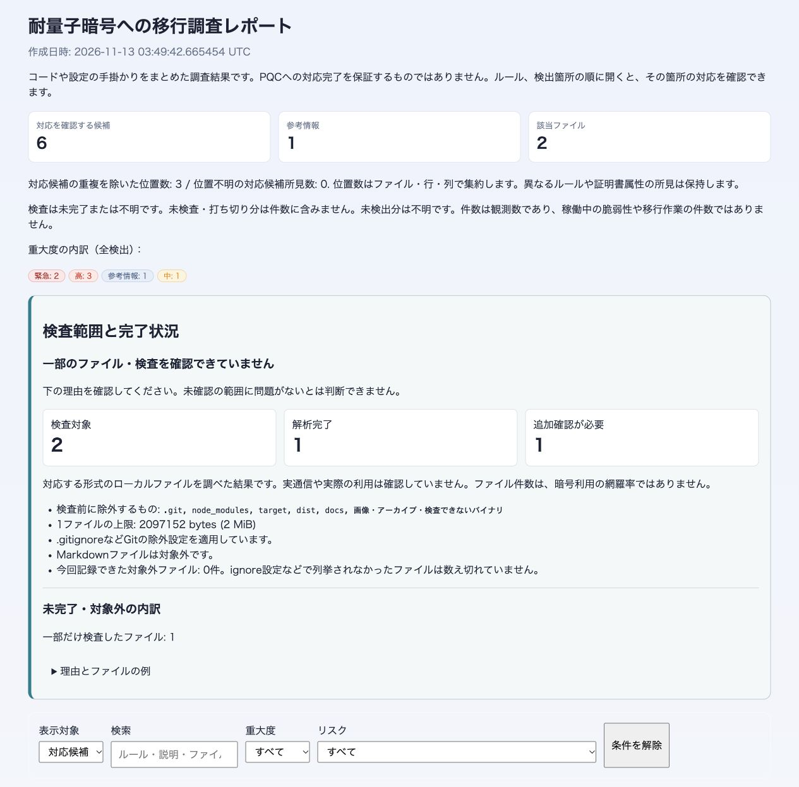

# develop 敵対的監査 P1・P2 対応結果

P1・P2 の修正・改善を実装し、受け入れ条件を検証しました。P3 は対象外です。

## 対象と互換性

- 基準: develop `5f552b818ec82cc0b6b4a8af77b6179d63e281e3`。監査時 `1e4ca0f` と製品実装は同一です。
- 作業ブランチ: `codex/audit-p1-p2-fixes`。元の作業中ブランチ・未コミット変更は保持しています。
- 最終コードとテスト: [SOURCE-FINAL.json](audit062/SOURCE-FINAL.json)。変更ファイル: [CHANGESET.json](audit062/CHANGESET.json)。未コミット差分もハッシュで固定しています。
- CLI・機械可読形式・重大度エンジン・CBOM集約方式を維持しています。検出条件の絞込み、追加の参考情報、案内、Gradleの抽出結果、人向け表示は意図的に変わります。

## 実装した内容

| 対象 | 結果 |
|---|---|
| RSA鍵長 | 一般的なKeyと数値の近接を条件から外し、明示的なRSAの文脈に限定。ML-KEM/Falcon/HSSの指摘箇所の誤検出がないことを確認。 |
| TLS | RSA鍵交換とECDHE/DHEのRSA認証を区別。一般的な方式名の参照から有効な設定を断定しない案内に変更。conf/cfgの#コメント行を文字列照合から除外。 |
| 秘密鍵・用途別案内 | ヘッダだけで漏えいを確定せず、運用中の鍵の露出確認を条件に更新を案内。一般EdDSA、鍵生成、既存の複合KEMとJWT発行を区別する確認事項を表示。 |
| PQC棚卸し | PQC_STANDARD_REFERENCEを追加。標準名・対応する識別子・ハイブリッドグループを参考情報として表示。実行成功・有効化・FIPS適合は主張しない。 |
| 集計 | 全findingを保持し、対応候補の既知のファイル・行・列で重複を除いた位置数と、位置不明の所見数を別に表示。異なる証明書属性は保持。 |
| 部分検査 | 件数の近くに未完了・不明状態と未検査／打ち切り分を含まない注記を表示。未知の欠落数は推定しない。 |
| Gradle | 既存6設定の1行map宣言に対応。動的なgroup/nameは除外、動的versionはunknown。引用符内commaで依存を落とさない。スクリプト評価・解決済み版の推定は行わない。 |

## 同じ10対象での再走査

各対象は元監査と同じSHAです。全走査 exit 0、JSON・SARIF・HTML・Markdownの所見数が一致しました。以下のPQC列は `quantum-safe` の参照件数であり、製品の安全性や稼働状態の評価ではありません。

| 対象 | 全finding 修正前→後 | PQC参照 修正前→後 |
|---|---:|---:|
| certificates | 141 → 141 | 0 → 0 |
| go | 127 → 226 | 0 → 99 |
| java | 8683 → 10232 | 136 → 1772 |
| javascript | 170 → 163 | 0 → 0 |
| middleware-haproxy | 401 → 401 | 0 → 0 |
| python | 2658 → 2962 | 43 → 360 |
| ruby | 141 → 138 | 5 → 19 |
| rust | 725 → 786 | 0 → 61 |
| typescript | 926 → 971 | 0 → 63 |
| web-nginx | 20 → 20 | 0 → 0 |

PQC参考情報を追加したため、全findingは増える対象があります。移行作業数や脆弱性数が増えたという意味ではありません。javaの依存SBOMは5→22件となり、指摘されたmail、JMH、Yubikit、LDAP、junitを確認できました。certifiの141件と属性内訳は変わりません。

変更の内訳は、PQC参照の追加とRSA鍵長条件・位置の変更でした。追加された鍵長所見15件はすべて、同じルールが修正前にもあった同じ行で一致位置が変わったものでした。削除された所見157件を、すべて独立判定済みの誤検出とは扱っていません。変更のないIDの所見は、修正対象の説明・案内と、走査ごとに更新する証明書判定時刻だけを除いて全フィールドが一致しました。

- [全差分と実行コマンド](audit062/COMPARISON.json)
- [実例の受け入れ確認](audit062/ACCEPTANCE.json)・[検証スクリプト](audit062/acceptance.py)

## 検証とレビュー

- `cargo test --workspace`: 485件成功、exit 0。
- `cargo fmt --all --check`、`cargo clippy --workspace --all-targets -- -D warnings`、`cargo build --workspace`: exit 0。
- `--all-features` を有効にしたCLI回帰9件: 成功、exit 0。任意機能のフルプロトコル試験を実行したという主張ではありません。
- Node 34件成功。Python 21件実行、任意のPyYAML照合1件skip、その他成功。
- 初期6件の回帰と、レビューで追加した動的式・引用内commaの回帰は、修正前の失敗を保存しています。
- [コマンド・終了結果・ログ](audit062/CHECKS.json)
- [実装レビュー承認](audit062/IMPLEMENTATION-REVIEW.md): `/root/implementation_review`
- [テストレビュー承認](audit062/TEST-REVIEW.md): `/root/test_review`

英日・完了／未完了の表示、1265×1247と390×844の表示、キーボード展開、棚卸しフィルタ、読み込み後のサーバー停止中の展開操作を確認しました。狭い画面の横方向のはみ出しはありません。[ブラウザ記録](audit062/BROWSER.json)。専用サーバーは生成したレポートだけを127.0.0.1で配信しています。

合成入力による確認用URL: [日本語レポート](http://127.0.0.1:18762/ja/report.html)

## 維持する境界

名称やAPI参照は実行成功・製品のPQC対応完了を証明しません。未検査・未対応・サイズ超過・打ち切りの制限は残ります。すべてのテスト・文書参照を除外したり、一般的な全依存解決やGradle実行を行ったりする変更ではありません。P3のHAProxy設定棚卸し、SARIF元重大度の追加、証明書曲線表示の改善は実施対象外です。過去の監査・自己走査allowance・測定成果物は書き換えていません。
