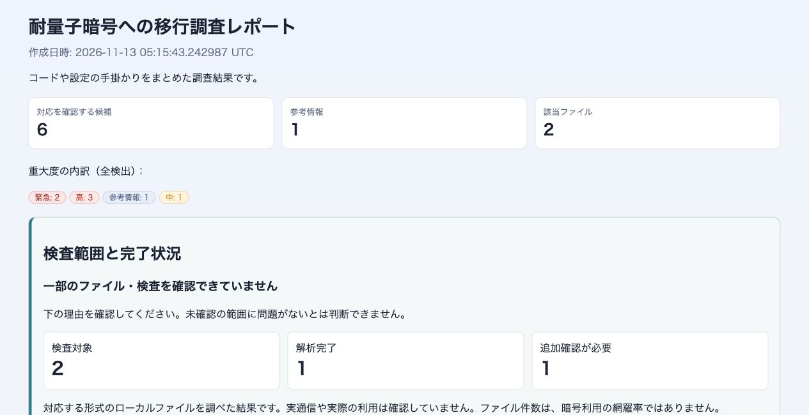

# レポート冒頭の簡素化

ユーザーの追加指示により、上部の位置数・集計定義・一般的な注意書き・操作案内を英日HTML/Markdownから削除します。検出所見、既存の集計カード、検査範囲と完了状況は保持します。過去のtask 062で合意・検証した上部表示要件は、この追加指示で変更されています。過去の測定・レビュー・完了記録はそのまま残します。

AGENTS.mdに生成レポートの利用者向け編集方針を追加し、BEST-PRACTICES.mdから参照します。個別のレビュープロンプトに重複するルールは追加しません。

状態: 完了。指定文言の削除、関連ガイドの同期、表示更新と検証、両レビューの承認を確認しました。

実装レビュアー: `/root/implementation_review`
テストレビュアー: `/root/test_review`
変更ソース: SOURCE.json（前回SOURCE-FINAL.jsonからの変更と関連ガイド）。

## 検証

- [コマンドと終了結果](CHECKS.json): workspaceテスト、fmt、clippy、build、任意機能有効時CLI回帰、Node、diffの全7チェックがexit 0。
- [修正前の失敗](checks/red.log)、[修正後CLI9件の成功](checks/cli.log)。
- [機械出力比較](COMPATIBILITY.json): 英日サンプルのJSONは生成時刻を除き同一。SARIF、CBOM、依存SBOMも同一。
- [ブラウザ確認](BROWSER.json): 指定文言の削除、集計カードと検査状況保持、横方向のはみ出しなし、キーボード展開と読み込み後のオフライン操作を確認。
- [実装レビュー承認](IMPLEMENTATION-REVIEW.md)・[テストレビュー承認](TEST-REVIEW.md)。
- 基準はdevelop 5f552b8と前回のSOURCE-FINAL.json。今回の差分はSOURCE.jsonで固定。コミット・統合は行っていません。

更新済みサンプル: [日本語レポート](http://127.0.0.1:18762/ja/report.html)

