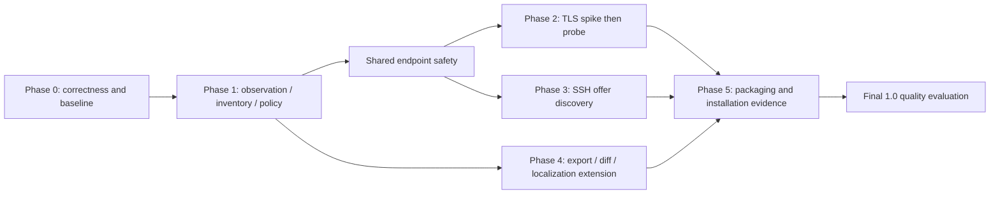

# OSS evolution roadmap

Design date: 2026-11-09. Baseline: `b3104f9a4193b1b21ea11ca060f06301de2e936b`. At plan creation, all 22 new tasks were **pending**. Task YAML records are authoritative for current implementation and validation status. Existing tasks 001-017 remain unchanged; 014 is pending, 016 is review and 017 is done. Explicit user-requested queue creation does not enable the automatic Monitor.

## Implementation checkpoint (2026-11-10)

Latest local code checkpoint: `9201dc5022ea918e1416db7abf710db58a4bd855`.
The isolated task031 study `48fad23` was adopted under explicit delegated
selection in `cae2730`. Runtime TLS/SSH and local packaging are committed separately. Task YAML remains authoritative; design-time statements below describe
the original plan unless updated explicitly.

| Phase | Tasks | Current task state |
|---|---|---|
| 0: correctness and baseline | 018–024, 028, 029 | 018–022, 024, 028, 029 `done`; 023 `review` |
| 1: observations, inventory, assessment | 025–027 | All three `done` |
| 2: target safety and TLS | 030–032 | 030/031 `done`; 032 `blocked` only on human-report browser acceptance |
| 3: SSH advertised discovery | 033 | `blocked` on human-report browser acceptance; source/protocol review accepted |
| 4: standards, comparison and human reports | 034–036 | 034/035 `done`; 036 `blocked` on real-browser acceptance |
| 5: packaging and final quality | 038 then 037 | 038 `blocked` on notice/dependency acceptance after clean local installs; 037 `blocked` on final quality gates, no publication |
| Conditional future negotiation | 039 | `pending`; no concrete negotiated-session use case selected |

See [runtime integration validation](../quality/RUNTIME-INTEGRATION-VALIDATION.md),
[earlier static/transport acceptance](../quality/ROADMAP-CONTINUATION-VALIDATION.md),
[TLS feasibility](../quality/TASK-031-TLS-FEASIBILITY.md) and the
[selected runtime contract](../architecture/RUNTIME-PROBE-IMPLEMENTATION.md).
The current static inventory schema has not been changed to include endpoints.

The task-to-phase assignments agree with the implemented scope and local acceptance records. Phase 0 is **not fully complete**: task 023's reviewed corpus/harness and measurements exist, but maintainer approval of its protocol and measured numeric budget proposal remains outstanding. Later user-requested tasks consumed the reviewed technical baseline and recorded their own comparisons; they did not close 023 or approve its budgets. Dependencies on 023 mean that baseline evidence is needed for those comparisons, while its remaining approval gate stays open. They do not authorize bypassing future probe, policy or release decisions.

The user-facing task 025 artifact is now the **Cryptographic Inventory and Evidence Report** (暗号資産・検出根拠レポート): `--inventory-json` writes `scan.inventory.v1.json`. The old `--native-json` switch was explicitly removed. Internal native type/schema names and historical task plans remain for compatibility/provenance. Current built-in rule count is 119; the 117-rule design baseline predates the certificate-validity additions.

The one-task/one-PR rule below is the default delivery policy. Historical explicit
requests delivered tasks022–027 and CI follow-ups together through PR#14; that
exception does not merge task states or change phase assignments. The continuation
handoff records PR#15 merged at `e7f32bb`, followed by the local-only `3c357ce`
format-support correction. Current continuation commits remain local; no new
combined PR, publication or release is authorized by that history.

See the [task-by-task alignment record](../quality/PHASE-0-1-ALIGNMENT.md), [current README](../../README.md) and [Japanese README](../../README.ja.md). No task status, approved budget or future scope is changed by this documentation checkpoint.

## Principles and dependencies

Retain the five workspace crates and their detectors/rules/report APIs. No existing subsystem replacement is proposed. Changes to rule meaning, storage contracts or high-risk architecture meet AGENTS.md human-review gates before implementation; this plan does not approve such changes.

Read the [vision](../product/PRODUCT-VISION.md), [gap evidence](../quality/CURRENT-GAP-ANALYSIS.md), [architecture](../architecture/NEXT-GEN-ARCHITECTURE.md), [domain model](../architecture/DOMAIN-MODEL.md), [probe design](../architecture/TLS-SSH-PROBE-DESIGN.md) and [quality gates](../quality/QUALITY-GATES.md). YAML files are queue records; this roadmap explains purpose and sequencing. Planning alone never marks an implementation task done.

Size estimates describe relative scope, unknowns and verification burden, not days. The default is **one task, one PR**, including its implementation, tests and documentation. Implementation steps are an ordered sequence within that PR; they do not create separate task records, PRs or lifecycle states. A task is complete only after its whole scope and acceptance criteria are validated.

Keep a feasibility study separate when its evidence is needed to decide whether or how to implement a feature: task 031 precedes TLS implementation in 032, and deferred SSH study 039 does not authorize a negotiated-SSH feature. These are separate tasks with distinct outcomes, each normally delivered in one PR. Do not routinely split API, CLI, tests and documentation into separate PRs.

If actual implementation proves too large or reveals a necessary independent decision, Planner may revise task boundaries before proceeding, documenting the reason, independently reviewable outcomes and dependencies. Do not preallocate A/B/C child tasks or PRs. Conditional steps are evaluated within the selected task; record a justified omission rather than scheduling a second PR automatically.

Task `required_files` identifies existing extension points; `planned_new_paths`, where present, names proposed modules/crates/schemas without creating them. Core modules remain within the existing crate. Only tasks 032/033 propose protocol crates, conditional on their prior gates. Specific corpus/helper filenames can be refined by the selected implementer without changing responsibility or contracts.

Tasks 018, 022 and 023 may start independently. Corrections need not wait for a new inventory model. Phase 1 follows its task prerequisites rather than an indivisible phase barrier. SSH discovery need not wait for TLS implementation. CycloneDX mapping research can start early, while emission depends on normalized provenance. English/Japanese reports already exist; Phase 4 extends them. Completed SSH negotiation is a conditional future study, not a Phase 3 deliverable.

## First implementation PR and completion conditions

Select **task 018 as one PR**: preserve public ScanResult, scan_repository and existing Detector implementations while adding detailed outcomes and typed read/detector failure accounting. Start with regression fixtures that distinguish a failed read/failed detector from successful zero findings and retain another detector's hit. Add accurate counters and unknown applicability; do not claim that a legacy adapter proves completeness. Then expose warnings and opt-in diagnostics/require-complete behavior after the interface decision, with the tests and both READMEs in the same PR.

Completion requires the entire task: detailed API and CLI integration, unchanged legacy schema/ID contracts, failure/empty/partial/counter/exit tests, both READMEs, pinned build/fmt/test/clippy, Reviewer acceptance and Evaluator evidence. Approval of the interface remains a decision gate within this task, not a preplanned separate PR. Remaining parser/cap gaps remain explicitly unknown until their already defined follow-up tasks; default scan exit semantics are retained.

## Phase 0: inspection correctness and quality baseline

Prioritize silent failures/limits, certificate and SARIF correctness, AST occurrence retention, safe evidence and rule validation. Measure accuracy/performance before adopting numeric targets.

### 018: Account for read and detector failures without changing legacy outputs

**Purpose:** Account for read and detector failures without changing legacy outputs.

**Category:** Existing implementation correction; Existing implementation extension. No subsystem replacement.

**Target code:** `crates/pqc_scan_core/src/pipeline.rs`, `crates/pqc_scan_core/src/walker.rs`, `crates/pqc_scan_core/src/lib.rs`, `crates/pqc_scan_core/src/model.rs`, `crates/pqc_scan_cli/src/main.rs`; README.md and README.ja.md when behavior changes.

**Scope:** Add private-field ScanDocument/diagnostic/coverage API and object-safe detect_detailed default adapter; keep legacy wrapper and structs. Aggregate read/detector failures with partial hits, accurate counters and NotReported legacy applicability. Add stderr notice and opt-in diagnostics.json/require-complete behavior after interface review.

**Out of scope:** No new inventory engine, rule changes or default machine-schema changes.

**Dependencies:** None; baseline and role instructions still apply.

**Risks:** Legacy adapters cannot prove completeness; old scanned_files meaning must remain stable.

**Done conditions:** Successful empty inspection differs from errors and partial success. Other detectors' hits survive a failure; old API/output/ID contracts remain valid.

**Verification:** Injected read error and Err Detector plus successful detector; empty/partial/unknown outcomes. Counter reconciliation, legacy golden outputs and CLI exit precedence. Apply the shared quality gates and record executed versus unexecuted evidence.

**Size / unknowns / validation load:** Medium; moderate validation burden.

**Implementation sequence (one PR):** 1. detailed API and failure/counter tests; 2. opt-in CLI diagnostics and both READMEs.

**Decision gate:** Approve additive artifact/CLI names and opt-in exit policy; do not replace legacy storage.

**Queue:** [018-inspection-diagnostics.yaml](../../tasks/018-inspection-diagnostics.yaml).

### 019: Expose detector limits after eligibility filtering

**Purpose:** Expose detector limits after eligibility filtering.

**Category:** Existing implementation correction; Existing implementation extension. No subsystem replacement.

**Target code:** `crates/pqc_scan_detectors/src/regex_detector.rs`, `crates/pqc_scan_detectors/src/tree_sitter_detector.rs`, `crates/pqc_scan_detectors/src/key_detector.rs`, `crates/pqc_scan_core/src/pipeline.rs`; README.md and README.ja.md when behavior changes.

**Scope:** Implement detailed applicability/cap outcomes. Separate examined candidates from accepted hits; apply accepted regex budget after comment filtering and retain a finite work budget.

**Out of scope:** No unbounded scanning or silent default cap increase.

**Dependencies:** 018.

**Risks:** Recovered hits are intentional result changes; exact-cap does not prove omitted matches.

**Done conditions:** Limits preserve partial results and report known truncation or conservative limit-reached status. No false CompleteWithinScope.

**Verification:** 32 comments plus code; 40 eligible hits; nine dummy key markers; exact-cap and cap-plus-one cases. Apply the shared quality gates and record executed versus unexecuted evidence.

**Size / unknowns / validation load:** Small/medium; boundary-case validation.

**Implementation sequence (one PR):** 1. regex budget; 2. AST/key outcomes.

**Decision gate:** Normal role review; document expected result deltas.

**Queue:** [019-bounded-detector-outcomes.yaml](../../tasks/019-bounded-detector-outcomes.yaml).

### 020: Parse certificate and public-key attributes accurately

**Purpose:** Parse certificate and public-key attributes accurately.

**Category:** Existing implementation correction; Existing implementation extension. No subsystem replacement.

**Target code:** `crates/pqc_scan_detectors/src/certificate_detector.rs`, `crates/pqc_scan_core/src/classifier.rs`; README.md and README.ja.md when behavior changes.

**Scope:** Reuse x509-parser/pem with content-based PEM/DER detection including .crt/.cer. Separate signature OID, SPKI type/parameters, RSA modulus bits, EC curve and encoded size. Retain public DER/SPKI fingerprints and object positions; report malformed/unsupported formats; expose narrow parser helpers for later TLS reuse.

**Out of scope:** No private-key decryption, PKCS#12 passwords, signature/chain validation or new PKI framework.

**Dependencies:** 018.

**Risks:** Corrected key evidence changes are intentional; unknown/PQC encodings cannot be treated as RSA.

**Done conditions:** Known public fixtures yield correct semantic sizes and separate signature/subject-key attributes. Bundles retain distinct object identity and unsupported containers have explicit outcomes.

**Verification:** RSA 1024/2048/3072, P-256, Ed25519, unknown/PQC OID, DER extension, malformed and bundle fixtures. Apply the shared quality gates and record executed versus unexecuted evidence.

**Size / unknowns / validation load:** Medium; ASN.1 and fixture review.

**Implementation sequence (one PR):** 1. typed parser/public fixtures; 2. detailed outcomes, object identity and docs.

**Decision gate:** Review corrected cryptographic-attribute specification before implementation.

**Queue:** [020-certificate-attribute-parsing.yaml](../../tasks/020-certificate-attribute-parsing.yaml).

### 021: Correct exact certificate classification and validity assessment

**Purpose:** Correct exact certificate classification and validity assessment.

**Category:** Existing implementation correction. No subsystem replacement.

**Target code:** `rules/default/cert.yml`, `crates/pqc_scan_detectors/src/certificate_detector.rs`, `crates/pqc_scan_core/src/risk.rs`, `docs/rules-reference.md`; README.md and README.ja.md when behavior changes.

**Scope:** Specify exact typed/OID predicates, custom-rule compatibility and expected output deltas. Prevent ECDSA-to-DSA confusion and filename-based key size matches. Review separate quantum/classical classification and fixed-clock validity evaluation; retain old rule IDs/semantics until approved migration.

**Out of scope:** No automatic PQC certificate deployment or blanket severity rewrite.

**Dependencies:** 020 and a reviewed certificate-only baseline before implementation. The user-requested 021 execution captures that focused baseline and old/new truth-unit comparison; the broader cross-language/performance study 023 was not yet implemented when 021 was selected and was not a prerequisite for exact OID/type/time corrections. It is now implemented and in `review` for its remaining approval gate. No product-wide accuracy budget is inferred.

**Risks:** Existing classification/rule meanings change; this requires human review.

**Done conditions:** ECDSA emits no DSA-only finding; RSA size predicates require RSA subject keys. Validity uses parsed timestamps and explicit clock; intended classification deltas are approved.

**Verification:** Filename-spoof, ECDSA/DSA pairs, fixed-clock boundaries and old/new corpus result diff. Apply the shared quality gates and record executed versus unexecuted evidence.

**Size / unknowns / validation load:** Medium; high cryptographic/compatibility review burden.

**Implementation sequence (one PR):** 1. reviewed predicate/classification specification; 2. exact matching; 3. validity and migration docs.

**Decision gate:** The explicit user request to implement 021 authorizes the corrections in its reviewed [concrete specification](TASK-021-IMPLEMENTATION.md). Additional CLI/schema/general scoring or migration-policy changes remain subject to separate human review.

**Queue:** [021-certificate-classification-policy.yaml](../../tasks/021-certificate-classification-policy.yaml).

### 022: Emit valid SARIF for unknown and non-ASCII locations

**Purpose:** Emit valid SARIF for unknown and non-ASCII locations.

**Category:** Existing implementation correction. No subsystem replacement.

**Target code:** `crates/pqc_scan_report/src/sarif_report.rs`, `crates/pqc_scan_detectors/src/dependency_detector.rs`; README.md and README.ja.md when behavior changes.

**Scope:** Omit unknown regions; preserve known artifact locations. Define valid URI encoding and column units. Add offline pinned SARIF 2.1.0 validation and semantic fixtures.

**Out of scope:** No invented line 1 or fake runtime source locations.

**Dependencies:** None; baseline and role instructions still apply.

**Risks:** Consumers may rely on previous invalid locations; document corrected semantics.

**Done conditions:** Schema-valid unknown/Unicode/reserved-character locations with preserved rules/results/IDs.

**Verification:** Writer fixtures, official schema validation and current SARIF contract regression. Apply the shared quality gates and record executed versus unexecuted evidence.

**Size / unknowns / validation load:** Small; schema and Unicode validation.

**Implementation sequence (one PR):** 1. location correction and tests.

**Decision gate:** Normal role review; preserve schema version and document corrected values.

**Queue:** [022-sarif-location-contract.yaml](../../tasks/022-sarif-location-contract.yaml).

### 023: Establish labeled accuracy and reproducibility baselines

**Purpose:** Establish labeled accuracy and reproducibility baselines.

**Category:** Existing implementation extension. No subsystem replacement.

**Target code:** `crates/pqc_scan_detectors/tests/pqc_readiness.rs`, `examples/pqc-readiness/`, `docs/quality/QUALITY-GATES.md`, `.github/workflows/pqc-scan.yml`.

**Scope:** Reuse fixtures/tests and add reviewed truth units, corpus/version/licenses and tuning/holdout split. Measure per-family TP/FP/FN/ambiguity and coverage; before diagnostics exist mark completeness unmeasurable. Measure repeatability, wall/CPU/RSS under recorded environment; propose budgets only after results.

**Out of scope:** No invented targets, private repositories or external endpoints.

**Dependencies:** None; baseline and role instructions still apply.

**Risks:** Corpus bias and template leakage inflate metrics.

**Done conditions:** Reviewed baseline records denominators, unsupported populations, config, environment and versions. Maintainers review measured budgets; rule/test counts are not accuracy.

**Verification:** Independent labeling/adjudication, evaluator sanity fixtures and repeat local measurements. Apply the shared quality gates and record executed versus unexecuted evidence.

**Size / unknowns / validation load:** Medium/high; labeling and measurement dominate.

**Implementation sequence (one PR):** 1. corpus and labels; 2. evaluator/benchmark harness; 3. baseline and budget review.

**Decision gate:** Agree measurement protocol and budgets after measuring; no predetermined percentages.

**Queue:** [023-quality-baseline.yaml](../../tasks/023-quality-baseline.yaml).

### 024: Preserve AST occurrences and characterize grammar limits

**Purpose:** Preserve AST occurrences and characterize grammar limits.

**Category:** Existing implementation correction; Existing implementation extension. No subsystem replacement.

**Target code:** `crates/pqc_scan_detectors/src/tree_sitter_detector.rs`, `crates/pqc_scan_detectors/src/comment_filter.rs`, `crates/pqc_scan_detectors/tests/pqc_readiness.rs`; README.md and README.ja.md when behavior changes.

**Scope:** Distinguish nested duplicate candidates from separate same-line calls using spans/columns. Characterize JS-grammar TypeScript handling, aliases and same-named functions. Add only corpus-justified structural improvements; proper TS grammar requires measured benefit.

**Out of scope:** No whole-program resolver, dataflow engine or tree-sitter rewrite.

**Dependencies:** 023.

**Risks:** Traversal/grammar changes can alter precision, recall and performance.

**Done conditions:** Distinct same-line calls survive without duplicate parent/child hits. Grammar/API limits are measured and documented.

**Verification:** Alias/local-function/string/TS/nested/same-line fixtures, holdout and performance comparison. Apply the shared quality gates and record executed versus unexecuted evidence.

**Size / unknowns / validation load:** Medium; language-specific uncertainty.

**Implementation sequence (one PR):** 1. occurrence correction; 2. measured grammar/API improvements only if justified within this task.

**Decision gate:** Review dependency cost before adding a grammar.

**Queue:** [024-ast-occurrence-fidelity.yaml](../../tasks/024-ast-occurrence-fidelity.yaml).

### 028: Strengthen rule validation and quality provenance compatibly

**Purpose:** Strengthen rule validation and quality provenance compatibly.

**Category:** Existing implementation correction; Existing implementation extension. No subsystem replacement.

**Target code:** `crates/pqc_scan_rules/src/lib.rs`, `rules/default/`, `docs/rules-reference.md`; README.md and README.ja.md when behavior changes.

**Scope:** Report traversal failures; retain regex/duplicate-ID validation. Validate finite bounded confidence and nonempty IDs; inventory custom-scope semantics before tightening. Add companion metadata for standard edition, method limits and positive/negative fixtures. Review all 119 current rules (117 at design time, plus two certificate-validity rules) against a purpose/algorithm/classical/quantum matrix without silently changing detections.

**Out of scope:** No rule DSL, breaking scope rejection or bulk rewrite.

**Dependencies:** 018, 023.

**Risks:** Loose custom packs may depend on current acceptance.

**Done conditions:** Invalid confidence and partial rule loading cannot silently succeed. Built-in/custom corpus preserves compatibility with reviewed warning/migration behavior.

**Verification:** Empty IDs, numeric bounds/nonfinite, traversal injection, regex and legacy/custom scopes. Apply the shared quality gates and record executed versus unexecuted evidence.

**Size / unknowns / validation load:** Small/medium; compatibility review.

**Implementation sequence (one PR):** 1. validation/loader errors; 2. source/fixture quality manifest.

**Decision gate:** Human approval before rejecting existing custom semantics or changing detection patterns.

**Queue:** [028-rule-validation-provenance.yaml](../../tasks/028-rule-validation-provenance.yaml).

### 029: Verify safe evidence collection across all outputs

**Purpose:** Verify safe evidence collection across all outputs.

**Category:** Existing implementation correction; Existing implementation extension. No subsystem replacement.

**Target code:** `crates/pqc_scan_core/src/model.rs`, `crates/pqc_scan_core/src/pipeline.rs`, `crates/pqc_scan_detectors/src/key_detector.rs`, `crates/pqc_scan_report/src/lib.rs`, `crates/pqc_scan_report/tests/`; README.md and README.ja.md when behavior changes.

**Scope:** Trace allowed collection-to-output fields. Add synthetic canaries for key formats, inline secret-like content, metadata/inventory/actions/diagnostics/stderr. Make minimal fixes for demonstrated gaps while preserving technical facts and IDs.

**Out of scope:** No real secrets/private keys, decryption or universal secret-scanning claim.

**Dependencies:** 018, 023.

**Risks:** Heuristic masking can miss formats or erase benign facts; missing checks alone do not prove exploit.

**Done conditions:** Supported canaries never survive output/log paths. Technical facts/IDs stay stable and privacy limitations remain explicit.

**Verification:** All-format canaries, markup/URLs, multilingual fact parity and field provenance review. Apply the shared quality gates and record executed versus unexecuted evidence.

**Size / unknowns / validation load:** Medium; cross-format security validation.

**Implementation sequence (one PR):** 1. data-flow/canaries; 2. demonstrated fixes.

**Decision gate:** Review concrete data flow; do not assert unproven leakage.

**Queue:** [029-evidence-privacy-contract.yaml](../../tasks/029-evidence-privacy-contract.yaml).

## Phase 1: observations, inventory and assessment

Add focused core modules, the versioned Cryptographic Inventory and Evidence Report, and local policy. Separate algorithm definitions, concrete assets, observations and assessments while keeping legacy projections.

### 025: Add observations, normalized inventory and an opt-in inventory report

**Purpose:** Add observations, normalized inventory and the opt-in Cryptographic Inventory and Evidence Report (original task title: native JSON).

**Category:** Existing implementation extension; New feature addition. No subsystem replacement.

**Target code:** `crates/pqc_scan_core/src/model.rs`, `crates/pqc_scan_core/src/pipeline.rs`, `crates/pqc_scan_core/src/lib.rs`, `crates/pqc_scan_detectors/src/`, `crates/pqc_scan_report/src/json_report.rs`, `crates/pqc_scan_cli/src/main.rs`; README.md and README.ja.md when behavior changes.

**Scope:** Add focused core observation/inventory/identity/compat modules with safe evidence and assurance/usage distinctions. Normalize exact algorithms, public cert/SPKI identities and separate source instances. Add versioned length-delimited IDs and legacy-index/ID multimap associations while retaining legacy normalization. Publish the v1 schema and separately selected `scan.inventory.v1.json` via `--inventory-json`, with explicit loss notes. The internal schema remains `schemas/native-scan-v1.schema.json`; the former `scan.native.v1.json` CLI artifact name is historical.

**Out of scope:** No new model/inventory crate, changed default schemas or replacement legacy ID algorithm.

**Dependencies:** 018, 019, 020, 023.

**Risks:** Weak/duplicate anchors and premature API freezing.

**Done conditions:** Algorithm vs instance, certificate vs key and multi-method observations remain distinct. New keys avoid tuple ambiguity/checkout roots; old IDs and machine shapes remain unchanged. Native schema and legacy shadow comparison have reviewed fixtures.

**Verification:** Schema/golden/tolerant-reader, root/line/move/duplicate/public-cert cases and old consumer entrypoints. Apply the shared quality gates and record executed versus unexecuted evidence.

**Size / unknowns / validation load:** Large but incremental; high identity/contract validation.

**Implementation sequence (one PR):** 1. safe observation types; 2. inventory and identity adapters; 3. native schema and explicit CLI.

**Decision gate:** Approve native v1 artifact and identity scope; no default schema replacement.

**Queue:** [025-observation-inventory-native.yaml](../../tasks/025-observation-inventory-native.yaml).

### 026: Separate assessment axes and add explainable local policy

**Purpose:** Separate assessment axes and add explainable local policy.

**Category:** Existing implementation extension; New feature addition. No subsystem replacement.

**Target code:** `crates/pqc_scan_core/src/risk.rs`, `crates/pqc_scan_core/src/recommendation.rs`, `crates/pqc_scan_core/src/model.rs`, `crates/pqc_scan_cli/src/main.rs`, `docs/product/STANDARDS-REGISTER.md`; README.md and README.ja.md when behavior changes.

**Scope:** Add pure assessment/policy functions with quantum/classical/certainty/usage/context/priority/policy separation. Keep construction/standardization separate from exposure, with component/combiner-specific hybrid and parameter-specific symmetric/hash assessments. Version local profiles, provenance and Pass/Fail/Indeterminate/NotApplicable decisions. Attach candidate purpose/status/runtime/provider/peer prerequisites; retain RecommendedAction presentation. Add explicit offline policy evaluation; keep legacy severity unless separately approved.

**Out of scope:** No approval server, remote rules, automatic crypto edits or universal deadlines.

**Dependencies:** 025, 021.

**Risks:** Incomplete context/dependency presence can be mistaken for deployment readiness.

**Done conditions:** Quantum and classical concerns coexist; incomplete scope cannot produce false clean pass. Heuristic confidence stays uncalibrated; JWT/PKI prerequisites remain explicit.

**Verification:** Policy tables, unknown context, incomplete coverage, reproducibility and KEM/signature/JOSE prerequisite cases. Apply the shared quality gates and record executed versus unexecuted evidence.

**Size / unknowns / validation load:** Medium/high; standard/applicability review.

**Implementation sequence (one PR):** 1. assessment/catalog; 2. profiles and policy; 3. explicit CLI and guidance.

**Decision gate:** Human review for changed rule/classification or legacy severity; choose profile applicability.

**Queue:** [026-assessment-local-policy.yaml](../../tasks/026-assessment-local-policy.yaml).

### 027: Distinguish declared dependency constraints from resolved versions

**Purpose:** Distinguish declared dependency constraints from resolved versions.

**Category:** Existing implementation correction; Existing implementation extension. No subsystem replacement.

**Target code:** `crates/pqc_scan_detectors/src/dependency_detector.rs`, `crates/pqc_scan_core/src/pipeline.rs`, `crates/pqc_scan_core/src/model.rs`; README.md and README.ja.md when behavior changes.

**Scope:** Preserve declared constraint, optional resolved version and source provenance. Only assert versioned purl with resolution evidence; retain path/git/workspace unknowns. Keep legacy flat projection and avoid fabricated dependency relationships. Replace internal parse-to-empty fallbacks with typed outcomes for valid zero-dependency input, malformed supported input and unsupported formats; retain partial inventory.

**Out of scope:** No package downloads or universal resolver.

**Dependencies:** 025.

**Risks:** Manifest/lock conflicts and ecosystem identities can merge incorrectly.

**Done conditions:** Manifest ^1.2.3 alone is not asserted as installed 1.2.3 in native inventory. Lock/conflicting origins remain traceable; old array shape retained. Malformed/unsupported input differs from successful empty input and cannot produce false CompleteWithinScope.

**Verification:** Manifest-only/lock/workspace/path/git/ecosystem/malformed fixtures, asserting distinct valid-empty, malformed-supported, unsupported and partial outcomes. Apply the shared quality gates and record executed versus unexecuted evidence.

**Size / unknowns / validation load:** Medium; ecosystem matrix.

**Implementation sequence (one PR):** 1. parser provenance; 2. inventory/purl contract.

**Decision gate:** Review intentional semantic correction and document legacy projection limitations.

**Queue:** [027-dependency-version-provenance.yaml](../../tasks/027-dependency-version-provenance.yaml).

## Phase 2: explicit TLS diagnostics

Implement reviewed endpoint safety, demonstrate pinned API/provider feasibility, then add the optional TLS crate/command. No custom TLS cryptography or implicit networking.

### 030: Implement explicit endpoint policy and bounded probe transport

**Purpose:** Implement explicit endpoint policy and bounded probe transport.

**Category:** New feature addition. No subsystem replacement.

**Target code:** `crates/pqc_scan_core/src/lib.rs`, `crates/pqc_scan_core/src/model.rs`, `crates/pqc_scan_cli/src/main.rs`, `Cargo.toml`; README.md and README.ja.md when behavior changes.

**Scope:** Add concrete target-policy types and finite deadline/attempt/traffic accounting without protocol dependencies. Validate all bounded DNS answers/CIDRs/mapped IPv6; pin SocketAddr and check connected peer; SNI is separate. Prevent proxy/config expansion, re-resolution, redirects and auto-retries.

**Out of scope:** No discovery, bulk targets, management server or auth infrastructure.

**Dependencies:** 025, 029.

**Risks:** DNS rebinding, mixed addresses, uncancelled I/O and aggregate budget bypass.

**Done conditions:** Only validated authorized socket addresses connect. Normal scan never networks; limits/failures produce typed outcomes.

**Verification:** Mock resolver/socket tests and isolated loopback binding/cancellation/budget cases with no egress. Apply the shared quality gates and record executed versus unexecuted evidence.

**Size / unknowns / validation load:** Medium/high; network/platform validation.

**Implementation sequence (one PR):** 1. pure policy/config; 2. bounded transport and isolated tests.

**Decision gate:** Maintainers choose allowlist defaults, reviewed hard caps and explicit command shape.

**Queue:** [030-probe-target-safety.yaml](../../tasks/030-probe-target-safety.yaml).

### 031: Validate TLS API and provider feasibility before selection

**Purpose:** Validate TLS API and provider feasibility before selection.

**Category:** New feature addition. No subsystem replacement.

**Target code:** `docs/architecture/TLS-SSH-PROBE-DESIGN.md`, `Cargo.toml`, `rust-toolchain.toml`.

**Scope:** Use isolated disposable harness to pin rustls/provider/features and build on Rust 1.93.1/selected platforms. Prove actual protocol/suite/group and bounded certificate access with local peers. Record unsupported APIs/groups, verifier limitations, native build cost and static feature isolation. Rust 1.93.1 remains a reference constraint; no unapproved toolchain bump.

**Out of scope:** No public targets, insecure verifier bypass, custom TLS crypto or FIPS claim.

**Dependencies:** 020, 025, 030.

**Risks:** Mutable docs do not prove compiler/MSRV/provider/platform behavior.

**Done conditions:** Reviewed evidence record identifies actual API results and unknowns. Backend choice has explicit supported facts and unsupported outcomes.

**Verification:** Pinned local build matrix; direct group assertion; failed verifier/None and default-static dependencies. Apply the shared quality gates and record executed versus unexecuted evidence.

**Size / unknowns / validation load:** Medium; high uncertainty until spike.

**Implementation sequence (one PR):** 1. isolated feasibility record and dependency decision.

**Decision gate:** Approve backend/features/platforms after spike; no custom TLS fallback.

**Queue:** [031-tls-feasibility.yaml](../../tasks/031-tls-feasibility.yaml).

### 032: Add explicit TLS session diagnostics

**Purpose:** Add explicit TLS session diagnostics.

**Category:** New feature addition; Existing implementation extension. No subsystem replacement.

**Target code:** `Cargo.toml`, `crates/pqc_scan_cli/src/main.rs`, `crates/pqc_scan_report/src/lib.rs`, `crates/pqc_scan_detectors/src/certificate_detector.rs`; README.md and README.ja.md when behavior changes.

**Scope:** Add optional pqc_scan_probe_tls only after feasibility passes. Use fresh verified full handshake, no application data/resumption/0-RTT/client auth/key logging. Record pinned endpoint/profile, actual group/suite/version, certificate facts, assurance and failures. Keep advertised/negotiated/client limitation/unknown distinct; optional profiles share finite total budget.

**Out of scope:** No exhaustive enumeration, old-version custom stack, insecure switch or initial CertificateVerify workaround.

**Dependencies:** 026, 030, 031.

**Risks:** Provider visibility, trust ecosystem and partial certificate limits.

**Done conditions:** Hybrid claim comes from actual group, never TLS 1.3 suite. Single failure never declares server-wide PQC absence; scan remains offline.

**Verification:** Offline HRR/classical/hybrid/trust/name/expiry/unsupported/time/traffic/certificate matrix and zero payload assertion. Apply the shared quality gates and record executed versus unexecuted evidence.

**Size / unknowns / validation load:** Medium/high; protocol/build/identity validation.

**Implementation sequence (one PR):** 1. optional crate/session; 2. CLI/model/assessment; 3. isolated matrix/docs.

**Decision gate:** Backend selection and network defaults must already pass 030/031 decisions.

**Queue:** [032-tls-runtime-probe.yaml](../../tasks/032-tls-runtime-probe.yaml).

## Phase 3: SSH advertised algorithm discovery

Collect bounded unauthenticated KEXINIT offers only. Separate server candidates from completed key exchange and verified host identity.

### 033: Add bounded unauthenticated SSH algorithm discovery

**Purpose:** Add bounded unauthenticated SSH algorithm discovery.

**Category:** New feature addition. No subsystem replacement.

**Target code:** `Cargo.toml`, `crates/pqc_scan_cli/src/main.rs`, `crates/pqc_scan_report/src/lib.rs`; README.md and README.ja.md when behavior changes.

**Scope:** Add optional pqc_scan_probe_ssh with bounded identification/KEXINIT parser/state machine. Preserve ordered remote KEX/host-key candidates, extension markers and exact namespace/status. Stop before KEX execution, service/userauth/channel requests; mark offers unauthenticated.

**Out of scope:** No completed KEX, auth none/password/agent, host verification, commands or system ssh backend.

**Dependencies:** 026, 030.

**Risks:** Malicious framing, split reads, waiting-for-client KEXINIT and deceptive banners.

**Done conditions:** Advertised candidates are never labeled negotiated. Zero service/userauth/channel messages; malformed/limited outcomes are visible.

**Verification:** Parser/fuzz fixtures, local classical/hybrid OpenSSH offers and message-type/resource assertions. Apply the shared quality gates and record executed versus unexecuted evidence.

**Size / unknowns / validation load:** Medium/high; bounded protocol parser review.

**Implementation sequence (one PR):** 1. parser/fixtures; 2. explicit command/transport; 3. isolated interoperability/docs.

**Decision gate:** Review parser scope/caps; full library needs separately justified decision.

**Queue:** [033-ssh-offer-discovery.yaml](../../tasks/033-ssh-offer-discovery.yaml).

## Phase 4: standards export, diffing and localization extension

Add separate standard documents, completeness-aware comparison and new diagnostic copy. Export can precede probes because static inventory supports the initial mapping.

### 034: Add truthful opt-in CycloneDX 1.7 exports

**Purpose:** Add truthful opt-in CycloneDX 1.7 exports.

**Category:** New feature addition; Existing implementation extension. No subsystem replacement.

**Target code:** `crates/pqc_scan_report/src/json_report.rs`, `crates/pqc_scan_report/src/lib.rs`, `crates/pqc_scan_cli/src/main.rs`; README.md and README.ja.md when behavior changes.

**Scope:** Pin official schema/references/samples and license/digests for offline tests. Map separate algorithms/certificates/keys/protocols/software with valid references/provenance. Add separate cbom.cdx-1.7.json/dependency-sbom.cdx-1.7.json opt-in outputs; retain legacy arrays/default all. Record conversion loss and omit unsupported strength/state/certification/resolved-version claims.

**Out of scope:** No secret values, invented graph/CVEs or rebranding legacy arrays.

**Dependencies:** 025, 027, 029.

**Risks:** Schema-valid documents can still have false crypto semantics/dangling refs.

**Done conditions:** Official schemas plus semantic/ref/privacy gates pass. Observed facts only; legacy contracts unchanged; uncertainty/loss explicit.

**Verification:** Offline schema, unique/resolving refs, cert/key/unknown fixtures, semantic golden and consumer compatibility. Apply the shared quality gates and record executed versus unexecuted evidence.

**Size / unknowns / validation load:** Medium/high; standards mapping validation.

**Implementation sequence (one PR):** 1. mapping/schema fixtures; 2. exporters/CLI; 3. semantic/consumer validation.

**Decision gate:** Approve separate filenames/format; never replace old arrays without new migration approval.

**Queue:** [034-cyclonedx-17-export.yaml](../../tasks/034-cyclonedx-17-export.yaml).

### 035: Compare scans with identity and completeness limits

**Purpose:** Compare scans with identity and completeness limits.

**Category:** New feature addition. No subsystem replacement.

**Target code:** `crates/pqc_scan_core/src/model.rs`, `crates/pqc_scan_cli/src/main.rs`, `crates/pqc_scan_report/src/lib.rs`; README.md and README.ja.md when behavior changes.

**Scope:** Compare compatible native documents using exact asset/occurrence keys. Report added/removed/changed/unresolved; move/similarity candidates remain heuristic. Disclose rule/profile/scope drift and prevent resolution claims for uninspected targets.

**Out of scope:** No history DB, automatic rename proof or stable use of legacy ID.

**Dependencies:** 025, 026.

**Risks:** Duplicate anchors/moves/partial scans can mimic progress.

**Done conditions:** Root/line/move/duplicate cases have explicit behavior. Failed/skipped target never becomes resolved solely by absence.

**Verification:** Paired golden scope/identity/coverage/schema-mismatch fixtures and deterministic ordering. Apply the shared quality gates and record executed versus unexecuted evidence.

**Size / unknowns / validation load:** Medium; correspondence/false-resolution validation.

**Implementation sequence (one PR):** 1. exact compare and scope checks; 2. uncertain move correspondence/reporting.

**Decision gate:** Approve explicit repository scope and heuristic matching behavior.

**Queue:** [035-stable-diff-scan.yaml](../../tasks/035-stable-diff-scan.yaml).

### 036: Extend existing bilingual reports for diagnostics and assessments

**Purpose:** Extend existing bilingual reports for diagnostics and assessments.

**Category:** Existing implementation extension. No subsystem replacement.

**Target code:** `crates/pqc_scan_report/src/japanese.rs`, `crates/pqc_scan_report/src/grouping.rs`, `crates/pqc_scan_report/src/compact.rs`, `crates/pqc_scan_report/src/markdown_report.rs`, `crates/pqc_scan_report/tests/japanese.rs`; README.md and README.ja.md when behavior changes.

**Scope:** Reuse current catalogs/renderers/full-payload action sharing. Add completeness/assurance/policy wording with exact fact bindings; runtime sections follow available probes. Use humanizer-jp and optional pinned textlint in development only.

**Out of scope:** No translation service, new UI framework or recreation of tasks 016/017.

**Dependencies:** 025, 026.

**Risks:** Readable prose can strengthen uncertainty into false verified security claims.

**Done conditions:** Both languages retain records, facts, numbers, IDs and custom fallback. Existing compact layout/action association stays intact.

**Verification:** Machine parity, localized fact binding, escaping and real-browser/keyboard/offline acceptance. Apply the shared quality gates and record executed versus unexecuted evidence.

**Size / unknowns / validation load:** Small/medium; language/browser review.

**Implementation sequence (one PR):** 1. diagnostic/catalog parity; 2. runtime sections after probe availability.

**Decision gate:** No runtime LLM; add optional runtime sections only after their feature exists.

**Queue:** [036-diagnostic-localization.yaml](../../tasks/036-diagnostic-localization.yaml).

## Phase 5: OSS 1.0 evidence and distribution preparation

Prepare packaging/security/upgrade and clean-install evidence in 038 before final supported-scope 1.0 evaluation in 037. Numbering does not imply execution order. External publication remains separately authorized.

### 037: Demonstrate supported-scope OSS 1.0 quality

**Purpose:** Demonstrate supported-scope OSS 1.0 quality.

**Category:** Existing implementation extension. No subsystem replacement.

**Target code:** `.github/workflows/pqc-scan.yml`, `crates/`, `docs/quality/QUALITY-GATES.md`; README.md and README.ja.md when behavior changes.

**Scope:** Run agreed holdout/performance/privacy/reproducibility and feature/platform matrix. Publish schema/support/compatibility policies and explicit residual limitations. Record separate unit/browser/protocol/current-HEAD CI evidence.

**Out of scope:** No universal accuracy/compliance guarantee or publication.

**Dependencies:** 019, 021, 022, 024, 026, 027, 028, 029, 032, 033, 034, 035, 036, 038.

**Risks:** Unmeasured regressions and unbounded support claims.

**Done conditions:** Agreed measured budgets pass or maintainers explicitly revise release scope. No supported-path silent failure; schemas/privacy/reproducibility gates pass.

**Verification:** Pinned build/fmt/test/clippy, Node/browser, offline schemas, corpus, isolated protocols, clean platforms and independent evaluation. Apply the shared quality gates and record executed versus unexecuted evidence.

**Size / unknowns / validation load:** High validation load; integration, not redesign.

**Implementation sequence (one PR):** 1. CI matrix/gates; 2. release-candidate evidence/support contract.

**Decision gate:** Maintainers approve baseline-derived budgets and release scope.

**Queue:** [037-oss-10-quality.yaml](../../tasks/037-oss-10-quality.yaml).

### 038: Prepare reproducible OSS packaging and operating documentation

**Purpose:** Prepare reproducible OSS packaging and operating documentation.

**Category:** Existing implementation extension; New feature addition. No subsystem replacement.

**Target code:** `Cargo.toml`, `crates/pqc_scan_cli/Cargo.toml`, `.github/workflows/`, `docs/`; README.md and README.ja.md when behavior changes.

**Scope:** Inventory actual external release channels before packaging decisions. Define supported OS/arch, rule asset installation/discovery and optional probe variants. Prepare artifact hashes/license/security/update/release workflow and reproducibility evidence. Update both READMEs for install/upgrade/authorization/offline use; publication is separate.

**Out of scope:** No push, package publication, signing credential setup or hosted service.

**Dependencies:** 028, 029, 032, 033, 034, 035, 036.

**Risks:** Missing rule assets and native platform differences; supply-chain claims need evidence.

**Done conditions:** Clean installation finds reviewed rules and operates offline. Packaging/provenance plan is reviewable; publication is not implied.

**Verification:** Clean installs/rule discovery on declared platforms; license/hash/build checks and bilingual doc acceptance. Apply the shared quality gates and record executed versus unexecuted evidence.

**Size / unknowns / validation load:** Medium/high; packaging/platform unknowns.

**Implementation sequence (one PR):** 1. release inventory/decision; 2. install/rule assets; 3. security/release/upgrade docs.

**Decision gate:** Choose channels/support window; external publication requires separate authorization.

**Queue:** [038-oss-distribution-docs.yaml](../../tasks/038-oss-distribution-docs.yaml).

## Future: conditional SSH negotiation and enterprise consumers

Do not prebuild platform infrastructure. Enterprise aggregation, ownership, RBAC/SSO, audit/approval and dashboards remain outside the engine. Task 039 is optional and adds no dependency to the initial SSH release.

### 039: Evaluate completed SSH KEX without authentication as a future option

**Purpose:** Evaluate completed SSH KEX without authentication as a future option.

**Category:** New feature addition. No subsystem replacement.

**Target code:** `docs/architecture/TLS-SSH-PROBE-DESIGN.md`, `docs/roadmap/OSS-ROADMAP.md`.

**Scope:** Only if a concrete use case is selected, compare russh/ssh2 in isolated local harnesses. Prove completed KEX, verified host signature with trusted pins/known-host input and zero service/userauth/channel requests. Record public API/algorithm/provider/build limits; propose separate implementation if justified.

**Out of scope:** No shipped negotiated mode, credentials or homegrown cryptography.

**Dependencies:** 033.

**Risks:** Libraries may hide offers or automatically send auth-related service requests.

**Done conditions:** Accept/reject candidates with evidence and explicit unknowns; offers stay advertised.

**Verification:** Sanitized message-type record, local trusted-host positive/negative cases and source/API review. Apply the shared quality gates and record executed versus unexecuted evidence.

**Size / unknowns / validation load:** Unknown until selected; deliberately deferred.

**Implementation sequence (one PR):** 1. conditional investigation only.

**Decision gate:** No Phase 3 dependency; maintainers must justify negotiated-session use case first.

**Queue:** [039-ssh-negotiation-feasibility.yaml](../../tasks/039-ssh-negotiation-feasibility.yaml).

## Decisions and remaining uncertainty

Approved/selected decisions for CLI/output, address limits, TLS backend, runtime scope and local distribution are recorded in [CONTINUATION-DECISIONS.md](CONTINUATION-DECISIONS.md). Measured 1.0 regression budgets, final release acceptance and any external publication remain unapproved; untested platform/support claims are not added.

No inventory/assessment crate extraction is scheduled. A real independent consumer and an acyclic type-ownership design are prerequisites for revisiting it. Full negotiated SSH requires task 039 evidence and a new implementation decision. No platform DB, web server, queues or plugin ABI is approved.

Independent design review must challenge duplicated functionality, early abstractions, hidden schema/ID changes, unsupported capability claims, dependency cycles and untestable acceptance. Unexecuted implementation checks remain unexecuted.

## Local acceptance checkpoint — 2026-11-11

This checkpoint supersedes earlier browser/notice blockers. Source `75b9afd` and
source-bound evidence in [REMAINING-ROADMAP-VALIDATION.md](../quality/REMAINING-ROADMAP-VALIDATION.md)
passed one implementation review and one separate test-adequacy review. Actual
loopback HTTP browser checks now cover both languages and static/TLS/SSH pages;
032,033,036 are done. 038 technical preparation is done: both local macOS arm64
variants repeat byte-identically and clean-install offline. Static missing notice
sets were completed; four combined-variant upstream license statements still
require publication review and do not constitute legal clearance.

037 remains blocked on approved budgets/1.0 support scope and actual current-HEAD
hosted CI. The concrete existing-baseline proposal and measurements are in the
validation document; no approval is inferred from silence. 039 remains conditional
pending, without a selected completed-KEX consumer. No push, publication, signing
or stable multi-platform support claim was made.

## Maintainer acceptance decision — 2026-11-11

The maintainer explicitly approved the proposed regression signals and 1.0 scope.
For unchanged eligible truth, per split/family TP must not decrease and FP/FN must
not increase. On the same host/profile/config/input, wall time or peak RSS above
twice the previous observed warm maximum requires investigation. Existing local
measurements are within these signals; this does not establish a universal accuracy
or performance guarantee or silently enable threshold enforcement in CI.

Approved scope: static scanning is the formal 1.0 target; TLS/SSH probes remain
experimental; local distribution validation covers macOS arm64. This approval
supersedes the earlier pending-budget/scope statements, without declaring 1.0
released or promising other platforms. 037 remains blocked on successful hosted
CI for the actual target commit. Four combined-probes notice reviews remain
publication prerequisites. Push, publication and signing were not authorized.

## Task039 feasibility checkpoint — 2026-11-11

The maintainer selected actual hybrid KEX plus trusted-host verification without
user authentication/login. The previous conditional-use-case deferral is
superseded by the [task039 study](../quality/TASK-039-SSH-KEX-FEASIBILITY.md).
russh0.65.1/AWS-LC with a separately provisioned public host-key pin is the selected
future backend shape, based on isolated positive/negative cases. This is a study
outcome, not a shipped negotiated SSH feature; the current probe still reports
unauthenticated advertisements. Host certificate/known-host rules, safety-budget
integration and platform/adversarial coverage remain future implementation work.

## Task039 product follow-up — 2026-11-11

Explicit maintainer authorization extended039 from feasibility to product integration.
Experimental `probe ssh-kex` now verifies fixed hybrid KEX against an explicit
trusted Ed25519 public host-key pin, with no user authentication/login. The new
mode is optional and its reports are separate; existing SSH offer collection and
static scans retain their behavior. Both required independent reviews and local
protocol/browser gates passed. See [product validation](../quality/SSH-KEX-PRODUCT-VALIDATION.md).
037's actual target-commit hosted-CI gate remains unfulfilled; the prior1.0 scope
keeps probes experimental. Existing distribution artifacts predate the new mode.
