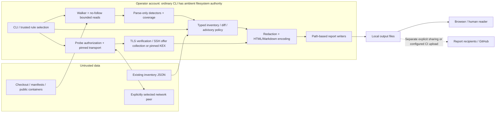

# pqc-scan リポジトリの脅威モデル

## 1. 概要

2026-11-17（Asia/Tokyo）時点の作業ツリーを対象に作成した。ソースを根拠に、構成とセキュリティ上の境界をまとめた再利用用の文書である。新たな脆弱性スキャンや、全ソースの監査完了を意味するものではない。

対象の HEAD は `f07d782cd68cfac95d93585d5ace049f590160d4`。既存の追跡済み・未追跡の変更を含む。作業ツリーのダイジェストは前回の Codex Security スキャンと一致しており、正確な識別値は末尾に記載した。リポジトリの指示で調査の委任が禁止されているため、構成の確認はメインエージェントが順に実施した。別の担当者による独立レビューは受けていない。

### 製品と実行形態

pqc-scan は、暗号の利用箇所と耐量子暗号（PQC）への移行リスクを調べる Rust 製 CLI である。ローカルのルールと選択したファイルを読み、コードを実行せずに解析する。検出結果を正規化し、必要に応じて型付きの観測記録や評価を加え、ローカルへレポートを出力する。アプリケーションの移行そのものは行わず、暗号が実行時に使われていることも証明しない。既定の検出器は tree-sitter、正規表現、依存関係、証明書、秘密鍵マーカーの5種類である（`crates/pqc_scan_detectors/src/lib.rs:17-24`）。

CLI の既定ビルドでは、追加の feature は有効になっていない。TLS 診断、SSH の提示情報収集、SSH ハイブリッド鍵交換の検証は、それぞれ対応する feature を有効にして明示実行する。検査対象の URL や証明書をきっかけに自動実行する処理ではない（`crates/pqc_scan_cli/Cargo.toml:8-14`、`crates/pqc_scan_cli/src/main.rs:39-58`、`crates/pqc_scan_cli/src/probe_command.rs:77-141`）。

公開ライブラリの呼び出し側は、設定や検出器の実装を選べる。そのため、CLI の既定のファイルサイズ上限や検出上限が、すべてのライブラリ呼び出しにも適用されるとは限らない。独自の Rust 検出器は呼び出し側と同じ権限で動き、信頼できないプラグインを隔離するサンドボックスは設けていない（`crates/pqc_scan_core/src/model.rs:9-23`、`crates/pqc_scan_core/src/pipeline.rs:19-34`）。

| 構成要素 | 担当する処理と保護対象へのアクセス | 根拠 |
|---|---|---|
| CLI | 明示されたコマンドを解釈し、検査ルート、ルール、出力先、インベントリ、評価ポリシー、終了条件を選ぶ | `crates/pqc_scan_cli/src/main.rs:74-127`, `crates/pqc_scan_cli/src/main.rs:307-409` |
| ファイル走査と安全な読み込み | 検査対象を選び、入力ファイルと引用用のソースを読み込む | `crates/pqc_scan_core/src/walker.rs:36-51`, `crates/pqc_scan_core/src/safe_read.rs:6-134` |
| スキャン処理 | ファイル単位で並列解析し、失敗の集計、検出結果の正規化、秘密情報の位置との対応付けを行う | `crates/pqc_scan_core/src/pipeline.rs:73-156`, `crates/pqc_scan_core/src/pipeline.rs:286-414` |
| ルール | ローカルの YAML を読み、正規表現をコンパイルし、ID の重複を拒否する | `crates/pqc_scan_rules/src/lib.rs:123-137`, `crates/pqc_scan_rules/src/lib.rs:155-193` |
| 検出器 | 信頼できないソース、依存関係定義、SBOM、公開証明書やコンテナの構造を解析する | `crates/pqc_scan_detectors/src/tree_sitter_detector.rs:610-665`, `crates/pqc_scan_detectors/src/dependency_detector/decode.rs:173-206`, `crates/pqc_scan_detectors/src/certificate_detector/pkcs12.rs:1-96` |
| ネイティブインベントリ・差分・ポリシー | 上限付きの型付き情報を保存し、既存インベントリの取り込み、スコープ比較、助言用ポリシーの評価を行う | `crates/pqc_scan_core/src/inventory.rs:429-461`, `crates/pqc_scan_core/src/diff.rs:81-159`, `crates/pqc_scan_core/src/policy.rs:293-331` |
| レポート | JSON、SARIF、CycloneDX を直列化し、HTML／Markdown を生成して出力先へ書き込む | `crates/pqc_scan_report/src/lib.rs:115-194`, `crates/pqc_scan_report/src/compact.rs:390-439` |
| 任意のネットワーク診断 | 接続先を許可・固定し、通信量を制限する。TLS の接続相手や、明示された SSH ホスト鍵を検証する | `crates/pqc_scan_core/src/target_policy.rs:181-219`, `crates/pqc_scan_core/src/probe_transport.rs:22-67`, `crates/pqc_scan_probe_ssh/src/negotiated.rs:238-299` |
| CI とパッケージ作成 | 信頼するソースをビルドして成果物を生成・アップロードし、上限を設けたアーカイブと静的版候補のビルド来歴を用意する | `.github/workflows/pqc-scan.yml:212-263`, `.github/workflows/release.yml:1-65`, `scripts/package-release.py:52-133` |
| 開発用の隔離環境 | 選んだソースを使い捨ての制限付きコンテナへコピーし、持ち出す成果物を検査する | `tests/protocol/container_runner.py:36-108`, `tests/protocol/container_runner.py:117-145`, `tests/protocol/container_runner.py:189-213` |

図の区切りはデータの信頼境界を表す。Rust のクレートごとにプロセスを隔離しているわけではなく、通常の CLI とライブラリは実行アカウントの権限を共有する。Docker による隔離は開発用テストの仕組みであり、すべての `pqc-scan scan` に適用されるものではない。

### 実際に使う入出力先と権限

以下のパスは、作業ディレクトリ（CWD）を基準とする CLI の既定値、または利用者が選ぶパスを表す。認証情報の実値は記載していない。

| 実行形態・ワークフロー | 対象とする資源・操作 | 設定と優先順位 | 実際の値・場所 | 読み手・書き手・受領者 | 制御 | 根拠・未確認事項 |
|---|---|---|---|---|---|---|
| 静的 CLI | リポジトリファイルの読み込み | 位置引数で検査ルートを指定。CLI のサイズ上限は固定 | 明示したルート配下で選択された通常ファイル。CLI 入力は1ファイルあたり最大2 MiB | スキャナーが読み、ホストのファイルシステムが内容を渡す | ignore 設定を反映した選択、読み込み量の上限、Unix で保持したディレクトリからの `openat` と `O_NOFOLLOW`、通常ファイルの確認 | `crates/pqc_scan_cli/src/main.rs:330-350`、`crates/pqc_scan_core/src/safe_read.rs:6-82` |
| Windows のリポジトリ読み込み | ファイルハンドルの解決 | 選択したルートを正規化し、再解析ポイント用フラグで開く | 開いた通常ファイルの最終ハンドルパスが、正規化したルート配下に収まる | スキャナー | 親要素のリンクを事前確認し、最終ハンドルパスの包含関係を調べる | `crates/pqc_scan_core/src/safe_read.rs:79-134`。今回の調査では Windows 上で実行していない |
| 静的 CLI | 検査ルール | `--rules-dir` の指定が `./rules` に優先する | 選んだローカルルールディレクトリ内の YAML。ローダーは既定ルールの階層もたどる | 利用者がルールを選び、ローダーが読む | スキーマと列挙値の検証、正規表現のコンパイルサイズ上限、ID の一意性 | `crates/pqc_scan_cli/src/main.rs:89-93`、`crates/pqc_scan_rules/src/lib.rs:123-193`。ルールファイルの読み込みには明示的なバイト上限がない |
| Maven の文脈 | 親 POM の読み込み | relativePath の宣言値、または既定の親パスを使用。読み込み済みの選択対象に限る | ルート内に正規化した親ファイル。参照の段数と合計バイト数に上限がある | 依存関係検出器が RepositoryContext を通じて読む | Maven の実行・取得は行わない。選択対象との一致、ルート内への制限、安全な読み込み、16階層／8 MiB の上限 | `crates/pqc_scan_core/src/repository_context.rs:36-46`、`crates/pqc_scan_detectors/src/dependency_detector/maven_context.rs:81-125` |
| 静的レポート | 出力ファイルの書き込み | `--out-dir` の指定が `./pqc-report` に優先。形式の既定値は all | `OUT/report.{json,html,md,sarif}` と CBOM・依存関係 SBOM。インベントリ、診断、評価、CycloneDX は明示選択した名前で出力 | スキャナーが書き、利用者と後の共有先が読む | 内容のマスキングとエスケープ。ファイルは通常のパス指定で書き込む | `crates/pqc_scan_cli/src/main.rs:78-93`、`crates/pqc_scan_report/src/lib.rs:21-61`、`crates/pqc_scan_report/src/lib.rs:132-194`。出力先リンクの追跡は、確認済みで未修正の問題 |
| 比較 CLI | 既存インベントリの読み込みと差分出力 | 2つの入力パス、リポジトリスコープ、出力先を明示指定 | 入力は最大16 MiB。出力は `OUT/scan.diff.v1.{json,md}` | 取り込み用パーサーとローカルレポートの閲覧者 | スキーマ、参照、パス、スコープを検証。Markdown の要約は固定文。出力には通常の書き込みを使う | `crates/pqc_scan_cli/src/diff_command.rs:8-35`、`crates/pqc_scan_core/src/diff.rs:81-159` |
| 助言用ポリシーの CLI | 利用者が与える文脈 | 評価プロファイルを明示選択し、必要に応じて文脈ファイルを指定 | 上限付きの v1 列挙値・真偽値 JSON。対応状況は利用者の未検証の申告として扱う | ローカルのポリシー評価器 | 文脈は最大16 KiB。型付きでデシリアライズし、スクリプトや式は評価しない | `crates/pqc_scan_cli/src/main.rs:312-327`、`crates/pqc_scan_core/src/policy.rs:97-106` |
| 診断時の DNS | 名前解決プロセス | 明示・正規化したホスト名。実行中のバイナリをホスト環境から取得 | 同じバイナリの非表示コマンド `__resolve-host`。環境変数を消去し、標準入力・標準エラーを無効化。標準出力はパイプで受け、量を制限 | CLI の親子プロセスとシステムの DNS リゾルバー | 引数配列、期限・キャンセル、強制終了と子プロセス回収、応答数・出力量の上限 | `crates/pqc_scan_cli/src/probe_resolver.rs:18-61`、`crates/pqc_scan_cli/src/probe_resolver.rs:77-132` |
| 診断の通信処理 | 外向き TCP 接続 | ホストとポートを明示指定。allow-cidr で、通常は拒否する特殊な範囲を追加許可できる | 検査済みの数値アドレス1つ。重複を除いた許可済み DNS 応答の先頭を使い、接続先を再試行しない | 選択した接続相手のみ。DNS リゾルバーには要求した名前が伝わる | 応答に1つでも未許可アドレスがあれば拒否。上限管理と結び付けた非公開の AuthorizedTarget、数値アドレスへの接続、相手アドレスの一致確認 | `crates/pqc_scan_core/src/target_policy.rs:181-219`、`crates/pqc_scan_core/src/target_policy.rs:265-309`、`crates/pqc_scan_core/src/probe_transport.rs:22-67` |
| TLS 診断 | TLS の信頼元と検証名 | 既定の検証名は接続先ホスト。server-name で変更できる。ca-file は同梱ルート証明書を置き換える | 同梱の Mozilla ルート証明書、または選択したローカル CA ファイル内の最大16件・256 KiB の公開 PEM 証明書。秘密の認証情報は扱わない | TLS 検証器。DNS 名を使う場合、相手に SNI が伝わる | rustls によるチェーン・名前・時刻の検証。セッション再開、early data、鍵ログ、クライアント認証は使わない | `crates/pqc_scan_cli/src/probe_command.rs:80-103`、`crates/pqc_scan_probe_tls/src/runtime.rs:49-125`、`crates/pqc_scan_probe_tls/src/runtime.rs:362-397` |
| SSH の提示情報診断 | 相手が提示するアルゴリズムの収集 | `probe ssh` を明示実行 | 未認証のバナーと提示情報。ユーザーの識別情報は扱わない | 選択した SSH 接続先とレポートの閲覧者 | フレーム、リスト、バナーに上限を設け、未認証の申告として記録する | `crates/pqc_scan_probe_ssh/src/runtime.rs:51-108`、`crates/pqc_scan_probe_ssh/src/parser.rs:32-130` |
| SSH ハイブリッド鍵交換 | 接続先の認証 | 別途用意した host-key-file の指定が必須 | OpenSSH 形式の Ed25519 公開鍵1つ、最大4096バイト。鍵交換は ML-KEM768+X25519 に固定 | russh の検証ハンドラーとレポートの閲覧者 | 公開鍵データの完全一致、ライブラリの署名検証経路、初回鍵交換1回、ログイン前の切断 | `crates/pqc_scan_probe_ssh/src/negotiated.rs:63-99`、`crates/pqc_scan_probe_ssh/src/negotiated.rs:238-299` |
| 診断レポート | ローカルへの書き込み | out-dir の明示指定がコマンドごとの既定値に優先する | `./pqc-probe/tls`、`./pqc-probe/ssh`、`./pqc-probe/ssh-kex`。各ディレクトリにプロトコル別 JSON と report.html/report.md を出力 | CLI が書き、利用者と共有先が接続先のメタデータを読む | レポートの基本構造を検証し、値を再帰的にマスキング。出力には通常のパス指定を使う | `crates/pqc_scan_cli/src/probe_command.rs:59-74`、`crates/pqc_scan_cli/src/probe_command.rs:103-141`、`crates/pqc_scan_report/src/probe_report.rs:14-75` |
| リポジトリ自身の検査 CI | GitHub へ結果を送る権限 | develop への push または手動の scan ジョブ。PR の quality ジョブとは別 | contents:read と security-events:write。元の SARIF、公開用 SARIF、監査記録、依存関係 SBOM を設定済みの GitHub 送信先へアップロード | ランナー上のコード、GitHub Code Scanning と成果物の受領者 | アクションを固定し、結果の除外をファイル・結果のダイジェストと件数に結び付ける | `.github/workflows/pqc-scan.yml:212-263`、`shell/prepare-code-scanning.cjs:88-132`。成果物の実際のアクセス権は未確認 |
| 配布物準備の CI | ビルドと来歴証明の権限 | 手動ワークフローのみ。prepare ジョブに id-token と attestations の権限を付与 | 静的版 tarball は `target/task-038/static-first`、ネットワーク版候補は network-first。GH_TOKEN は検証ステップ内だけで github.token を参照 | 信頼するランナーとアクション、GitHub の来歴証明・成果物サービス | チェックアウトの認証情報を保持しない。静的アーカイブのリポジトリ、ワークフロー、ソースダイジェストを照合。リリース公開処理はない | `.github/workflows/release.yml:1-65`。このファイルにはネットワーク版アーカイブに対応する来歴証明ステップがない |
| ローカルのパッケージ作成・導入確認 | アーカイブの内容と指定バイナリ | 信頼する source-root と呼び出し側が渡すバイナリを使い、variant と出力先を明示指定。check-install は別処理 | 静的版／ネットワーク版の準備済みアーカイブ、チェックサム、来歴情報。一時ディレクトリへ展開した導入用ツリー | パッケージ作成スクリプト。導入確認では指定バイナリを明示実行 | 正規化した USTAR の部分形式、通常ファイル限定、メンバー数・展開後サイズの上限。一時展開に data フィルターを使い、導入確認は macOS の通信禁止サンドボックス内で実行 | `scripts/package-release.py:52-133`、`scripts/package-release.py:251-332`、`tests/distribution/check-install.py:20-42`。パッケージ作成だけではバイナリとソースの一致を証明しない |
| 開発用コンテナ | ソース、キャッシュ、作業領域、持ち出す成果物 | 既存の不変なローカルイメージ ID を使い、選んだソースを使い捨てツリーへコピー | `/source` とコンテナのルートは読み取り専用。`/scratch` は書き込み可能で容量に上限がある。ホストの Docker ソケットをマウントする宣言はない | 非特権のコンテナユーザー。ホスト側の回収処理が上限付きで成果物を読む | network none、capability の削除、no-new-privileges、資源上限、マウントの確認。ソースのリンク非追跡と通常ファイルだけの回収 | `tests/protocol/container_runner.py:36-108`、`tests/protocol/container_runner.py:117-145`、`tests/protocol/container_runner.py:189-213`。ホストのカーネルとコンテナエンジンは信頼する前提 |

出力先は検査ルートとは別に解決する。入力をルート内に限定しても、出力先は保護されない。また、静的スキャンがオフラインで動くことと、別に設定した CI アップロードや明示的なネットワーク診断は両立する。README もこの違いを説明しており、上のワークフローには実際のアップロード処理がある（`README.md:13-19`）。

## 2. 保護対象、信頼境界、前提

### 保護する資産と守るべき条件

- ホストの秘密情報とファイルの完全性を守る。検査対象が制御するパスを通じて、想定外の場所を読んだり破壊的に書き換えたりしてはならない。明示的な検査ルート、信頼するポリシーファイル、公開の信頼情報を選ぶ権限は利用者にある。
- 非公開ソースと認証情報を守る。対応する秘密鍵・認証情報が、検出根拠、プレビュー、メタデータ、レポートの直列化を通じて漏れないようにする。マスキング後も、ソースの位置、識別子、接続先のメタデータは機微な情報になり得る。
- 評価の正確さを守る。検出結果、検査範囲、ID、インベントリ間の対応、ポリシーの出所は、実際の観測に即して記録する。未検出、解析失敗、比較後の記録欠落、利用者による対応状況の申告を、安全性の証拠に変えてはならない。
- 検査と診断を停止不能にしない。悪意ある入力や接続先にも、解析、読み込み、通信量、期限、収集件数の上限を適用する。ただし、ファイル単位の上限だけで、リポジトリ全体のメモリ量や処理時間は保証できない。
- 診断先の許可と本人性を確かめる。実際に接続する数値アドレスを許可判定し、未認証の提示情報と、暗号学的に検証した接続相手・合意済みパラメーターを区別する。
- ビルドと配布物の信頼性を守る。信頼できないコード・データとビルド権限、アーカイブの完全性と真正性、準備済み候補と公開済み・独立再現済みバイナリを、それぞれ区別する。

秘密情報の保護範囲は文書で限定している。未知・難読化された構文、任意の認証情報名、複数行にまたがる認証情報の位置追跡、秘密を含む構造フィールドは保証の対象外である。ここで守るのは、その明示された範囲の処理であり、あらゆる秘密情報の除去を約束するものではない（`docs/user/COVERAGE.md:190-198`）。

### 関係者と当初の権限

| 関係者 | 当初から制御できるもの | 持っているとは仮定しない権限 | 境界が破れた場合に得る能力 |
|---|---|---|---|
| チェックアウトの提供者・変更者 | リポジトリの内容、ファイル名、ignore ファイル、依存関係定義、公開コンテナ、チェックアウトに保持されるシンボリックリンク | 利用者が信頼する外部ルール、ホーム内のファイル、CLI 引数、ホストアカウント | ホストデータの読み取り・破壊、レポート経由の保護情報の流出、スキャナーや CI の資源枯渇 |
| インベントリの提供者 | 利用者が明示的に取り込むインベントリの内容 | 利用者の本人性、スコープの選択、出力先 | 比較結果を誤らせる、後続の表示へデータを注入する、解析資源を消費する |
| ネットワークの接続相手・悪意ある DNS 応答の提供者 | プロトコル上の応答、または明示的に名前解決したホストの DNS 応答 | 診断の任意実行、信頼する CA、信頼する SSH 公開鍵 | 外向き接続の転送、検証済みの相手へのなりすまし、診断資源の枯渇、レポート内容の汚染 |
| レポートの閲覧者・共有先 | 成果物を受け取る、またはブラウザーで開く | スキャナーの実行権限、すべての非公開ソースへのアクセス | 漏れた機微情報の取得、エスケープ不備がある場合の能動的なマークアップの受領 |
| PR の作成者 | CI イベントでテストする変更案 | develop へのマージ、手動リリースの実行、追加の GitHub 権限 | 実際のイベントとランナーの権限を超える取得だけを問題として数える。テストジョブが提案コードを実行すること自体は想定内 |
| 依存パッケージ・アクションの配布者 | 許可されたビルドが取得する依存関係やアクションの内容 | 任意の本番認証情報、リリースの所有権 | 完全性確認、版の固定、ランナーの制御が破れた場合のビルド権限や来歴証明の侵害 |
| 利用者・保守担当者 | 検査ルート、ルール、allow-cidr、TLS の検証名・CA、SSH 公開鍵、出力先、承認した共有 | 実装にないテナントやリモートアプリケーションの本人性は想定しない | 許可する処理を定める。信頼する設定の選択ミスが、そのままスキャナーの脆弱性になるわけではない |

対象はローカル CLI であり、認証付きのネットワークサービスではない。このモデルでは、コード上にないテナント・セッション境界、HTTP API、遠隔ジョブ受付サービスを想定しない。外部サーバーから CLI を呼び出すなら、そのサーバー側で認可、ファイルシステムの隔離、同時実行、レポートへのアクセスを設計する必要がある。ここでは、そうした仕組みがあるとは仮定していない。

### 信頼境界と不変条件

| 境界 | 守るべき条件 | 確認した仕組みと限界 |
|---|---|---|
| チェックアウト → ファイルハンドル | 意図した通常ファイルだけを上限内で読み、ツリー内の別名参照から外へ出ない | Unix では通常名以外の相対パス要素を拒否し、ディレクトリ FD を保持する。明示したルート自体はリンクでもよい。Windows では最終ハンドルのパスを確認し、それ以外のプラットフォームは未対応として失敗する（`crates/pqc_scan_core/src/safe_read.rs:6-134`）。 |
| 選択したファイル → 解析・検出根拠 | ソースの実行、モジュール取得、テンプレート評価をせずに解析し、未完了の状態を保持する | 既定検出器の登録、解析専用の構文木作成、上限付きの値デコード、選択対象内の親ファイル読み込みを使う。tree-sitter やネイティブ依存関係の内部実装は信頼する側に含まれる（`crates/pqc_scan_detectors/src/lib.rs:17-24`、`crates/pqc_scan_detectors/src/tree_sitter_detector.rs:610-665`、`crates/pqc_scan_detectors/src/dependency_detector/decode.rs:19-32`）。 |
| ローカルのポリシー → 解析 | 選択されたポリシーを使い、攻撃者が選んだルールを独立した信頼できる根拠として扱わない | 外部ルールディレクトリは利用者の入力。YAML の定義検証、正規表現のコンパイル、ID 重複の拒否を行うが、上限付きの検査入力とは別の境界である（`crates/pqc_scan_rules/src/lib.rs:155-193`）。 |
| 生のソース → 出力する検出根拠 | 対応する機微情報を一貫してマスキングし、構造フィールドには文書化した限界を適用する | ソースの秘密情報の位置と検出結果を対応付け、出力時にも無害化する。ネイティブインベントリには生の一致文字列、引用、任意メタデータを含めない（`crates/pqc_scan_core/src/pipeline.rs:208-229`、`crates/pqc_scan_core/src/privacy.rs:169-241`、`crates/pqc_scan_core/src/inventory.rs:447-461`）。 |
| 検出結果 → ブラウザー・Markdown | 信頼できない値を、動くコンテンツではなく文字列やコードとして表示する | HTML では両方の引用符をエスケープし、Markdown では特殊文字と改行を処理する。参照リンクは HTTP(S) だけを生成し、UI は textContent を使う（`crates/pqc_scan_report/src/japanese.rs:205-224`、`crates/pqc_scan_report/src/compact.rs:390-439`、`crates/pqc_scan_report/src/compact.js:23-47`）。 |
| 表示用データ → 出力先のファイルシステム | 既存リンクや置き換え競合があっても、意図した出力権限の範囲で同じ出力先を扱う | 確認済みの欠落がある。create_dir_all と std::fs::write は通常のパス解決を使い、リンク非追跡や保持したディレクトリによる出力保護がない（`crates/pqc_scan_report/src/lib.rs:132-148`、`crates/pqc_scan_report/src/json_report.rs:20-24`）。 |
| 取り込んだインベントリ → 比較 | サイズ、構造、参照、パス、明示スコープを検証する。記録がないことを修正の証拠にしない | バイト数・記録数の上限、ID・パスの確認、スコープの一致、固定文の Markdown 要約を使う（`crates/pqc_scan_core/src/diff.rs:63-159`）。 |
| 観測・文脈 → ポリシーの結論 | 利用者の申告は未検証として残し、証拠不足なら判定不能にする | 文脈の出所は operator_supplied_unverified。集約判定には検査とインベントリの完了状況を反映する（`crates/pqc_scan_core/src/policy.rs:97-106`、`crates/pqc_scan_core/src/policy.rs:293-331`）。 |
| 接続先の名前 → 実際の接続相手 | 許可したアドレスへ接続し、対象を自動で広げない | 全 DNS 応答を確認し、上限管理と結び付けた非公開の接続先を使う。数値アドレスへ接続して一致を確かめ、名前解決と接続試行は各1回に限る（`crates/pqc_scan_core/src/target_policy.rs:181-219`、`crates/pqc_scan_core/src/target_policy.rs:451-464`、`crates/pqc_scan_core/src/probe_transport.rs:22-67`）。 |
| 相手の応答 → 検証済みという判断 | 提示情報を本人性と混同しない。TLS と SSH の検証済み情報には、それぞれの認証経路が必要 | TLS はハンドシェイク後に検証結果を公開する。SSH の提示情報は未認証と明示する。SSH 鍵交換は事前の公開鍵と完全一致を確認し、初回鍵交換の完了後に成功とする（`crates/pqc_scan_probe_tls/src/runtime.rs:155-235`、`crates/pqc_scan_probe_ssh/src/runtime.rs:51-108`、`crates/pqc_scan_probe_ssh/src/negotiated.rs:190-205`）。 |
| ビルド・証拠 → 外部の受領者 | 共有と来歴証明の権限を明示し、実際より強い来歴を出力に持たせない | CI アップロードと手動の準備ワークフローを分ける。パッケージ作成では、呼び出し側が渡したバイナリであることと、準備段階であることを記録する（`.github/workflows/pqc-scan.yml:242-263`、`.github/workflows/release.yml:3-21`、`scripts/package-release.py:310-332`）。 |

### 上限値と呼び出し側の前提

CLI では、リポジトリ入力を1ファイルあたり2 MiB までに制限する。既定では .git、node_modules、target、dist、docs、Markdown を除外し、ignore 設定でも対象が減る。したがって「検査完了」が表すのは、選択され、対応している範囲の完了である（`crates/pqc_scan_cli/src/main.rs:330-334`、`crates/pqc_scan_core/src/walker.rs:8-8`、`docs/user/COVERAGE.md:198-198`）。

検出器の既定値は、ルール・ファイルごとに採用する検出が4,096件、調べる一致候補が65,536件、AST 候補が262,144件、処理待ちに登録する AST ノードが2,000,000件、AST の一致判定で調べる候補テキストの累計が256 MiB である（`crates/pqc_scan_detectors/src/budget.rs:11-20`）。

これらはプロセス全体のメモリ上限ではない。スキャン処理は複数ファイルを並列に解析し、結果をまとめて保持する（`crates/pqc_scan_core/src/pipeline.rs:97-138`）。不正形式、未対応、上限による打ち切りは、問題なく完了した検査とは別に記録する（`crates/pqc_scan_core/src/pipeline.rs:310-409`）。

診断の上限は、DNS 応答8件、DNS 5秒、TCP 接続3秒、プロトコル処理5秒、全体15秒、受信512 KiB、送信64 KiB である。ProbeBudget は既定値を超える指定を拒否し、名前解決と接続試行の回数も制限する（`crates/pqc_scan_core/src/target_policy.rs:358-419`、`crates/pqc_scan_core/src/target_policy.rs:451-464`）。 接続先ポリシーは技術上のアドレス制限であり、他者の接続先を診断する法的・組織上の許可を与えるものではない。

### 運用の前提、制御の食い違い、未確認事項

1. 利用者のアカウント、カーネル、実行バイナリ、明示的に信頼したポリシーや信頼情報は、すでに侵害されていないものとする。通常の CLI と同等のアカウント権限を持つ別プロセスの間に、秘密情報の隔離はない。
2. 文書で定めるソースの秘密情報保護には範囲がある。対応する鍵をマスキングしても、ソースや接続先のレポートにはアクセス制限が必要な場合がある。実際の共有先、GitHub 成果物のアクセス権、宣言されたワークフロー以外の保持期間は確認していない。
3. 入力の安全な読み込みと、出力の完全性は別の制御である。文書ではリポジトリ外の新規出力先を案内しているが、CLI の既定値は相対パスで、書き込み処理は既存パスを再利用する。前回確認した出力リンクの問題は未修正であり、運用の案内だけでは出力先を保護できない（`docs/user/SCANNING.md:27-39`、`crates/pqc_scan_cli/src/main.rs:89-93`、`crates/pqc_scan_report/src/lib.rs:139-148`）。
4. README に記載されているとおり、protocols の CI ジョブは false 条件で無効になっている。そのため、プロトコルと隔離の定期チェックは動かない。ただし、これは検証の不足であり、実行時の制御が破れているという新たな脆弱性の証拠ではない（`.github/workflows/pqc-scan.yml:78-80`、`README.md:181-184`）。
5. 静的版候補には来歴の検証処理がある。同じワークフローはネットワーク版候補も準備するが、対応する来歴証明ステップはない。静的版の来歴を全 variant に一般化してはならない。コードで確認した対象範囲の違いであり、成果物の侵害を示すものではない（`.github/workflows/release.yml:35-57`）。
6. モデル作成では、オフラインでソースだけを確認した。アプリケーション、攻撃コード、実接続の診断、ブラウザー、Cargo のテスト一式、コンテナの制限確認、外部の脆弱性情報の照会は実行していない。呼び出し元の確認だけで、ネイティブ依存関係や外部アクションの実動作まで検証したことにはならない。
7. 公開パーサーや CLI の入力境界を記述するために、実環境への公開を仮定する必要はない。一方、ローカルの可用性上の制約をリモートサービスの致命的な問題と評価するには、追加のソースや運用の証拠が要る。

## 3. 攻撃面、対策、攻撃シナリオ

以下の優先度は調査の順序であり、確認済みの重要度ではない。T1 だけが前回の静的スキャンで確認した問題に対応する。ほかの行は脅威の仮説、既存の制御で抑えている範囲、または明示的な運用上の前提を表す。

| 優先度 | シナリオと攻撃者が得る能力 | 成立条件 | 影響 | 既存の制御 | 対策・確認する点 | 根拠 |
|---|---|---|---|---|---|---|
| T1（確認済み、重要度は中） | チェックアウト内の pqc-report/report.json にシンボリックリンクを置き、既定のスキャン出力から外部ファイルを破壊する | 利用者が攻撃者の用意した出力先を使う。リンクが保持され、参照先へ利用者の権限で書き込める | チェックアウトの権限を超えた、ホストファイルの完全性・可用性の損失 | 入力のリンク非追跡と内容のマスキングは、出力先を制限しない。信頼できる外部の新規出力先なら、この配置条件を避けられる | 提案段階。出力先を管理する共通の書き込み処理で、保持したディレクトリとリンク非追跡、または安全な排他的作成・置き換えを使う。形式ごとにファイル・親リンクと置き換え競合を確認する | `crates/pqc_scan_cli/src/main.rs:89-90`、`crates/pqc_scan_report/src/lib.rs:139-148`、`crates/pqc_scan_report/src/json_report.rs:20-24` |
| T2（既存制御のある仮説） | 悪意あるパスや親 POM 参照からホストの秘密情報を読み、検出結果へ混ぜる | 攻撃者が選択対象のツリーを制御する、または読み込み中に変更する | 意図したルートを越えた秘密情報の読み取り | Unix でのディレクトリハンドル保持、O_NOFOLLOW、上限付きの通常ファイル読み込み、選択対象との一致、POM パスのルート内への正規化 | 読み込み中もハンドルを保持する。置き換え競合と Windows の挙動は別途確認する。明示的な検査ルートの選択は引き続き信頼する | `crates/pqc_scan_core/src/safe_read.rs:6-134`、`crates/pqc_scan_core/src/repository_context.rs:36-46` |
| T3（資源面の未検証仮説） | 細工したソース、YAML、XML、DER、または大量のファイルでスキャナーや CI の資源を消費する | ホストが敵対的なデータを検査する。ライブラリの呼び出し側が上限を広げる場合もある | ローカルや CI の可用性。複数利用者向けのリモートサービスは想定しない | ファイル上限、有限の検出上限、値の深さ・件数の制限、YAML ノード属性の拒否、XML ノード数・親参照の制限、PKCS#12 の上限 | 実際の並列数で処理全体の資源消費を測る。具体的な失敗があればネイティブパーサー内部を調べる。上限値を性能の実測結果として扱わない | `crates/pqc_scan_detectors/src/budget.rs:11-20`、`crates/pqc_scan_detectors/src/dependency_detector/decode.rs:19-32`、`crates/pqc_scan_detectors/src/dependency_detector/yaml_preflight.rs:1-112`、`crates/pqc_scan_detectors/src/certificate_detector/pkcs12.rs:7-10` |
| T4（保護範囲を限定した制御がある仮説） | ソースの秘密情報が検出根拠の変換後も残り、レポートの共有先へ届く | 保護対象を含むレポートを、より信頼度の低い相手に共有する | 非公開ソース・認証情報の漏えい | 対応する秘密情報のマスキング、ファイル・位置と秘密情報の対応付け、ネイティブ出力からの生データ除外 | 各出力形式を対応構文と照合する。構造フィールドへ秘密を入れず、共有権限を確認する。未知の構文だけでは、約束した保護の違反を証明しない | `crates/pqc_scan_core/src/privacy.rs:113-145`、`crates/pqc_scan_core/src/privacy.rs:169-241`、`docs/user/COVERAGE.md:190-198` |
| T5（既存制御のある仮説） | ソース、パス、推奨対応、接続相手のメタデータを、開いた時に動く HTML・Markdown として紛れ込ませる | 利用者が生成物を開き、注入した値が表示文脈に届く | ブラウザーの権限での実行、またはレポート内容の誤認 | HTML の引用符・テキストのエスケープ、Markdown のエスケープと字下げコードの正規化、参照先の HTTP(S) 制限、textContent による UI 更新 | 追加する各フィールドにも文脈に合ったエスケープを適用する。ブラウザーでの実際の影響は別途検証する | `crates/pqc_scan_report/src/japanese.rs:205-224`、`crates/pqc_scan_report/src/compact.rs:97-109`、`crates/pqc_scan_report/src/compact.rs:390-439`、`crates/pqc_scan_report/src/compact.js:23-47` |
| T6（既存制御のある仮説） | 偽のインベントリパスや ID、観測記録の欠落で、差分やポリシーの結論を誤らせる | 利用者が攻撃者提供のインベントリや文脈を取り込む | 判断の正確さ、解析資源の消費 | JSON サイズ・記録数の上限、参照・スコープ・正規パスの検証、比較後の欠落は未解決扱い、利用者の申告という出所の記録、証拠不足時の判定不能 | 版をまたぐ対応関係と出所を確認する。スコープの除外や NotApplicable を、実環境の安全性に読み替えない | `crates/pqc_scan_core/src/diff.rs:81-159`、`crates/pqc_scan_core/src/policy.rs:97-106`、`crates/pqc_scan_core/src/policy.rs:293-331` |
| T7（既存制御のある仮説） | DNS リバインディングや特殊アドレスで、許可した診断を想定外のホストへ向ける | 診断を明示実行し、攻撃者が DNS 応答を制御する | 未許可のネットワーク先への接続 | 1つでも未許可なら全応答を拒否。数値アドレスに正規化した接続先、相手アドレスと上限管理の厳密な結び付け、再試行・プロキシ参照なし | 数値アドレスへの接続時にも許可判定との対応を守る。範囲ポリシーやライブラリを変える際は呼び出し間の一貫性を確認する | `crates/pqc_scan_core/src/target_policy.rs:181-219`、`crates/pqc_scan_core/src/target_policy.rs:265-309`、`crates/pqc_scan_core/src/probe_transport.rs:22-67` |
| T8（既存制御のある仮説） | 悪意ある TLS・SSH 相手について、根拠なく本人性を検証済み、または PQC 対応済みと報告する | 該当する追加機能を有効化し、攻撃者の接続先を選ぶ。信頼情報自体は侵害されていない | 認証と評価結果の正確さ | 結果を公開する前の rustls 検証、クライアント認証情報を使わない構成、明示した Ed25519 公開鍵と初回ハイブリッド鍵交換、未認証の提示情報の区別 | チェーン、名前、公開鍵、署名、鍵交換が不正な場合を確認する。提示、合意済みの通信条件、サーバー全体の対応を混同しない | `crates/pqc_scan_probe_tls/src/runtime.rs:49-125`、`crates/pqc_scan_probe_tls/src/runtime.rs:155-235`、`crates/pqc_scan_probe_ssh/src/negotiated.rs:190-205`、`crates/pqc_scan_probe_ssh/src/negotiated.rs:238-299` |
| T9（既存制御のある仮説） | 相手が応答を止め、大量のバナー・フレーム・証明書を送る、または初回観測後も SSH 処理を続けさせる | 悪意ある相手へ明示的に接続する | 診断の可用性、終了後の通信、完了状態の誤報 | 期限監視、キャンセル、バイト数の計測、フレーム・リスト・収集量の上限、ランタイム破棄前の切断、ログイン経路なし | 各状態で期限切れとキャンセルを確認する。ランタイムや依存関係の実行制御には、実行による証拠が必要 | `crates/pqc_scan_core/src/target_policy.rs:358-419`、`crates/pqc_scan_probe_ssh/src/runtime.rs:131-174`、`crates/pqc_scan_probe_ssh/src/negotiated.rs:165-195`、`crates/pqc_scan_probe_tls/src/runtime.rs:301-358` |
| T10（ルールの信頼に依存する脅威） | 相対パスの既定ルールからチェックアウト内のルールを選ばせ、検出を落とす、または重い定義を読み込ませる | 利用者が信頼する外部 rules-dir を指定せず、チェックアウト内から実行する | 攻撃者が選んだポリシーによる誤った安心、またはローカルの可用性低下 | ルールの構造・ID・正規表現の検証。パッケージやソースの実行はしない | ルールの出所を独立した入力として扱う。文書では信頼する rules-dir の絶対パスを案内している。利用者が選んだポリシーを、独立監査の保証としない | `crates/pqc_scan_cli/src/main.rs:89-93`、`crates/pqc_scan_rules/src/lib.rs:155-193`、`docs/user/SCANNING.md:34-39` |
| T11（ビルド・配布経路に依存する脅威） | 悪意ある依存関係、変更されたビルド入力、差し替えアーカイブを真正なリリースと信じさせる | 許可された取得・ビルド・成果物流通経路へ攻撃者が影響できる。追加権限の取得は別途確認が必要 | 配布バイナリの完全性、ランナーの権限 | ロックファイル、アクションの固定、静的版の来歴確認、通常ファイルに限定した上限付きアーカイブ検証、指定バイナリであることの明記 | 成果物、リポジトリ、ワークフロー、ソースの識別値を照合する。チェックサムと真正性、静的版とネットワーク版の来歴を分ける。ここでリリースを公開すると仮定しない | `.github/workflows/release.yml:19-57`、`scripts/package-release.py:52-133`、`scripts/package-release.py:310-332` |
| T12（開発用処理に既存制御のある仮説） | コンテナの出力を回収する処理から外へ書き出す、またはソースのコピーにホストの非公開データを混ぜる | 利用者が開発用実行環境を起動し、攻撃者がコピー対象や成果物の内容に影響できる | テスト用領域を越えたホストの秘密情報・完全性の侵害 | パス要素ごとのリンク非追跡、ソース・出力のサイズ上限、通常ファイルの一意性、排他的な出力作成、ソース・ルートの読み取り専用化、非特権・オフラインのコンテナ | ホスト側の成果物解析とサンドボックスの制限を分けて確認する。実行時にはカーネル・エンジンが実際に制限を守ることを確かめる | `tests/protocol/container_runner.py:36-108`、`tests/protocol/container_runner.py:117-145`、`tests/protocol/container_runner.py:189-213` |
| T13（設定された共有先に関する前提） | スキャン自体はオフラインでも、CI アップロードでソースや接続先の情報を意図しない相手へ渡す | ワークフローが明示的にレポートを送り、実際の共有先やアクセス権が意図と異なる | 残した情報やファイル名の秘密性 | マスキングと、別処理としての明示的なアップロード。あらゆる情報の匿名化は保証しない | データの機微性に応じたアクセス権・保持期間を設定する。漏えいを主張する前に実際の受領者を確かめる | `.github/workflows/pqc-scan.yml:242-263`、`.github/workflows/release.yml:58-65`、`docs/user/COVERAGE.md:196-196` |

### 前回から引き継ぐ確認済みの問題

前回のスキャン ID は `2fc43073-9586-4ffe-92bf-4af7a263300d`、指摘 ID は `csf_b669284abdfc84566c51858b`。分類は CWE-61、重要度は中、ソース上の根拠に対する確信度は高である。静的な処理追跡で確認しており、攻撃コードを実行した結果ではない。記録した引用コード5件と位置範囲11件は、現在のソースとの照合に成功した。作業ツリーのダイジェストも変わっていない。

最小の攻撃手順は、外部の書き込み可能ファイルを指す出力用リンクをチェックアウト内へ置き、利用者にそのチェックアウトから既定の出力先で通常の静的スキャンを実行させること。書き込み処理がリンクを追跡し、参照先を切り詰める。攻撃者は、自分のチェックアウトを越えた場所へ、利用者の権限で破壊的に書き込める。任意コード実行、権限昇格、実際の攻撃発生までは確認していない。

修正は適用していない。このモデルは完了済みスキャンの記録を保持し、その指摘を再開・置換・拡張するものではない。表に記した制御や検証の案は提案であり、実装、新しいタスク記録、新たに確認した脆弱性ではない。

### 各シナリオの扱いと残る確認

- T1 は既存の確認済み指摘に対応する。T2、T5からT9、T12 にはソースで確認した具体的な制御があり、実行時・プラットフォーム別の検証限界も残している。T3 の可用性を評価するには、処理全体の測定が必要である。
- T4 と T13 は、実際に出力する内容と受領者の両方に依存する。対応範囲のマスキングとオフライン動作だけで、すべてのレポートを公開してよいとは判断できない。
- T6 と T10 は、利用者のポリシー、証拠の不足、攻撃者が制御する入力を分けて扱う。未検出や利用者による対象除外は、暗号の安全性の証拠ではない。
- T11 は、取得・ビルド・公開の具体的な経路に依存する。このリポジトリの準備ワークフローはリリースを公開しない。実際の公開成果物の真正性や、外部 CI サービスの動作は確認していない。
- ここで整理したのは構成上の境界であり、脆弱性を全件調べたわけではない。前回のスキャンのファイル精査範囲は一部にとどまる。この文書を作成しても、全範囲の検査完了には変わらない。
- Windows の最終ハンドルの挙動、ネイティブパーサーの資源消費、プロトコルのキャンセル・署名検証、成果物の共有先、ホスト・コンテナの制限は、引き続き確認事項として残す。確認せずに脆弱性や実行テスト合格へ読み替えない。

## 4. 重要度の判断基準

重要度は、確認できた攻撃者、その攻撃者が新たに得る能力、影響、成立しやすさ、前提条件、実際の制御から判断する。確信度は、それらの事実をどこまで根拠で支えられるかを表し、影響の代わりにはならない。静的なソースの証拠で境界の破綻を確認できる場合もあるが、運用に依存する主張には、その成立条件を残す。

| 重要度 | このリポジトリで該当し得る例 | それだけでは該当しないもの | 評価を変える根拠 |
|---|---|---|---|
| 致命的（Critical） | 広く到達できる解析・ビルドの境界から、信頼できない変更者が、少ない追加権限で保護対象のホストやリリース権限を直ちに大きく支配できることを実証し、成立しやすさも高い場合 | テストデータ内の弱い暗号、ローカルパーサーの上限、実在を確認していないリモート受付、通常の PR テスト実行 | 機微な権限、到達できる攻撃の連鎖、公開状況、実際の封じ込め。危険そうな API 名だけでは判断しない |
| 高（High） | 低権限の入力経路から、有用な保護対象の認証情報を安定して漏らす、またはスキャナー・ビルド実行者の権限でコードを実行することをソースで確認し、影響と成立しやすさが高い場合 | 秘密鍵という名前でも無効・切り詰め済みのテストデータ、利用者が手動で選んだ攻撃者の CA、未認証と明示した SSH の提示情報 | 使える保護対象やコード実行境界、現実的な実行条件、有効な権限。対象範囲やサンドボックスによって影響は下がる |
| 中（Medium） | 既存の出力リンクの問題。攻撃者が置ける出力先を使う条件下で、悪意あるチェックアウトが通常のレポート書き込みを通じ、外部の書き込み可能ファイルを壊す | そのソース追跡だけでリモート RCE や root 権限を主張すること、全利用者が問題の相対出力先を使うと仮定すること | 書き換える対象の機微性、該当する操作の頻度、出力先保護の強制。後続の実行への影響には別の根拠が必要 |
| 低（Low） | 攻撃者が当初からできることを超える、限定されたローカルの可用性・完全性の損失を実証でき、影響と成立条件が狭い場合 | 全体の実行上限がないという事実だけ、未知のデータ、同じ権限内で自分だけに及ぶ操作 | 測定した上限と影響、攻撃者の初期権限、ホストの隔離、現実的な反復可能性 |

影響が大きくても、成立しやすさが中程度または不明なら、原則として重要度は中とする。成立しにくい場合は低とする。影響が中程度または不明なら、成立しやすい場合だけ中とし、それ以外は低とする。影響の小さい問題は低のままである。特権者しか実行できず、新たな権限の取得や境界越えもない操作は、破壊的という理由だけで脆弱性として報告しない。

通常の許可設定は、制御の回避ではない。明示したプライベート CIDR は接続を追加許可し、選んだ公開 CA や SSH 公開鍵は信頼元を定め、選んだルートは検査対象の権限範囲を定める。ただし、その選択で、チェックアウト内の既存リンクから後続の書き込みを別の場所へ向ける権限まで与えたことにはならない。

対象とスナップショットの解決、ソース参照の照合は、読み取り専用で実施した。この文書が依頼された脅威モデルの成果物である。実装、テスト実行、スキャンの再完了、安全性の認証を表すものではない。

原文の脅威モデルを作成した際の検証記録：

- `git rev-parse HEAD` で、冒頭に記した HEAD を取得した（終了コード0）。
- `git ls-files -z --cached --others --exclude-standard` で、対象ソースの一覧を取得した（終了コード0）。
- 読み取り専用の Python 検査で、ソース参照100件をファイル一覧と行数に照合した。対象は43ファイルで、欠落や行範囲の誤りはなかった（終了コード0）。主張の根拠となるコード自体も確認し、ファイルの存在だけから内容を推測していない。
- 保存前に、プラグインの読み取り専用関数 `workbench_target.worktree_content_digest(Path(repository))` でダイジェストを再計算し、末尾の値と前回スキャンへの一致を確かめた（終了コード0）。

Repository: target_sha256_cb12e66d65afee0bf1dfc7281023c07ed34a5176d916ca2e6ae877f746c33295
Version: codex-security-snapshot/v1:sha256:4ade87b809a77ca5059d1af2a37cb533bd17a05c5365d200600f8630eecbb2a0
