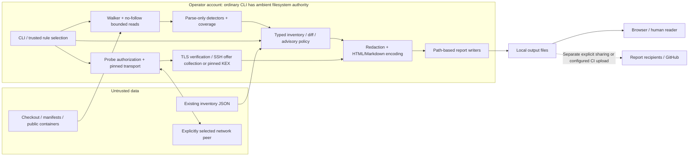

# pqc-scan Repository Threat Model

## 1. Overview

Prepared on 2026-11-17 (Asia/Tokyo) for the current repository worktree. This is a reusable, source-backed model of the software's architecture and security boundaries, not a new vulnerability scan or a statement that every source file has been audited.

The source HEAD is `f07d782cd68cfac95d93585d5ace049f590160d4`, with existing tracked and untracked changes. The worktree digest matches the preceding Codex Security scan. The exact snapshot identity is recorded in the footer. The main agent performed the architecture review sequentially: repository instructions prohibit delegating its investigation, and no independent architecture review was obtained.

### Product and execution modes

The product is a Rust CLI for advisory investigation of cryptographic usage and PQC migration risk. Its normal flow is local rules and selected repository files → parse-only detectors → normalized findings and optional typed observations/assessment → local reports. It does not implement an application's migration or prove runtime use of cryptography. The CLI's registered default detectors are tree-sitter, regex, dependency, certificate and private-key-marker detectors (`crates/pqc_scan_detectors/src/lib.rs:17-24`).

The default CLI build has no features enabled. TLS, SSH offer collection and verified SSH hybrid KEX are separately feature-gated and explicitly invoked; they are not actions triggered by a scanned URL or certificate (`crates/pqc_scan_cli/Cargo.toml:8-14`; `crates/pqc_scan_cli/src/main.rs:39-58`; `crates/pqc_scan_cli/src/probe_command.rs:77-141`). Public library callers can select configuration and detector implementations; the CLI's default file-size and detector limits must not be assumed to constrain every library call. Custom Rust detector implementations run with caller authority, rather than inside an untrusted plugin sandbox (`crates/pqc_scan_core/src/model.rs:9-23`; `crates/pqc_scan_core/src/pipeline.rs:19-34`).

| Component | Responsibility and sensitive consumer | Source evidence |
|---|---|---|
| CLI | Parses explicit commands, selects root/rules/output, enables inventory/policy and exit gates | `crates/pqc_scan_cli/src/main.rs:74-127`, `crates/pqc_scan_cli/src/main.rs:307-409` |
| Walker and safe reader | Selects files; opens repository inputs and snippet rereads | `crates/pqc_scan_core/src/walker.rs:36-51`, `crates/pqc_scan_core/src/safe_read.rs:6-134` |
| Scan pipeline | Parallel per-file processing, failure accounting, normalization and privacy binding | `crates/pqc_scan_core/src/pipeline.rs:73-156`, `crates/pqc_scan_core/src/pipeline.rs:286-414` |
| Rules | Loads local YAML policy, compiles regex and rejects duplicate IDs | `crates/pqc_scan_rules/src/lib.rs:123-137`, `crates/pqc_scan_rules/src/lib.rs:155-193` |
| Detectors | Parse untrusted source, manifests, SBOMs and public certificate/container structure | `crates/pqc_scan_detectors/src/tree_sitter_detector.rs:610-665`, `crates/pqc_scan_detectors/src/dependency_detector/decode.rs:173-206`, `crates/pqc_scan_detectors/src/certificate_detector/pkcs12.rs:1-96` |
| Native inventory, diff and policy | Stores bounded typed facts, imports inventories, compares scope, evaluates advisory policy | `crates/pqc_scan_core/src/inventory.rs:429-461`, `crates/pqc_scan_core/src/diff.rs:81-159`, `crates/pqc_scan_core/src/policy.rs:293-331` |
| Reports | Serializes JSON/SARIF/CycloneDX, renders HTML/Markdown, writes output paths | `crates/pqc_scan_report/src/lib.rs:115-194`, `crates/pqc_scan_report/src/compact.rs:390-439` |
| Optional network probes | Authorizes/pins destination, bounds transport, checks TLS identity or explicit SSH host pin | `crates/pqc_scan_core/src/target_policy.rs:181-219`, `crates/pqc_scan_core/src/probe_transport.rs:22-67`, `crates/pqc_scan_probe_ssh/src/negotiated.rs:238-299` |
| CI and packaging | Builds trusted source, emits/upload artifacts, prepares bounded archives and static-candidate provenance | `.github/workflows/pqc-scan.yml:212-263`, `.github/workflows/release.yml:1-65`, `scripts/package-release.py:52-133` |
| Developer isolation | Copies selected source into a disposable confined container and validates exported artifacts | `tests/protocol/container_runner.py:36-108`, `tests/protocol/container_runner.py:117-145`, `tests/protocol/container_runner.py:189-213` |

This diagram shows data boundaries, not process isolation between Rust crates. The normal CLI process and its library code share the invoking account's authority. Docker confinement belongs to the developer test workflow, not to every `pqc-scan scan` invocation.

### Effective resources and authority

Paths below are effective CLI defaults relative to the current working directory (CWD), or symbolic paths chosen by the operator. No actual credential value is reproduced.

| Deployment or workflow | Resource or capability | Configuration and precedence | Safe effective value or location | Readers, writers, or recipients | Enforcing control | Evidence or unknowns |
|---|---|---|---|---|---|---|
| Static CLI | Repository file reads | Positional scan root; fixed CLI max size | Selected regular files under the explicit root, at most 2 MiB per CLI input | Scanner process; host filesystem supplies bytes | Ignore-aware selection; bounded reads; Unix held-directory `openat` with `O_NOFOLLOW`; regular-file check | `crates/pqc_scan_cli/src/main.rs:330-350`; `crates/pqc_scan_core/src/safe_read.rs:6-82` |
| Windows repository reader | Repository handle resolution | Selected root canonicalized; file opened with reparse-point flag | Opened regular file whose final handle path stays under canonical root | Scanner process | Parent-link prechecks and final handle-path containment | `crates/pqc_scan_core/src/safe_read.rs:79-134`; not executed on Windows in this review |
| Static CLI | Rule policy | `--rules-dir` overrides `./rules` | YAML files under the selected local rule directory; the loader descends to default packs | Operator chooses policy; rule loader consumes it | Schema/enum validation, regex compile-size bound, ID uniqueness | `crates/pqc_scan_cli/src/main.rs:89-93`; `crates/pqc_scan_rules/src/lib.rs:123-193`; rule-file read has no explicit byte cap |
| Maven context | Parent POM reads | Declared relativePath or default parent, only among already selected files | Normalized, in-root selected parent path; finite chain and aggregate bytes | Dependency detector through RepositoryContext | No Maven invocation/fetch; membership, containment, safe reader, 16 levels/8 MiB | `crates/pqc_scan_core/src/repository_context.rs:36-46`; `crates/pqc_scan_detectors/src/dependency_detector/maven_context.rs:81-125` |
| Static reports | Output writes | `--out-dir` overrides `./pqc-report`; format defaults to all | `OUT/report.{json,html,md,sarif}`, plus CBOM/dependency SBOM; opt-in inventory/diagnostic/assessment/CycloneDX names | Scanner writes; operator and later report recipients read | Payload redaction and encoding; ordinary path-based filesystem writes | `crates/pqc_scan_cli/src/main.rs:78-93`; `crates/pqc_scan_report/src/lib.rs:21-61`; `crates/pqc_scan_report/src/lib.rs:132-194`; output links are a known unresolved control failure |
| Comparison CLI | Existing inventory reads and diff output | Two explicit input paths, mandatory explicit repository scope and out-dir | Inputs bounded to 16 MiB; `OUT/scan.diff.v1.{json,md}` | Import parser, local report reader | Schema/reference/path/scope checks; fixed-copy Markdown summary; output uses ordinary writes | `crates/pqc_scan_cli/src/diff_command.rs:8-35`; `crates/pqc_scan_core/src/diff.rs:81-159` |
| Advisory policy CLI | Operator context | Opt-in policy profile + optional context file | Bounded v1 enum/boolean JSON; support claims labeled operator-supplied and unverified | Local policy evaluator | 16 KiB context cap and typed deserialization; no script/expression evaluation | `crates/pqc_scan_cli/src/main.rs:312-327`; `crates/pqc_scan_core/src/policy.rs:97-106` |
| Probe DNS | Resolver process | Explicit normalized host; current executable selected by host runtime | Same executable's hidden `__resolve-host` command, cleared environment, null stdin/stderr and piped bounded stdout | CLI parent and child; system DNS resolver | Argument array, deadline/cancel, kill/reap guard, answer/output limits | `crates/pqc_scan_cli/src/probe_resolver.rs:18-61`; `crates/pqc_scan_cli/src/probe_resolver.rs:77-132` |
| Probe transport | Outbound TCP | Explicit host/port; optional allow-cidr adds authorization for otherwise denied special ranges | One checked numeric address, first deduplicated authorized DNS answer; no target retry | Selected peer only; DNS resolver sees requested name | Reject if any answer unauthorized; budget-bound private AuthorizedTarget; numeric connect and peer equality | `crates/pqc_scan_core/src/target_policy.rs:181-219`; `crates/pqc_scan_core/src/target_policy.rs:265-309`; `crates/pqc_scan_core/src/probe_transport.rs:22-67` |
| TLS probe | TLS trust/verification identity | Name defaults to target host; explicit server-name overrides it. Explicit ca-file replaces bundled roots | Bundled Mozilla roots or up to 16 public PEM certificates/256 KiB from selected local CA file; no private credentials | TLS verifier; peer sees SNI when DNS identity is used | rustls chain/name/time verification; no resumption/early data/key logging/client auth | `crates/pqc_scan_cli/src/probe_command.rs:80-103`; `crates/pqc_scan_probe_tls/src/runtime.rs:49-125`; `crates/pqc_scan_probe_tls/src/runtime.rs:362-397` |
| SSH offers probe | Advertised algorithm collection | Explicit `probe ssh` | Unauthenticated banner/offer observations; no user identity | Selected SSH peer and report reader | Bounded frames/lists/banner; assurance explicitly records unauthenticated advertisement | `crates/pqc_scan_probe_ssh/src/runtime.rs:51-108`; `crates/pqc_scan_probe_ssh/src/parser.rs:32-130` |
| SSH hybrid KEX | Endpoint authentication | Mandatory separately provisioned host-key-file | One OpenSSH Ed25519 public key, at most 4096 bytes; fixed ML-KEM768+X25519 KEX preference | russh verification handler and report reader | Exact public key-data match, library signature verification path, one initial KEX, disconnect before login | `crates/pqc_scan_probe_ssh/src/negotiated.rs:63-99`; `crates/pqc_scan_probe_ssh/src/negotiated.rs:238-299` |
| Probe reports | Local output writes | Explicit out-dir overrides per-command default | `./pqc-probe/tls`, `./pqc-probe/ssh` or `./pqc-probe/ssh-kex`; each gets protocol JSON and report.html/report.md | CLI writes; operator/later recipients read endpoint metadata | Envelope validation and recursive value redaction; ordinary path-based writes | `crates/pqc_scan_cli/src/probe_command.rs:59-74`; `crates/pqc_scan_cli/src/probe_command.rs:103-141`; `crates/pqc_scan_report/src/probe_report.rs:14-75` |
| Repository self-scan CI | GitHub reporting authority | Develop push/manual scan job, distinct from PR quality job | Job has contents:read and security-events:write; raw/projected SARIF, audit and dependency SBOM go to configured GitHub uploads | Runner code, GitHub Code Scanning/artifact recipients | Pinned actions; result suppression bound to file/result digests and counts | `.github/workflows/pqc-scan.yml:212-263`; `shell/prepare-code-scanning.cjs:88-132`; actual artifact ACLs not inspected |
| Distribution preparation CI | Build/provenance authority | Manual workflow only; prepare job's id-token/attestations permissions | Static tarballs under `target/task-038/static-first`; network candidates under network-first; GH_TOKEN references github.token only in verification step | Trusted runner/actions, GitHub attestation/artifact services | Credential persistence disabled; exact repo/workflow/source-digest verification for static archives; no release publication step | `.github/workflows/release.yml:1-65`; network archive has no corresponding attestation step in this file |
| Local packaging/install check | Archive content, supplied binary | Trusted source-root and caller-supplied binary; explicit variant/output; check-install separate | Prepared static/network archive plus checksum/provenance; extracted temporary installation tree | Packaging script; explicitly executed supplied binary in install check | Canonical USTAR subset, regular files, member/decoded limits; temp extraction/data filter; install execution uses macOS deny-network sandbox | `scripts/package-release.py:52-133`; `scripts/package-release.py:251-332`; `tests/distribution/check-install.py:20-42`; packaging is not proof of binary/source equivalence |
| Developer container workflow | Source/cache/scratch/export | Existing immutable local image ID; selected source copied into disposable source tree | Read-only bind `/source`, read-only container root, writable bounded `/scratch`; no host Docker socket mount declared | Unprivileged container user; host collector reads bounded exports | Network none, dropped caps, no-new-privileges, resource limits, inspected mounts, no-follow source copy and regular-file export | `tests/protocol/container_runner.py:36-108`; `tests/protocol/container_runner.py:117-145`; `tests/protocol/container_runner.py:189-213`; host kernel/engine assumed trusted |

Report destinations are resolved independently from the scan root. A root-bound reader does not protect the writer. Likewise, the static scan's offline behavior does not prohibit a separately configured CI upload or an explicit network probe. The README makes that distinction (`README.md:13-19`); the workflow demonstrates the upload path above.

## 2. Threat Model, Trust Boundaries, and Assumptions

### Assets and objectives

- **Host confidentiality and integrity:** repository-controlled paths must not turn inspection into reads or destructive writes outside the intended resources. Explicitly chosen roots, trusted policy files and public trust inputs are operator authority, not attacker authority.
- **Private source and credential confidentiality:** recognized private-key/credential content should not escape through evidence, previews, metadata or report serialization. Source locations, identifiers and endpoint metadata can remain sensitive even after supported masking.
- **Assessment integrity:** findings, coverage, identities, inventory correspondence and policy provenance must preserve what was actually observed. Absence of detection, parser failure, missing-after inventory entries and operator support claims must not become proof of security.
- **Availability:** malicious files and probe peers should encounter finite applicable parser, read, traffic, deadline and collection limits. Per-file bounds do not establish a whole-repository memory/time guarantee.
- **Probe identity and authorization:** authorize the numeric destination actually used; distinguish unauthenticated offers from cryptographically verified peer identity and negotiated facts.
- **Supply-chain and distribution integrity:** distinguish untrusted code/data from trusted build authority, archive integrity from authenticity, and prepared candidates from published or independently reproduced binaries.

The bounded privacy contract is explicit: unknown/obfuscated syntax, arbitrary credential names, multiline credential position tracking and secret-bearing structural fields are outside its guarantee (`docs/user/COVERAGE.md:190-198`). The goal is faithful enforcement of that contract, not an invented promise of universal secret removal.

### Actors and starting capabilities

| Actor | Initial control | Authority not assumed | Potential new capability if a boundary fails |
|---|---|---|---|
| Checkout contributor/provider | Repository content, filenames, ignore files, manifests, public containers and checkout-preserved symlinks | Operator's trusted external rule pack, home files, CLI arguments, host account | Read or corrupt host data; disclose protected content through generated reports; exhaust scanner/CI |
| Inventory supplier | Bytes in an inventory the operator explicitly chooses to import | Operator identity, scope choice or filesystem destination | Mislead comparisons or inject data into downstream views; parser resource consumption |
| Network peer / hostile DNS response | Peer protocol bytes, or answers for explicitly resolved names | Arbitrary probe invocation, trusted CA or trusted SSH pin | Redirect outbound connection, impersonate a verified peer, exhaust probe resources, taint reports |
| Report viewer/recipient | Receives an artifact or opens it in a browser | Scanner execution authority or every private source file | Observe leaked sensitive content; receive active markup if encoding fails |
| PR author | Proposed repository changes tested in a CI event | Merged develop, manual release authority or additional GitHub privileges | Only count privileges beyond the actual event/runner permissions; ordinary execution of proposed code in a test job is expected |
| Dependency/action distributor | Dependency or action content when fetched by an authorized build | Arbitrary production credentials or release ownership | Compromise trusted build/provenance boundary if integrity/pinning/runner controls fail |
| Operator/maintainer | Explicit roots, rule policy, allow-cidr, TLS identity/CA, SSH pin, output paths and approved sharing | No invented tenant or remote application identity | Defines authorized operation; errors in these trusted choices are not automatically scanner vulnerabilities |

The process is a local CLI, not an authenticated network service. There is no source-supported tenant/session boundary, HTTP API or remote job submission service in this model. An external server wrapping the CLI would need its own authorization, filesystem isolation, concurrency and report-access model; none is assumed to exist here.

### Boundaries and invariants

| Boundary | Required invariant | Observed mechanism and limitation |
|---|---|---|
| Checkout → file handles | Only intended bounded regular files are read; in-tree aliases cannot escape | Unix reader rejects non-normal relative components and holds directory FDs. Explicit root may itself be a link. Windows uses final-handle containment; other platforms fail unsupported (`crates/pqc_scan_core/src/safe_read.rs:6-134`). |
| Selected files → parse/evidence | Parse data without running source, fetching modules or evaluating templates; retain incomplete status | Default detector registration, parse-only tree construction, bounded value decoding and selected-parent reads; tree-sitter/native dependency internals remain trusted implementation dependencies (`crates/pqc_scan_detectors/src/lib.rs:17-24`; `crates/pqc_scan_detectors/src/tree_sitter_detector.rs:610-665`; `crates/pqc_scan_detectors/src/dependency_detector/decode.rs:19-32`). |
| Local policy → analysis | Use the policy actually selected; do not silently treat attacker-chosen rules as trusted independent evidence | External rule directory is operator input. YAML loading validates definitions, compiles regex and rejects duplicate IDs, but is a different boundary from bounded scan inputs (`crates/pqc_scan_rules/src/lib.rs:155-193`). |
| Raw source → exported evidence | Recognized sensitive content is masked consistently; structural fields retain their declared limits | Source privacy binding and writer sanitization; native inventory omits raw matches/snippets/arbitrary metadata (`crates/pqc_scan_core/src/pipeline.rs:208-229`; `crates/pqc_scan_core/src/privacy.rs:169-241`; `crates/pqc_scan_core/src/inventory.rs:447-461`). |
| Findings → browser/Markdown | Untrusted values remain text/code rather than active content | HTML escapes both quote forms; Markdown escapes metacharacters/newlines; HTTP(S)-only reference-link generation; UI uses textContent (`crates/pqc_scan_report/src/japanese.rs:205-224`; `crates/pqc_scan_report/src/compact.rs:390-439`; `crates/pqc_scan_report/src/compact.js:23-47`). |
| Rendered data → output filesystem | Destination identity must stay inside intended output authority, including existing links and races | **Known gap:** create_dir_all and std::fs::write use normal path resolution, with no output no-follow/held-directory guard (`crates/pqc_scan_report/src/lib.rs:132-148`; `crates/pqc_scan_report/src/json_report.rs:20-24`). |
| Imported inventory → comparison | Validate bounded structure/references/paths and explicit scope; absence is not remediation | Byte/record limits, ID/path checks, scope equality and fixed-copy Markdown summary (`crates/pqc_scan_core/src/diff.rs:63-159`). |
| Observation/context → policy conclusion | Operator claims remain unverified; incomplete evidence stays indeterminate | Context provenance is operator_supplied_unverified; summary considers inspection and inventory completeness (`crates/pqc_scan_core/src/policy.rs:97-106`; `crates/pqc_scan_core/src/policy.rs:293-331`). |
| Target name → connected peer | The address authorized is the one connected; no automatic target expansion | All DNS answers checked; private budget-bound target; numeric connection and equality check; one resolution/attempt (`crates/pqc_scan_core/src/target_policy.rs:181-219`; `crates/pqc_scan_core/src/target_policy.rs:451-464`; `crates/pqc_scan_core/src/probe_transport.rs:22-67`). |
| Peer bytes → verified claims | Offers are not identity; verified TLS/SSH facts require the respective authentication path | TLS publishes after handshake; SSH offers explicitly unauthenticated; SSH KEX checks exact prior public pin and completes initial KEX before success (`crates/pqc_scan_probe_tls/src/runtime.rs:155-235`; `crates/pqc_scan_probe_ssh/src/runtime.rs:51-108`; `crates/pqc_scan_probe_ssh/src/negotiated.rs:190-205`). |
| Build/evidence → external consumers | Sharing and attestation authority are explicit; outputs cannot silently claim stronger provenance | Separate CI uploads and manually scoped preparation workflow; packaging labels supplied-binary provenance and prepared status (`.github/workflows/pqc-scan.yml:242-263`; `.github/workflows/release.yml:3-21`; `scripts/package-release.py:310-332`). |

### Concrete limits and caller assumptions

The CLI selects 2 MiB repository inputs. Default exclusions include .git, node_modules, target, dist, docs and Markdown; ignore policy can hide additional files. Completeness therefore describes selected supported scope, not all repository content (`crates/pqc_scan_cli/src/main.rs:330-334`; `crates/pqc_scan_core/src/walker.rs:8-8`; `docs/user/COVERAGE.md:198-198`).

Current detector defaults allow 4,096 accepted hits per rule/file, 65,536 examined matches, 262,144 AST candidates, 2,000,000 scheduled AST nodes and 256 MiB cumulative AST match text (`crates/pqc_scan_detectors/src/budget.rs:11-20`). These are not whole-process memory ceilings: the pipeline collects outcomes across files in parallel (`crates/pqc_scan_core/src/pipeline.rs:97-138`). Malformed/unsupported/truncated outcomes remain distinct from clean successful inspection (`crates/pqc_scan_core/src/pipeline.rs:310-409`).

Probe maxima are eight DNS answers, 5s DNS, 3s TCP, 5s protocol, 15s overall, 512 KiB received and 64 KiB sent. ProbeBudget rejects requests exceeding these defaults and restricts resolution/attempt count (`crates/pqc_scan_core/src/target_policy.rs:358-419`; `crates/pqc_scan_core/src/target_policy.rs:451-464`). The target policy is a technical address gate, not legal or organizational permission to probe someone else's endpoint.

### Deployment assumptions, disagreements and unknowns

1. The operator account, kernel, executable and explicitly trusted policy/trust inputs are not already compromised. No confidentiality isolation exists between the ordinary CLI and another process with equivalent account authority.
2. The documentation's private-source handling is bounded. Source and endpoint reports may need access control even when recognized keys are masked. Actual report distribution, GitHub artifact ACLs and retention outside declared workflows were not inspected.
3. **Observed control disagreement:** reader hardening cannot satisfy output integrity. A fresh external output directory is documented usage guidance, while the CLI retains a relative default and writers reuse existing paths. The prior scan's output-link finding remains unresolved; guidance alone does not enforce destination integrity (`docs/user/SCANNING.md:27-39`; `crates/pqc_scan_cli/src/main.rs:89-93`; `crates/pqc_scan_report/src/lib.rs:139-148`).
4. **Explicit validation gap, not a new vulnerability:** protocols CI is disabled with a false job condition, as described in README. This removes those routine protocol/isolation checks; it does not establish that runtime controls fail (`.github/workflows/pqc-scan.yml:78-80`; `README.md:181-184`).
5. Static-candidate provenance verification is present. The same workflow prepares a network candidate without a corresponding network attestation step. Do not generalize static-candidate provenance to every variant; this is a source-observed scope distinction, not proof of a compromised artifact (`.github/workflows/release.yml:35-57`).
6. Model creation involved offline source inspection only. No application, exploit, live probe, browser, Cargo suite, container enforcement test or external advisory lookup was executed. Native dependencies and external action behavior are not independently proven by reading their callers.
7. There is no need to infer deployment exposure to describe a public parser/CLI boundary. Conversely, turning local availability limits into a critical remote-service claim would require additional source/deployment evidence.

## 3. Attack Surface, Mitigations, and Attacker Stories

The priorities below order investigation, not confirmed severity. Only T1 is carried forward as a confirmed static finding from the preceding scan; all other rows are threat hypotheses, bounded control dispositions or explicit operational assumptions.

| Priority | Scenario and capability gain | Prerequisites | Impact | Existing controls | Mitigation or validation focus | Evidence |
|---|---|---|---|---|---|---|
| T1 — confirmed; medium | A checkout provides pqc-report/report.json as a symlink. Default scan writes through it and destroys a file outside the checkout. | Operator uses attacker-prepared output path; target writable by operator; symlinks preserved | Host file integrity/availability beyond checkout authority | Input no-follow reads and payload redaction do not constrain output. Trusted fresh external output avoids this placement condition. | Proposed only: common destination-owned writer with held-directory/no-follow or safe exclusive staging/replacement; test file/parent links and replacement races across formats | `crates/pqc_scan_cli/src/main.rs:89-90`; `crates/pqc_scan_report/src/lib.rs:139-148`; `crates/pqc_scan_report/src/json_report.rs:20-24` |
| T2 — controlled hypothesis | Malicious checkout paths or parent-POM references attempt to read host secrets and carry them into findings. | Attacker controls selected tree or mutates it during reads | Confidentiality beyond intended root | Held Unix directory handles, O_NOFOLLOW, bounded regular-file reads, selected-file membership and normalized in-root POM paths | Preserve handles through reads; check replacement races and Windows semantics separately; explicit root selection remains trusted | `crates/pqc_scan_core/src/safe_read.rs:6-134`; `crates/pqc_scan_core/src/repository_context.rs:36-46` |
| T3 — open resource hypothesis | Crafted source, YAML, XML, DER or many files consume excessive scanner/CI resources. | Host scans adversarial data; library callers may choose wider limits | Local/CI availability; no remote multi-tenant service assumed | File cap, finite detector budgets, bounded value depth/count, YAML node-property guard, XML node/parent limits, bounded PKCS#12 | Measure whole-run resource use under realistic concurrency; inspect native parser internals if a concrete failure appears; resource caps are not measured performance | `crates/pqc_scan_detectors/src/budget.rs:11-20`; `crates/pqc_scan_detectors/src/dependency_detector/decode.rs:19-32`; `crates/pqc_scan_detectors/src/dependency_detector/yaml_preflight.rs:1-112`; `crates/pqc_scan_detectors/src/certificate_detector/pkcs12.rs:7-10` |
| T4 — controlled hypothesis with contract limits | Source secrets survive evidence transformations and reach a report recipient. | Report contains protected input and is later shared with a lower-trust recipient | Private source/credential disclosure | Recognized secret redaction, file/position privacy binding, native omission of raw payloads | Check each exported representation against supported syntax; keep structural fields free of secrets; review distribution access; unknown syntax alone is not proof of a violated promised control | `crates/pqc_scan_core/src/privacy.rs:113-145`; `crates/pqc_scan_core/src/privacy.rs:169-241`; `docs/user/COVERAGE.md:190-198` |
| T5 — controlled hypothesis | Malicious source/path/action/peer metadata becomes active HTML or Markdown when opened. | Victim opens generated artifact; injected field reaches a rendering context | Browser-origin execution or misleading report content | HTML quote/text encoding, Markdown escaping/indented-code normalization, HTTP(S) reference restriction, textContent UI | Maintain context-specific encoding for every new field; browser runtime effects need separate validation | `crates/pqc_scan_report/src/japanese.rs:205-224`; `crates/pqc_scan_report/src/compact.rs:97-109`; `crates/pqc_scan_report/src/compact.rs:390-439`; `crates/pqc_scan_report/src/compact.js:23-47` |
| T6 — controlled hypothesis | Forged inventory paths/IDs or missing observations mislead comparison or policy conclusions. | Operator imports attacker-supplied inventory or context | Decision integrity; parser resource use | Bounded JSON/records, reference and scope validation, canonical paths, missing-after unresolved, operator provenance, incomplete summary stays indeterminate | Validate correspondence and provenance across versions; do not turn scope exclusion or NotApplicable into deployment safety | `crates/pqc_scan_core/src/diff.rs:81-159`; `crates/pqc_scan_core/src/policy.rs:97-106`; `crates/pqc_scan_core/src/policy.rs:293-331` |
| T7 — controlled hypothesis | DNS rebinding or special addresses turn an authorized probe into a connection to an unintended host. | Explicit probe invocation; attacker controls DNS answers | Unauthorized network reachability | Reject all answers if any unauthorized; normalized numeric target; exact peer/budget binding; no retry/proxy lookup | Keep authorization at numeric connect boundary; audit range policy and library-call consistency if changing it | `crates/pqc_scan_core/src/target_policy.rs:181-219`; `crates/pqc_scan_core/src/target_policy.rs:265-309`; `crates/pqc_scan_core/src/probe_transport.rs:22-67` |
| T8 — controlled hypothesis | Hostile TLS/SSH peer is reported as identity-verified or PQC-capable without the claimed evidence. | Relevant optional feature; selected attacker peer; trusted identity inputs not compromised | Authentication/assessment integrity | rustls verification before facts; no client credentials; explicit Ed25519 pin and initial hybrid KEX; unauthenticated offers labeled separately | Test negative chain/name/pin/signature/KEX paths; keep offer, negotiation and global-support claims distinct | `crates/pqc_scan_probe_tls/src/runtime.rs:49-125`; `crates/pqc_scan_probe_tls/src/runtime.rs:155-235`; `crates/pqc_scan_probe_ssh/src/negotiated.rs:190-205`; `crates/pqc_scan_probe_ssh/src/negotiated.rs:238-299` |
| T9 — controlled hypothesis | Peer stalls, sends excessive banners/frames/certificates, or attempts later SSH activity after the initial observation. | Explicit connection to malicious peer | Probe availability, post-invocation traffic or misleading completion | Deadline watchdog/cancel/byte counters; finite frames/lists/collection; close before runtime teardown; no login path | Validate timeout/cancel at every state; runtime and dependency scheduling still require execution evidence | `crates/pqc_scan_core/src/target_policy.rs:358-419`; `crates/pqc_scan_probe_ssh/src/runtime.rs:131-174`; `crates/pqc_scan_probe_ssh/src/negotiated.rs:165-195`; `crates/pqc_scan_probe_tls/src/runtime.rs:301-358` |
| T10 — conditional trusted-policy threat | Default relative rules select a checkout-provided rule pack, allowing omissions or resource-intensive definitions. | Operator runs from checkout without an external trusted rules-dir | False reassurance or local availability under attacker-selected policy | Rule structure/ID/regex validation; no package/source execution | Treat rule provenance as a separate explicit input. Absolute trusted rules-dir is documented; do not call a policy selected by the operator an independent audit guarantee | `crates/pqc_scan_cli/src/main.rs:89-93`; `crates/pqc_scan_rules/src/lib.rs:155-193`; `docs/user/SCANNING.md:34-39` |
| T11 — conditional build/distribution threat | Malicious dependency, changed build input or substituted archive is trusted as an authentic release. | Attacker influence over authorized fetch/build/artifact channel; additional privileges must be established | Distributed binary integrity; runner authority | Lockfiles, pinned actions, static provenance checks, bounded regular-file archive verifier, explicit supplied-binary caveat | Verify exact artifact/repo/workflow/source identity; separate checksums from authenticity and static/network provenance; do not assume release upload occurs here | `.github/workflows/release.yml:19-57`; `scripts/package-release.py:52-133`; `scripts/package-release.py:310-332` |
| T12 — controlled developer-workflow hypothesis | Container-generated exports escape the collector or source copying pulls private host data. | Operator invokes developer harness; attacker influences copied source/export bytes | Host confidentiality/integrity beyond test workspace | No-follow source component reads, finite source/export limits, unique regular entries, exclusive output files, readonly source/root and unprivileged offline container | Keep host collector parsing and sandbox enforcement separate; verify actual kernel/engine controls when running the harness | `tests/protocol/container_runner.py:36-108`; `tests/protocol/container_runner.py:117-145`; `tests/protocol/container_runner.py:189-213` |
| T13 — configured sharing assumption | CI uploads disclose source or endpoint context to an unintended audience even if scanning itself is offline. | A workflow explicitly uploads reports; recipients/ACL differ from intended audience | Confidentiality of retained facts and filenames | Redaction and explicit separate upload steps; no universal anonymization claim | Set artifact access/retention to match data sensitivity; determine actual recipients before asserting a disclosure | `.github/workflows/pqc-scan.yml:242-263`; `.github/workflows/release.yml:58-65`; `docs/user/COVERAGE.md:196-196` |

### Confirmed finding carried forward

Previous scan: `2fc43073-9586-4ffe-92bf-4af7a263300d`; finding: `csf_b669284abdfc84566c51858b`, CWE-61, medium, high source confidence. It was established by a static trace, not an executed exploit. The five recorded source excerpts and eleven location ranges were compared with current source successfully. The worktree digest is unchanged.

Minimal attack story: a checkout supplies an output-file symlink pointing at an external writable target; the operator runs a normal static scan from that checkout with the default destination; the ordinary writer follows the link and truncates the target. The gained capability is destructive writing with the operator's authority outside the attacker's checkout. This does not establish arbitrary code execution, privilege escalation, or a live exploitation event.

No remediation has been applied. The model preserves the completed scan and does not re-open, replace or extend its findings. Suggested controls and validation in the table are proposals, not implementation work, new task records or new confirmed vulnerabilities.

### Reconciliation and open questions

- T1 maps to the existing confirmed finding. T2, T5–T9 and T12 have specific source-backed controls, with runtime/platform validation limits retained. T3 needs whole-run measurements before an availability guarantee can be evaluated.
- T4 and T13 depend on both actual exported content and actual recipients. Bounded masking and offline scanning do not establish that every report is safe to publish.
- T6 and T10 distinguish operator policy, incomplete evidence and attacker-controlled input. A tool finding nothing or an operator excluding scope is not evidence that cryptography is safe.
- T11 depends on the precise fetch/build/publication path. This repository's preparation workflow does not publish releases; actual published-artifact authentication and external CI service behavior were not checked.
- Architectural boundaries were mapped, not exhaustively vulnerability-audited. The preceding scan retained partial file coverage; creating this document does not turn that coverage into complete coverage.
- Windows final-handle behavior, native parser resource behavior, protocol cancellation/signature behavior, artifact audience and host/container enforcement remain explicit verification questions. None is silently promoted to a finding or a passing runtime test.

## 4. Severity Calibration (Critical, High, Medium, Low)

Severity follows the established attacker, meaningful gain, impact, likelihood, prerequisites and effective controls. Confidence reports how firmly those facts are supported; it is not a substitute for impact. Static source evidence can establish a boundary failure without a deployed instance or runtime reproduction, but deployment-specific claims must retain their prerequisites.

| Level | Repository-specific example that could qualify | What does not qualify by itself | Evidence that changes the rating |
|---|---|---|---|
| Critical | A demonstrated, broadly reachable parser/build boundary gives an untrusted contributor immediate severe control of protected host/release authority with realistic high likelihood and little additional privilege | A weak algorithm found in a fixture; a local parser cap; an imagined remote wrapper; routine PR test execution | Actual sensitive authority and reachable exploit chain, exposure and effective containment, not only a dangerous API name |
| High | A source-proven low-privilege input path reliably exposes useful protected credentials or executes code as the scanner/build identity, with high impact and likelihood | A file named private key containing invalid/truncated fixture bytes; a manually chosen attacker CA; unauthenticated SSH offers explicitly labeled as such | Usable protected asset or code-execution boundary, realistic trigger and effective permissions; scope and sandbox may lower impact |
| Medium | The existing output-link issue: a malicious checkout can cause the normal operator-side report writer to corrupt an external writable file, conditional on output-path placement | Claiming remote RCE or root privilege from that source trace; assuming every operator uses the vulnerable relative output directory | Target sensitivity, frequency of reachable workflow and any enforced destination protection; further execution impact requires separate evidence |
| Low | A demonstrated constrained local availability/integrity failure with limited consequences and narrow prerequisites, beyond what the attacker can already do | The mere absence of an aggregate runtime cap; unknown data; same-authority self-only actions | Measured bound/impact, attacker's initial privileges, host isolation and realistic repetition |

High impact with only medium or unknown likelihood generally warrants medium; with low likelihood it generally warrants low. Medium/unknown impact warrants medium only with high likelihood, otherwise low. Low-impact issues remain low. A privileged-only action with no new authority crossing is not reported as a vulnerability merely because it is destructive.

Normal authorized exceptions are not bypasses: an explicitly selected private CIDR adds network authorization; a chosen public CA or host pin defines trust; a selected root defines inspected authority. Conversely, those operator choices do not authorize a checkout to redirect later output writes through pre-existing links.

Evidence and completion record: target/snapshot resolution and source-reference verification are read-only. This document is the requested model deliverable. It is not an implementation, test run, renewed scan completion claim or security certification.

Verification performed for this document:

- `git rev-parse HEAD` returned the source HEAD above (exit 0).
- `git ls-files -z --cached --others --exclude-standard` supplied the current source inventory (exit 0).
- A read-only Python reference check verified all 100 distinct source citations against that inventory and file line counts: 43 files, no missing files or invalid line ranges (exit 0). Material claims were checked against the cited source, not inferred from filename existence alone.
- The plugin's read-only `workbench_target.worktree_content_digest(Path(repository))` was recomputed before saving and matched the footer and previous scan (exit 0).

Repository: target_sha256_cb12e66d65afee0bf1dfc7281023c07ed34a5176d916ca2e6ae877f746c33295
Version: codex-security-snapshot/v1:sha256:4ade87b809a77ca5059d1af2a37cb533bd17a05c5365d200600f8630eecbb2a0
