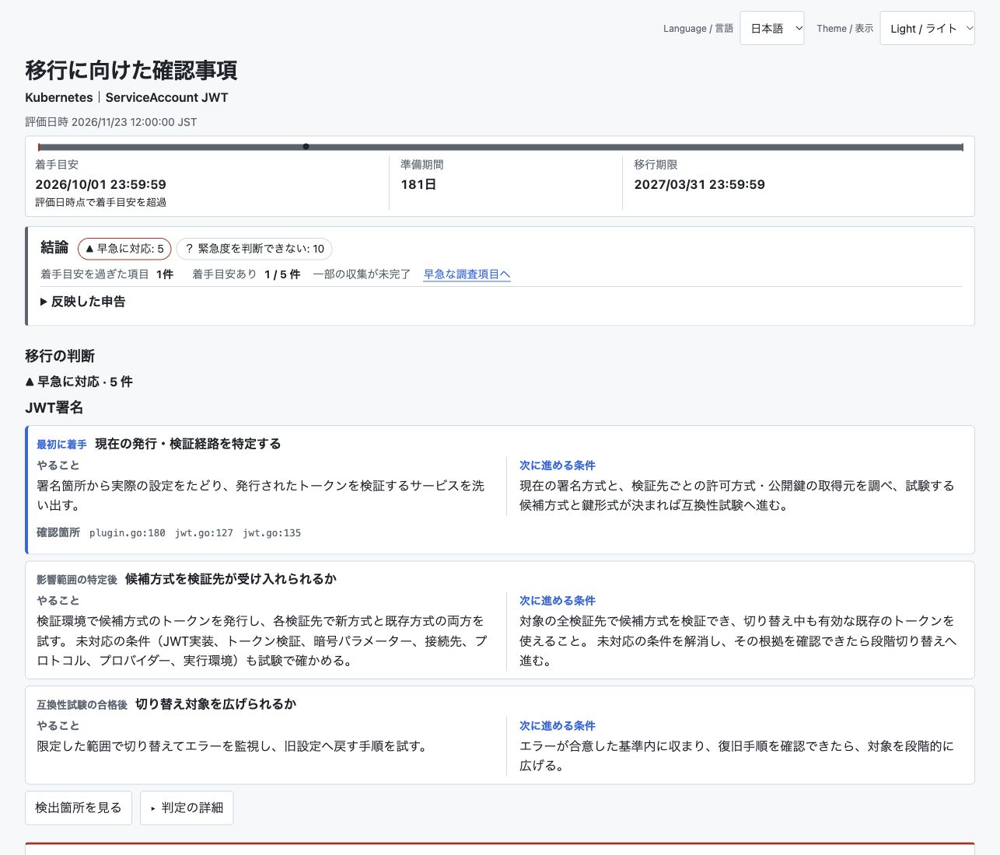

# 結果の読み方

[English](REPORTS.md) · [README](https://github.com/wakaken/pqc-scan/blob/codex/v04-roadmap-20261118/README.ja.md)

このガイドはv0.4.0の静的スキャンを対象とします。バージョン間の変更点は[リリースノート](../releases/v0.4.0.md)を参照してください。

スキャンが終わったら、まず人が読むレポートで所見を確認し、追跡や自動処理に必要なファイルを選びます。
所見には検出根拠と確認事項が含まれますが、それだけを理由に暗号方式を置き換える必要はありません。

レポートでは、検出内容・場所・次に確認することを表示します。検査が完了していない箇所や追加確認が必要なファイルは、「検査範囲と完了状況」で確認できます。


HTML・Markdownでは、同じファイル・行・列、同じ方式の記述、同じ指摘内容を1件にまとめます。一致したルールと各説明・重大度・確認事項は詳細に残し、対応案は統合して保持します。重大度は一致したルールのうち最も高いものを表示します。根拠が空・マスク済み、または位置が不明な場合はまとめません。サマリー・グラフ・ファイルツリーは統合後の件数を示します。「検査対象ファイル数」は暗号利用の検出件数ではありません。JSON・SARIF・棚卸しデータと検出IDは従来のルール別記録を保持するため、HTML・Markdownとは件数が異なる場合があります。

検出結果の見出しには指摘内容を表示し、ルールIDや対象言語は表示しません。「一致したルール」の詳細は説明を先に表示し、ルールIDを補助情報として残します。保存データ・検索・フィルターで使うルールIDは変更しません。


## 目次

- [所見を確認する](#review)
- [リスクとPQCの所見を読み分ける](#pqc-findings)
- [用途に合うレポートを選ぶ：CBOM・SBOMを含む](#choose-report)
- [詳しい暗号資産の棚卸しを追加する](#inventory)
- [CycloneDX 1.7形式で出力する](#cyclonedx)
- [棚卸しを比較する](#diff)
- [ローカル方針で評価する](#assessment)
- [保存済み入力を再評価する](#saved-assessment)
- [SARIFの位置情報を読む](#sarif-locations)

<a id="review"></a>

## 所見を確認する

`report.html` を開き、次の順に確認します。

1. 冒頭の「検査範囲と完了状況」で、対象件数・解析完了・追加確認の件数、除外条件を確認します。
2. ルールとファイル位置を選び、周辺のコードと検出根拠を読みます。
3. 実際のアプリケーション、設定、依存関係、サンプル、テストのどれに属する記述か確認します。静的な一致だけでは、稼働時の利用まで判断できません。
4. 対処案を読み、実行環境・ライブラリ・プロトコル・接続相手の条件を確かめてから変更します。

HTMLの上部には、結果・検査状況の短いサマリーと、全検出の重大度分布を表示します。
絞り込み中も、サマリーとグラフは全体の件数を示します。検査範囲と除外条件は折りたたみ、未完了の検査は常に表示します。
左側の「検索条件」と「ファイル」は、見出しで個別に折りたためます。右上の表示切替ボタンはありません。「すべての結果を表示」リンクで全条件を解除できます。
左側のパネルで、ルール名・説明・ファイル名の検索と、重大度・リスク・ルール・ファイルの絞り込みを組み合わせられます。
「テストコードの結果を表示」は既定でONです。OFFにするとスキャン時と同じテスト用パス・ファイル名の規則に当てはまる結果を非表示にします。混在ファイル内のテストだけを判別するものではありません。表示の切替で保存済みデータは削除せず、サマリーとツリーの件数も全体のままです。
「対応候補」とPQC参照などの「参考情報」を切り替えられ、条件をすべて解除すると参考情報を含む全件を表示します。
狭い画面ではフィルターを重大度順のルール一覧の上に配置します。印刷には、画面の絞り込みやページに関係なく、全件と展開した根拠を含みます。
ルールと検出箇所はそれぞれ20件ずつ表示します。
ルール、検出箇所の順に開くと、その箇所のコードと対応を確認できます。
同じ共通手順は繰り返さず参照リンクにまとめ、IDが同じでも内容の異なる対応案は残します。
JavaScriptが無効な場合は全件を表示し、標準の折りたたみで確認できます。
外部スクリプトや通信は不要です。長い参考URLも、狭い画面内で折り返して表示します。Markdownにもルール・検出箇所への索引を設けています。
ソース断片とコード例はCRLF・CRの改行を正規化し、全行を字下げします。
Markdownとして表示したときも、含まれるHTML記法をコードの中に保ちます。

TLSの推奨は1.3を優先し、1.2は互換性が必要な場合に限って安全な設定で残す方針です。
PQCの上書き設定にはその設定の確認手順を示し、RSA利用を断定しません。

HTMLには日英の表示を同梱し、言語選択で説明・推奨対応・画面の文言を切り替えられます。絞り込み・閲覧ページ・開いている検出箇所は引き継ぎます。`--lang` はHTMLの初期言語とMarkdownの言語を選ぶ指定で、JavaScriptなしではその初期言語を表示します。ルール選択には短い説明も添え、付近と各ルールの詳細から、今回所見を出したルールの説明をダイアログで開けます。説明はHTMLに同梱し、通信は不要です。Escapeまたは「閉じる」で元のリンクへ戻り、検索条件を維持します。JavaScriptなしでは `report.rules.html` へ移動するため、2つのHTMLを同じ場所に保存してください。外部の翻訳サービスは使いません。

表示モードはライトとダークを選べます。既定はライトで、選んだモードはブラウザ内に保存できる場合に保存します。印刷はライトの配色です。HTMLの作成日時は閲覧環境のタイムゾーンで表示し、日本の設定ならJSTになります。元の時点はtime要素に保持します。JavaScriptなしでは生成元のローカル時刻とオフセットを表示します。Markdownも生成元のローカル時刻で、機械出力の時刻は変わりません。IPや位置情報による国の判定通信は行いません。

`--lang ja` を付けると、HTMLの初期表示とMarkdownを日本語にします。
既定は英語で、`--lang en` でも指定できます。

```bash
pqc-scan scan . --lang ja --format all --out-dir /path/to/reports/product-scan-ja --rules-dir /path/to/pqc-scan/rules
```

見出し、組み込みルールの説明、確認事項、推奨アクションを日本語で記載します。
「参考情報」は問題の指摘ではなく、暗号利用の棚卸しです。
PQCの記述が見つかっても、実際の通信や製品全体の対応完了を保証するものではありません。

JSON・SARIF・CBOM・依存関係SBOMは、言語指定によらず従来の内容を維持します。
検出ID、ファイル名、ソースコード、方式名、参考URLも書き換えません。
独自ルールや対応案に日本語文面がない場合は、その旨を明示して原文を残します。
訳文はプログラムに含まれており、翻訳サービスへコードを送信することはありません。

<a id="pqc-findings"></a>

## リスクとPQCの所見を読み分ける

移行上の懸念だけでなく、参考になる方式名も所見として表示します。
重大度は調査の優先順位を決める手掛かりです。信頼度はパターン一致の確かさを表す値で、アプリケーションが脆弱である確率ではありません。
リスクのラベルは次の意味で使います。

| ラベル | 読み方 |
|---|---|
| `quantum-vulnerable` | 参照された暗号方式や使い方に、量子計算を考慮した移行上の懸念がある |
| `non-quantum-risk` | 弱い方式や証明書に関する問題など、従来型の懸念がある。PQC移行とは分けて確認する |
| `quantum-uncertain` | 得られた根拠だけでは、耐量子性や対応状況を判断できない |
| `quantum-safe` | 参照された暗号方式を耐量子方式として分類している。アプリケーション全体の判定ではない |

### PQC方式が見つかったという所見は何を意味するか

ML-KEM（鍵共有）、ML-DSA・SLH-DSA（署名）の名前や、Kyber・Dilithiumといった旧草案の名前も検出します。
すでに移行に関係するコードや依存関係がある場合、その場所を探す手掛かりになります。ただし、名前があることと実際に使えることは別です。

| 見つかった記述の例 | さらに確認すること |
|---|---|
| コード中のML-KEMという名前 | 利用する実行環境・providerが対応しているか、その処理が実際に使われるか |
| PQCに対応し得るライブラリの依存関係 | 解決済みのバージョン、有効な機能、実際に呼ぶAPI。依存関係にあるだけでは、どれも確認できない |
| Kyber・Dilithiumなどの旧名称 | どの実装・仕様のバージョンを指すか。旧草案と最終仕様を同じものとして扱わない |
| PQC・ハイブリッド方式を無効にするTLS設定 | 実際に有効な設定と接続相手の対応。通信して決まった方式を観測した結果ではない |

対象には、[対象一覧](https://github.com/wakaken/pqc-scan/blob/codex/v04-roadmap-20261118/README.ja.md#targets)の7言語のML-KEM・ML-DSA参照、Java・Node・Rubyの一部のSLH-DSA API参照、対応候補のライブラリ、Java・Rubyの古典方式限定TLS設定、Goの `GODEBUG=tlsmlkem=0` があります。
証明書ではML-DSA・SLH-DSAの署名OIDと公開鍵OIDを別々に照合し、ファイル名では方式を判定しません。
OIDの解析だけで、署名・信頼チェーンやPQC鍵の妥当性を検証したことにはなりません。

参考情報の所見もCBOMやSARIFに含まれます。`quantum-safe` は方式の分類として読み、「移行完了」と解釈しないでください。依存関係の所見は `quantum-uncertain` のままです。
Node crypto・WebCrypto、ブラウザー、TypeScriptの実行環境では対応条件や必要なバージョンが異なります。
JWT署名を変更する際は、JOSE形式・ライブラリ・検証側の互換性も確認します。
具体的な検出パターンは[静的な記述例と参考資料](https://github.com/wakaken/pqc-scan/blob/11ff0b0c3e6f8c9a17148fe0551256f29dee74f0/examples/pqc-readiness/README.md)を参照してください。

移行案を適用する前に、次を確認してください。

- Javaのバージョンが不明な場合は、配備先の実環境を調べてください。古いバージョンとは断定しません。標準のML-KEM・ML-DSA APIはJDK 24以降が対象です。
- 署名方式とパラメーターセットに合う新しい鍵ペアを生成し、公開鍵とJOSE・PKIの符号化形式を検証側へ配備してください。RSA鍵をML-DSAへ流用できません。
- BCの例はBC Java 1.85の `BC` プロバイダーが対象です。`BCPQC` とは区別し、解決済みライブラリのバージョン、配備先JDK、対応する方式を確認してください。
- 証明書の移行では具体的な構成と符号化形式を選び、プロバイダー、認証局、クライアント、信頼ストアの対応を確認してから本番以外で試してください。FIPS 204/205は署名方式の規格であり、共通のハイブリッド証明書形式を定めていません。
- Envoyの `cipher_suites` はTLS 1.0〜1.2に作用し、TLS 1.3には適用されません。静的RSA鍵交換の廃止とECDHE_RSAのRSA認証の廃止は別です。証明書と通信相手の互換性を別に確認してください。

<a id="choose-report"></a>

## 用途に合うレポートを選ぶ

| ファイル | 出力条件 | 用途 |
|---|---|---|
| `report.html` | `--format html` または `all` | 検索や絞り込みを使って調査する |
| `report.rules.html` | HTMLと一緒に出力 | 今回検出したルールの説明と、根拠へ戻るリンク |
| `report.md` | `--format md` または `all` | 所見とソース・対処案へのリンクをテキストで共有する |
| `report.json` | `--format json` または `all` | 所見・根拠・対処案・集計を自動処理する |
| `report.sarif` | `--format sarif` または `all` | Code Scanningツールへ所見を渡す |
| `cbom.json` | どの出力形式でも出力 | 暗号利用の所見を方式・位置・リスク・対処案ごとに確認する |
| `dependency-sbom.json` | どの出力形式でも出力 | マニフェスト、ロック、入力SBOMから得た依存関係を確認する |
| `scan.inventory.v1.json` | `--inventory-json` | 観測記録、暗号資産、従来の所見との対応を残す |
| `scan.assessment.v1.json` | 棚卸しに加え `--policy-profile migration-review-v1` | 別ファイルのローカル評価を確認する |
| `diagnostics.json` | `--diagnostics` | 検査範囲、集計、安全な理由コードを確認する |
| `cbom.cdx-1.7.json`、`dependency-sbom.cdx-1.7.json` | `--cyclonedx-17` | CycloneDX 1.7を扱うツールへ、暗号資産とソフトウェアの棚卸しを別々に渡す |

`--format all` は従来の6ファイルにルール解説の `report.rules.html` を加え、7ファイルを出力します。棚卸し・診断情報・CycloneDXには、それぞれのオプションが必要です。単一のレポート形式を選んでも、2種類の一覧は出力します。
`--lang en|ja` の対象はHTML・Markdownだけです。比較には新しい出力先を使ってください。過去のファイルは自動削除されません。

標準の6ファイルに、棚卸し・診断情報・2種類のCycloneDX出力を加え、ルール解説を含む計11ファイルを保存する例です。

```bash
pqc-scan scan /path/to/your-product --format all --inventory-json --diagnostics --cyclonedx-17 --lang ja --out-dir /path/to/reports/product-scan --rules-dir /path/to/pqc-scan/rules
```

ローカル方針による評価を加える場合は、別途指定が必要です。製品バージョン0.4.0と、出力形式のInventory v1、SARIF 2.1.0、CycloneDX 1.7は別のバージョン番号です。製品の更新に合わせて形式名が変わるわけではありません。probeの独立した出力は[診断ガイド](PROBING.ja.md)を参照してください。

### このツールでいうCBOMとSBOM

SBOM（Software Bill of Materials）は、ソフトウェアの構成要素や依存関係の一覧です。
CBOM（Cryptographic Bill of Materials）は、暗号方式やその利用箇所をまとめた一覧です。
たとえば、依存関係の記録からは暗号ライブラリの指定を確認でき、暗号利用の所見からはソース内の方式名の位置を確認できます。
両方を使ってライブラリの調査とコード・設定の確認を結び付けます。どちらも、実際の稼働を証明するものではありません。

`dependency-sbom.json` と `cbom.json` はpqc-scan独自の項目を持つJSONの一覧で、CycloneDX・SPDX形式ではありません。実行時の全情報を網羅する一覧でもありません。
既存のCycloneDX・SPDXを読み込む機能に加え、明示した場合だけ別ファイルへCycloneDX形式で出力できます。
従来の所見に加えて詳しい観測記録や情報の出所を残す場合は、`scan.inventory.v1.json` を使います。

<a id="inventory"></a>
## 詳しい暗号資産の棚卸しを追加する

`--inventory-json` を付けると、観測方法ごとの記録、アルゴリズム・公開鍵・証明書・依存関係の
棚卸し、従来の検出結果との対応を含む `scan.inventory.v1.json` を追加します。
これはpqc-scan独自のJSON形式です。`--format all` だけでは追加されず、この指定で従来レポートのスキーマや所見IDの計算方式は変わりません。
`--repository-scope team/project` はこのオプションと併用し、スキャン間でソース位置を
対応付ける弱い手掛かりを付与します。秘密情報や絶対パスは指定しないでください。
実際の稼働、証明書の信頼性、PQC対応判定を保証するものではありません。
詳細は[形式・識別方法・制約](https://github.com/wakaken/pqc-scan/blob/11ff0b0c3e6f8c9a17148fe0551256f29dee74f0/docs/architecture/INVENTORY-REPORT-V1.md)を参照してください。

```bash
pqc-scan scan . --inventory-json --repository-scope team/project --rules-dir ./rules
```

依存関係では、`^1.2.3` のような指定条件、ロックファイルで確認できたバージョン、情報の出所を分けて記録します。
指定条件やSBOMの申告だけから、バージョン付きpurlを生成しません。path・git・workspaceの参照先は未解決のままとし、
依存グラフの推測やパッケージのダウンロードは行いません。従来の `dependency-sbom.json` は同じ項目の配列を維持します。
purlと検査状況の値は、対応する宣言・解決の根拠に従います。従来形式で統合される出所も、棚卸しJSONでは別の記録として残します。

<a id="cyclonedx"></a>
## CycloneDX 1.7形式で出力する

CycloneDX 1.7を扱うツールと棚卸しを交換する場合は、`--cyclonedx-17` を付けます。

```bash
pqc-scan scan . --cyclonedx-17 --rules-dir /path/to/pqc-scan/rules --out-dir /path/to/new-output
```

`cbom.cdx-1.7.json` に観測した暗号方式・公開鍵・証明書、`dependency-sbom.cdx-1.7.json` に依存関係の申告情報を出力します。
内部では詳しい観測記録を収集しますが、`scan.inventory.v1.json` の保存には引き続き `--inventory-json` が必要です。
`--format all` や入力SBOMの検出だけでは、この2ファイルは追加しません。従来の一覧の名前や形式も維持します。

標準の項目と併せて、`pqc-scan` の追加プロパティと変換時に失われた情報を確認してください。
指定したバージョンの条件や入力SBOMが申告するバージョンは、インストールの証明ではありません。
静的な方式名の参照を実通信の観測として扱わず、不明な事実、信頼検証、暗号強度、認証取得を推測して埋めることもありません。

<a id="diff"></a>
## 棚卸しを比較する

両方のスキャンで `--inventory-json --repository-scope team/project` を指定して保存し、次のように比較します。

```bash
pqc-scan diff /path/to/before/scan.inventory.v1.json /path/to/after/scan.inventory.v1.json --repository-scope team/project --out-dir /path/to/new-diff
```

両入力には、指定した同じリポジトリ範囲と、互換性のあるスキーマ・識別方式が必要です。
`scan.diff.v1.json` と `scan.diff.v1.md` を出力します。対応付けには棚卸しの資産・観測箇所のキーを使い、従来の所見IDやチェックアウト先の絶対パスでは同一性を判断しません。
ルール、検査方針、検査範囲の変化も表示します。重複する手掛かりや、対象を検査した証拠がない差は未解決のままです。
現在のinventory v1では対象ごとの網羅的な不在を証明できないため、消えた記録も未解決として扱います。消えたことだけで対処済みとは判断しません。
一意に対応する別パスの記録は移動候補として示す場合がありますが、自動統合や、確認済みの改名としての扱いは行いません。

<a id="assessment"></a>

## ローカル方針で評価する

HTMLの冒頭には、検査対象・解析完了・追加確認の件数、実際の除外設定、ファイルサイズ上限を表示します。未完了の理由と「完了状況が不明」は分けて示し、対象外の全件数を把握できない場合も明記します。
`--diagnostics` を付けた場合は、理由ごとの件数と最大3件のファイル例を折りたたんで表示します。観測ID・確認根拠・利用状態の大量一覧はHTMLには載せず、詳しい記録を棚卸しJSON・Markdownに残します。
HTMLには評価方針による参考判定を表示しません。HTMLは検査状況、検出した箇所、確認する内容と対応案を読むための画面です。評価を明示的に求めた場合の判定・理由は、評価JSON・Markdownで確認してください。

`--inventory-json --policy-profile migration-review-v1` を明示すると、量子リスク・従来型の弱点・
検出の確かさ・用途・対応候補の前提条件を分けた `scan.assessment.v1.json` を追加します。
既存レポートと棚卸しJSONは維持し、評価によって従来の重大度や終了コードは変えません。
この方針は移行検討用で、規制適合や実稼働の安全性を保証するものではありません。期限も設けません。
検査不完全・情報不足は合格にせず、現在の棚卸しでは全体のPassを出しません。

```bash
pqc-scan scan . --inventory-json --policy-profile migration-review-v1 --rules-dir ./rules
```

任意の `--assessment-context ./context.json` で、用途や実行環境の対応状況を指定できます。
例は `{"version":1,"use_case":"jwt"}` です。省略値は不明のままとし、指定値も利用者の申告として記録します。
依存ライブラリの存在だけで、PQCを利用できるとは判定しません。
用途・前提条件・入力項目・制約は[評価仕様](https://github.com/wakaken/pqc-scan/blob/11ff0b0c3e6f8c9a17148fe0551256f29dee74f0/docs/architecture/LOCAL-ASSESSMENT-V1.md)を参照してください。

<a id="saved-assessment"></a>

## 保存済み入力から組織の移行判断を確認する

`assess`は、検出された暗号の利用箇所と組織・システムの申告を組み合わせ、
「どこで対応が必要か」「何が移行を妨げているか」「次に何を確認するか」を示します。
`scan`のHTMLはソース上の所見を調べるためのレポートです。`assess`のHTMLは、
その保存済み情報に業務上の前提を加え、組織の移行判断を支援するためのレポートです。

```console
pqc-scan assess saved.inventory.v1.json --input-format inventory-v1 \
  --as-of 2026-11-18T00:00:00Z --context migration-context.json \
  --out-dir ./migration-report --lang ja
```

出力先の`migration.assessment.html`をブラウザーで開いてください。
これは`assess`が直接生成するHTMLです。Markdownの変換、確認用サーバー、
`serve`の起動は不要です。自動ではブラウザーを開きません。
`migration.assessment.md`と`migration.assessment.v1.json`も同時に出力します。
入力形式と前提情報の作成方法は[保存済み入力のガイド](SAVED-EVIDENCE.ja.md)を参照してください。

ブラウザーでの入力から保存までは、[画面付きの8ステップ](SCANNING.ja.md#web-migration-walkthrough)を参照してください。以下は生成された移行確認の読み方です。

### 移行の判断を読む

評価日時と日程を確認し、「早急に対応」から読み進めます。各カードには「やること」と
「次に進める条件」があります。カード数は検出結果と申告で変わり、3件に固定していません。

現状把握・互換性試験・段階的な切り替えの3ステップは、有効で矛盾のない申告からシステム、
対応する用途（JWT署名、署名、PKI、鍵確立、暗号化、ハッシュ）、利用中／利用予定が確認でき、
対応が計画・未対応条件の解消・移行のいずれかに判定された場合に表示します。詳細を多く入力
するだけでは表示しません。調査には次に確かめる事実、継続確認や対象外には再評価の条件を
示します。「試験用途のみ」だけでは、RSA-SHA1や短いRSA鍵など既知の懸念による早急判定は
下がりません。有効な適用範囲の対象外申告は優先されますが、元の検出と、実処理で使われた
場合などの再評価条件は残ります。

用途に応じた手順を持つカードが1件でもあれば、継続確認・対象外の手順を含め、手順のない
残りのカードを「ほかの確認項目」に折り畳みます。ただし早急な調査は初期表示します。
そのような手順がなければ、折り畳まず緊急度別に表示します。「緊急度を判断できない」は
低リスクを意味せず、追加の情報が必要な状態です。対応項目は20件ずつ表示します。

以下は、JWTの用途・利用状況・計画を明示したKubernetesの検証入力による表示例です。着手目安と移行期限を区別し、各段階で進める条件を確認します。この日程や件数は例の入力に限り、すべてのプロジェクトに適用するものではありません。



### 日程と申告を確認する

上部に評価日時を表示します。同じ記録に有効な期限と所要期間があれば、「着手目安」
「準備期間」「移行期限」を分けて日本時間で表示します。着手目安の超過と移行期限の超過は
別の表示です。上部には日程を最大3組示し、残りは各カードで確認できます。目標年月は
「判定の詳細 → 申告された前提と計画」に表示する計画情報で、期限や緊急度を変えません。
未対応と申告された条件も詳細に示し、移行計画では互換性試験の条件にも反映します。

「反映した申告」では値と記録数を確認できます。各カードの「判定の詳細」から理由、根拠、
計画の前提を確認してください。評価記録数と記録された場所の数は区別します。どちらも
実稼働の用途数や確定した脆弱性の数ではありません。

### 検出箇所を調べ、結果を保存する

「検出箇所を見る」で「検出箇所」を開きます。方式やファイル名で検索でき、20箇所ずつ
表示します。長いパスは折り返し、各行の「詳細」から根拠を読めます。同じファイル・行で
同等の検出は行と詳細をまとめ、一致したルールと検出方法を残します。移行の判断一覧には
検索欄や緊急度フィルターはありません。

同じローカルジョブに元のスキャンレポートがあれば、検出箇所の詳細から元の所見を開けます。
単独の移行確認HTMLには元のスキャンレポートを含まず、このリンクも作りません。末尾の
「評価データを保存」で全件の評価JSONを保存できます。独立した確認リスト、担当者別一覧、
依頼文コピーの操作はありません。CLIの `assess` は引き続きHTML・Markdown・JSONを出力
します。HTMLの操作を整理しても、それらのファイルや元の検出内容は失われません。

スキャンHTMLと共通のスタイルを使い、言語とライト／ダーク表示を画面上で選べます。
`--lang ja`はHTMLの初期言語とMarkdownの言語を日本語にします。既定は英語です。
JavaScriptなしでも初期言語の本文と標準の折りたたみを使えます。
外部の翻訳サービス、スクリプト、フォントの取得は不要です。JSONや各種ID、事実、判断は
言語により変わりません。保存済み入力だけで評価し、再スキャンや再接続は行いません。

利用者や外部レビュー由来の申告は未検証です。準備が整ったという表示は、有効な対応状況の
申告に基づき、配備の検証結果ではありません。候補は採用前に正確なパラメーターと互換性の
検証が必要です。対象外は申告範囲の判断、継続確認は記録された技術的役割の範囲に限ります。
不明を低優先度とせず、全体の安全性や独立した実務評価の結果は示しません。

<a id="sarif-locations"></a>

## SARIFの位置情報を読む

SARIF 2.1.0形式で、対応する開発ツールへ検出箇所を渡せます。
位置が分かる場合はファイル・行・列を表示し、列が不明な場合は行までを残します。
SARIFを選んでも、他の出力形式の所見IDや位置情報は変わりません。

<a id="versions-and-identity"></a>

## 製品のバージョンと記録のID

同じバイナリ・ルール・入力・設定で得られた同じ所見は、同じIDで比較できます。
バージョンの更新、入力や設定の変更でIDや件数が変わる場合があります。
結果を比較するときは、バイナリとルールのバージョン、対象範囲、設定を一緒に確認してください。
[v0.4.0の互換性情報](../releases/v0.4.0.md)も参照してください。

### ファイルツリーとパネルの表示切替

名前は1行で表示し、深い階層や長いパスはツリー内の横スクロールで確認できます。フォルダやファイルにカーソルを合わせると、完全なパスを表示します。

「検索条件」「ファイル」の見出しで、条件を保持したままそれぞれを折りたためます。ツリーは検出のあるファイルだけをディレクトリ別に表示します。バッジは絞り込みに関係なく参考情報も含む全検出箇所を数えたもので、脆弱性の数ではありません。ファイルを選ぶと完全一致のファイル条件を適用し、他の条件と組み合わせます。「すべての結果を表示」は、テスト結果の表示を含めすべての条件を解除します。フォルダの展開・選択ファイル・パネル表示・ページ位置は言語を切り替えても保持します。印刷時とJavaScriptが使えない場合は、これらのナビゲーションパネルを表示しません。

`CERT_EXPIRY_2026_OR_BEFORE` の説明は、有効期限が2027年1月1日UTCより前かを示すもので、スキャン時点の期限切れをこの条件だけでは判断しないことを案内します。解析した有効期限と `CERT_EXPIRED` の検出結果を確認してください。ルールID・検出条件・機械出力の説明は変更していません。

フォルダは青いフォルダアイコン、ファイルは輪郭のある文書アイコンで表示し、選択したファイルの左端に青いマーカーを付けます。アイコンはHTML内の装飾用SVGで、ファイル名と件数はアイコンなしでも読み取れます。

移行HTMLには公開してよいレポート名を表示できます。検出の記録数と記録された場所の数を区別し、検出方法、対応付けの制約、判定に使った有効な期限・期間の申告を表示します。日時は日本時間、期間は日・時間などで表示し、混在する期限・期間はそれぞれの記録数を保持します。評価JSONは変更しません。組織・契約上の期限の入力は、ローカル画面での移行情報の入力手順を参照してください。

評価対象が0件の入力には、暗号利用がない、安全、対応不要を確認した結果ではないと説明する専用の表示があります。検索・絞り込みで一致する確認項目がない場合とは区別します。

テスト除外や `.pqcignore` を適用したレポートでは、既存の検査範囲欄にその条件を表示します。Rustの混在ファイルは解析したまま、テスト専用と構文から確認できた範囲の所見だけを省くため、ファイル数は減らない場合があります。周辺ソースには隣接するテストが表示される場合があります。[スキャン時の除外設定](SCANNING.ja.md#テストコードを除外する)も確認してください。

解析未完了の理由は、分かる範囲で原因別に表示します。診断記録数・ファイル数・ファイル例と次の確認方法を区別し、詳細は既存の診断JSONのmessageにも残します。対応するエラー文に含まれる方式名は、移行の対応候補ではなく参考情報に表示します。検出箇所を開いて原文を確認できます。
