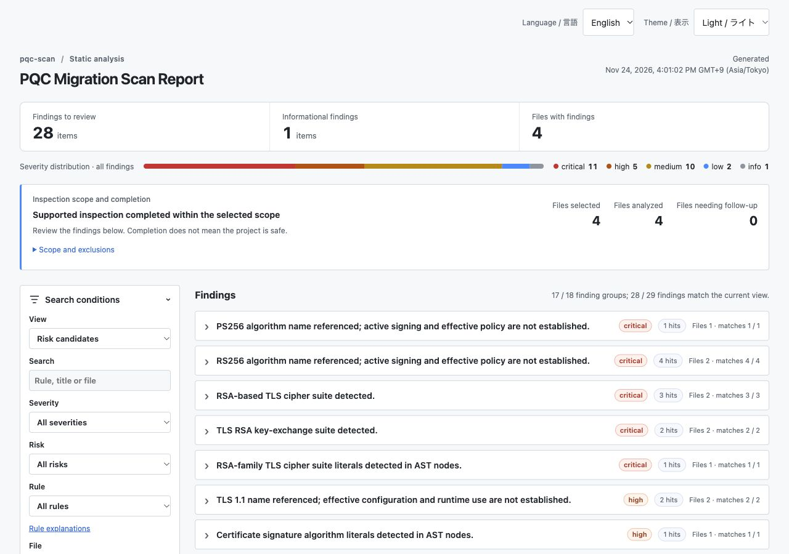
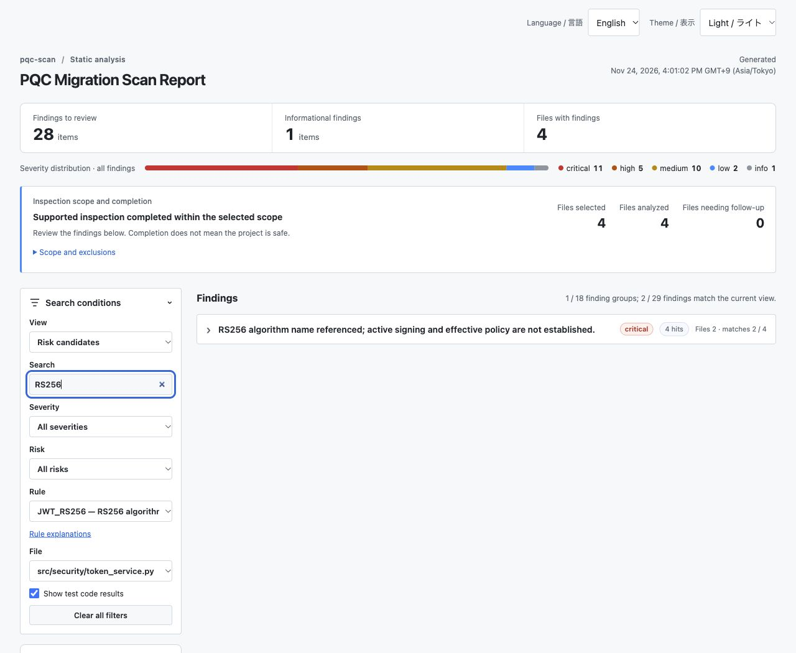
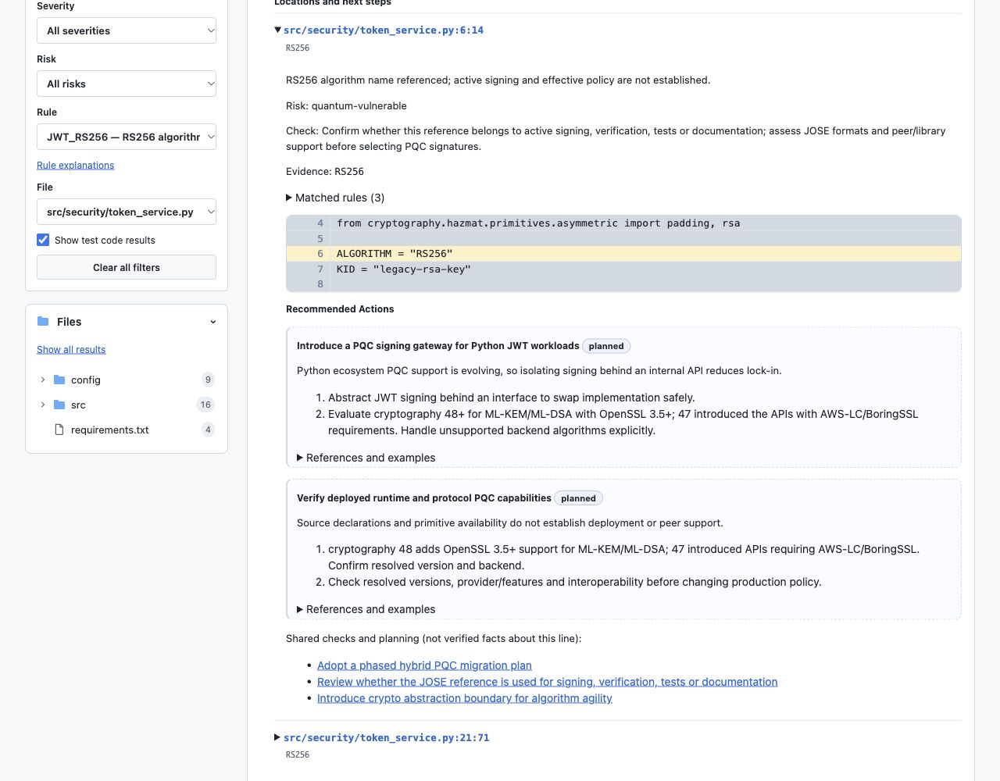

# Understanding reports

[日本語](REPORTS.ja.md) · [README](https://github.com/wakaken/pqc-scan/blob/develop/README.md)

This guide explains how to review scan results and choose a report.

After a scan, use the human report to investigate findings, then choose machine-readable files for tracking or automation. A finding records evidence and suggested checks; it is not an instruction to replace an algorithm without investigating its use.

Reports show findings, locations and suggested next steps. The inspection overview separately identifies incomplete checks and files needing follow-up.

## Contents

- [Review findings](#review)
- [Interpret risk and PQC findings](#pqc-findings)
- [Choose a report, including CBOM and SBOM](#choose-report)
- [Capture richer inventory](#inventory)
- [Export CycloneDX 1.7](#cyclonedx)
- [Compare inventories](#diff)
- [Use local policy assessment](#assessment)
- [Reassess saved evidence](#saved-assessment)
- [Read SARIF locations](#sarif-locations)

<a id="review"></a>

## Review findings

Open `report.html` in a browser and follow these four steps. The screenshots use
v0.4.0 with the public `examples/python` sample. Counts, paths and code belong to
this example; they do not establish deployed use.

### 1. Check what was inspected

Start with **Inspection scope and completion**: selected files, analyzed files and
files needing follow-up. If inspection is unfinished, open the reasons and file
examples to decide what to inspect next. **Scope and exclusions** records the
size limit, test exclusion and other conditions used for this scan.



All four files were analyzed in this example. Completed inspection or zero findings
does not establish project-wide safety or completed PQC migration. The top totals
and severity chart continue to show the whole report after filtering.

### 2. Narrow down the findings

Use **Search conditions** to combine an algorithm/description/filename search with
severity, risk, rule and file filters. This example searches `RS256` and selects
the rule and `src/security/token_service.py`, leaving two matching findings.
You can also choose a file from the **Files** tree.



Use **Show all results** to clear the conditions. PQC references are included in
**Inventory**, so check that view when investigating algorithms already referenced
in the project. Filters affect the display, not saved data or global/tree totals.

### 3. Open a location and read the evidence and actions

Expand the finding heading, then its filename and position. Read the **Evidence**,
surrounding source and **Check** guidance. Establish whether the reference belongs
to application code, configuration, dependencies, an example or a test.
**Matched rules** retains the rules that matched this location.



`ALGORITHM = "RS256"` in this example establishes a name reference, not execution
of a signing operation or the effective configuration. Read **Recommended Actions** and **Shared checks and planning** and verify the runtime, library and
peer conditions before considering a change. Shared guidance is separate from
facts confirmed at an individual location.

### 4. Check the meaning of a rule

**About this rule** opens its meaning, category, severity/risk for this scan and
example checks. The sidebar's **Rule explanations** link also opens explanations. The rule selector includes short explanations.
Escape or **Close** returns to the original link while retaining your filters.


### Search and file-display reference

| Need | Control or interpretation |
|---|---|
| Switch between risk candidates and inventory | Use **View**. Clearing every condition includes informational findings |
| Hide test results | **Show test code results** defaults to checked. Uncheck it to hide matching test paths/filenames; it does not identify just the inline tests in mixed files |
| Collapse a panel | **Search conditions** and **Files** open and close independently without clearing filters. On narrow screens, filters move above the list |
| Select a file | The tree contains only files with findings. Selection applies an exact file condition combined with other filters. Badges count all occurrences, including inventory, not vulnerabilities |
| Read a long path | Scroll horizontally within the tree or hover a folder/file for the full path. Blue folder icons, document icons and a leading blue marker distinguish folders, files and the selected file. Names and counts remain readable without icons |
| Browse more results | Rules and locations have separate 20-item pages. Finding headings use descriptions; find rule IDs in **Matched rules** or the rule filter |
| Read shared actions | Identical guidance is linked once. Recommendations with the same action ID but different content remain distinct |

**Scope and exclusions** records test exclusion and `.pqcignore`. Mixed Rust files
remain analyzed while syntax-proven test-only findings are omitted, so file counts
may not decrease and source context can include adjacent tests. See
[scan exclusion settings](SCANNING.md#exclude-test-code).

If inspection is incomplete, review diagnostics for the cause, affected files and next checks.
Available findings are retained, but areas with no findings may not have been inspected.

### Print, offline reading and Markdown

| Reading mode | Content and required files |
|---|---|
| Print | All findings and expanded evidence, regardless of filters or pagination, using the light palette. Search/file panels are omitted |
| Offline | Search, language switching and embedded rule help need no external scripts or connection. Long reference URLs wrap within the report |
| Without JavaScript | All findings in the initial language remain available through native disclosures. Search/file panels are hidden. Keep `report.rules.html` alongside `report.html` for rule explanations |
| Markdown | Rule/location indexes link to evidence. Source excerpts and examples normalize line endings and indent every line, keeping embedded HTML syntax inside code |

### Language, theme and timestamps

HTML carries both English and Japanese copy. Switch language and Light/Dark theme
in the report while retaining filters, pages, opened locations, selected file, panel visibility and
folder expansion. Light is the default; explicit theme choices are saved locally
when browser storage is available.

HTML creation times use the viewer's timezone while preserving the original instant. Without JavaScript, and in Markdown,
the generation host's local time and explicit offset are shown. Machine timestamps
do not change. There is no IP/geolocation lookup or external translation request.

`--lang ja` selects the initial HTML language and Markdown language; English
(`--lang en`) is the default.

```bash
pqc-scan scan . --lang ja --format all --out-dir /path/to/reports/product-scan-ja --rules-dir /path/to/pqc-scan/rules
```

Custom rules or actions lacking Japanese copy show a notice and retain the original
text. Language selection does not rewrite JSON, SARIF, CBOM, dependency SBOM, IDs,
paths, source code, algorithm names or reference URLs.

<a id="pqc-findings"></a>

## Interpret risk and PQC findings

The scanner reports both migration concerns and informational references. Severity helps prioritize investigation; confidence describes a heuristic match, not a calibrated probability that the application is vulnerable.
Risk labels describe the matched signal:

| Label | How to read it |
|---|---|
| `quantum-vulnerable` | A quantum-related migration concern for the referenced algorithm or usage |
| `non-quantum-risk` | A conventional weakness, such as a weak algorithm or certificate-related issue; it is a separate concern from PQC migration |
| `quantum-uncertain` | The available evidence is insufficient to determine quantum readiness |
| `quantum-safe` | The referenced primitive is classified as quantum-resistant; this is not a verdict on the application |

TLS guidance prefers TLS 1.3, retaining securely configured TLS 1.2 only for an identified interoperability need. PQC override settings receive setting-specific checks rather than an assertion of RSA usage.

### Why PQC-related references appear

The results include references to ML-KEM (key establishment), ML-DSA and SLH-DSA (signatures), as well as old draft names such as Kyber and Dilithium. These help locate code and dependencies that may already be involved in migration work.
For example:

| Observed reference | What still needs checking |
|---|---|
| An ML-KEM name in code | Whether the intended runtime/provider supports it and whether that path is actually used |
| A PQC-capable library in a dependency file | The resolved version, enabled features and actual API calls; dependency presence alone proves none of these |
| A Kyber/Dilithium draft name | Which implementation and specification version it refers to; old and final names are not interchangeable evidence |
| A TLS setting that disables PQC/hybrid groups | The effective configuration and peer support; this is a configuration signal, not an observed negotiated connection |

Informational findings can also appear in CBOM and SARIF. Read `quantum-safe`
as an algorithm classification, not "migration complete." Dependency findings
remain `quantum-uncertain`.

Before applying migration guidance, check runtime and library support, key and
certificate settings, and peer compatibility. A signature change also requires
compatible keys and a way to distribute public keys. Validate operation and
interoperability in a test environment before production deployment.

`CERT_EXPIRY_2026_OR_BEFORE` identifies certificates expiring before January 1,
2027 UTC. To check expiry at scan time, review the actual expiry date and
`CERT_EXPIRED` findings.

<a id="choose-report"></a>

## Choose a report

| File | Selection | Use |
|---|---|---|
| `report.html` | `--format html` or `all` | Investigate findings interactively |
| `report.rules.html` | With HTML | Explain the rules found in this report and link back to their evidence |
| `report.md` | `--format md` or `all` | Share text findings and source/action links |
| `report.json` | `--format json` or `all` | Process findings, evidence, recommendations and summary |
| `report.sarif` | `--format sarif` or `all` | Send findings to Code Scanning tools |
| `cbom.json` | Every report format | Track the cryptographic findings by algorithm, location, risk and guidance |
| `dependency-sbom.json` | Every report format | Track dependencies extracted from manifests, locks and supplied SBOMs |
| `scan.inventory.v1.json` | `--inventory-json` | Keep typed observations, assets and links to legacy findings |
| `scan.assessment.v1.json` | Inventory plus `--policy-profile migration-review-v1` | Review a separate local advisory assessment |
| `diagnostics.json` | `--diagnostics` | Check inspection scope, coverage and safe failure reasons |
| `cbom.cdx-1.7.json`, `dependency-sbom.cdx-1.7.json` | `--cyclonedx-17` | Exchange separate CycloneDX 1.7 cryptographic and software inventories |

`--format all` selects the six original files plus the companion `report.rules.html` (seven files). Inventory, diagnostics and CycloneDX still require their own options. A single selected report format still writes both flat inventory files. `--lang en|ja` changes HTML/Markdown only.
Use a fresh output directory for comparisons; files from previous runs are not automatically removed.

To request the six default files plus inventory, diagnostics and both CycloneDX
exports and the HTML rule guide (eleven files in total):

```bash
pqc-scan scan /path/to/your-product --format all --inventory-json --diagnostics --cyclonedx-17 --lang en --out-dir /path/to/reports/product-scan --rules-dir /path/to/pqc-scan/rules
```

A policy assessment is an additional, separate opt-in. Product version 0.5.0 is separate from Inventory v1, SARIF 2.1.0 and CycloneDX 1.7; it does not rename these formats. Separate
probe reports are described in the [probe guide](PROBING.md).

### Why counts differ

HTML and Markdown may group repeated findings for the same location, algorithm
and issue. JSON, SARIF and inventories retain individual records, so counts may
differ. File counts and finding counts are not vulnerability counts.

### What CBOM and SBOM mean here

An SBOM (Software Bill of Materials) lists software components and dependencies. A CBOM (Cryptographic Bill of Materials) lists cryptographic algorithms and usages.
For instance, a dependency record can show that a crypto library is declared, while a cryptographic finding can point to an algorithm reference in a source file. Use both to connect dependency investigation with code/configuration review, without treating either as proof of runtime use.

`dependency-sbom.json` and `cbom.json` are pqc-scan's flat JSON inventories. They are not CycloneDX/SPDX documents or exhaustive runtime inventories. Reading an existing CycloneDX/SPDX SBOM is supported. The separate opt-in CycloneDX export is described below.
Use `scan.inventory.v1.json` when you need richer observations and provenance alongside the legacy findings.

<a id="inventory"></a>
## Capture richer inventory

`--inventory-json` adds `scan.inventory.v1.json`, recording cryptographic assets
and finding locations in pqc-scan's own JSON format. `--format all` alone does
not save it. To compare inventories later, use the same
`--repository-scope team/project` for both scans. Do not include secrets or
absolute paths in this name. Inventory does not establish actual use or
completed PQC migration.

```bash
pqc-scan scan . --inventory-json --repository-scope team/project --rules-dir ./rules
```

The inventory keeps dependency declarations and resolved-version records distinct.
A declaration alone does not establish the installed version or actual use.
The scanner does not install packages or resolve dependencies.

<a id="cyclonedx"></a>
## Export CycloneDX 1.7

Use `--cyclonedx-17` to exchange inventory with tools accepting CycloneDX 1.7:

```bash
pqc-scan scan . --cyclonedx-17 --rules-dir /path/to/pqc-scan/rules --out-dir /path/to/new-output
```

`cbom.cdx-1.7.json` carries observed algorithm/public-key/certificate assets;
`dependency-sbom.cdx-1.7.json` carries software dependency assertions. To also save
`scan.inventory.v1.json`, add `--inventory-json`. Neither `--format all` nor input SBOM detection enables
this export automatically. The two legacy arrays retain their names and shape.

Read the `pqc-scan` properties and conversion-loss notes as well as the standard
fields. A declared constraint or a version reported in an input SBOM is not proof
of installation. Static references are not runtime protocol observations; missing
facts, trust validation, security strength and certification are not invented.

<a id="diff"></a>
## Compare inventories

Capture both scans with `--inventory-json --repository-scope team/project`, then:

```bash
pqc-scan diff /path/to/before/scan.inventory.v1.json /path/to/after/scan.inventory.v1.json --repository-scope team/project --out-dir /path/to/new-diff
```

Both inputs must use the same repository scope and compatible output formats.
The command writes `scan.diff.v1.json` and `scan.diff.v1.md`. Check changes to
rules, assessment policy and inspection scope as well.

A finding that disappears is not proof of remediation. Ambiguous matches and
differences without evidence of inspection remain unresolved. If a possible file
move is suggested, check the original records and the change.

<a id="assessment"></a>

## Use local policy assessment

HTML starts with selected/analyzed/follow-up file counts, actual exclusion settings
and file-size limits. Failed, incomplete and unknown checks remain distinct;
unrecorded excluded populations are never presented as a complete total.
With `--diagnostics`, a closed details section groups reasons and shows at most
three example paths per reason. Per-observation IDs, assurance and usage ledgers
are omitted from HTML; exact records remain in inventory JSON and Markdown.
HTML does not display advisory policy decisions. It focuses on inspection
status, finding locations, checks and next steps. Explicitly requested policy
results and reasons remain in assessment JSON and Markdown.

`--inventory-json --policy-profile migration-review-v1` adds a separate
`scan.assessment.v1.json` with quantum/classical concerns, observation certainty,
usage, priority and purpose-specific candidate prerequisites. Existing reports,
inventory JSON, severity and exit codes remain unchanged. This is local advisory
migration review, not compliance or deployed-security assurance, with no deadlines.
Unknown/incomplete inspection cannot yield a clean pass; current inventory v1
cannot yield aggregate Pass.

```bash
pqc-scan scan . --inventory-json --policy-profile migration-review-v1 --rules-dir ./rules
```

Optional `--assessment-context ./context.json` supplies typed local context, e.g.
`{"version":1,"use_case":"jwt"}`. Missing support stays unknown; provided values are
unverified operator claims. Dependency presence does not prove PQC readiness.
See [scope, prerequisites and context fields](https://github.com/wakaken/pqc-scan/blob/develop/docs/architecture/LOCAL-ASSESSMENT-V1.md).

<a id="saved-assessment"></a>

## Review an organization's migration response from saved evidence

`assess` combines detected cryptographic references with declared organization and
system context to explain where attention is needed, what blocks migration and
what to check next. The scan HTML investigates source findings; the assess HTML
supports migration decisions using saved evidence and business assumptions.

Replace the input and context filenames and choose an evaluation time at or after collection.
Replace `YYYY-MM-DDTHH:MM:SS+09:00` with the actual time, including seconds and timezone offset.
See the [saved-input guide](SAVED-EVIDENCE.md) to prepare the context JSON.

```console
pqc-scan assess saved.inventory.v1.json --input-format inventory-v1 \
  --as-of 'YYYY-MM-DDTHH:MM:SS+09:00' --context migration-context.json \
  --out-dir ./migration-report --lang ja
```

Open `migration.assessment.html` in the output directory using a browser. This
is generated directly by assess; no Markdown conversion, QA server or `serve`
command is required. The browser does not open automatically. The command also
writes `migration.assessment.md` and `migration.assessment.v1.json`. See the
[saved-input guide](SAVED-EVIDENCE.md) for formats and context preparation.

For browser input through saving, follow the [eight illustrated steps](SCANNING.md#web-migration-walkthrough). The sections below explain the generated migration review.

Migration Markdown links each record to shared check lists and candidate details.
Each target retains its own decision and candidate references. Expand its details to read evidence, declarations and reference IDs.

### Read the migration decisions

Check the evaluation time and schedule, then review **Urgent** items. Read each
card's **What to do** and **When to proceed**. Depending on purpose and usage,
cards show migration steps, further investigation or continued review.

Open **Other checks**, when present, to review the remaining items. Undetermined
urgency needs more information and does not mean low risk. A test-only declaration
alone does not resolve known concerns. Work items are paged 20 at a time.

The example below uses saved Kubernetes evidence with explicit JWT purpose, usage and planning declarations. Start-by and migration deadline are separate; each phase states its condition for proceeding. These dates and counts belong to this example, not every project.


### Check dates and declarations

The top of the report shows evaluation time. An active deadline and lead time on
the same record produce separate **Start by**, **Lead time** and **Migration
deadline** fields in Japan time. Passing the start-by date and passing the
migration deadline have separate labels. The top shows up to three date pairs;
remaining pairs are available in the cards. A goal month is planning information
shown under **Assessment details → Applied declarations and planning**; it does
not set a deadline or change urgency. Declared blockers also appear in details
and, for migration plans, in the compatibility step.

**Applied declarations** summarizes values and record counts. Open a card's
**Assessment details** for its reasons, evidence and planning assumptions.
Counts distinguish assessment records from distinct recorded locations; neither
is a count of deployed uses or confirmed vulnerabilities.

### Inspect locations and save the result

Open **View detection locations** and search by algorithm or filename. Locations
are paged 20 at a time. Use each row's **Details** to read the evidence. When the
original scan report remains in the same local job, details also link to the
original finding.

Use **Save assessment data** at the bottom to save the complete assessment JSON.
CLI `assess` writes HTML, Markdown and JSON. See the
[saved-results guide](SAVED-EVIDENCE.md) to reassess saved inputs.

Switch language and light/dark display on the page. `--lang ja` selects Japanese
for the HTML initial language and Markdown. Assessment uses saved inputs without
rescanning or contacting endpoints.

Distinguish declared purpose and usage from facts checked by the scanner.
"Ready" is also based on declarations and requires deployment and compatibility
validation. For exclusions and continued review, check each card's reassessment
conditions. Zero assessment targets do not establish absence of cryptography,
safety or that no action is needed.

<a id="sarif-locations"></a>

## Read SARIF locations

SARIF 2.1.0 lets compatible development tools display finding locations.
File, line and column are included when known; an unknown column leaves the line
available. Selecting SARIF does not change finding IDs or locations in other outputs.

<a id="versions-and-identity"></a>

## Product versions and record identity

Identical findings produced with the same binary, rules, input and settings can
be compared by ID. Version upgrades or changes to inputs and settings can change
IDs and counts. Compare binary/rule versions, selected scope and settings together.
See the [v0.5.0 compatibility notes](../releases/v0.5.0.md#compatibility).

## Interpreting source-only records

Algorithm and implementation references help locate possible cryptographic use.
Read the code or configuration at the finding location and confirm its purpose
and use in the deployed system before acting. Informational findings are also
available, but a reference alone does not establish a vulnerability or completed PQC migration.

Several findings at one location do not necessarily represent independent uses
of cryptography. A test path or dependency-file classification alone does not
establish that no action is needed.

<a id="source-excerpts"></a>

## Protected source excerpts

Source excerpts show the detected line and up to two lines before and after it.
Ordinary code remains visible while recognized credentials and private or shared
key values are masked. Regions that cannot be inspected sufficiently may be
withheld more broadly. A mask alone does not establish that a valid private key was found.

This feature does not find and hide every secret. Review the report before
sharing it. File paths and public-key information may also contain information
that is sensitive within your organization.

Saved reports keep their contents. Rescan to obtain current source excerpts.
