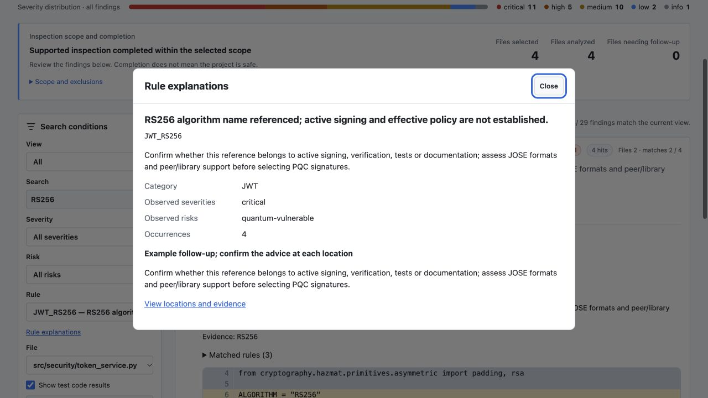
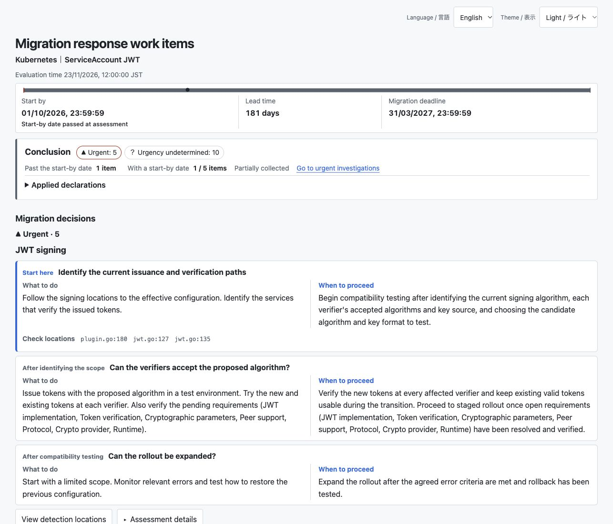

# Understanding reports

[日本語](REPORTS.ja.md) · [README](https://github.com/wakaken/pqc-scan/blob/develop/README.md)

This guide covers v0.4.0 static scanning. See the [release notes](../releases/v0.4.0.md) for changes between versions.

After a scan, use the human report to investigate findings, then choose machine-readable files for tracking or automation. A finding records evidence and suggested checks; it is not an instruction to replace an algorithm without investigating its use.

Reports show findings, locations and suggested next steps. The inspection overview separately identifies incomplete checks and files needing follow-up.

## Contents

- [Review findings](#review)
- [Interpret risk and PQC findings](#pqc-findings)
- [Choose a report, including CBOM and SBOM](#choose-report)
- [Capture richer inventory](#inventory)
- [Export CycloneDX 1.7](#cyclonedx)
- [Compare inventories](#diff)
- [Use local policy assessment](#assessment)
- [Reassess saved evidence](#saved-assessment)
- [Read SARIF locations](#sarif-locations)

<a id="review"></a>

## Review findings

Open `report.html` in a browser and follow these four steps. The screenshots use
v0.4.0 with the public `examples/python` sample. Counts, paths and code belong to
this example; they do not establish deployed use.

### 1. Check what was inspected

Start with **Inspection scope and completion**: selected files, analyzed files and
files needing follow-up. If inspection is unfinished, open the reasons and file
examples to decide what to inspect next. **Scope and exclusions** records the
size limit, test exclusion and other conditions used for this scan.


All four files were analyzed in this example. Completed inspection or zero findings
does not establish project-wide safety or completed PQC migration. The top totals
and severity chart continue to show the whole report after filtering.

### 2. Narrow down the findings

Use **Search conditions** to combine an algorithm/description/filename search with
severity, risk, rule and file filters. This example searches `RS256` and selects
the rule and `src/security/token_service.py`, leaving two matching findings.
You can also choose a file from the **Files** tree.


Use **Show all results** to clear the conditions. PQC references are included in
**Inventory**, so check that view when investigating algorithms already referenced
in the project. Filters affect the display, not saved data or global/tree totals.

### 3. Open a location and read the evidence and actions

Expand the finding heading, then its filename and position. Read the **Evidence**,
surrounding source and **Check** guidance. Establish whether the reference belongs
to application code, configuration, dependencies, an example or a test.
**Matched rules** retains the rules that matched this location.


`ALGORITHM = "RS256"` in this example establishes a name reference, not execution
of a signing operation or the effective configuration. Read **Recommended Actions** and **Shared checks and planning** and verify the runtime, library and
peer conditions before considering a change. Shared guidance is separate from
facts confirmed at an individual location.

### 4. Check the meaning of a rule

**About this rule** opens its meaning, category, severity/risk for this scan and
example checks. The sidebar's **Rule explanations** link also opens explanations. The rule selector includes short explanations.
Escape or **Close** returns to the original link while retaining your filters.



### Search and file-display reference

| Need | Control or interpretation |
|---|---|
| Switch between risk candidates and inventory | Use **View**. Clearing every condition includes informational findings |
| Hide test results | **Show test code results** defaults to checked. Uncheck it to hide matching test paths/filenames; it does not identify just the inline tests in mixed files |
| Collapse a panel | **Search conditions** and **Files** open and close independently without clearing filters. On narrow screens, filters move above the list |
| Select a file | The tree contains only files with findings. Selection applies an exact file condition combined with other filters. Badges count all occurrences, including inventory, not vulnerabilities |
| Read a long path | Scroll horizontally within the tree or hover a folder/file for the full path. Blue folder icons, document icons and a leading blue marker distinguish folders, files and the selected file. Names and counts remain readable without icons |
| Browse more results | Rules and locations have separate 20-item pages. Finding headings use descriptions; find rule IDs in **Matched rules** or the rule filter |
| Read shared actions | Identical guidance is linked once. Recommendations with the same action ID but different content remain distinct |

**Scope and exclusions** records test exclusion and `.pqcignore`. Mixed Rust files
remain analyzed while syntax-proven test-only findings are omitted, so file counts
may not decrease and source context can include adjacent tests. See
[scan exclusion settings](SCANNING.md#exclude-test-code).

Unfinished-inspection details distinguish diagnostic records, file counts, examples
and next checks; diagnostic JSON retains the detail in `message`. Algorithm names
inside recognized error text appear under inventory. Open the location to read
the original text.

### Print, offline reading and Markdown

| Reading mode | Content and required files |
|---|---|
| Print | All findings and expanded evidence, regardless of filters or pagination, using the light palette. Search/file panels are omitted |
| Offline | Search, language switching and embedded rule help need no external scripts or connection. Long reference URLs wrap within the report |
| Without JavaScript | All findings in the initial language remain available through native disclosures. Search/file panels are hidden. Keep `report.rules.html` alongside `report.html` for rule explanations |
| Markdown | Rule/location indexes link to evidence. Source excerpts and examples normalize line endings and indent every line, keeping embedded HTML syntax inside code |

### Language, theme and timestamps

HTML carries both English and Japanese copy. Switch language and Light/Dark theme
in the report while retaining filters, pages, opened locations, selected file, panel visibility and
folder expansion. Light is the default; explicit theme choices are saved locally
when browser storage is available.

HTML creation times use the viewer's timezone while preserving the original instant. Without JavaScript, and in Markdown,
the generation host's local time and explicit offset are shown. Machine timestamps
do not change. There is no IP/geolocation lookup or external translation request.

`--lang ja` selects the initial HTML language and Markdown language; English
(`--lang en`) is the default.

```bash
pqc-scan scan . --lang ja --format all --out-dir /path/to/reports/product-scan-ja --rules-dir /path/to/pqc-scan/rules
```

Custom rules or actions lacking Japanese copy show a notice and retain the original
text. Language selection does not rewrite JSON, SARIF, CBOM, dependency SBOM, IDs,
paths, source code, algorithm names or reference URLs.

<a id="pqc-findings"></a>

## Interpret risk and PQC findings

The scanner reports both migration concerns and informational references. Severity helps prioritize investigation; confidence describes a heuristic match, not a calibrated probability that the application is vulnerable.
Risk labels describe the matched signal:

| Label | How to read it |
|---|---|
| `quantum-vulnerable` | A quantum-related migration concern for the referenced algorithm or usage |
| `non-quantum-risk` | A conventional weakness, such as a weak algorithm or certificate-related issue; it is a separate concern from PQC migration |
| `quantum-uncertain` | The available evidence is insufficient to determine quantum readiness |
| `quantum-safe` | The referenced primitive is classified as quantum-resistant; this is not a verdict on the application |

TLS guidance prefers TLS 1.3, retaining securely configured TLS 1.2 only for an identified interoperability need. PQC override settings receive setting-specific checks rather than an assertion of RSA usage.

### Why PQC-related references appear

The results include references to ML-KEM (key establishment), ML-DSA and SLH-DSA (signatures), as well as old draft names such as Kyber and Dilithium. These help locate code and dependencies that may already be involved in migration work.
For example:

| Observed reference | What still needs checking |
|---|---|
| An ML-KEM name in code | Whether the intended runtime/provider supports it and whether that path is actually used |
| A PQC-capable library in a dependency file | The resolved version, enabled features and actual API calls; dependency presence alone proves none of these |
| A Kyber/Dilithium draft name | Which implementation and specification version it refers to; old and final names are not interchangeable evidence |
| A TLS setting that disables PQC/hybrid groups | The effective configuration and peer support; this is a configuration signal, not an observed negotiated connection |

The rule set includes ML-KEM/ML-DSA references across the seven listed languages, selected Java, Node and Ruby SLH-DSA API references, selected libraries, Java/Ruby classical-only TLS group settings and Go `GODEBUG=tlsmlkem=0`.
Certificate signature OIDs and subject-public-key OIDs for ML-DSA/SLH-DSA are checked separately; a filename does not establish the certificate's algorithm. Parsed OIDs do not verify a signature, trust chain or valid PQC key.

These references can appear as informational findings in CBOM and SARIF too. Read `quantum-safe` as a classification of the primitive, not “migration complete.” Dependency findings remain `quantum-uncertain`.
Node crypto/WebCrypto, browser and TypeScript runtime support must be checked individually; their version requirements differ. JWT signature changes also need compatible JOSE formats, libraries and verifiers.
See [static examples and references](https://github.com/wakaken/pqc-scan/blob/develop/examples/pqc-readiness/README.md) for specific patterns.

Before applying migration guidance:

- If the Java version is unknown, check the deployed runtime; do not infer that it is old. Standard ML-KEM/ML-DSA APIs start at JDK 24.
- Generate a new key pair for the selected signature algorithm and parameter set, then provision its public key and JOSE/PKI encoding to verifiers. An RSA key cannot be reused for ML-DSA.
- The BC example is scoped to BC Java 1.85 and the `BC` provider, not `BCPQC`. Verify the resolved library release, deployed JDK and algorithm support before using it.
- For certificate migration, choose the exact construction and encoding and confirm provider, CA, client and trust-store support before a nonproduction pilot. FIPS 204/205 specify signature primitives, not a universal hybrid certificate format.
- Envoy `cipher_suites` applies to TLS 1.0–1.2, not TLS 1.3. Retiring static RSA key exchange differs from removing RSA authentication in ECDHE_RSA suites; check certificate and peer compatibility separately.

For `CERT_EXPIRY_2026_OR_BEFORE`, the human report identifies expiry before January 1, 2027 UTC and explains that the cutoff alone does not establish expiry at scan time. Check the parsed expiry and `CERT_EXPIRED` findings.

<a id="choose-report"></a>

## Choose a report

| File | Selection | Use |
|---|---|---|
| `report.html` | `--format html` or `all` | Investigate findings interactively |
| `report.rules.html` | With HTML | Explain the rules found in this report and link back to their evidence |
| `report.md` | `--format md` or `all` | Share text findings and source/action links |
| `report.json` | `--format json` or `all` | Process findings, evidence, recommendations and summary |
| `report.sarif` | `--format sarif` or `all` | Send findings to Code Scanning tools |
| `cbom.json` | Every report format | Track the cryptographic findings by algorithm, location, risk and guidance |
| `dependency-sbom.json` | Every report format | Track dependencies extracted from manifests, locks and supplied SBOMs |
| `scan.inventory.v1.json` | `--inventory-json` | Keep typed observations, assets and links to legacy findings |
| `scan.assessment.v1.json` | Inventory plus `--policy-profile migration-review-v1` | Review a separate local advisory assessment |
| `diagnostics.json` | `--diagnostics` | Check inspection scope, coverage and safe failure reasons |
| `cbom.cdx-1.7.json`, `dependency-sbom.cdx-1.7.json` | `--cyclonedx-17` | Exchange separate CycloneDX 1.7 cryptographic and software inventories |

`--format all` selects the six original files plus the companion `report.rules.html` (seven files). Inventory, diagnostics and CycloneDX still require their own options. A single selected report format still writes both flat inventory files. `--lang en|ja` changes HTML/Markdown only.
Use a fresh output directory for comparisons; files from previous runs are not automatically removed.

To request the six default files plus inventory, diagnostics and both CycloneDX
exports and the HTML rule guide (eleven files in total):

```bash
pqc-scan scan /path/to/your-product --format all --inventory-json --diagnostics --cyclonedx-17 --lang en --out-dir /path/to/reports/product-scan --rules-dir /path/to/pqc-scan/rules
```

A policy assessment is an additional, separate opt-in. Product version 0.4.0 is separate from Inventory v1, SARIF 2.1.0 and CycloneDX 1.7; it does not rename these formats. Separate
probe reports are described in the [probe guide](PROBING.md).

### Why counts differ

HTML and Markdown count equivalent findings once when file, line, column, algorithm evidence and issue agree. Details retain every matched rule, description, severity and check; actions are combined and the highest severity is displayed. Missing positions and empty or masked evidence are not merged. Summaries, charts and file-tree counts use this projection. Files inspected is a file count, not a count of cryptographic detections. JSON, SARIF, inventories and stable finding IDs retain original rule-level records, so their counts can differ from HTML and Markdown.

### What CBOM and SBOM mean here

An SBOM (Software Bill of Materials) lists software components and dependencies. A CBOM (Cryptographic Bill of Materials) lists cryptographic algorithms and usages.
For instance, a dependency record can show that a crypto library is declared, while a cryptographic finding can point to an algorithm reference in a source file. Use both to connect dependency investigation with code/configuration review, without treating either as proof of runtime use.

`dependency-sbom.json` and `cbom.json` are pqc-scan's flat JSON inventories. They are not CycloneDX/SPDX documents or exhaustive runtime inventories. Reading an existing CycloneDX/SPDX SBOM is supported. The separate opt-in CycloneDX export is described below.
Use `scan.inventory.v1.json` when you need richer observations and provenance alongside the legacy findings.

<a id="inventory"></a>
## Capture richer inventory

`--inventory-json` adds `scan.inventory.v1.json` with method-specific observations,
normalized algorithm/public-key/certificate/dependency assets, and links to legacy
findings. This is pqc-scan's own JSON format. It is opt-in even with `--format all`;
selecting it does not change the legacy report schemas or finding identity algorithm. Use `--repository-scope team/project`
with inventory capture to enable weak cross-scan source correlation. Omit secret
or absolute identifiers. The report does not assert active use, trust or a PQC
assessment. See the [contract and limitations](https://github.com/wakaken/pqc-scan/blob/develop/docs/architecture/INVENTORY-REPORT-V1.md).

```bash
pqc-scan scan . --inventory-json --repository-scope team/project --rules-dir ./rules
```

Dependency assets preserve declared constraints (for example `^1.2.3`), optional
lock-record resolved versions and source provenance separately. A declaration or
SBOM claim alone never creates a versioned purl. Path/git/workspace locators stay
unresolved; no dependency graph or package download is inferred. The legacy
`dependency-sbom.json` is a flat array; its purls and inspection diagnostics reflect
the supported declaration/resolution evidence. Source origins remain
separate in inventory even when the legacy projection collapses them.

<a id="cyclonedx"></a>
## Export CycloneDX 1.7

Use `--cyclonedx-17` to exchange inventory with tools accepting CycloneDX 1.7:

```bash
pqc-scan scan . --cyclonedx-17 --rules-dir /path/to/pqc-scan/rules --out-dir /path/to/new-output
```

`cbom.cdx-1.7.json` carries observed algorithm/public-key/certificate assets;
`dependency-sbom.cdx-1.7.json` carries software dependency assertions. Native
observations are captured internally; writing `scan.inventory.v1.json` still
requires `--inventory-json`. Neither `--format all` nor input SBOM detection enables
this export automatically. The two legacy arrays retain their names and shape.

Read the `pqc-scan` properties and conversion-loss notes as well as the standard
fields. A declared constraint or a version reported in an input SBOM is not proof
of installation. Static references are not runtime protocol observations; missing
facts, trust validation, security strength and certification are not invented.

<a id="diff"></a>
## Compare inventories

Capture both scans with `--inventory-json --repository-scope team/project`, then:

```bash
pqc-scan diff /path/to/before/scan.inventory.v1.json /path/to/after/scan.inventory.v1.json --repository-scope team/project --out-dir /path/to/new-diff
```

Both inputs must use the requested scope and compatible schema/identity versions.
The command writes `scan.diff.v1.json` and `scan.diff.v1.md`. Exact correspondence
uses inventory asset/occurrence keys, not legacy finding IDs or checkout roots.
Rule/profile/coverage changes are disclosed. Duplicate anchors and missing target
inspection evidence stay unresolved; absence alone never proves remediation.
Current inventory v1 cannot prove target-level exhaustive absence, so disappeared
records remain unresolved. Unique changed-path pairs may be suggested as heuristic
moves; they are never merged automatically or treated as verified renames.

<a id="assessment"></a>

## Use local policy assessment

HTML starts with selected/analyzed/follow-up file counts, actual exclusion settings
and file-size limits. Failed, incomplete and unknown checks remain distinct;
unrecorded excluded populations are never presented as a complete total.
With `--diagnostics`, a closed details section groups reasons and shows at most
three example paths per reason. Per-observation IDs, assurance and usage ledgers
are omitted from HTML; exact records remain in inventory JSON and Markdown.
HTML does not display advisory policy decisions. It focuses on inspection
status, finding locations, checks and next steps. Explicitly requested policy
results and reasons remain in assessment JSON and Markdown.

`--inventory-json --policy-profile migration-review-v1` adds a separate
`scan.assessment.v1.json` with quantum/classical concerns, observation certainty,
usage, priority and purpose-specific candidate prerequisites. Existing reports,
inventory JSON, severity and exit codes remain unchanged. This is local advisory
migration review, not compliance or deployed-security assurance, with no deadlines.
Unknown/incomplete inspection cannot yield a clean pass; current inventory v1
cannot yield aggregate Pass.

```bash
pqc-scan scan . --inventory-json --policy-profile migration-review-v1 --rules-dir ./rules
```

Optional `--assessment-context ./context.json` supplies typed local context, e.g.
`{"version":1,"use_case":"jwt"}`. Missing support stays unknown; provided values are
unverified operator claims. Dependency presence does not prove PQC readiness.
See [scope, prerequisites and context fields](https://github.com/wakaken/pqc-scan/blob/develop/docs/architecture/LOCAL-ASSESSMENT-V1.md).

<a id="saved-assessment"></a>

## Review an organization's migration response from saved evidence

`assess` combines detected cryptographic references with declared organization and
system context to explain where attention is needed, what blocks migration and
what to check next. The scan HTML investigates source findings; the assess HTML
supports migration decisions using saved evidence and business assumptions.

Replace the input and context filenames and choose an evaluation time at or after collection.
Replace `YYYY-MM-DDTHH:MM:SS+09:00` with the actual time, including seconds and timezone offset.
See the [saved-input guide](SAVED-EVIDENCE.md) to prepare the context JSON.

```console
pqc-scan assess saved.inventory.v1.json --input-format inventory-v1 \
  --as-of 'YYYY-MM-DDTHH:MM:SS+09:00' --context migration-context.json \
  --out-dir ./migration-report --lang ja
```

Open `migration.assessment.html` in the output directory using a browser. This
is generated directly by assess; no Markdown conversion, QA server or `serve`
command is required. The browser does not open automatically. The command also
writes `migration.assessment.md` and `migration.assessment.v1.json`. See the
[saved-input guide](SAVED-EVIDENCE.md) for formats and context preparation.

For browser input through saving, follow the [eight illustrated steps](SCANNING.md#web-migration-walkthrough). The sections below explain the generated migration review.

Migration Markdown links each record to shared check lists and candidate details.
Each target retains its own decision and candidate references. Expand its details to read evidence, declarations and reference IDs.

### Read the migration decisions

Start with the evaluation time and schedule, then review **Urgent** items. Each
card gives **What to do** and **When to proceed**. The number of cards depends
on the saved evidence and declarations; it is not a fixed three.

A three-step migration plan (identify current use, test compatibility, roll out
in stages) appears when active, non-conflicting declarations identify a system,
a supported use (JWT, signature, PKI, key establishment, encryption or hashing),
and active/planned usage, and the assessed action is plan, unblock or migrate.
Adding more detail alone does not create a plan. Investigation cards show the
next fact to establish; monitoring and declared exclusions show reassessment
conditions instead. Test-only usage alone does not override known classical
concerns such as RSA-SHA1 or short RSA keys. An applicable explicit scope
exclusion takes precedence; it retains the original detection and conditions
for reassessment if live processing uses it.

When at least one card has a use-specific workflow (including monitoring or an
exclusion), **Other checks** initially folds remaining cards without a workflow,
except urgent investigations, which stay visible. Without such a workflow, all
cards appear by urgency without this fold. Undetermined urgency needs more
information; it is not low risk. Work items are paged 20 at a time.

The example below uses saved Kubernetes evidence with explicit JWT purpose, usage and planning declarations. Start-by and migration deadline are separate; each phase states its condition for proceeding. These dates and counts belong to this example, not every project.



### Check dates and declarations

The top of the report shows evaluation time. An active deadline and lead time on
the same record produce separate **Start by**, **Lead time** and **Migration
deadline** fields in Japan time. Passing the start-by date and passing the
migration deadline have separate labels. The top shows up to three date pairs;
remaining pairs are available in the cards. A goal month is planning information
shown under **Assessment details → Applied declarations and planning**; it does
not set a deadline or change urgency. Declared blockers also appear in details
and, for migration plans, in the compatibility step.

**Applied declarations** summarizes values and record counts. Open a card's
**Assessment details** for its reasons, evidence and planning assumptions.
Counts distinguish assessment records from distinct recorded locations; neither
is a count of deployed uses or confirmed vulnerabilities.

### Inspect locations and save the result

**View detection locations** opens **Detection locations**. Search there by
algorithm or filename and browse 20 locations at a time. Long paths wrap; each
row has a **Details** button. Equivalent detections at the same file and line
share the row and detail view, retaining their matched rules and methods.
Migration decisions themselves have no search box or urgency filter.

When the same local job has the original scan report, the location details can
open the corresponding finding. A standalone assessment HTML does not carry
that original report or create this link. The bottom action, **Save assessment
data**, exports the complete assessment JSON. There is no separate end-of-page
checklist, owner list or request-copy control. CLI `assess` still writes HTML,
Markdown and JSON; simplifying HTML controls does not remove those files or the
original detection data.

The page reuses the scan HTML's styles and local language/theme controls.
`--lang ja` selects the HTML initial language and Markdown language; English is
the default. Without JavaScript, the initial language and native disclosures
remain available. No external translation, scripts or fonts are fetched. JSON,
IDs, facts and decisions are language-independent. Assessment uses saved inputs
without rescanning or connecting to endpoints.

Operator/external-review claims remain unverified. Ready means active declared
support, not verified deployment. Candidates need exact parameter and compatibility
validation before adoption. Outside scope is a scoped declaration; monitor applies
to the recorded technical role. Unknown is not low priority; no aggregate safety
or independently measured practitioner-usefulness verdict is presented.

Migration HTML can carry a bounded non-secret report label. It separates detector record counts from distinct recorded locations, names observation methods, explains known binding limitations, and shows applied active deadline/lead-time pairs in Japan time and human durations. Mixed pairs retain their own record counts; exact UTC timestamps and seconds remain available in JSON. See local migration input for scoped organization/contract deadline authoring.

Zero assessment targets do not establish absence of cryptography, safety or no required action. This differs from having targets whose urgency is undetermined, or finding no matching records in a detection-location search.

<a id="sarif-locations"></a>

## Read SARIF locations

SARIF 2.1.0 lets compatible development tools display finding locations.
File, line and column are included when known; an unknown column leaves the line
available. Selecting SARIF does not change finding IDs or locations in other outputs.

<a id="versions-and-identity"></a>

## Product versions and record identity

Identical findings produced with the same binary, rules, input and settings can
be compared by ID. Version upgrades or changes to inputs and settings can change
IDs and counts. Compare binary/rule versions, selected scope and settings together.
See the [v0.4.0 compatibility notes](../releases/v0.4.0.md).
