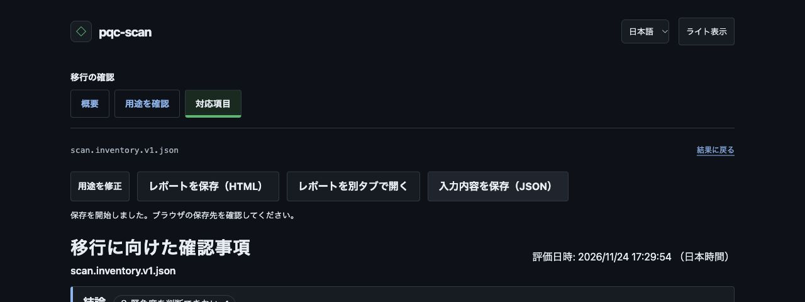
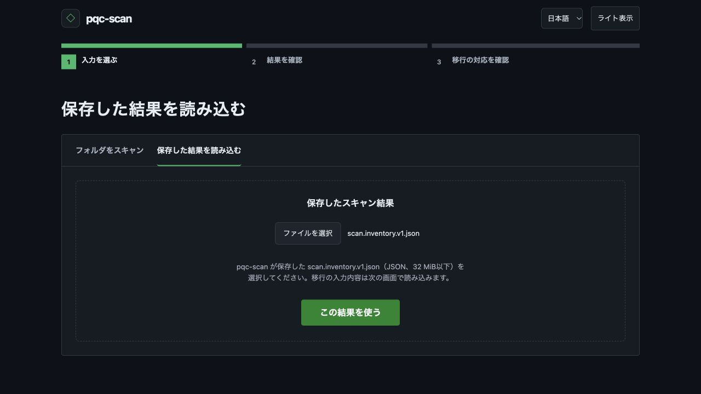
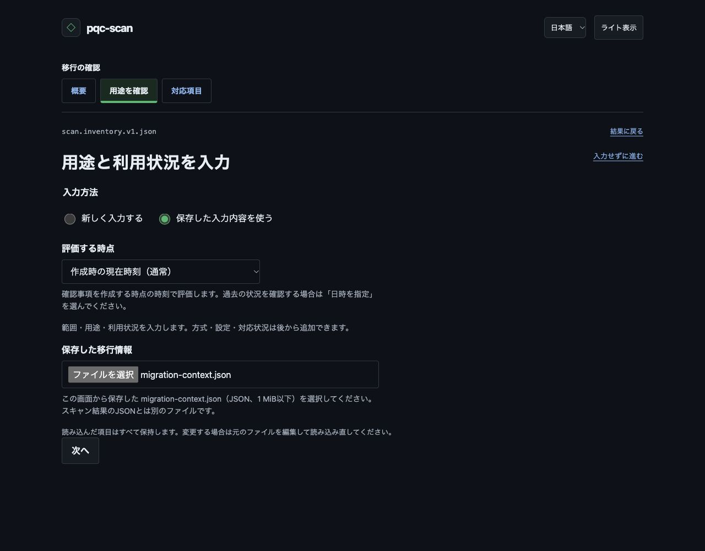
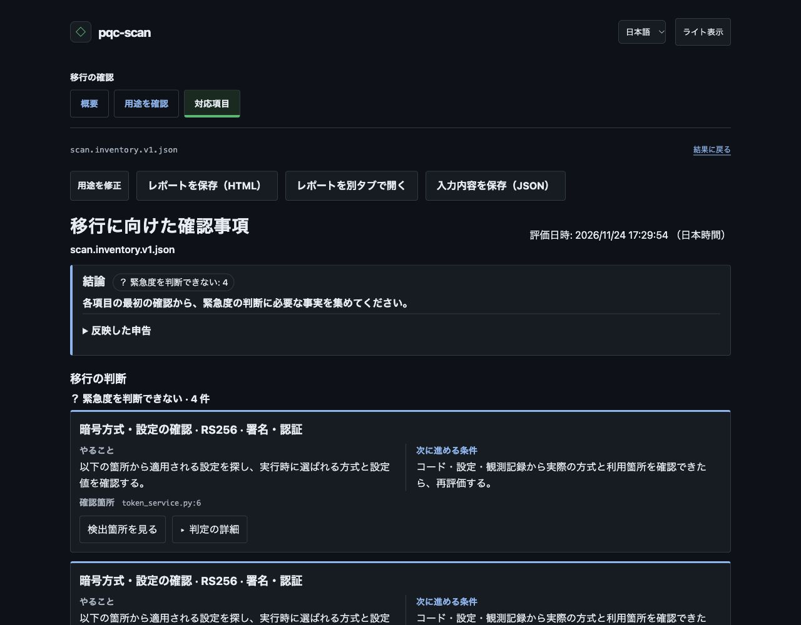

# 保存した結果で移行を再確認する

[English](SAVED-EVIDENCE.md)

以前のスキャン結果と、入力した用途・利用状況を読み込み、移行に向けた確認事項を作り直す手順です。\
保存した時点の検出結果を使うため、ソースの変更を調べ直したい場合は、新しくスキャンしてください。

ブラウザでは、ファイルと確認したい項目を画面上で選びます。\
コマンドから使う場合は、保存した検出結果を評価する **`pqc-scan assess` コマンド**を使います。\
どちらも再評価のためにソースを再スキャンしたり、接続先へ通信したりしません。

| 利用方法 | 進め方 |
|---|---|
| ブラウザから使う | 下の[画面付き4ステップ](#browser-save)へ進みます。初回のスキャンと用途入力は[SCANNING](SCANNING.ja.md#web-migration-walkthrough)を参照してください |
| ターミナルから使う | [用途・利用状況を入力する](#context-template) → [保存した結果を再評価する](#reassess)へ進みます |

<a id="browser-save"></a>

## ブラウザで保存・再評価するとき

画面はv0.4.0で公開サンプル `examples/python` を使った例です。\
件数・入力値は説明用で、実際の利用状況を確認したものではありません。

### 1. 検出結果と入力内容を一組で保管する

移行の確認を作成したら、「入力内容を保存（JSON）」を押します。\
「保存を開始しました」の案内と、ブラウザの保存先の `migration-context.json` を確認してください。\
取得に失敗した場合は、この画面から再試行できます。



再評価には、次の2ファイルが必要です。

| ファイル | 入っているもの・保管場所 |
|---|---|
| `scan.inventory.v1.json` | 元の検出結果。Webスキャンでは、起動時にターミナルへ表示された `pqc-scan-web-*` の保存先内に、ジョブごとのサブフォルダで残ります。CLIのスキャンでは `--inventory-json` を指定して出力します |
| `migration-context.json` | 入力した用途・利用状況。画面の「入力内容を保存（JSON）」でダウンロードします |

「レポートを保存（HTML）」は閲覧用、「評価データを保存」は評価結果の保存です。\
この2つは、入力内容を再利用する `migration-context.json` とは別です。\
元の検出結果を整形・変更すると入力との対応が変わるため、保存したファイルをそのまま保管してください。

### 2. 保存した検出結果を開く

移行確認を有効にして起動したローカルWeb画面で、「保存した結果を読み込む」を選びます。\
`scan.inventory.v1.json`（32 MiBまで）を指定し、「この結果を使う」を押します。\
読み込み後の結果画面で「移行の確認へ進む」を押し、概要を確認して「次へ」へ進みます。\
起動方法は[ローカルWebスキャン](SCANNING.ja.md#ローカルwebスキャン)を参照してください。



ここで選ぶのは検出結果です。\
用途・利用状況の入力JSONは、次の画面で読み込みます。

### 3. 保存した用途・利用状況を読み込む

「保存した入力内容を使う」を選び、対応する `migration-context.json`（1 MiBまで）を指定します。\
「評価する時点」は通常「作成時の現在時刻（通常）」を選びます。\
過去の状況を調べる場合だけ「日時を指定」を使い、検出結果の収集日時以降を指定します。\
指定した時点より後の申告は、その評価には使いません。



読み込んだ項目は保持されますが、画面上では読み取り専用です。\
変更する場合は元のJSONを編集して読み込み直します。\
保存した入力JSONがない場合は「新しく入力する」で、[用途・利用状況を入力](SCANNING.ja.md#web-migration-walkthrough)してください。\
分かる項目だけ回答してください。

### 4. 確認事項を作り直し、結果を読む

「次へ」を押すと、読み込んだ結果と入力内容から確認事項を作成します。\
結論、評価日時、「やること」「次に進める条件」を確認してください。\
「検出箇所を見る」から、元の検出記録と判断の根拠へ進めます。



この例の「緊急度を判断できない」は、低リスクの判定ではなく、追加の確認が必要な状態です。\
入力した情報に有効期限がなければ、有効性は不明として扱います。\
結果の詳しい読み方は[レポートガイド](REPORTS.ja.md#saved-assessment)、日時の条件は[詳細](#claim-validity)を参照してください。\
保存済み結果からの再評価には元のスキャンレポートを含まないため、同じジョブから元のスキャンレポートへ戻るリンクはありません。

<a id="context-template"></a>
<a id="対象idを転記せずに設定を作る"></a>

## コマンドから用途・利用状況を入力する

### 1. 入力を適用する検出記録を選ぶ

`context-template` は、保存した検出結果から選んだ記録に、用途・利用状況を入力するためのJSONを作るコマンドです。\
最初のコマンドで一覧を表示し、番号・暗号アルゴリズム・役割・ファイルと行番号を見て、入力を適用する記録を選びます。\
次のコマンドの `--target 1` は、その一覧の1番を選ぶ例です。\
実際には確認した番号へ置き換えてください。\
同じ行でもルールや技術的役割が異なる記録は複数並ぶ場合があります。

ファイル名と保存先も自分の環境に置き換えます。\
`YYYY-MM-DDTHH:MM:SS+09:00` は置換用で、例のままでは実行できません。\
評価日時は収集日時以降、申告日時は情報を確認した日時とし、秒と時差を含めます。

```console
pqc-scan context-template saved.inventory.v1.json --input-format inventory-v1 --list-targets
pqc-scan context-template saved.inventory.v1.json --input-format inventory-v1 \
  --target 1 --out migration-context.json --as-of 'YYYY-MM-DDTHH:MM:SS+09:00' \
  --set 'use_case="signature"' --set 'usage_state="active"' \
  --set 'business_critical=false' --unknown confidential \
  --actor owner --asserted-at 'YYYY-MM-DDTHH:MM:SS+09:00'
```

この例は、選んだ記録に「署名」「利用中」などを回答し、`migration-context.json` に保存します。\
一覧の番号を選べば、検出記録を区別する識別子と入力ファイルの照合情報はコマンドが設定します。\
対象IDを調べてコピーする必要はありません。

<details>
<summary>複数記録の選択・回答オプション・入力条件</summary>

| 設定するもの | 操作・条件 |
|---|---|
| 対象 | 表示された番号を `--target` で選びます。複数は繰り返し指定します。番号はこの保存済み入力に限って有効です |
| 検出記録との対応付け | コマンドが設定します。曖昧な対象、重複、不正な番号、別の内容に結び付いた既存設定は拒否します |
| 対象を選ばない場合 | 対応付けのない有効なひな形を作ります。申告の指定は拒否し、全対象へ自動適用しません |
| 組織・システムの別名 | 既定の `organization`・`system-1` を使えます。会社・部署の入力は不要です。変更は `--organization`・`--system` で行います |

### 回答オプション

| オプション | 指定方法 |
|---|---|
| `--set 項目=JSON値` | 定義済みの項目名を使います。対応状況は `support.peer` などです。文字列はJSONの引用符で囲み、真偽値・秒数はJSONの型で指定します |
| `--unknown 項目` | 明示的な「不明」です。省略した項目は未回答です |
| `--actor`・`--asserted-at` | 回答には申告者と申告日時が必要です |
| `--valid-until` | 任意の有効期限です。自動では補いません。有効な申告として使う日時の条件は[後述](#claim-validity)します |

根拠資料に基づく期限はローカル画面から入力できます。\
個人利用でも重要度の意味は変わりません。\
継承などの詳細は[申告の対応付け](#claims)とJSONスキーマを参照し、生成した設定を次の `assess` で使います。

</details>

<a id="reassess"></a>

## コマンドから保存した結果を再評価する

### 2. 確認事項を作成し、HTMLを開く

`assess` は、保存した検出結果と任意の用途入力を読み、移行に向けた確認事項を作るコマンドです。\
元の `saved.inventory.v1.json` と、そのファイルに対応する `migration-context.json` を指定します。\
評価日時は、収集日時以降の実際に確認したい日時へ置き換えてください。

```console
pqc-scan assess saved.inventory.v1.json --input-format inventory-v1 \
  --as-of 'YYYY-MM-DDTHH:MM:SS+09:00' --context migration-context.json \
  --out-dir ./migration-report
```

出力先の `migration.assessment.html` をブラウザーで開きます。\
製品が直接生成するHTMLなので、Markdownの変換やプレビュー用サーバーは不要です。\
元の検出結果を再生成・整形した場合や、別のスキャン結果を使う場合は、一覧を確認して入力設定も作り直してください。

| 入出力 | 内容 |
|---|---|
| `--input-format` | `inventory-v1`、`tls-v1`、`ssh-offers-v1`、`ssh-kex-v1` を明示します |
| `--context` | 任意です。省略しても技術上の懸念は残りますが、業務への適用・緊急度・移行準備状況は不明になり得ます |
| HTML | `migration.assessment.html`。スキャンレポートと共通のスタイルで、言語・ライト／ダークを選べます |
| Markdown・JSON | `migration.assessment.md`・`migration.assessment.v1.json`。既存のスキャンレポートとは別に出力します |
| `--lang` | `en`（既定）または `ja` でHTMLの初期言語とMarkdownの言語を指定します。JSON・ID・事実・判断結果は共通です |
| `--report-label` | HTMLの表示名だけを指定し、保存する評価JSONは変えません |

手順の表示条件、日程、緊急度、保存方法は[レポートの読み方](REPORTS.ja.md#saved-assessment)にまとめています。\
移行の判断は条件が一致する記録をまとめ、対象ごとの不明点・制約・由来を残します。\
「詳細」ではルール・検出方法・判定理由と、判断に使った申告を確認できます。\
末尾に独立した申告・出典一覧はありません。

## 閲覧と入力の詳しい条件

### 閲覧・保存時の注意

| 条件 | 確認方法・制約 |
|---|---|
| オフライン閲覧 | HTMLは単独で閲覧でき、外部ファイルは不要です |
| JavaScriptなし | 最初の20対応項目を表示します。全件の閲覧にはJavaScript、MarkdownまたはJSONを使います |
| 印刷 | 表示中の項目が対象です。元の全件の評価データは画面からも保存できます |
| 「未特定」の表示 | 記録から方式名を特定できていない状態です |

### 判定を読むときの注意

| 判定の軸 | 値・意味 |
|---|---|
| 緊急度 | `urgent`、`plan`、`monitor`、`undetermined`、`not_applicable` |
| 情報の状態 | `sufficient`、`incomplete`、`conflicting` |
| 移行準備状況 | `ready`、`blocked`、`unknown`、`not_applicable`。`ready` は必要な対応状況が有効な申告ですべて満たされている意味で、実装の検証ではありません |
| 次の対応 | 緊急でも、依存条件の解消や調査が必要な場合があります。候補・必要条件・使った申告・不足情報・検証手順を紐付けます |

「試験用途のみ」では、既知の古典暗号の懸念による早急判定は下がりません。\
有効な明示的対象外申告は優先しますが、検出事実と再評価条件を保持します。\
`monitor` は確認できた役割と事実の範囲、`not_applicable` は申告された対象範囲の判断に限ります。

候補の採用には正確なパラメーター・プロトコルの選定と、相互運用・配備の検証が別途必要です。\
レポートには収集・評価時刻、入力・前提情報のダイジェスト、申告の由来、判断理由、出典、確認範囲の制約を残します。\
判断に使った申告だけを転記し、利用者の参照資料は `context:` 名前空間の未検証情報として扱います。\
全体の安全性判定、移行の数値スコア、量子計算機の到来予測日は出しません。

### 選択した移行先の方式・設定

| 任意の申告 | 保存・評価の扱い |
|---|---|
| `migration_target` | 用途・方式・鍵長や方式の設定・由来を保存します。ローカル画面または `context-template --set` で指定します |
| 対応状況と設定の関係 | 同じ申告範囲の方式・設定に結び付きます。別範囲から継承した既知の回答を結び直すことはできません。方式・設定や用途が評価日時に有効でなければ、その設定への対応を確認済みとしません |
| 設定の検証範囲 | 方式と用途の組み合わせは検証します。手入力した設定の暗号学的妥当性・実環境の互換性は検証しません。項目のない既存ファイルは従来どおり一般的な対応状況として評価します |
| `migration_goal_month` | 目標年月（YYYY-MM、0001〜9999年）または明示的な「不明」を由来とともに保存します。日時へ換算せず、`deadline`・判定結果・項目のない入力の意味は変えません |
| 画面の年・月による期間入力 | `migration_lead_seconds` の正確な秒数に換算して保存し、再読込時に解釈し直しません |

画面の操作は[移行情報の任意入力と再評価](SCANNING.ja.md#移行情報の任意入力と再評価)を参照してください。

### 入力対象を選べない場合

用途を入力できない記録は、理由とともに選択不可で表示します。\
通常の回答を追加しても、記録を特定できない状態は解消しません。\
元の検出箇所と説明を確認してください。\
参照だけの記録には、方式が不明でも用途を申告できる場合がありますが、用途の入力で方式が確定するわけではありません。

<details>
<summary>JSONを手作業で確認する場合：識別子・申告・有効性</summary>

<a id="対象が表すもの"></a>

## 検出記録と入力の対応（詳細）

通常の操作で、識別子を入力・編集する必要はありません。\
JSONを手作業で確認する場合、対象IDは「どの保存ファイルの、どの検出記録・技術的役割か」を区別する識別子です。\
用途・利用状況を別の記録へ誤って適用しないために使います。\
同じ方式定義を参照する観測も統合しません。\
JSONの空白を含め1バイトでも変われば、入力のダイジェストと対象IDが変わります。\
元の実行・観測・資産IDは変わりません。\
ダイジェストは内容の同一性を示すもので、収集者の真正性は証明しません。

同じ目印を持つソース記録も、保存済みの位置と記録を一意に区別できれば用途を入力できます。\
位置の欠落・衝突がある記録は対応付けできず、スキャン間の照合に使う曖昧さの印も維持します。

| 入力 | 保存された情報の意味 |
|---|---|
| ソース・証明書・依存関係 | 静的参照は文字列・構文の証拠、証明書は解析した属性です。依存関係の宣言・解決は、プロバイダーの有効化や配備と区別します。不明な識別子・パラメーターの符号化は補いません |
| TLS | 交渉した鍵確立・証明書署名・公開鍵を別対象にします。検証済みセッションとは、保存記録が接続先との対応と完全なハンドシェイクの検証成功を報告している意味です。正当な部分取得では証明書収集やグループが不完全でも既知の交渉結果を保持し、成功・検証・ハンドシェイクの記述が矛盾すれば拒否します。未記録のCertificateVerify方式・ASN.1符号化は補いません |
| SSH提示一覧 | 順序を持つ未認証の提示能力です。拡張マーカーは暗号方式の対象から除き、保存された候補分類を技術判断の根拠にしません |
| SSH鍵交換 | 対応するホスト鍵の固定、完了したハンドシェイク、ユーザー認証を試していないことが記録に必要です。ホスト署名と鍵確立を区別します |

複合方式も、構成要素の最終版・ドラフトの識別と結合方法の確認範囲を保ちます。\
PQCの構成要素があるだけで、システム全体を安全とは判断しません。

<a id="claims"></a>

## 組織・システムの申告を対応付ける

入力JSONは [`pqc-scan.migration-context` v1スキーマ](../../schemas/migration-context-v1.schema.json)に従います。\
通常は `context-template` を使い、手作業で作る場合は次の条件を確認します。

| 項目 | 条件 |
|---|---|
| 対応付け | 対象一覧を読み、入力形式・正確なSHA-256・対象IDを、申告するシステムの別名へ明示的に対応付けます。同じ保存済み入力と評価時刻を使います |
| 拒否する対応付け | 別ファイル・整形し直した内容、不明・重複対象、入力内で区別できない利用箇所、不明なシステム |
| 申告できる内容 | 適用条件、用途・利用状態、重要度、機密性、保護・署名検証の必要期間、過去の暗号文、移行所要期間、根拠のある期限、移行時の対応状況 |
| 各申告の形式 | 型の決まった「既知」の値または明示的な「不明」。申告者・情報源の区分・申告時刻と、任意の有効期限・参照を個別に持ちます。認証情報・鍵の内容・自由記述の説明文は不要です |
| 既定値と上書き | 明示的に対応付けた対象だけに、組織 → システム → 対象の順で適用します。省略は継承、明示的な不明は置換、`false` は否定として保持します。対応条件は項目ごとに継承します |
| 矛盾と共有 | 用途が既知の事実と矛盾しても方式を書き換えず、事実と申告を保持します。共有する方式の資産を通じて別対象へ申告を移しません |

対応表自体も利用者の申告であり、実際の業務システムを検証した結果ではありません。\
資料のリンクは申告として保存し、自動ではアクセスしません。

<a id="claim-validity"></a>

### 日時と有効性

申告は申告時刻から有効になり、有効期限に達すると失効します。\
評価に使うには、評価日時が申告日時以上かつ有効期限より前である必要があります。\
将来・失効済み・有効期限不明の申告も表示用に保持しますが、有効な肯定的根拠には使いません。\
外部レビューという区分も申告であり、スキャナーの検証ではありません。

新しい申告・評価日時は、秒と時差を含めて入力し、UTCへ正規化します。\
収集より前の評価日時は拒否します。

</details>

## 入力上限とエラー

| 項目 | 上限・動作 |
|---|---|
| 棚卸し入力 | 32 MiB |
| TLS・SSHの各入力形式 | 1 MiB |
| 入力設定JSON | 読込・生成とも1 MiB。定義された項目・有効な日時を使います |
| 各評価レポート | 64 MiB。超過時は切り詰めず拒否します |
| 出力先 | 入力・設定と同じファイルは拒否します。`context-template` は同名・ハードリンク・リンク先への出力、不正な値・由来、上限超過を置換前に拒否します。既存出力は1ファイルずつ置き換えます |
| 終了コード0 | 評価処理の成功。緊急・情報不足の結果でも0です |
| 終了コード1 | 入力・設定・時刻・出力のエラー。拒否した値を含まない固定エラーを返します |

不正・未対応の形式やバージョン、不正参照、事実の矛盾、上限超過は受け付けません。\
型と用途を限定した出力には、生の検出内容・任意のメタデータ・不明な方式名をコピーしません。\
ただし、元のソースパス・公開フィンガープリント・識別子に運用上の機密性が残る場合があります。\
入力の実行、参照先の取得、ソースの再スキャン、接続先との通信は、診断機能を有効にしたビルドでも行いません。\
TLS・SSHで検出結果を取得する方法と配布物は、[診断ガイド](PROBING.ja.md)を参照してください。
