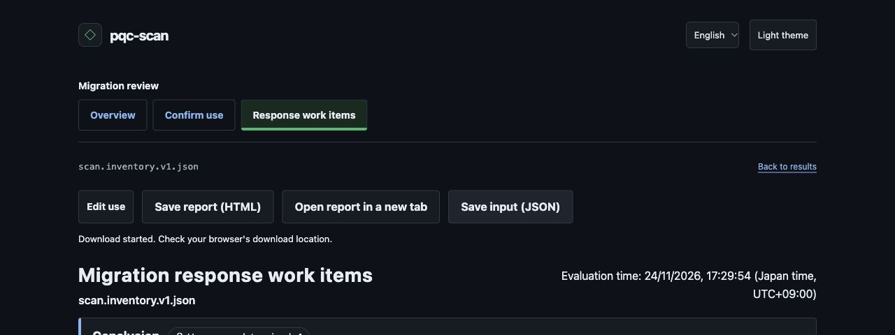
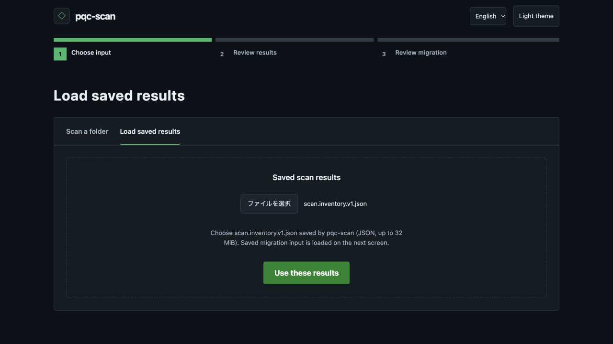
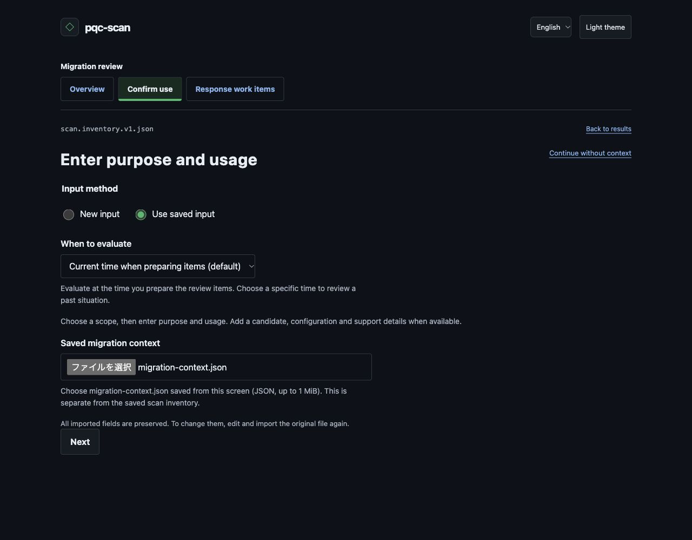
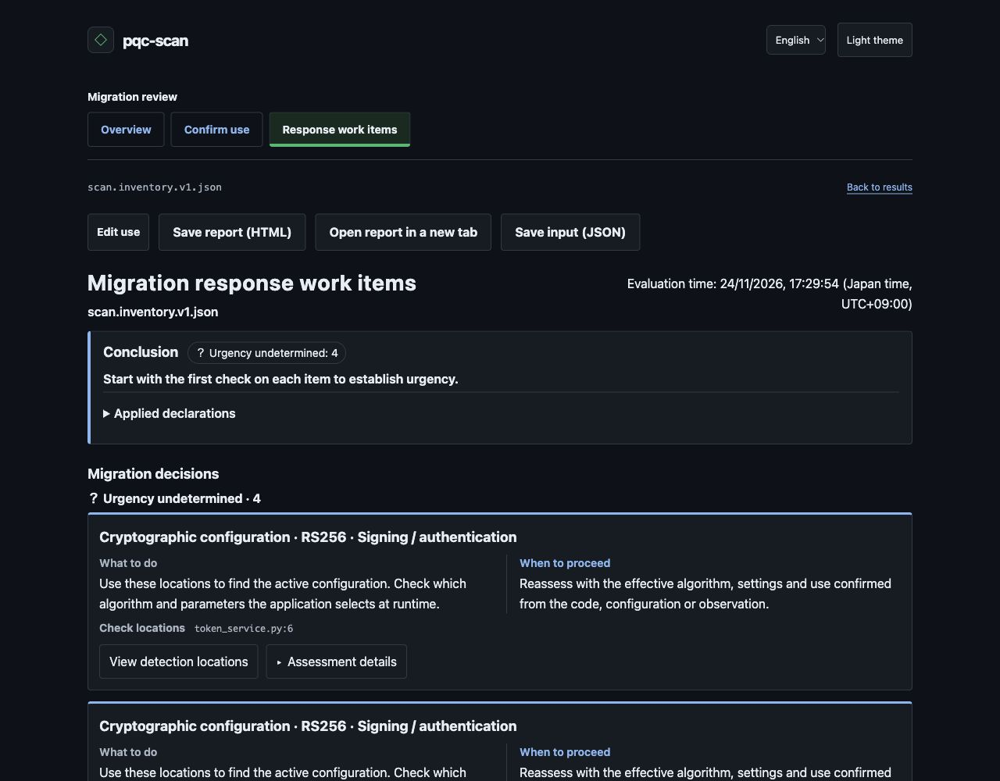

# Review migration using saved results

[日本語](SAVED-EVIDENCE.ja.md)

Load an earlier scan result and your purpose/usage input to prepare migration
review items again. This uses detections from the saved scan; run a new scan to
inspect source changes.

In the browser, choose files and records on screen. For terminal use,
**`pqc-scan assess` is the command that evaluates saved detection results**.
Neither reassessment path rescans source or contacts endpoints.

| Workflow | Start here |
|---|---|
| Browser | Follow the [four illustrated steps](#browser-save) below. For an initial scan and purpose input, see [SCANNING](SCANNING.md#web-migration-walkthrough) |
| Terminal | [Enter purpose and usage](#context-template), then [reassess saved results](#reassess) |

<a id="browser-save"></a>

## Saving and reassessing in the browser

The screenshots use v0.4.0 with the public `examples/python` sample. Counts and
input values are examples, not verified deployed use.

### 1. Keep detection results and your input together

After preparing migration review items, choose **Save input (JSON)**. Check the
**Download started** notice and `migration-context.json` in the browser's download
location. If retrieval fails, retry from this screen.



Keep these two files for reassessment:

| File | Content and location |
|---|---|
| `scan.inventory.v1.json` | Original detections. Web scans retain it in each job's subdirectory under the `pqc-scan-web-*` output directory printed at server startup. For CLI scans, request it with `--inventory-json` |
| `migration-context.json` | Your purpose and usage input, downloaded with **Save input (JSON)** |

**Save report (HTML)** saves a viewable report; **Save assessment data** saves the
assessment result. Neither replaces the reusable input in `migration-context.json`.
Keep original detection files unchanged: reformatting or editing changes their binding to the input.

### 2. Open saved detection results

In the local web interface started with migration review enabled, choose **Load
saved results**. Select `scan.inventory.v1.json` (up to 32 MiB) and choose **Use
these results**. On the loaded-results screen, choose **Review migration**, inspect
the overview and choose **Next**. See [local web scanning](SCANNING.md#local-web-scanning)
for startup instructions.



This file supplies detections. Load purpose and usage input on the next screen.

### 3. Reuse saved purpose and usage input

Choose **Use saved input** and select the matching `migration-context.json`
(up to 1 MiB). Normally use **Current time when preparing items (default)** under
**When to evaluate**. Choose a specific time only to review a past situation,
at or after detection collection. Assertions later than that time will not apply.



Imported fields are retained and read-only on screen. To change them, edit the
original JSON and import it again. If you have no saved input, choose **New input**
and [enter purpose and usage](SCANNING.md#web-migration-walkthrough). Answer what
you know.

### 4. Prepare review items again and read the result

Choose **Next** to prepare items from the loaded results and input. Check the
conclusion, evaluation time, **What to do** and **When to proceed**.
Use **View detection locations** to inspect the saved records and decision evidence.



**Urgency undetermined** in this example means more information is needed, not
low risk. Claims without expiry retain unknown validity. See the [report guide](REPORTS.md#saved-assessment)
for interpretation and [validity details](#claim-validity) for time conditions.
Reassessment from saved results does not include the original scan report, so
there is no same-job link back to it.

<a id="context-template"></a>
<a id="generate-context-without-copying-target-ids"></a>

## Enter purpose and usage from the terminal

### 1. Select the detection records to describe

`context-template` creates purpose/usage input JSON for selected records in saved
detection results. Run the first command to list records, then use the number,
algorithm, role, file and line to choose where your answers apply. `--target 1`
in the second command selects number 1 from that list; replace it with the number
you checked. One location can have several records with different rules or technical roles.

Replace file paths too. `YYYY-MM-DDTHH:MM:SS+09:00` is a placeholder, not an
executable value. Evaluation must be at or after collection; assertion time is
when the information was confirmed. Include seconds and a timezone offset.

```console
pqc-scan context-template saved.inventory.v1.json --input-format inventory-v1 --list-targets
pqc-scan context-template saved.inventory.v1.json --input-format inventory-v1 \
  --target 1 --out migration-context.json --as-of 'YYYY-MM-DDTHH:MM:SS+09:00' \
  --set 'use_case="signature"' --set 'usage_state="active"' \
  --set 'business_critical=false' --unknown confidential \
  --actor owner --asserted-at 'YYYY-MM-DDTHH:MM:SS+09:00'
```

This example answers **Signature**, **In use** and other fields for the selected
record and saves `migration-context.json`. Selecting a list number lets the command
set record identifiers and input-file checks automatically; you do not need to find
or copy target IDs.

<details>
<summary>Selecting multiple records, answer options and input conditions</summary>

| Setting | Control or condition |
|---|---|
| Targets | Select displayed numbers with `--target`; repeat for a group. Numbers apply only to this exact saved input |
| Record bindings | Calculated by the command. Ambiguous targets, duplicates, invalid numbers and existing context bound to other bytes are rejected |
| No selected target | Writes a valid unbound template and refuses claims; never selects every target implicitly |
| Organization/system aliases | Defaults `organization` and `system-1` need no company/department. Customize with `--organization` and `--system` |

### Answer options

| Option | Input |
|---|---|
| `--set FIELD=JSON_VALUE` | Use defined fields, such as `support.peer` for prerequisites. Strings require JSON quotes; booleans and seconds use JSON types |
| `--unknown FIELD` | Explicit uncertainty; omission means no answer |
| `--actor` / `--asserted-at` | Answers require an actor and assertion time |
| `--valid-until` | Optional expiry, never generated automatically; see [validity conditions](#claim-validity) |

Enter reference-backed deadlines through the local form. Personal use does not
change criticality. See [claim binding](#claims) and its JSON schema for inheritance
and advanced settings, then use the generated context with `assess` below.

</details>

<a id="reassess"></a>

## Reassess saved results from the terminal

### 2. Prepare review items and open the HTML

`assess` reads saved detections and optional purpose/usage input to prepare migration
review items. Supply original `saved.inventory.v1.json` and its matching
`migration-context.json`. Replace evaluation time with the actual time to review,
at or after collection.

```console
pqc-scan assess saved.inventory.v1.json --input-format inventory-v1 \
  --as-of 'YYYY-MM-DDTHH:MM:SS+09:00' --context migration-context.json \
  --out-dir ./migration-report
```

Open `migration.assessment.html` in the output directory. This is direct product
output, so no Markdown conversion or preview server is needed. If detections are
regenerated, reformatted or replaced with another scan, check the list and create
matching context again.

| Input/output | Meaning |
|---|---|
| `--input-format` | Explicitly choose `inventory-v1`, `tls-v1`, `ssh-offers-v1` or `ssh-kex-v1` |
| `--context` | Optional. Without it, technical concerns remain, but business applicability, urgency and readiness may be unknown |
| HTML | `migration.assessment.html`, using scan-report styles and language/Light/Dark controls |
| Markdown/JSON | `migration.assessment.md` and `migration.assessment.v1.json`, separate from existing scan reports |
| `--lang` | `en` (default) or `ja` sets initial HTML and Markdown language. JSON, IDs, facts and decisions are unchanged |
| `--report-label` | Sets the HTML display name only; does not change saved assessment JSON |

The [report guide](REPORTS.md#saved-assessment) covers workflow conditions,
schedules, urgency and saving. Cards group compatible decisions while preserving
each target's uncertainty, limits and provenance. **Details** shows rules, methods,
reasons and declarations used by the decision; no separate declaration/source
ledger is appended.

## Viewing and input reference

### Viewing and saving limits

| Condition | Behavior |
|---|---|
| Offline | Standalone HTML; no external assets required |
| Without JavaScript | First 20 work items only. Use JavaScript, Markdown or JSON for all records |
| Print | Visible items only. Original assessment data for all records can also be saved from the page |
| **Unidentified** | The saved record does not identify the algorithm |

### Interpreting the assessment

| Dimension | Values and meaning |
|---|---|
| Urgency | `urgent`, `plan`, `monitor`, `undetermined`, `not_applicable` |
| Information | `sufficient`, `incomplete`, `conflicting` |
| Readiness | `ready`, `blocked`, `unknown`, `not_applicable`. Ready means required support claims are active and true, not that implementation was verified |
| Next action | Urgency can coexist with blocked prerequisites or investigation. Actions link candidates, required support, applied claims, missing input and validation steps |

Test-only usage alone does not lower urgent known classical concerns. A valid
explicit outside-scope declaration takes precedence while preserving facts and
reassessment conditions. `monitor` applies only to the bounded role and facts;
`not_applicable` is limited to the operator's declared scope.

Candidates need exact parameter/protocol choices and separate interoperability
and deployment validation. Reports retain collection/evaluation times, input/context
digests, claim provenance, reasons, sources and coverage limits. Only applied
claims are copied; operator references use the unverified `context:` namespace.
There is no aggregate safety verdict, numerical migration score or quantum-arrival prediction.

### Selected migration configuration

| Optional claim | Storage and assessment |
|---|---|
| `migration_target` | Saves purpose, algorithm, key-size/configuration and provenance through the local form or `context-template --set` |
| Support binding | Tied to configuration in the same claim scope. Inherited known answers from another scope cannot be rebound. Inactive configuration or use cannot establish configuration-specific support |
| Configuration checks | Family/purpose combinations are validated; custom cryptographic validity and deployment compatibility are not. Existing files without this field retain generic support semantics |
| `migration_goal_month` | Provenanced goal month (`YYYY-MM`, years 0001–9999) or explicit unknown. Does not become an instant, replace `deadline`, change decisions or alter the meaning of inputs lacking the field |
| Calendar durations in the form | Converted to exact `migration_lead_seconds` and not reinterpreted on import |

See [optional migration context and reassessment](SCANNING.md#optional-migration-context-and-reassessment) for form operations.

### When a record cannot be selected

Records that cannot receive use declarations are disabled with an explanation.
Ordinary answers cannot resolve an unidentified record; inspect its original
location and explanation. Reference-only records may accept a purpose while the
algorithm stays unknown. Entering a purpose does not identify the algorithm.

<details>
<summary>Manual JSON inspection: identifiers, claims and validity</summary>

<a id="what-the-targets-mean"></a>

## How records and input are matched (details)

Purpose and usage answers apply to individual records in the saved detection
results. You do not need to edit identifiers during normal use. Preserve the
original saved file without reformatting it. If its contents change, previous
answers may no longer apply.

Saved source references do not establish actual use or deployment. Read TLS
results as recorded connection evidence, and SSH offers as unauthenticated
advertisements. Review SSH key exchange results together with their host-key
verification conditions. A PQC component alone does not establish whole-system safety.

<a id="claims"></a>

## Bind organization and system claims

Context JSON follows the [`pqc-scan.migration-context` v1 schema](../../schemas/migration-context-v1.schema.json).
Normally generate it with `context-template`; check the following for manual authoring.

| Item | Condition |
|---|---|
| Binding | Read the target manifest and explicitly map input format, exact SHA-256 and target IDs to declared system aliases, using the same saved input and evaluation time |
| Rejected bindings | Another file, reformatted bytes, unknown/duplicate targets, indistinguishable source locations or unknown systems |
| Claim fields | Applicability, purpose/use, criticality, confidentiality, protection/signature-verification lifetimes, historical ciphertext, migration lead time, sourced deadline and integration support |
| Claim representation | Typed known value or explicit unknown, with actor, source kind, assertion time and optional expiry/reference per claim. No credentials, key material or free-text justification required |
| Defaults and overrides | Explicitly bound targets only, in organization → system → target order. Omission inherits, explicit unknown replaces, `false` stays false. Support prerequisites inherit independently |
| Conflicts and sharing | Conflicting purpose preserves technical facts and the claim instead of rewriting the primitive. Claims do not transfer through shared algorithm assets |

The mapping remains an operator declaration about a business system, not verified
use. Reference links are stored as claims and never fetched.

<a id="claim-validity"></a>

### Time and validity

Claims are active from assertion time inclusive until expiry exclusive. Evaluation
must be at or after assertion and before expiry. Future, expired and expiry-unknown
claims remain visible but cannot establish an active favorable claim. An external-review
label is still a claim, not scanner verification.

New assertion/evaluation times require seconds and an explicit time-zone offset. Evaluation before collection is rejected.

</details>

## Input limits and errors

| Item | Limit or behavior |
|---|---|
| Inventory input | 32 MiB |
| Each TLS/SSH input format | 1 MiB |
| Context JSON | 1 MiB for reading and generation; use defined fields and valid times |
| Each assessment report | 64 MiB; overflow rejects without truncation |
| Destination | Use files separate from the input and context. Existing output files are replaced |
| Exit 0 | Successful assessment, including urgent or incomplete results |
| Exit 1 | Input/context/time/output error, using fixed errors without echoing rejected values |

Invalid/unsupported formats or versions, invalid references, contradictory facts
and oversized input are rejected. Source paths, public fingerprints and identifiers
can remain sensitive operational metadata. Review the contents before sharing. Even probe-enabled builds never
execute input, fetch references, rescan source or contact endpoints. See the
[probe guide](PROBING.md) for TLS/SSH collection and distributions.
