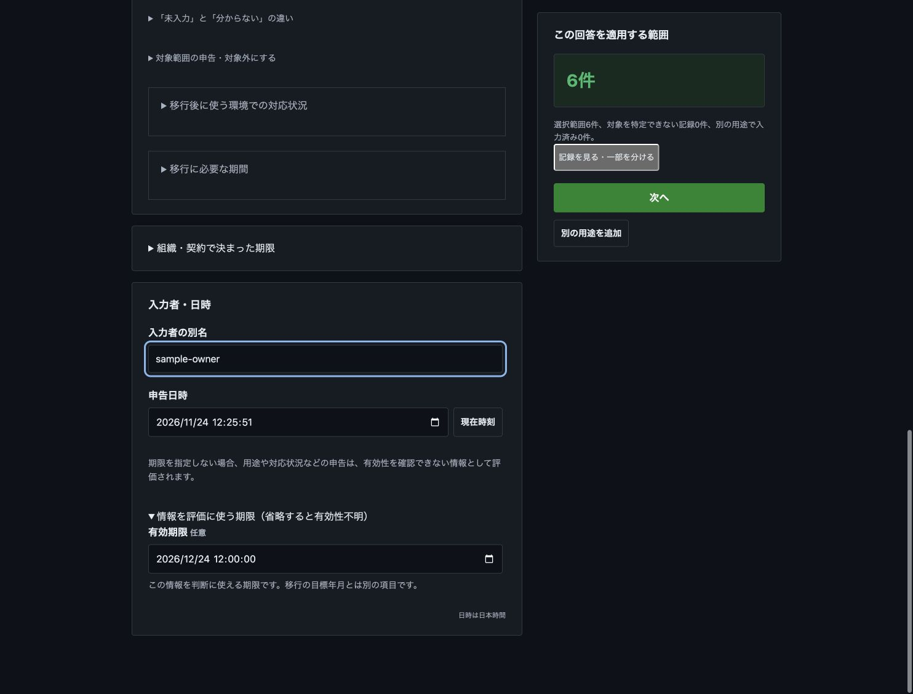
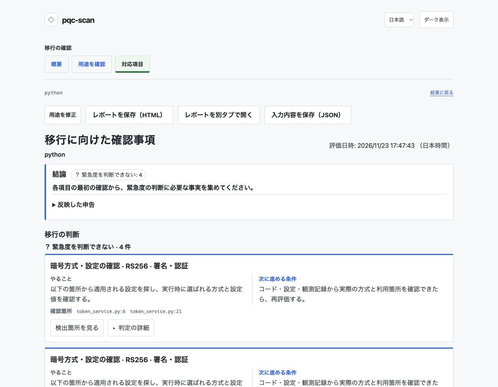
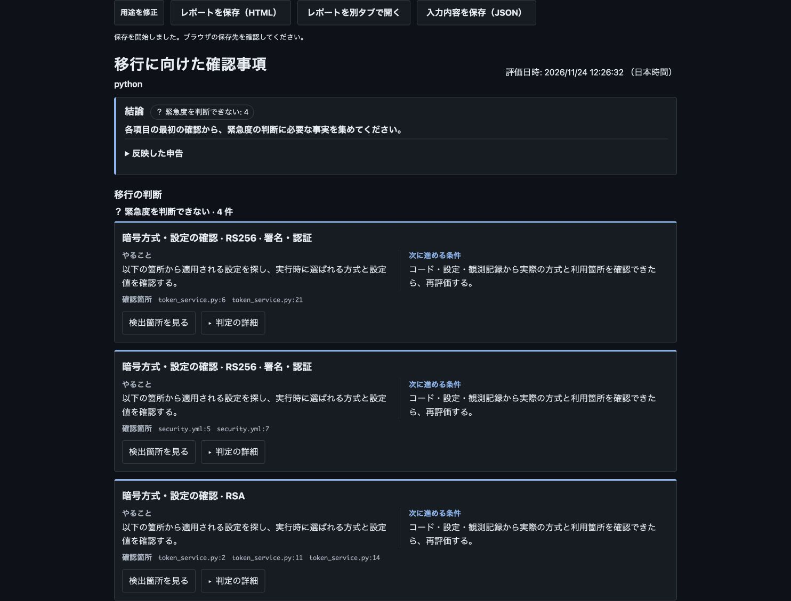

# リポジトリのスキャン方法

[English](SCANNING.md) · [README](../../README.ja.md)

このガイドは、現在のソースに含まれる静的スキャンを対象とし、v0.5開発中のPHP・C#・C・C++対応も説明します。\
v0.4.0向けの配布アーカイブとは対応範囲が異なります。\
v0.4.0の内容は[リリースノート](../releases/v0.4.0.ja.md)を参照してください。

静的スキャンの出力オプション、CIの終了判定、検査できなかった箇所の確認方法を説明します。
棚卸しや評価の見方は[結果の読み方](REPORTS.ja.md)、形式ごとの制約は[対応する入力と検査範囲](COVERAGE.ja.md)を参照してください。

## 目次

- [コマンドと指定方法](#command)
- [PHP・C#・C・C++をスキャンする](#added-languages)
- [GitHub Actions](#github-actions)
- [ソースから実行する](#from-source)
- [診断情報と検査の完全性](#diagnostics)
- [画面で進めるスキャンと移行確認](#web-migration-walkthrough)
- [入力・保存・再評価の詳細](#migration-input-details)
- [テストコードを除外する](#exclude-test-code)
- [独自の除外パス](#custom-exclusions)

<a id="command"></a>

## コマンドと指定方法

```bash
pqc-scan scan <path> [--format json|html|md|sarif|all] [--lang en|ja] [--out-dir ./pqc-report] [--rules-dir ./rules] [--fail-on high|critical] [--threads N] [--max-file-size-mib N] [--diagnostics] [--require-complete] [--include-non-scannable] [--exclude-tests] [--cyclonedx-17] [--inventory-json] [--repository-scope ID] [--policy-profile migration-review-v1] [--assessment-context PATH]
pqc-scan rules list [--rules-dir ./rules]
pqc-scan rules show <rule-id> [--rules-dir ./rules]
pqc-scan diff <before-inventory> <after-inventory> --repository-scope ID --out-dir DIR
```

既定値は `--format all`、`--lang en`、`--out-dir ./pqc-report`、`--rules-dir ./rules`、`--threads 0`（自動選択）です。\
検出結果の重大度や検査の完全性による終了判定は、明示しない限り有効になりません。\
相対パスは実行時の作業ディレクトリを基準にします。

`--repository-scope` と `--policy-profile` には `--inventory-json` が必要です。\
`--assessment-context` は評価方針を指定したときだけ使えます。\
全オプションは `pqc-scan scan --help` で確認できます。

別ファイルのCycloneDX 1.7棚卸しには `--cyclonedx-17` を付けます。\
用途と制約は[形式の説明](REPORTS.ja.md#cyclonedx)と[棚卸しの比較](REPORTS.ja.md#diff)を参照してください。


<a id="added-languages"></a>

### PHP・C#・C・C++をスキャンする

JavaやGoと同じスキャン操作を使います。\
ファイル名と対応する構文から言語を選ぶため、言語専用の指定は不要です。\
`--lang` はレポートの表示言語の指定であり、ソースの言語を選ぶものではありません。\
PHPや.NETの実行環境、コンパイラー、依存パッケージのインストール、対象のビルドも必要ありません。

1. 現在のソースから作成したスキャナーと、同じチェックアウトの同梱ルールを使います。<br>別のリポジトリを調べる場合は、後述の手順に沿って `--rules-dir` にそのチェックアウトの `rules` ディレクトリの絶対パスを指定します。
2. `<path>` にプロジェクトのルートを指定し、ソースと対応する依存宣言を一緒に調べます。<br>ignore、テスト除外、ファイルサイズの設定は引き続き適用されます。
3. `--diagnostics` を付けて検査できなかった範囲を確認します。<br>`report.html` を開き、検査範囲を確かめてから、検出結果を展開して位置・コード・確認事項を読みます。

| 言語 | 対象ソース | 主な制約 |
|---|---|---|
| PHP | `.php`、`.phtml`、PHP開始タグを持つ`.inc` | HTML内の静的なPHPを検査します。Bladeは描画せず、未完了として扱います。 |
| C# | `.cs` | Razor、プロジェクト全体の型・オーバーロード解決は対象外です。 |
| C | `.c`、`.h`、`.c.inc` | プリプロセッサー、include、コンパイルは実行しません。 |
| C++ | `.C`、`.cc`、`.cpp`、`.cxx`、`.hpp`、`.hh`、`.hxx`、`.h`、`.cc.inc`、`.cpp.inc`、`.cxx.inc` | テンプレートの具体化やコンパイラーの意味解析は行いません。ポインターの追跡は限定的です。 |

共有の`.h`は、上限を設けてCとC++の両方で検査します。\
構文や変数の対応が食い違う箇所は、未完了として残る場合があります。\
検出がない場合も、[詳しい対応範囲](COVERAGE.ja.md#source-limits)を確認してください。

Composer、NuGet／MSBuild、vcpkg、Conan、静的なCMake参照も、[対応する範囲](COVERAGE.ja.md#native-dependencies)で読み取ります。\
宣言が見つかっても、ライブラリの導入済み状態や実行環境の対応を確認した意味ではありません。

同梱ルールはv0.4.0の125件から14件増え、現在は139件です。\
`rules list` は読み込んだルールを一覧にし、スキャンの `report.rules.html` は、そのスキャンで検出結果が出たルールを説明します。\
通常の引数と周辺コードは表示し、認識した秘密の値をマスクします。\
詳しくは[コード抜粋の表示と保護](REPORTS.ja.md#source-excerpts)を参照してください。

### ファイルサイズの上限

`--max-file-size-mib N` で、1ファイルの上限を1〜64MiBの整数で指定できます。\
既定値は2です。\
例：`pqc-scan scan . --max-file-size-mib 16 --threads 1 --diagnostics`。\
1MiBは1,048,576バイトです。\
指定値は診断・棚卸しの検査範囲に記録し、それを超えるファイルは対象外として残します。\
ignore・形式・テスト除外の設定や、解析内部の作業上限も引き続き適用します。\
読み込み上限を増やしても解析完了の保証にはならないため、診断を確認してください。\
対象データと並列数が増えると、処理時間や最大メモリ使用量も増える場合があります。

`serve --max-file-size-mib N` は、フォルダ選択画面の初期値を指定します。\
「1ファイルのサイズ上限（MB）」は次のスキャンに適用し、選択した複数フォルダには同じ値を使います。\
スキャン中は変更できません。\
設定を変えても保存済みのレポートや履歴は書き換えません。\
画面のMBも1単位は1,048,576バイトです。\
入力欄は1〜64の整数を受け付け、範囲外や空欄の場合はエラーを表示してスキャンを開始できなくします。

### 出力先の安全性

Unix（macOS・Linuxを含む）では、出力先ディレクトリの経路にあるシンボリックリンクと、
出力ファイル位置にある既存のリンク・通常ファイル以外の項目を拒否します。\
macOSのシステム管理下にある`/tmp`・`/var`・`/etc`は利用できますが、その配下のリンクには
同じ検査を適用します。\
それ以外のディレクトリ別名は実体のパスを指定してください。\
スキャン・棚卸し・評価・診断・CycloneDX・差分・probeの各レポートに適用されます。

存在しないディレクトリは作成します。\
通常の既存レポートは上書きできます。\
出力先への書き込み権限が必要です。\
途中で失敗すると、一部の出力だけが残る場合があります。\
レポートの保管先は、第三者が変更できない場所を選んでください。

### プロダクトリポジトリでの推奨実行方法

`pqc-scan` を自分のプロダクトリポジトリ内（`pqc-scan` リポジトリ外）で実行する場合は、`--rules-dir` に **絶対パス** を指定してください。

```bash
pqc-scan scan . --format all --out-dir /path/to/reports/product-scan --rules-dir /path/to/pqc-scan/rules
```

### よく使うコマンド

```bash
# すべてのレポート形式を出力

pqc-scan scan . --format all --out-dir /path/to/reports/product-scan --rules-dir /path/to/pqc-scan/rules

# SARIF形式で出力（GitHub Code Scanning向け）

pqc-scan scan . --format sarif --out-dir /path/to/reports/product-scan --rules-dir /path/to/pqc-scan/rules

# CI失敗ゲート

pqc-scan scan . --fail-on high --out-dir /path/to/reports/product-scan --rules-dir /path/to/pqc-scan/rules

# 1つのルール詳細を確認

pqc-scan rules show JWT_RS256 --rules-dir /path/to/pqc-scan/rules
```

<a id="github-actions"></a>

## GitHub Actions

プロダクトのCIでは `--format sarif` で出力し、検出結果でジョブを失敗させる場合は `--fail-on high|critical` を指定します。\
検査の不完全さも失敗とする場合に限り、`--require-complete` を加えます。\
終了コード3は検出結果のしきい値より優先されるため、対象範囲や未対応形式も確認してください。

自分のプロダクトに合う終了条件を選び、元のレポートも保存して検出結果を確認できるようにしてください。

<a id="from-source"></a>

## ソースから実行する

インストールせず試す場合は、ソースから直接実行できます。

```bash
cargo run --manifest-path /path/to/pqc-scan/crates/pqc_scan_cli/Cargo.toml --bin pqc-scan -- scan /path/to/your-product --format all --out-dir /path/to/reports/product-scan --rules-dir /path/to/pqc-scan/rules
```

<a id="diagnostics"></a>

## 診断情報と検査の完全性

検出がゼロでも、すべての対象を検査できたとは限りません。\
読み込みや解析に失敗した場合も、ほかの検出結果は保持します。\
検査が部分成功・失敗・不明の場合は、標準エラーに警告を表示します。\
これとは別に、ignoreなどで列挙していないファイルがあり得るという注記も表示します。\
注記だけで検査失敗にはなりません。\
CLIが生成するHTML・Markdownにも検査状態と件数を表示します。\
`--diagnostics` を付けると安全な理由情報も確認できます。\
言語指定で変わるのは人間向けの文面だけです。

### 診断情報を保存し、必要に応じてCIを止める

検査できなかった箇所を調べるには `--diagnostics`、不完全な検査をCIで失敗とするには `--require-complete` を使います。\
2つのオプションは単独でも指定できます。

| オプション | 動作 |
|---|---|
| `--diagnostics` | `--out-dir` に `diagnostics.json` を追加し、検査範囲・集計・理由コードを保存する |
| `--require-complete` | 検査の完了を確認できなければ、要求されたレポートを出力した後に終了コード3を返す |

両方を指定する例です。

```bash
pqc-scan scan . --diagnostics --require-complete --out-dir /path/to/reports/product-scan --rules-dir /path/to/pqc-scan/rules
```

`diagnostics.json` には `schema_version: "1"` と生成時刻も含みます。\
ファイル内容や検出器・I/Oのエラー本文は含めません。\
`--format all` だけでは追加されず、既存6形式のファイル名と機械出力スキーマは変わりません。\
`--lang` の対象はHTMLとMarkdownだけです。

終了コードは次のように読み分けます。

| コード | 意味 |
|---|---|
| 0 | 実行成功。検査の完了や安全性を保証するものではない |
| 1 | 読み込みの準備や出力などの実行エラー |
| 2 | `--fail-on` で指定した重大度のしきい値に到達 |
| 3 | `--require-complete` を指定し、検査の完了を確認できなかった |

複数の条件に当てはまる場合は、1、3、2の順に優先します。\
診断情報を出す指定だけでは、完全性による終了判定は有効になりません。

### 「完了」が意味する範囲

完了判定は、Gitのignore設定・既定の除外・サイズ制限を適用した検査範囲内に限ります。\
有効な範囲に対象ファイルがなければ完了扱いになりますが、範囲外に暗号がないという意味ではありません。\
また、`Complete` は対応するパターンや形式を検査したという意味で、名前解決、実際の稼働、全鍵形式の網羅を保証しません。

集計を見るときは、ファイルの選択と解析の完了を区別してください。\
`scanned_files` はwalkerが選択したファイル数です。\
診断情報では、選択・読み込み成功／失敗・解析完了・部分成功・解析失敗・未対応・対象外・不明を分けて記録します。\
列挙できたポリシー除外と列挙失敗は別に数え、ignoreで見えないファイル数は不明として扱います。

### 処理上限に達した場合

処理上限で検査が終わらなかった場合も、それまでの検出結果は残ります。\
診断に表示された理由を確認し、対象を分けて再スキャンするか、該当箇所を直接確認してください。

### 解析エラー・未対応形式の扱い

構文エラーがある場合は、取得できた検出結果を残し、未完了と表示します。\
バイナリ入力、未対応のソース言語、適用ルールがない場合は、その検出器の対象外として扱います。

証明書では、不正な形式、未知の鍵属性、未対応ブロックの混在を `detector_partial`、未対応コンテナーを `detector_unsupported` として報告します。\
コンテナーを検出しても、内部を検査できたとは限りません。\
解析できてもルールに一致しない証明書は検出結果を出力しません。

依存関係では、有効な空データ、不正な対応形式、部分成功、未対応のバージョン、上限到達を区別します。\
対応する構造化データの範囲では完了を報告し、関係のないファイルは対象外です。\
Go・Maven POM・requirements・Rubyの定義とロックは、対応する構文を解析できた範囲で完了を報告します。\
Gemfile・gemspecのリテラルによる依存宣言は、選択済みのローカルgemspec参照を含め、Rubyの構文木で検査します。\
動的・未対応の記述は未完了とし、Gradleの簡易解析は `detector_not_reported` とします。\
完了はパッケージ管理ツールと同じ検証やインストール状態の保証ではありません。

`--require-complete` の終了コードの規約は変わりませんが、解析結果や対応範囲によって、実際に返るコードは変わり得ます。\
依存関係ごとの詳細は[指定と確認根拠](https://github.com/wakaken/pqc-scan/blob/develop/docs/architecture/DEPENDENCY-PROVENANCE.md)を参照してください。

## 通常は除外するバイナリ形式を含める

`scan` は既知の画像・アーカイブ・コンパイル済みデータの拡張子と、テキストとして扱えないバイナリを、ファイルの選択前に除外します。\
除外件数は検査未完了と分けて記録します。\
`--include-non-scannable` でこれらも対象に戻せますが、形式の解析機能が増えるわけではなく「適用する検査なし」の件数が増える場合があります。\
既存のディレクトリ・Markdown・Git ignore・サイズの除外は引き続き適用します。\
鍵・証明書・信頼ストア等の拡張子は、検査できない部分も把握できるよう既定で残します。\
全パスは診断JSONに残し、人向け診断は件数と理由ごとに最大3件の例に集約します。

<a id="reference-positions"></a>

### 検出箇所の確認

レポートのファイル名と位置を使って、元のソースや設定を確認してください。\
参照の検出だけでは、実行時に使われる方式までは確定しません。

## ローカルWebスキャン

`--root` に対象フォルダを含むディレクトリ、`--rules-dir` に手元のルールの場所を指定して起動します。

```bash
pqc-scan serve --root /path/to/projects --rules-dir /path/to/pqc-scan/rules
```

ブラウザが開いたら対象フォルダを選び、「選択したフォルダをスキャン」を押します。\
通常モードでは、1フォルダならレポートが自動で開き、複数ならフォルダごとの結果一覧を表示します。\
完了までページを開いたままにし、終了時はターミナルで **Ctrl+C** を押してください。

画面での操作は、以下の手順1〜8を参照してください。\
フォルダの移動方法、起動オプション、実行上限は[Webスキャンの操作と制約](#web-scan-details)にまとめています。

### 移行情報の任意入力と再評価

用途・利用状況を入力して移行の確認まで進める場合は、起動時に `--migration` を付けます。\
通常のスキャンレポートだけを見る場合は、上の `serve` を使い、手順1〜2で対象を選んでレポートを開いてください。

```console
pqc-scan serve --migration --root /path/to/projects --rules-dir /path/to/pqc-scan/rules
```

<a id="web-migration-walkthrough"></a>

以下はソースリポジトリの公開サンプル（`examples/go` と `examples/python`）を使った操作例です。\
サンプルはバイナリ配布物に含まれません。\
ご自身のフォルダでも同じ手順で操作できます。\
件数と入力値はこの例に限ります。\
画面はv0.4.0で撮影しています。

#### 1. フォルダを選んでスキャンする

起動時に表示された完全なURLを開き、調べるフォルダにチェックを入れます。\
複数選択でき、下の一覧で対象を確認してから「選択したフォルダをスキャン」を押します。\
例では公開サンプルの `go` と `python` を選んでいます。

テストコードは既定で含みます。\
除外する場合は「テストコードを除外」を選び、必要なら1ファイルのサイズ上限も変更します。\
処理中は進捗画面が開き、「残りのスキャンをキャンセル」で未実行の対象だけを中止できます。


#### 2. 対象の結果を開く

フォルダごとのカードで名前を確認します。\
「スキャンレポートを開く ↗」は検出結果を別タブで開き、「移行の確認へ進む」はその対象の移行確認を開きます。\
例では `python` を選びます。

「過去のスキャン履歴」にも同じ操作があります。\
履歴はこのサーバーのセッション内のもので、サーバーを再起動しても引き継がれる履歴ではありません。\
通常の `serve` で1フォルダだけを調べた場合は、スキャンレポートが自動で開きます。


#### 3. 概要を確認する

「概要」で、記録数、方式名の分かる範囲、記録の場所を確認します。\
これらは保存された検出の内訳で、実稼働の用途数ではありません。

「次へ」で用途入力へ進みます。\
分かる情報がなければ「入力せずにレポートを見る」で調査項目を確認できます。


#### 4. 範囲・用途・利用状況を入力する

「新しく入力する」を選び、回答を適用する記録の範囲にチェックを入れます。\
例では「署名・認証」のソースファイル6記録を選び、用途名を `jwt-demo`、用途を「JWT」、利用状況を「利用中」としています。\
適用件数を確認し、範囲を分ける場合は「記録を見る・一部を分ける」を使います。

分かる項目だけ回答してください。\
「未入力」は回答なし、「分からない」は不明という申告です。\
「個人」「組織」は入力の案内を変えるだけで、緊急度を下げる指定ではありません。\
方式・設定・対応状況や、根拠のある期限は必要に応じて追加します。


#### 5. 申告日時・有効期限を確認して作成する

回答には「入力者の別名」と「申告日時」が必要です。\
「情報を評価に使う期限」を開き、申告を有効として使える期限を入力します。\
例の `sample-owner` と日時は説明用の値です。\
実際には、その情報の確認者と確認日時・有効期限を使ってください。

有効期限を省略すると申告の有効性は不明になります。\
この期限は移行期限や目標年月とは別です。\
「評価する時点」は通常「作成時の現在時刻」のままで構いません。\
過去の状況を見る場合だけ「日時を指定」を選び、日本時間で入力します。\
検出情報の収集日時より前には指定できません。\
指定した評価日時より後の申告は、その評価には使われないことを画面で案内します。\
「次へ」で適用・作成します。\
「対応項目」タブを開いただけの場合は「確認事項を作成」を押します。



日時を指定し、申告日時が評価日時より後になる場合の注意表示です。\
通常の利用では「作成時の現在時刻」に戻してください。


#### 6. 移行の判断を読む

結論、評価日時、各カードの「やること」「次に進める条件」を確認します。\
この少量入力の例では、実際の方式・設定などの調査が残り、緊急度を判断できない項目を表示しています。\
用途を入力するだけで3ステップや移行可能の判定になるわけではありません。

条件の揃った移行計画には現状把握・互換性試験・段階切り替えの手順が出ます。\
早急な調査は初期表示し、手順のある項目がある場合は残りの確認を「ほかの確認項目」にまとめます。\
日程や判定条件の詳細は[レポートの読み方](REPORTS.ja.md#saved-assessment)を参照してください。



#### 7. 検出箇所と元の検出結果を調べる

「検出箇所を見る」で一覧を開き、方式やファイル名で検索します。\
「詳細」で検出方法、一致したルール、判定理由、判断に使った申告を確認できます。\
同じ場所の同等な記録はまとめて表示します。

同じローカルジョブにスキャンレポートがあれば、詳細内の「スキャンの検出箇所を開く」で元の検出結果へ移れます。\
保存済み入力の読込や単独HTMLなど、元のレポートがない入口にはこのリンクはありません。


#### 8. レポートと再評価用の入力を保存する

「入力内容を保存（JSON）」は、取得状況と失敗時の案内を表示します。\
保存開始の案内が出たら、ブラウザの保存先で `migration-context.json` を確認してください。\
取得に失敗した場合は現在の結果から再試行できます。

画面上部の「レポートを保存（HTML）」は閲覧用HTML、「入力内容を保存（JSON）」は申告を再利用するcontextです。\
末尾の「評価データを保存」は全件の評価結果で、再入力用contextとは別です。

再評価するなら、contextと同じジョブの `scan.inventory.v1.json` も保管してください。\
元の入力は、起動時にターミナルへ表示された `pqc-scan-web-*` の保存先内に、ジョブごとのサブフォルダで残ります。\
「保存した結果を読み込む」でこの棚卸しを選び、次の用途入力画面で「保存した入力内容を使う」から対応するcontextを読み込みます。\
評価日時を確認して再作成します。\
入力を整形・変更すると対応付けが変わるため、元のバイト列を保ってください。

「用途を修正」で変更した後は、確認事項を再作成し、HTMLと入力JSONも保存し直します。\
終了時はターミナルで **Ctrl+C** を押します。



<a id="web-scan-details"></a>

### Webスキャンの操作と制約

基本の流れは上の[画面付き8ステップ](#web-migration-walkthrough)を参照してください。\
ここでは、操作を変えたい場合と、処理が止まった場合の確認点をまとめます。

#### 起動オプションとアクセス範囲

| 指定 | 既定値・使い方 |
|---|---|
| `--root` | 現在のディレクトリ。指定範囲の外へは移動できず、シンボリックリンクは表示しません。範囲を変えるには起動し直します |
| `--port` | `8787`。`--port 0` なら空いているポートを使います |
| `--threads` | `4` |
| `--no-open` | ブラウザを開かず、起動URLを表示します |

サーバーは `127.0.0.1` だけで待ち受けます。\
開けない場合は、ターミナルのセッションURLを省略せずにコピーしてください。\
`localhost` への置換や、パスが `/` だけのURLは使えません。\
セッションURLは他者に共有しないでください。

#### フォルダの選択と画面設定

| やりたいこと | 操作・動作 |
|---|---|
| 選択・解除 | 行またはチェックボックスをクリックします。フォルダを移動しても選択は残ります |
| 選択内容の確認 | 選択一覧で正確なパスを確認します。個別に解除するか「選択をすべて解除」を使えます |
| フォルダを開く | ダブルクリックは開いて選択、右端の「›」は選択せずに開きます |
| 階層を移動 | 「戻る」「進む」や一覧上のパスを使います。現在のパスをクリックすると、`--root` 自体も選択・解除できます |
| キーボードで操作 | 上下キーでフォーカス移動、Spaceで選択切替、Enterで開く、Alt+上キーで親へ移動します |
| 検査条件を変える | 「スキャン設定」でテスト除外とファイルサイズ上限を変更します。ルールセット・判定閾値・ネットワーク検査は設定しません |
| 言語・配色を変える | 日本語・English、ライト・ダークを選べます。結果画面とレポートの間でも引き継ぎます |

起動時は未選択です。\
`--root` は移動できる範囲であり、スキャン対象は別に選びます。\
OSのフォルダ選択やフォルダアップロードは使いません。\
ブラウザに設定を保存できない場合も、選んだテーマは描画前に反映します。\
オフライン版にも言語・テーマ選択はありますが、セッションへ戻るリンクはありません。

#### 実行件数と処理中の動作

| 項目 | 上限・動作 |
|---|---|
| フォルダ一覧 | 最大1,000サブフォルダ。省略した件数を表示します |
| 選択・セッション | 最大20フォルダ、1セッション20件。保存済み結果の読み込みも含み、残り枠を超える選択は開始前に拒否します。残り枠は常時表示しません |
| 実行順 | 同時に1件、選択順に処理します。親子フォルダを両方選ぶと別々にスキャンします |
| 進捗 | 対象フォルダ、「何件目／全件数」、探索・解析・集計・レポート作成を表示します。処理中は他の操作とEscapeによる閉じる操作を止めます |
| 解析の件数 | 読込・解析に失敗したファイルも含みます。解析成功件数や残り時間ではありません |
| 中止 | 「残りのスキャンをキャンセル」で未実行分を止めます。実行中の1件は終了を待ち、結果を履歴に残します |

失敗・通信断・ページを閉じた場合の扱いは、[処理が止まった場合](#web-recovery)を参照してください。

<a id="履歴から開き直す"></a>

#### 結果を開く・保管する

| 確認したいこと | 操作・保管先 |
|---|---|
| 各フォルダの結果 | 完了したカードからスキャンレポートを別タブで開きます。利用可能なら移行確認にも進めます |
| 過去の結果 | 開始・結果画面の履歴から開きます。新しい順に、プロジェクト名または読込ファイル名、日本時間の受付日時、状態を表示します。分からない名前・日時は不明と示します |
| 同じ結果へ戻る | レポートの「結果に戻る」は再スキャンしません。別タブで開く際も言語・テーマと入力中の画面を保ちます |
| スキャン出力 | CLIと同じ解析処理で、`--format all` の7ファイルと `diagnostics.json` を出力します。ターミナルに表示する専用の `pqc-scan-web-*` 内に保存します |
| ダウンロード・オフライン閲覧 | レポートURL配下の各ファイル名から取得できます。`report.html` と `report.rules.html` は一緒に保管します |

履歴は現在のサーバーセッションだけのものです。\
レポート生成の成功と検査の完了状況は、別々に確認してください。\
スキャンエラーを検出0件としては扱いません。

ソース内容は配信せず、ソース・レポートをアップロードしません。\
ビルドスクリプトやパッケージコマンドも実行しません。\
セッションの出力先を含むフォルダは選べません。

<a id="migration-input-details"></a>

### 入力・保存・再評価の詳細

| 確認したいこと | 参照先 |
|---|---|
| 初めて用途・利用状況を入力する | 上の[手順4〜5](#4-範囲用途利用状況を入力する) |
| 保存した結果や入力を使い直す | [保存した結果で移行を再確認する](SAVED-EVIDENCE.ja.md#browser-save)の画面付き4ステップ |
| 結果・日程・次の対応を読む | [移行確認の読み方](REPORTS.ja.md#saved-assessment) |

以下は、入力の範囲や回答を変更するときの補足です。\
保存済み結果はローカルのセッション内で処理し、読み込み後の確認・保存は上の手順4〜8と共通です。

#### 入力する範囲と個別の修正

1. 検出した用途・役割・フォルダやファイルの種類から範囲を選びます。<br>
   必要なら最上位のフォルダで絞ります。<br>
   「テスト用フォルダ内」はパスの分類で、テスト専用の確認ではありません。
2. 右側の適用件数、特定できない記録、他の用途に入力済みの記録を確認します。
3. 「次へ」で、表示した範囲に回答を適用してレポートを作成します。<br>
   追加の確認用チェックボックスはありません。<br>
   別の用途は保存時にも分けます。

| 操作 | できること・注意点 |
|---|---|
| 「記録を見る・一部を分ける」 | 方式・ファイル名の検索、役割の絞り込み、20件ずつの一覧で範囲を確認します |
| 「個別に修正」 | その記録だけの回答を保存します。後で共通の内容を編集しても変わりません |
| 「共通の内容に戻す」 | 個別の回答を外し、現在の共通設定に戻します |
| 複数用途への入力 | 合計4096記録・256用途までです。上限超過は一部適用せず拒否します |
| 「個人」「組織」 | 入力の案内だけを変えます。重要性の判断には影響せず、会社名・部署名も不要です |

件数は品質・緊急度の点数ではありません。\
グループは編集をまとめる機能で、組織の既定値ではありません。\
未保存の入力は評価に含めず、再読み込みすると下書きとグループは失われます。\
残す申告は「移行情報を保存」で保存してください。

<details>
<summary>選択できない記録と、個別の回答の扱い</summary>

保存済み入力の中で記録を一意に特定できない場合は、申告を適用しません。\
通常の回答を追加しても、この検出上の制約は解消しません。\
同じ目印を持つソース記録も、保存位置が一意で整合していれば、明示的に選んで用途を入力できます。

場所で絞ると、その範囲に応じた分類・件数を表示します。\
入力可能件数には、特定できない記録と入力済み記録を含めません。

</details>

#### 未入力・不明・対象外の使い分け

| 回答 | 意味・画面での扱い |
|---|---|
| 未入力 | 回答の省略です。既定値を引き継ぐ場合があります |
| 不明 | 「分からない」は、不明という回答です。既知の既定値を上書きする場合があります |
| いいえ | 否定の回答です。不明や対象外とは区別します |
| 対象外 | 他の移行項目を隠し、その回答を生成する移行情報から除外します。下書きは保持し、対象に戻すと復元します。用途に合わない項目も同じ扱いです |

未入力・不明だけでは緊急度は決まりません。\
対象外の申告も、記録の削除や安全性の確認ではなく、技術上の懸念はレポートに残ります。

#### 移行先の方式と対応状況

| 操作 | 確認すること |
|---|---|
| 方式・設定を選ぶ | 方式を選び、鍵長・方式の設定を候補または「その他（手入力）」で指定します。候補は標準の設定名で、配備の推奨ではありません |
| 対応状況を回答する | 選んだ用途・方式・設定について回答します。その条件を変えたら、対応状況も回答し直して保存します |
| 根拠を確認する | 選択した方式・設定と申告の由来は、保存ファイルと評価レポートに残ります |

手入力した設定の妥当性は検証しません。\
申告だけで、実装の正しさ・通信の互換性・配備を検証したとは扱いません。\
方式・設定のない従来の入力は一般的な対応状況として扱い、別範囲の既知の回答を新しい設定へ引き継ぐ入力は拒否します。

<a id="中止できる操作と日程の入力"></a>

<a id="移行レポートの確認を補助する表示"></a>

#### 申告日時と評価日時

| 日時・日程 | 何を指定するか | 判定への使われ方 |
|---|---|---|
| 申告日時 | 情報を確認した日時。入力者の別名も必要です。「現在時刻」ボタンで入力できます | 評価日時より後の申告は注意を表示し、有効な申告として使いません |
| 評価する時点 | 通常は確認事項を作成する現在時刻。過去を見る場合は「日時を指定」を選びます | 指定した値を保持します。入力せずに進んでも、既知の懸念・不足情報は結果に残ります |
| 情報の有効期限 | 任意の詳細項目で指定します | 自動補完しません。省略すると用途・対応状況などの申告は有効性不明です。入力した情報と、判定に使える有効な申告は別です |
| 移行に必要な期間 | 年・月と日本時間の基準日で指定します | 正確な日数・秒数に換算し、上限315,576,000秒で保存します。保存済み見積もりは評価日時を変えても自動で変えません |
| 目標年月 | `YYYY-MM`、0001〜9999年の計画情報です | 日・時差へ換算せず、組織・契約上の期限や緊急度・対応状況の判定には使いません |
| 組織・契約で決まった期限 | 適用する期限、組織方針／契約要件の区別、公開してよい発行元・文書・版・条項名を指定します | 目標年月とは別に、必要期間とともに緊急度の判定に使います。「期限の指定はない」・省略・「確認が必要」を区別します |

日時の入力・確認画面は日本時間です。\
保存時は秒単位で時差を付け、JSONの正確なUTC・秒数を保ちます。\
必要期間と目標年月は、どちらかを明示的に選ぶと他方を解除します。\
読み込んだ保存済み情報の形式と意味は変えません。\
結果には、適用した期限を日本時間、所要期間を日・時間などで表示します。

<details>
<summary>必要期間の年・月から秒数への換算</summary>

初期の基準日は評価日です。\
基準日に指定月数を加え、月末は移動先の月の末日に合わせます。\
1か月を30日とみなさず、実際の日数・秒数を画面に示します。\
保存・再読込した秒数は、そのまま保持します。\
申告情報の有効期限は移行期限とは別なので、それぞれ確認してください。

</details>

<a id="保存した入力を読み込む"></a>

<a id="用途の削除と復元"></a>

#### 確認事項と保存先

| やりたいこと | 操作・保存内容 |
|---|---|
| 確認事項を作成する | 「次へ」で入力と適用先を検証し、評価します。「対応項目」タブを開くだけでは作成せず、「確認事項を作成」で開始します。再スキャン・外部通信はしません |
| 根拠を見る | 「検出箇所を見る」で20件ずつ表示します。1件を選ぶと検出方法・判定理由を確認できます。同じファイル・行で内容と判定が一致する記録は「詳細」にまとめ、一致したルールも残します |
| 用途を修正する | 入力を保ったまま戻ります。変更後に確認事項を作成し直します |
| 用途を削除・復元する | 削除すると個別設定も外れます。同じ画面を開いている間は「元に戻す」で復元できます。同じ記録を別用途に割り当てた場合は、重複する用途を先に削除してください |
| 閲覧用HTMLを保存する | 「レポートを保存（HTML）」で、現在の言語・テーマを初期表示にした単独HTMLを保存します |
| 入力を再利用する | 「入力内容を保存（JSON）」を使います。同じ保存済み結果と評価日時を指定したCLIの `assess` でも使えます |
| 保存済みの結果・入力を読み込む | `scan.inventory.v1.json` は32 MiB、用途入力は1 MiBまでです。対応する全項目・既定値・資料参照・由来を保持します。読み込んだ入力は読み取り専用で、変更は元ファイルを編集して再読込します |
| 保存先を確認する | セッションの `migration/` にHTML・Markdown・JSONの3形式と、指定した場合の `migration-context.json` を保存します。完了したファイルだけを開けます |

編集・削除・復元すると、表示中のレポートは無効になります。\
保存済みファイルは消さないため、変更後にHTMLと入力JSONを保存し直してください。\
別のスキャン結果を選んだ場合は、対応付けを解除して確認し直します。\
ファイルの違いと再読込の操作は、[画面付きの再評価手順](SAVED-EVIDENCE.ja.md#browser-save)を参照してください。

<details>
<summary>対応項目の件数と、レポート名の補足</summary>

同じシステム・用途・役割・判定・理由・不足情報・対応・妨げとなる条件・移行先候補の対応状況を持つ判断をまとめます。\
件数は結果によって変わり、0件の場合もあります。\
集約したことを理由に移行完了とは判定しません。\
検出記録数と記録された場所の数は別で、繰り返した検出を独立した利用箇所や脆弱性とは扱いません。

WebのHTMLレポート名は、選択した相対範囲です。\
CLIの `assess --report-label "Project / scope"` でも、公開してよい名前を付けられます（UTF-8で256バイト以内、制御文字不可）。\
詳しい結果の読み方とオフラインの制約は[レポートガイド](REPORTS.ja.md#saved-assessment)と[保存済み結果のガイド](SAVED-EVIDENCE.ja.md)を参照してください。

</details>

<a id="web-recovery"></a>

<a id="作成中失敗時の動作"></a>

#### 処理が止まった場合・画面を閉じる場合

| 状況 | 動作・次の確認 |
|---|---|
| 個別のスキャンが失敗 | 失敗を記録して次のフォルダへ進みます。失敗した対象は再実行できます |
| 開始に失敗・開始結果が不明 | 自動再送せず、残りを停止します |
| 通信断 | サーバーの状態を再確認できるまで進捗画面を維持します |
| 未実行のフォルダを残して再読込・終了 | 未実行分は失われます。実行中のスキャンと保存済み結果は残ります |
| 移行確認を作成中 | 読込・評価・各形式の作成・保存をモーダルとスピナーで表示します。保存中だけ実際のファイル数を示し、推測した進捗率は表示しません。開始後の評価は取り消せません |
| 移行確認の作成に失敗 | 入力を保ち、完了済みとして表示せず再試行できます |
| 保存に失敗 | 一部の出力ファイルだけ残る場合があります。完了したファイルと保存先を確認してください |

<a id="exclude-test-code"></a>

### テストコードを除外する

全体の棚卸しでは、暗号方式・互換性の手掛かりとなるテストも含めます。\
本体の移行候補に絞る場合は、CLIの `--exclude-tests` または画面の「テストコードを除外」を使います。\
画面では「選択をすべて解除」の下にあり、開始時の設定を選択した全フォルダへ適用します。

```bash
pqc-scan scan . --exclude-tests --diagnostics --out-dir /path/to/reports/product-only --rules-dir /path/to/pqc-scan/rules
```

| 分類 | 除外する相対パス・名前（大文字・小文字を区別） |
|---|---|
| ディレクトリ | `test/`、`tests/`、`__test__/`、`__tests__/`、`spec/`、`specs/`、`testsuite/`、`test-suite/`、`test-framework/` |
| Python・Go・Ruby | `test_*.py`、`*_test.py`、`tests.py`、`*_test.go`、`*_test.rb`、`*_spec.rb` |
| JavaScript／TypeScript | `*.test.{js,jsx,ts,tsx,mjs,cjs,mts,cts}`、`*.spec.{js,jsx,ts,tsx,mjs,cjs,mts,cts}` |
| Java・Rustのファイル名 | `*Test.java`、`*Tests.java`、`tests.rs` |

選択したルートより上の名前や、ルート自体の役割は推測しません。\
独自名のテストをすべて識別するものではなく、残った検出が本番利用だけとは限りません。\
ルートの依存関係情報は引き続き検査します。\
適用条件は「検査範囲と除外条件」、`diagnostics.json`、棚卸しJSONに記録します。\
条件が違うスキャンの件数は直接比較しないでください。

<details>
<summary>Rustのファイル内テストと、除外しない記述</summary>

構文エラーのないRustでは、明示的な `#[cfg(test)]` の項目・`#[test]` の関数に完全に収まる、元ソースと一致する検出を除外します。\
`cfg(any(test, ...))`、独自マクロ、`test` 属性のimport・globや未解決の属性マクロで書き換えが疑われる関数、位置・元の記述を確定できない検出は残します。\
外側の未解決属性マクロがある場合、内側の `#[cfg(test)]` も残します。\
混在ファイル全体を解析するためファイル数は変わらず、周辺ソースに隣接テストが含まれる場合もあります。

</details>

<a id="custom-exclusions"></a>

### 独自の除外パス

選んだフォルダの直下に、UTF-8・Gitignore形式の `.pqcignore` を置きます。\
CLI・ブラウザの両方に適用し、複数フォルダでは各フォルダ直下の設定を使います。\
次の例は、独自の検証用ファイルを除外し、指定した1ファイルを残します。

```gitignore
/integration-fixtures/*
!/integration-fixtures/production-control.rs
```

| 条件 | 扱い |
|---|---|
| 設定を読む範囲 | 選択ルート直下だけです。外側・下位の `.pqcignore` は継承せず、設定自体も検査から除外します |
| 不正な設定・読込失敗 | スキャンをエラーにし、設定内容はエラー文に出しません。シンボリックリンクも読みません |
| 否定パターン | Gitのignore・既定除外・`--exclude-tests` の対象は復帰できません |
| 混在ファイルの除外 | そのファイルの本体コードも対象外になります |
| 記録 | 検査範囲欄に適用を記録し、列挙できた除外ファイルを数えます |
| 既定の `target`・`docs` 除外 | 選択ルートからの相対パスで判定します。起点より外側の同名フォルダを理由に全体を除外しません |
