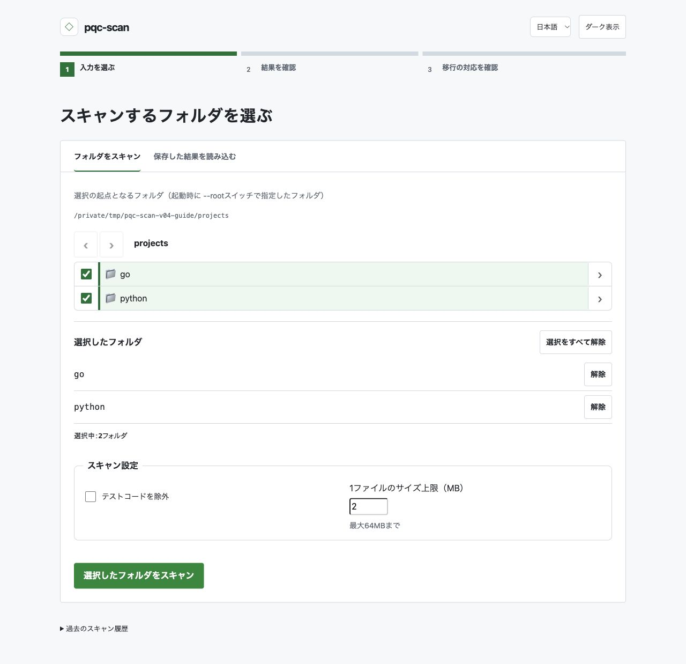
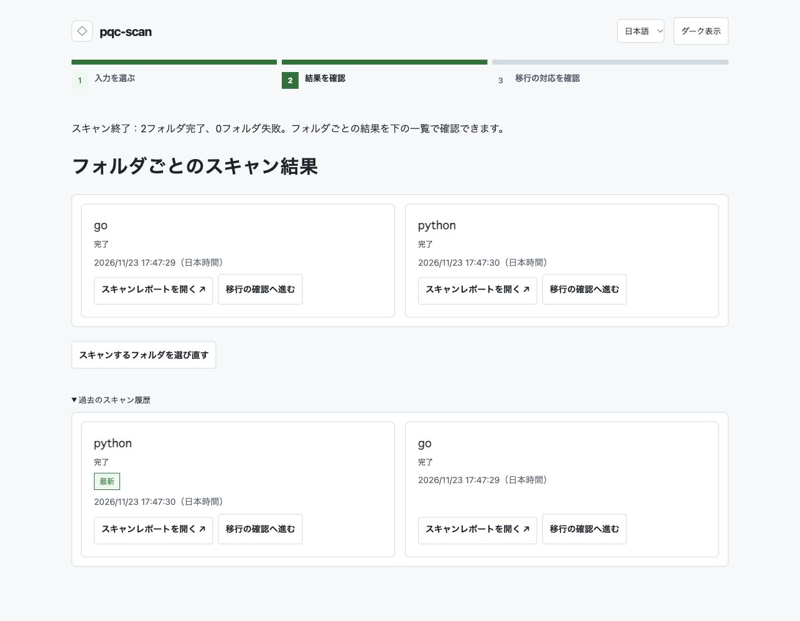
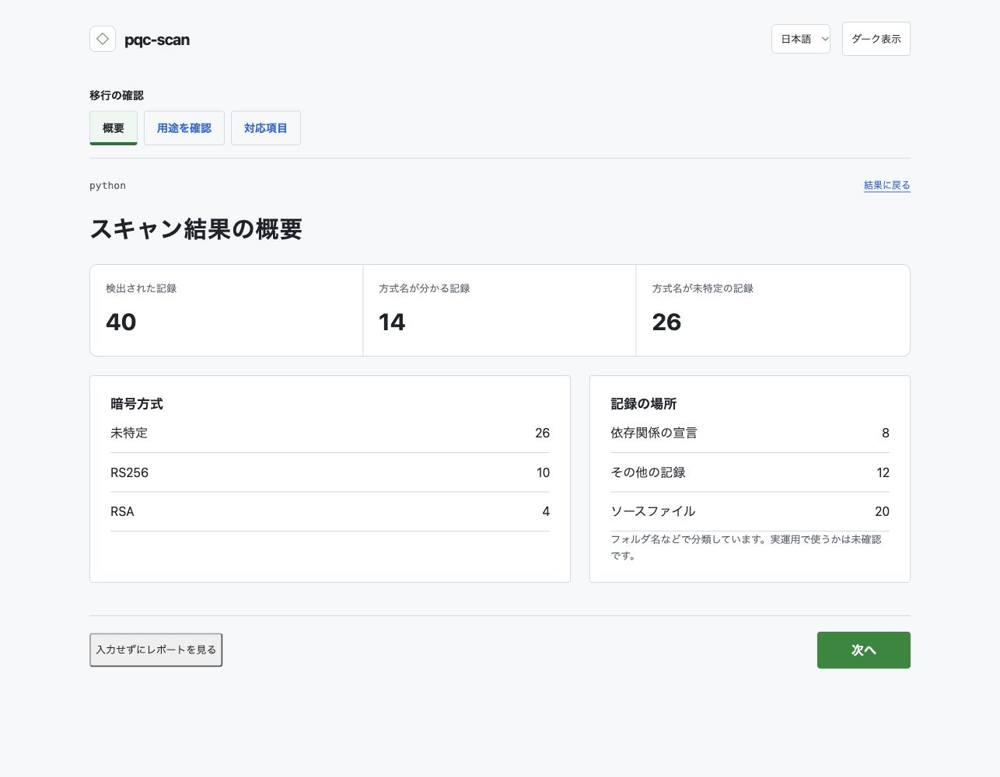
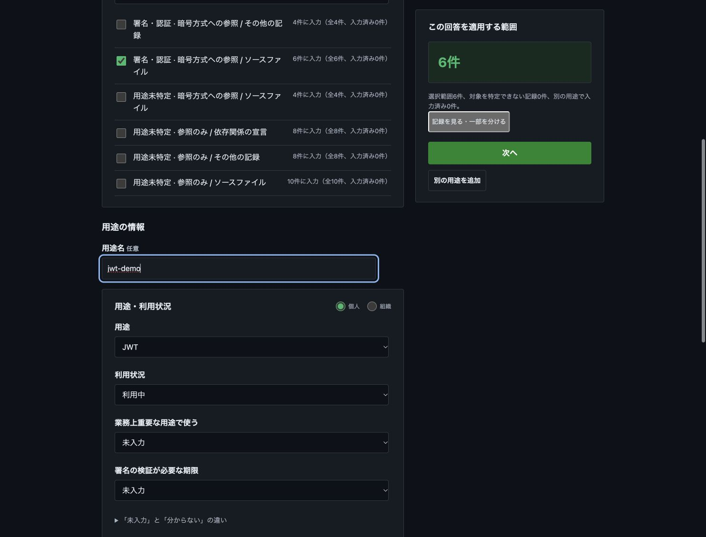
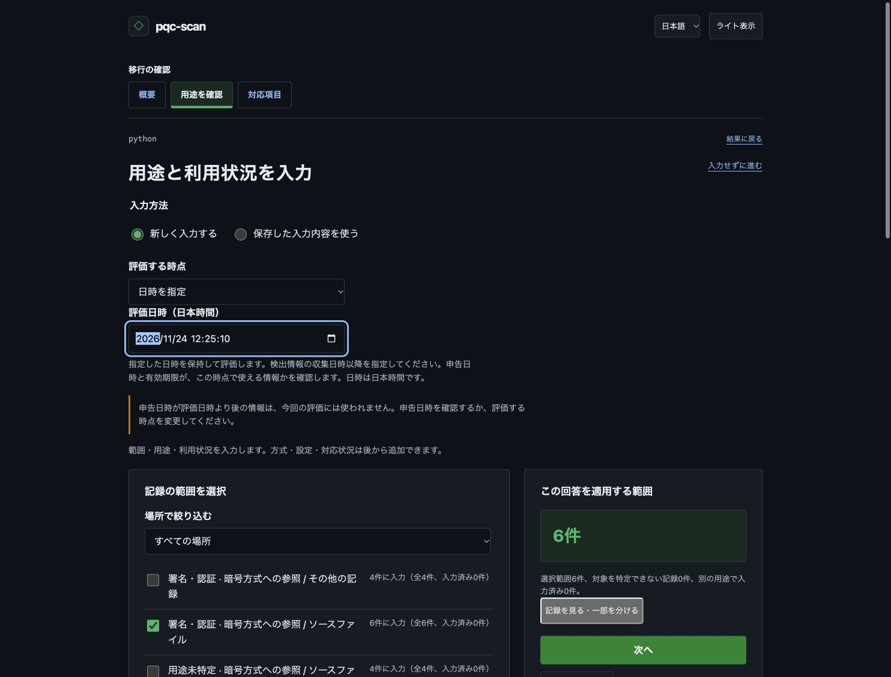
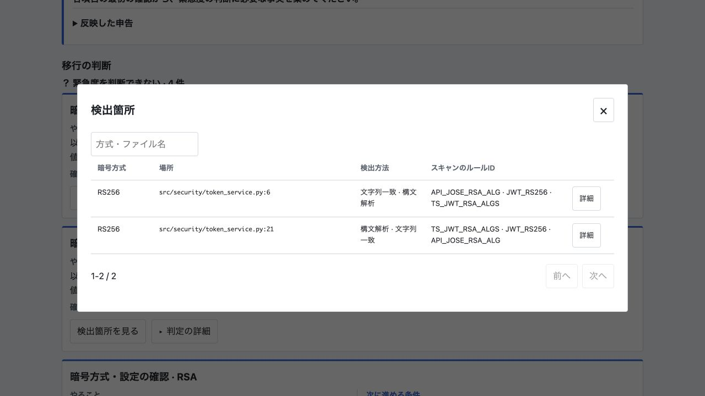

# リポジトリのスキャン方法

[English](SCANNING.md) · [README](https://github.com/wakaken/pqc-scan/blob/codex/v04-roadmap-20261118/README.ja.md)

このガイドはv0.4.0の静的スキャンを対象とします。バージョン間の変更点は[リリースノート](../releases/v0.4.0.md)を参照してください。

静的スキャンの出力オプション、CIの終了判定、検査できなかった箇所の確認方法を説明します。
棚卸しや評価の見方は[結果の読み方](REPORTS.ja.md)、形式ごとの制約は[対応する入力と検査範囲](https://github.com/wakaken/pqc-scan/blob/codex/v04-roadmap-20261118/docs/user/COVERAGE.ja.md)を参照してください。

## 目次

- [コマンドと指定方法](#command)
- [GitHub Actions](#github-actions)
- [ソースから実行する](#from-source)
- [診断情報と検査の完全性](#diagnostics)
- [画面で進めるスキャンと移行確認](#web-migration-walkthrough)

<a id="command"></a>

## コマンドと指定方法

```bash
pqc-scan scan <path> [--format json|html|md|sarif|all] [--lang en|ja] [--out-dir ./pqc-report] [--rules-dir ./rules] [--fail-on high|critical] [--threads N] [--max-file-size-mib N] [--diagnostics] [--require-complete] [--include-non-scannable] [--exclude-tests] [--cyclonedx-17] [--inventory-json] [--repository-scope ID] [--policy-profile migration-review-v1] [--assessment-context PATH]
pqc-scan rules list [--rules-dir ./rules]
pqc-scan rules show <rule-id> [--rules-dir ./rules]
pqc-scan diff <before-inventory> <after-inventory> --repository-scope ID --out-dir DIR
```

既定値は `--format all`、`--lang en`、`--out-dir ./pqc-report`、`--rules-dir ./rules`、`--threads 0`（自動選択）です。
所見の重大度や検査の完全性による終了判定は、明示しない限り有効になりません。相対パスは実行時の作業ディレクトリを基準にします。

`--repository-scope` と `--policy-profile` には `--inventory-json` が必要です。
`--assessment-context` は評価方針を指定したときだけ使えます。全オプションは `pqc-scan scan --help` で確認できます。

別ファイルのCycloneDX 1.7棚卸しには `--cyclonedx-17` を付けます。
用途と制約は[形式の説明](REPORTS.ja.md#cyclonedx)と[棚卸しの比較](REPORTS.ja.md#diff)を参照してください。


### ファイルサイズの上限

`--max-file-size-mib N` で、1ファイルの上限を1〜64MiBの整数で指定できます。既定値は2です。例：`pqc-scan scan . --max-file-size-mib 16 --threads 1 --diagnostics`。1MiBは1,048,576バイトです。指定値は既存の診断・棚卸しの検査範囲に記録し、それを超えるファイルは対象外として残します。ignore・形式・テスト除外の設定や、解析内部の作業上限も引き続き適用します。読み込み上限を増やしても解析完了の保証にはならないため、診断を確認してください。対象データと並列数が増えると、処理時間や最大メモリ使用量も増える場合があります。

`serve --max-file-size-mib N` は、フォルダ選択画面の初期値を指定します。「1ファイルのサイズ上限（MB）」は次のスキャンに適用し、選択した複数フォルダには同じ値を使います。スキャン中は変更できません。設定を変えても保存済みのレポートや履歴は書き換えません。 画面上のMB表記は従来のサイズ指定の呼称で、1単位は1,048,576バイトです。CLIのMiB指定とバイト上限は変わりません。入力欄は1〜64の整数を受け付け、範囲外や空欄の場合はエラーを表示してスキャンを開始できなくします。

### 出力先の安全性

Unix（macOS・Linuxを含む）では、出力先ディレクトリの経路にあるシンボリックリンクと、
出力ファイル位置にある既存のリンク・通常ファイル以外の項目を拒否します。
macOSのシステム管理下にある`/tmp`・`/var`・`/etc`は利用できますが、その配下のリンクには
同じ検査を適用します。それ以外のディレクトリ別名は実体のパスを指定してください。
スキャン・棚卸し・評価・診断・CycloneDX・差分・probeの各レポートに適用されます。

存在しないディレクトリは作成します。通常の既存レポートは上書きできます。
出力先への書き込み権限が必要です。途中で失敗すると、一部の出力だけが残る場合があります。
レポートの保管先は、第三者が変更できない場所を選んでください。


### プロダクトリポジトリでの推奨実行方法

`pqc-scan` を自分のプロダクトリポジトリ内（`pqc-scan` リポジトリ外）で実行する場合は、`--rules-dir` に **絶対パス** を指定してください。

```bash
pqc-scan scan . --format all --out-dir /path/to/reports/product-scan --rules-dir /path/to/pqc-scan/rules
```

### よく使うコマンド

```bash
# すべてのレポート形式を出力

pqc-scan scan . --format all --out-dir /path/to/reports/product-scan --rules-dir /path/to/pqc-scan/rules

# SARIF形式で出力（GitHub Code Scanning向け）

pqc-scan scan . --format sarif --out-dir /path/to/reports/product-scan --rules-dir /path/to/pqc-scan/rules

# CI失敗ゲート

pqc-scan scan . --fail-on high --out-dir /path/to/reports/product-scan --rules-dir /path/to/pqc-scan/rules

# 1つのルール詳細を確認

pqc-scan rules show JWT_RS256 --rules-dir /path/to/pqc-scan/rules
```

<a id="github-actions"></a>

## GitHub Actions

プロダクトのCIでは `--format sarif` で出力し、所見でジョブを失敗させる場合は `--fail-on high|critical` を指定します。
検査の不完全さも失敗とする場合に限り、`--require-complete` を加えます。終了コード3は所見のしきい値より優先されるため、対象範囲や未対応形式も確認してください。

自分のプロダクトに合う終了条件を選び、元のレポートも保存して所見を確認できるようにしてください。

<a id="from-source"></a>

## ソースから実行する

インストールせず試す場合は、ソースから直接実行できます。

```bash
cargo run --manifest-path /path/to/pqc-scan/crates/pqc_scan_cli/Cargo.toml --bin pqc-scan -- scan /path/to/your-product --format all --out-dir /path/to/reports/product-scan --rules-dir /path/to/pqc-scan/rules
```

<a id="diagnostics"></a>

## 診断情報と検査の完全性

検出がゼロでも、すべての対象を検査できたとは限りません。読み込みや解析に失敗した場合も、ほかの検出結果は保持します。
検査が部分成功・失敗・不明の場合は、標準エラーに警告を表示します。これとは別に、ignoreなどで列挙していないファイルがあり得るという注記も表示します。注記だけで検査失敗にはなりません。
CLIが生成するHTML・Markdownにも検査状態と件数を表示します。
`--diagnostics` を付けると安全な理由情報も確認できます。言語指定で変わるのは人間向けの文面だけです。

### 診断情報を保存し、必要に応じてCIを止める

検査できなかった箇所を調べるには `--diagnostics`、不完全な検査をCIで失敗とするには `--require-complete` を使います。
2つのオプションは単独でも指定できます。

| オプション | 動作 |
|---|---|
| `--diagnostics` | `--out-dir` に `diagnostics.json` を追加し、検査範囲・集計・理由コードを保存する |
| `--require-complete` | 検査の完了を確認できなければ、要求されたレポートを出力した後に終了コード3を返す |

両方を指定する例です。

```bash
pqc-scan scan . --diagnostics --require-complete --out-dir /path/to/reports/product-scan --rules-dir /path/to/pqc-scan/rules
```

`diagnostics.json` には `schema_version: "1"` と生成時刻も含みます。ファイル内容や検出器・I/Oのエラー本文は含めません。
`--format all` だけでは追加されず、既存6形式のファイル名と機械出力スキーマは変わりません。`--lang` の対象はHTMLとMarkdownだけです。

終了コードは次のように読み分けます。

| コード | 意味 |
|---|---|
| 0 | 実行成功。検査の完了や安全性を保証するものではない |
| 1 | 読み込みの準備や出力などの実行エラー |
| 2 | `--fail-on` で指定した重大度のしきい値に到達 |
| 3 | `--require-complete` を指定し、検査の完了を確認できなかった |

複数の条件に当てはまる場合は、1、3、2の順に優先します。診断情報を出す指定だけでは、完全性による終了判定は有効になりません。

### 「完了」が意味する範囲

完了判定は、Gitのignore設定・既定の除外・サイズ制限を適用した検査範囲内に限ります。
有効な範囲に対象ファイルがなければ完了扱いになりますが、範囲外に暗号がないという意味ではありません。
また、`Complete` は対応するパターンや形式を検査したという意味で、名前解決、実際の稼働、全鍵形式の網羅を保証しません。

集計を見るときは、ファイルの選択と解析の完了を区別してください。`scanned_files` はwalkerが選択したファイル数です。
診断情報では、選択・読み込み成功／失敗・解析完了・部分成功・解析失敗・未対応・対象外・不明を分けて記録します。
列挙できたポリシー除外と列挙失敗は別に数え、ignoreで見えないファイル数は不明として扱います。

### 処理上限に達した場合

処理上限で検査が終わらなかった場合も、それまでの検出結果は残ります。
診断に表示された理由を確認し、対象を分けて再スキャンするか、該当箇所を直接確認してください。

### 解析エラー・未対応形式の扱い

構文エラーがある場合は、取得できた検出結果を残し、未完了と表示します。
バイナリ入力、未対応のソース言語、適用ルールがない場合は、その検出器の対象外として扱います。

証明書では、不正な形式、未知の鍵属性、未対応ブロックの混在を `detector_partial`、未対応コンテナーを `detector_unsupported` として報告します。
コンテナーを検出しても、内部を検査できたとは限りません。解析できてもルールに一致しない証明書は所見を出しません。

依存関係では、有効な空データ、不正な対応形式、部分成功、未対応のバージョン、上限到達を区別します。
対応する構造化データの範囲では完了を報告し、関係のないファイルは対象外です。Go・Maven POM・requirements・Rubyの定義とロックは、対応する構文を解析できた範囲で完了を報告します。Gemfile・gemspecのリテラルによる依存宣言は、選択済みのローカルgemspec参照を含め、Rubyの構文木で検査します。動的・未対応の記述は未完了とし、Gradleの簡易解析は `detector_not_reported` とします。
完了はパッケージ管理ツールと同じ検証やインストール状態の保証ではありません。

`--require-complete` の終了コードの規約は変わりませんが、解析結果や対応範囲によって、実際に返るコードは変わり得ます。
依存関係ごとの詳細は[指定と確認根拠](https://github.com/wakaken/pqc-scan/blob/11ff0b0c3e6f8c9a17148fe0551256f29dee74f0/docs/architecture/DEPENDENCY-PROVENANCE.md)を参照してください。

## 通常は除外するバイナリ形式を含める

`scan` は既知の画像・アーカイブ・コンパイル済みデータの拡張子と、テキストとして扱えないバイナリを、ファイルの選択前に除外します。除外件数は検査未完了と分けて記録します。`--include-non-scannable` でこれらも対象に戻せますが、形式の解析機能が増えるわけではなく「適用する検査なし」の件数が増える場合があります。既存のディレクトリ・Markdown・Git ignore・サイズの除外は引き続き適用します。鍵・証明書・信頼ストア等の拡張子は、検査できない部分も把握できるよう既定で残します。全パスは診断JSONに残し、人向け診断は件数と理由ごとに最大3件の例に集約します。


<a id="reference-positions"></a>

### 検出箇所の確認

レポートのファイル名と位置を使って、元のソースや設定を確認してください。
参照の検出だけでは、実行時に使われる方式までは確定しません。

## ローカルWebスキャン

```bash
pqc-scan serve --root /path/to/projects --rules-dir /path/to/pqc-scan/rules
```

既定ブラウザでローカルの操作画面が開きます。選択画面では、選択したフォルダと「選択をすべて解除」をまとめ、テスト除外とファイルサイズ上限は「スキャン設定」に配置しています。残りスキャン件数の常時表示はありませんが、20件のセッション上限は引き続き適用します。

`--root` 配下の一覧やチェックボックスでフォルダを複数選び、「選択したフォルダをスキャン」を押すと、進捗モーダルを表示します。処理中はほかの画面操作とEscapeによる閉じる操作を止め、対象フォルダと「何件目／全件数」を表示します。対象ファイルの探索、ファイル解析（処理済み件数／対象件数）、結果の集計、レポート作成の順に進みます。件数は読み込みや解析に失敗したファイルも含み、解析の成功件数や全体の残り時間を示すものではありません。通常モードで1フォルダだけの場合は、生成後のHTMLレポートが自動で開きます。複数の場合は結果一覧に選択順のカードが並び、完了したカードからそのフォルダのスキャンレポートを別タブで開けます。移行の確認を使える場合は、同じカードから進めます。開始画面・結果画面のスキャン履歴でも、カードから直接操作できます。レポートの「結果に戻る」から同じ結果を再表示できます。再スキャンはしません。レポート生成の成功と、検査の完了状況は別に表示します。スキャンに失敗した場合は失敗として記録し、再実行できます。0件としては扱いません。

`--root` の既定値は現在のディレクトリです。選択画面ではその範囲外へ移動できず、シンボリックリンクは表示しません。`--port` の既定値は8787です。`--port 0` では空いているポートを使います。`--threads` の既定値は4です。`--no-open` を付けるとブラウザを開かずURLだけを表示します。操作画面は日本語とEnglishを選べます。レポートは操作画面の言語とライト／ダーク表示を引き継ぎ、レポートで変更した設定も結果画面に引き継ぎます。テーマはレポートの描画前に適用し、ブラウザに設定を保存できない場合も画面間で引き継ぎます。保存したオフライン版にも言語・テーマ選択がありますが、セッションの結果に戻るリンクは付きません。

サーバーは `127.0.0.1` だけで待ち受けます。ターミナルに表示したランダムなセッションURL全体を開いてください。`localhost` などの別名や、パスが `/` だけのURLは受け付けません。URLは他者に共有しないでください。ソースファイルの内容は配信しません。各スキャンはCLIと同じ解析処理を使い、`--format all` の7ファイルと `diagnostics.json` を出力します。ファイルサイズ上限とテスト除外は上の設定で変更できますが、この画面からルールセット・判定閾値の変更やネットワーク検査はできません。同時実行は1件、1セッションは最大20件です。フォルダ一覧は最大1,000サブフォルダを表示し、省略があれば件数を示します。選択は最大20フォルダで、保存済み結果の読み込みも含めたセッションの残り件数を超える場合は開始前に拒否します。選択順に実行し、親子フォルダの両方を選んだ場合も別々にスキャンします。個別のスキャンが失敗しても次へ進みますが、開始できなかった場合や開始結果が不明な場合は、要求を自動再送せず残りを停止します。通信が切れた場合は、サーバーの状態を再確認できるまでモーダルを維持します。未実行分はページのメモリーだけに保持するため、完了までページを開いておいてください。再読み込みやページを閉じると未実行分は失われますが、実行中のスキャンは取り消さず、サーバー上の結果も削除しません。

レポートはターミナルに表示した専用の `pqc-scan-web-*` ディレクトリに保存します。終了はCtrl+Cです。オフラインで残す場合は `report.html` と `report.rules.html` を一緒に保存してください。各出力はレポートURL配下の対応するファイル名からも取得できます。ソースやレポートのアップロード、プロジェクトのビルドスクリプト・パッケージコマンドの実行は行いません。セッションの出力先を含むフォルダは、スキャン対象に選べません。

### 移行情報の任意入力と再評価

```console
pqc-scan serve --migration --root /path/to/projects --rules-dir /path/to/pqc-scan/rules
```

<a id="web-migration-walkthrough"></a>

以下はソースリポジトリの公開サンプル（`examples/go` と `examples/python`）を使った操作例です。サンプルはバイナリ配布物に含まれません。ご自身のフォルダでも同じ手順で操作できます。件数と入力値はこの例に限ります。画面はv0.4.0で撮影しています。

#### 1. フォルダを選んでスキャンする

起動時に表示された完全なURLを開き、調べるフォルダにチェックを入れます。複数選択でき、下の一覧で対象を確認してから「選択したフォルダをスキャン」を押します。例では公開サンプルの `go` と `python` を選んでいます。

テストコードは既定で含みます。除外する場合は「テストコードを除外」を選び、必要なら1ファイルのサイズ上限も変更します。処理中は進捗画面が開き、「残りのスキャンをキャンセル」で未実行の対象だけを中止できます。



#### 2. 対象の結果を開く

フォルダごとのカードで名前を確認します。「スキャンレポートを開く ↗」は検出結果を別タブで開き、「移行の確認へ進む」はその対象の移行確認を開きます。例では `python` を選びます。

「過去のスキャン履歴」にも同じ操作があります。履歴はこのサーバーのセッション内のもので、サーバーを再起動しても引き継がれる履歴ではありません。通常の `serve` で1フォルダだけを調べた場合は、スキャンレポートが自動で開きます。



#### 3. 概要を確認する

「概要」で、記録数、方式名の分かる範囲、記録の場所を確認します。これらは保存された検出の内訳で、実稼働の用途数ではありません。

「次へ」で用途入力へ進みます。分かる情報がなければ「入力せずにレポートを見る」で調査項目を確認できます。



#### 4. 範囲・用途・利用状況を入力する

「新しく入力する」を選び、回答を適用する記録の範囲にチェックを入れます。例では「署名・認証」のソースファイル6記録を選び、用途名を `jwt-demo`、用途を「JWT」、利用状況を「利用中」としています。適用件数を確認し、範囲を分ける場合は「記録を見る・一部を分ける」を使います。

分かる項目だけ回答してください。「未入力」は回答なし、「分からない」は不明という申告です。「個人」「組織」は入力の案内を変えるだけで、緊急度を下げる指定ではありません。方式・設定・対応状況や、根拠のある期限は必要に応じて追加します。



#### 5. 申告日時・有効期限を確認して作成する

回答には「入力者の別名」と「申告日時」が必要です。「情報を評価に使う期限」を開き、申告を有効として使える期限を入力します。例の `sample-owner` と日時は説明用の値です。実際には、その情報の確認者と確認日時・有効期限を使ってください。

有効期限を省略すると申告の有効性は不明になります。この期限は移行期限や目標年月とは別です。「評価する時点」は通常「作成時の現在時刻」のままで構いません。過去の状況を見る場合だけ「日時を指定」を選び、日本時間で入力します。検出情報の収集日時より前には指定できません。指定した評価日時より後の申告は、その評価には使われないことを画面で案内します。「次へ」で適用・作成します。「対応項目」タブを開いただけの場合は「確認事項を作成」を押します。


日時を指定し、申告日時が評価日時より後になる場合の注意表示です。通常の利用では「作成時の現在時刻」に戻してください。



#### 6. 移行の判断を読む

結論、評価日時、各カードの「やること」「次に進める条件」を確認します。この少量入力の例では、実際の方式・設定などの調査が残り、緊急度を判断できない項目を表示しています。用途を入力するだけで3ステップや移行可能の判定になるわけではありません。

条件の揃った移行計画には現状把握・互換性試験・段階切り替えの手順が出ます。早急な調査は初期表示し、手順のある項目がある場合は残りの確認を「ほかの確認項目」にまとめます。日程や判定条件の詳細は[レポートの読み方](REPORTS.ja.md#saved-assessment)を参照してください。


#### 7. 検出箇所と元の所見を調べる

「検出箇所を見る」で一覧を開き、方式やファイル名で検索します。「詳細」で検出方法、一致したルール、判定理由、判断に使った申告を確認できます。同じ場所の同等な記録はまとめて表示します。

同じローカルジョブにスキャンレポートがあれば、詳細内の「スキャンの検出箇所を開く」で元の所見へ移れます。保存済み入力の読込や単独HTMLなど、元のレポートがない入口にはこのリンクはありません。



#### 8. レポートと再評価用の入力を保存する

「入力内容を保存（JSON）」は、取得状況と失敗時の案内を表示します。保存開始の案内が出たら、ブラウザの保存先で `migration-context.json` を確認してください。取得に失敗した場合は現在の結果から再試行できます。

画面上部の「レポートを保存（HTML）」は閲覧用HTML、「入力内容を保存（JSON）」は申告を再利用するcontextです。末尾の「評価データを保存」は全件の評価結果で、再入力用contextとは別です。

再評価するなら、contextと同じジョブの `scan.inventory.v1.json` も保管してください。元の入力は、起動時にターミナルへ表示された `pqc-scan-web-*` の保存先内に、ジョブごとのサブフォルダで残ります。「保存した結果を読み込む」でこの棚卸しを選び、次の用途入力画面で「保存した入力内容を使う」から対応するcontextを読み込みます。評価日時を確認して再作成します。入力を整形・変更すると対応付けが変わるため、元のバイト列を保ってください。

「用途を修正」で変更した後は、確認事項を再作成し、HTMLと入力JSONも保存し直します。終了時はターミナルで **Ctrl+C** を押します。


#### 入力・保存・再評価の詳細


スキャンが完了すると、「スキャンレポートを開く ↗」と「移行の確認へ進む」を選べます。複数フォルダをスキャンした場合は、対象フォルダの結果カードから移行の確認へ進みます。同じタブで移行の確認から戻ると、フォルダごとの結果一覧に戻ります。
入力画面の「保存した結果を読み込む」から、保存済みの `scan.inventory.v1.json` も選べます
（32MiBまで）。ファイルはローカルのセッション内で処理します。フォルダ名と現在の場所は
最初から表示します。複数選択したフォルダを順番に処理し、フォルダごとに結果を残します。通常の
`serve` で1フォルダだけの場合は、従来どおりスキャンレポートを自動で開きます。
移行の確認は「概要」「用途を確認」「対応項目」の3画面で進めます。概要の件数と方式・場所の
分布は、選択したスキャン結果から表示します。Keycloak以外でも同じ仕組みで使えます。
「次へ」で用途の入力に進みます。入力せずにレポートを開くこともできます。

入力する範囲は、検出した用途・役割・フォルダやファイルの種類から選びます。必要に応じて
最上位のフォルダで絞り込めます。「テスト用フォルダ内」はパスによる分類で、実際にテスト専用か
どうかは確定しません。右側には回答の適用件数、対象を特定できない記録、他の用途に入力済みの
記録を表示します。「次へ」で表示した範囲に回答を適用し、レポートを生成します。確認用の
チェックボックスはありません。別の用途は保存時にも分けます。件数は品質や緊急度の点数ではありません。

「記録を見る・一部を分ける」では、方式・ファイル名の検索、役割の絞り込みと20件ずつの一覧を
使えます。合計4096件・256用途まで入力でき、上限を超えた選択は一部だけ適用せずに拒否します。
保存済みの入力内で対象を特定できない記録には申告を適用しません。同じ目印を持つソースの記録でも、保存された位置が一意で整合していれば、明示的に選んで用途を入力できます。「個別に修正」で保存した内容は、共通の内容を
編集しても変わりません。「共通の内容に戻す」を選ぶと、現在の共通設定に戻ります。
グループは入力をまとめる機能で、組織の既定値ではありません。未保存の入力は評価に含めず、
ページ内だけで保持します。再読み込みすると下書きと入力グループは失われるため、申告を残す場合は
「移行情報を保存」で保存してください。個人・組織の選択は案内だけに使い、重要性の判断には
影響しません。会社名・部署名は不要です。

「未入力」は回答の省略、「分からない」は状況が分からないという回答です。「いいえ」と
「対象外」も区別します。「対象外」にすると他の移行項目を隠し、その内容を生成する移行情報から
除外します。下書きは保持し、対象に戻すと復元します。用途に合わない項目も同様に扱います。

検討する方式を選ぶと、鍵長・方式の設定を候補から選べます。「その他（手入力）」も使えます。
候補は標準の設定名であり、配備を推奨するものではありません。手入力した設定の妥当性は検証
しません。対応状況の質問は、選択した用途・方式・設定についての質問です。その条件を変更した
場合は、対応状況を回答し直してから保存します。選択した方式・設定と申告の由来は、保存ファイルと
評価レポートの根拠に残ります。申告だけで実装の正しさ、通信の互換性や配備の検証を確認したとは
扱いません。

回答には入力者の別名と申告日時が必要です。日時は日本時間で入力し、保存時には秒単位で時差を
付けます。確認画面も日本時間で表示します。申告日時の「現在時刻」は、その情報を確認した時刻を入力するためのボタンです。評価する時点は、通常は確認事項を作成するときの現在時刻です。「日時を指定」で過去の評価日時を選んだ場合は、その値を保持します。申告日時が評価日時より後の場合は注意を表示し、申告を有効として使ったことにはしません。
有効期限は任意で、自動では補いません。指定しなければ情報の有効性は不明です。移行に必要な期間は
年・月と日本時間の基準日で入力します。基準日に指定した月数を加え、月末は移動先の月の末日に
合わせます。実際の日数と秒数を画面に示し、既存の秒数として保存します（上限315,576,000秒）。
1か月を30日とは換算しません。最初の基準日は評価日です。評価日時を変更しても、保存済みの
見積もりは自動で変えません。読み込んだ秒数も保持します。別項目の目標年月（YYYY-MM、
0001〜9999年）は計画情報です。日や時差には換算せず、組織・契約上の期限や緊急度・対応状況の
判定には使いません。評価日時は別に確認してください。入力せずに進む場合も、
既知の懸念と不足情報はレポートに残ります。

「保存した入力内容を使う」では、対応する全項目・既定値・資料参照・由来を保持します
（1MiBまで）。読み込んだ内容は読み取り専用です。変更する場合は元のファイルを編集して読み込み
直してください。別のスキャン結果を選ぶと対応付けを解除し、確認し直します。方式・設定を持たない
従来の移行情報は、従来の一般的な対応状況として扱います。別の範囲の対応状況を、新たに選択した
設定への回答として引き継ぐことはできません。そのような混在は読み込み時に拒否します。

「次へ」で保存対象と入力を検証し、実際の評価処理でレポートを生成します。再スキャンや外部への
通信は行いません。生成中はスピナーとともに、読み込み・評価・各形式の作成・保存の段階を
表示します。保存中は実際のファイル数も表示します。全体の進捗率を推測して表示するものでは
ありません。開始後の評価は途中で取り消せません。失敗した場合は入力を保持し、完了済みの
結果を表示せずに再試行できるようにします。

対応項目は、システム、検出した用途・役割、判定、理由、不足情報、対応、妨げとなる条件と
移行先候補の対応状況が同じ判断をまとめます。件数は結果によって変わり、0件の場合もあります。
次の確認事項は画面に表示し、「検出箇所を見る」から20件ずつの検出箇所と、選択した1件の検出方法や判定理由を確認できます。同じファイル・行で検出内容と判定が一致する記録は、「詳細」でまとめて表示します。一致したルールも確認できます。
まとめたことを理由に移行完了とは判定しません。「用途を修正」で入力を保ったまま戻れます。
言語・テーマも切り替えられます。「レポートを保存（HTML）」では表示中の言語・テーマを初期表示にした
単独のHTMLを保存します。「入力内容を保存（JSON）」のファイルは、同じ保存済み結果・評価日時を指定した
CLIの `assess` でも使えます。オフラインでの操作と制約は
[レポートの操作](SAVED-EVIDENCE.ja.md)を参照してください。
保存に失敗すると、一部の出力ファイルだけが残る場合があります。

セッション内の `migration/` フォルダには3形式の移行レポートと、指定した場合は
`migration-context.json` を保存します。作成が完了したファイルだけを開けます。
保存済み入力の読み込みも、1セッション20件の上限に含まれます。


初期画面では、起動時の `--root` がアクセス可能な範囲として表示されます。一覧のフォルダを
クリック、またはチェックボックスで複数選択し、そのままスキャンします。再度クリックすると解除します。
選択一覧でパスを確認でき、個別の解除と全解除もできます。選択はフォルダを移動しても残ります。
ダブルクリックで開いて選択、右端の「›」で選択せずに開きます。「戻る」「進む」と、一覧上のパスで
階層を移動できます。現在のパスをクリックすると、`--root` 自体の選択も切り替えられます。
キーボードでは上下キーで移動、Spaceで選択、Enterで開く、Alt+上キーで親階層へ移動できます。
ページを最初に開いたときは未選択です。
範囲を変更する場合は `--root` を指定してサーバーを起動し直してください。
OSのフォルダ選択やブラウザへのフォルダアップロードは行いません。

移行情報の入力方法は「新しく入力する」「保存した入力内容を使う」から選びます。
範囲・用途・利用状況を入力し、検討が進んだら方式・設定・対応状況を追加してください。
未入力の項目は既定値を引き継ぐ場合があります。「分からない」は既知の既定値を上書きする場合が
あります。どちらの状態も、それだけで緊急度を決めるものではありません。対象外の申告は記録の削除や
安全性の確認を意味せず、技術上の懸念はレポートに残ります。

場所を絞ると、その範囲にある分類・件数に変わります。入力可能な件数から、対象を特定できない記録と
入力済みの記録を除きます。保存した用途を削除すると個別設定も外れますが、同じ画面を開いている間は
「元に戻す」で復元できます。同じ対象を別の用途に割り当てた場合は、重複する用途を先に削除してください。
編集・削除・復元後は表示中のレポートを無効にし、保存済みファイルは残します。変更後の内容でHTMLと
入力内容のJSONを保存し直してください。

過去のスキャン履歴は新しい順に並び、プロジェクト名または読込ファイル名、日本時間の受付日時と状態を
表示します。別セッションの履歴は保持しません。過去の名前・日時が分からない場合は、その旨を表示します。
スキャンレポートは現在の言語・テーマを引き継いで別タブで開き、入力中の画面を保ちます。


進捗モーダルの「残りのスキャンをキャンセル」で未実行のフォルダをまとめて中止できます。実行中の1件は終了を待ち、結果は過去のスキャン履歴に残します。用途の確認では読み込み・確認事項の作成中もモーダルを表示します。「対応項目」タブを開くだけでは作成を開始せず、「確認事項を作成」で開始します。評価日時は入力方法の近くに表示し、申告情報の有効期限は任意の詳細項目にまとめています。必要な期間と目標年月は、どちらかを明示的に指定すると他方を解除します。読み込んだ保存済み情報の形式と意味は維持します。

申告情報の有効期限を省略すると、用途や対応状況などの申告は有効性不明として評価されます。入力した事実と、判定に採用される有効な申告は別です。必要な期限を明示してください。


日程、手順が表示される条件、早急な調査、検出箇所、保存については[移行確認の読み方](REPORTS.ja.md#saved-assessment)を参照してください。

### 移行レポートの確認を補助する表示

任意の「組織・契約で決まった期限」では、対象に適用される期限、組織の方針／契約上の要件の区別、公開してよい発行元・文書・版・条項の識別名を入力できます。既存の参照情報の形式で保存し、目標年月とは別に、所要期間とともに緊急度の判定に使います。「期限の指定はない」、回答の省略、「確認が必要」は区別して保持します。記録を一意に対応付けできない場合は、回答の追加では解消できない検出上の制約として説明します。

対応項目には、適用された申告上の期限を日本時間で、所要期間を日・時間などで表示します。JSONの正確なUTC・秒数は保持します。記録数と記録された場所の数を区別し、複数の検出を独立した利用箇所や脆弱性とは扱いません。根拠一覧では検出方法も表示します。WebのHTMLレポートには選択した相対範囲の名前を表示します。CLIでは `assess --report-label "Project / scope"` でHTMLレポートに名前を付けられます（公開してよい文字列、UTF-8で256バイト以内、制御文字不可）。これらの表示情報や対応付け制約は、評価JSONの内容を変更しません。

### テストコードを除外する

既定ではテストコードも検査します。本体で利用する方式や互換性の手掛かりを含むため、全体の棚卸しでは含め、本体の移行候補を絞るときは `--exclude-tests` を指定してください。ブラウザでは「選択をすべて解除」の下にある「テストコードを除外」を選べます。設定はスキャン開始時に固定し、選択した全フォルダに適用します。

```bash
pqc-scan scan . --exclude-tests --diagnostics --out-dir /path/to/reports/product-only --rules-dir /path/to/pqc-scan/rules
```

対象ルートからの相対パスに `test/`・`tests/`・`__test__/`・`__tests__/`・`spec/`・`specs/`・`testsuite/`・`test-suite/`・`test-framework/` を含むファイルと、`test_*.py`・`*_test.py`・`*_test.go`・`*_test.rb`・`*_spec.rb`・`*.test.{js,jsx,ts,tsx,mjs,cjs,mts,cts}`・`*.spec.{js,jsx,ts,tsx,mjs,cjs,mts,cts}`・`*Test.java`・`*Tests.java` を除外します。判定は大文字・小文字を区別します。選択したルートより上のディレクトリ名は判定に使いません。ルート自体がテスト用フォルダであることは推測しません。

パス・ファイル名に加え、`tests.py`・`tests.rs` も除外します。Rustでは構文エラーのないソースについて、明示的な `#[cfg(test)]` の項目と `#[test]` の関数に完全に収まる、元ソースと一致する検出を除外します。`cfg(any(test, ...))`、独自マクロ、`test`属性のimport・globや未解決の属性マクロによる書き換えが疑われる関数、位置や元の記述を確定できない検出は残します。外側の未解決の属性マクロで書き換えられ得る範囲では、内側の `#[cfg(test)]` も残します。混在ファイル全体は解析するためファイル数は変わらず、周辺ソースの表示に隣接するテストが含まれる場合があります。独自の名前のテストをすべて識別する機能ではなく、除外後の結果が本番利用だけを表す保証でもありません。ルートの依存関係情報も引き続き検査します。適用した条件は「検査範囲と除外条件」と `diagnostics.json`・棚卸しJSONに記録します。条件が異なるスキャンの件数を直接比較しないでください。

### 独自の除外パス

スキャン対象に選んだフォルダの直下に `.pqcignore` を置くと、CLI・ブラウザのどちらでも適用されます。複数フォルダを選んだ場合は、各フォルダ直下の設定を適用します。UTF-8でGitignore形式のパターンを1行ずつ記載します。例えば次の設定は、独自の検証用ファイルを除外し、指定した1ファイルを残します。

```gitignore
/integration-fixtures/*
!/integration-fixtures/production-control.rs
```

起点の外側や下位フォルダの `.pqcignore` は読みません。設定自体は検査対象から除外します。不正なパターン・文字コード・読み取り失敗ではスキャンをエラーにし、設定内容はエラー文に出しません。シンボリックリンクは読みません。適用したことは既存の検査範囲欄に記録し、列挙できた除外ファイルを数えます。Gitのignoreや既定の除外、`--exclude-tests` の対象を否定パターンで復帰することはできません。混在ファイルをパスで除外すると、そのファイルの本体コードも対象外になります。

既定の `target`・`docs` などのディレクトリ除外も、選択した起点からの相対パスで判定します。起点より外側の同名ディレクトリによって、選択フォルダ全体を除外することはありません。
