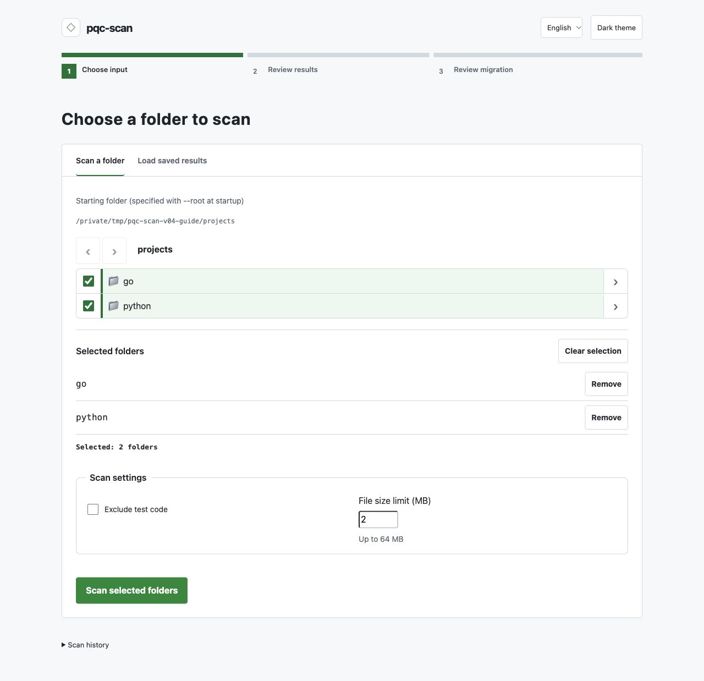
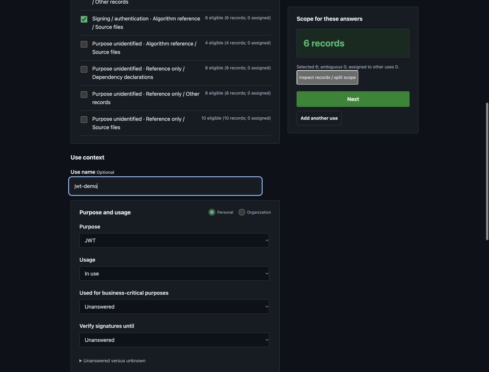
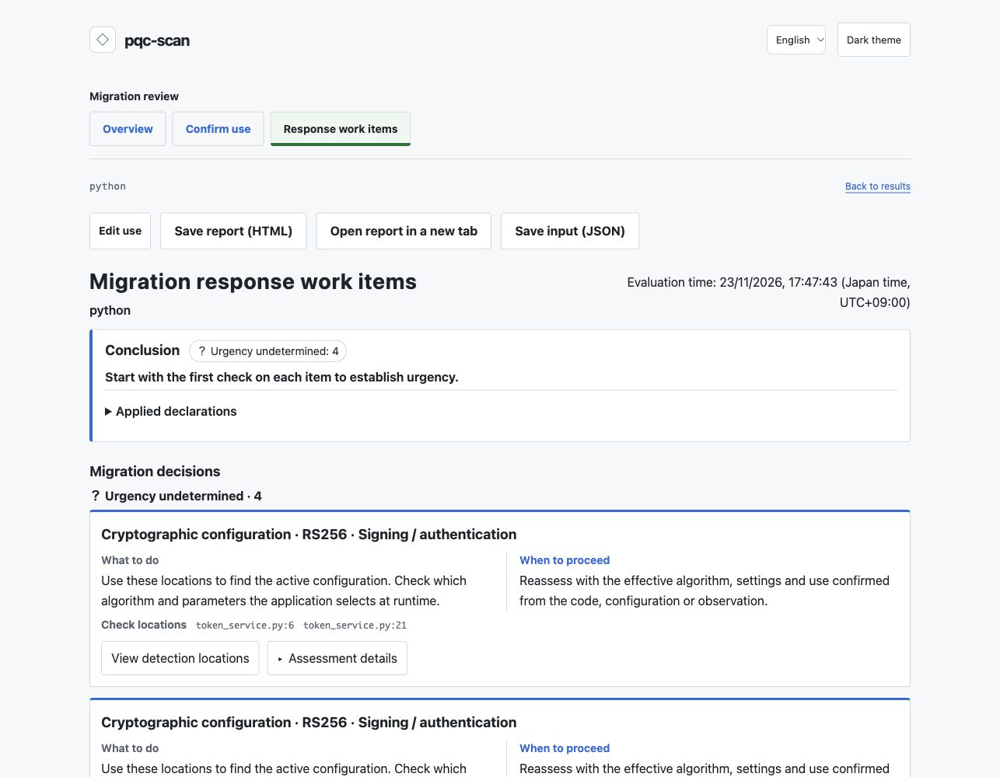
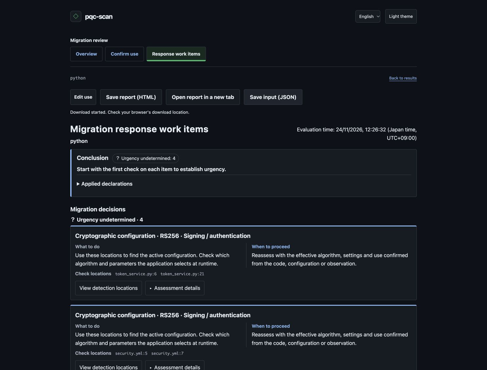

# Scanning repositories

[日本語](SCANNING.ja.md) · [README](https://github.com/wakaken/pqc-scan/blob/develop/README.md)

This guide covers v0.4.0 static scanning. See the [release notes](../releases/v0.4.0.md) for changes between versions.

Use this guide after the first scan when you need to select outputs, change CI exit behavior or understand incomplete inspection. See [report interpretation](REPORTS.md) for inventory and policy output, and [supported inputs](https://github.com/wakaken/pqc-scan/blob/develop/docs/user/COVERAGE.md) for format-specific limits.

## Contents

- [Command and options](#command)
- [GitHub Actions](#github-actions)
- [Running from source](#from-source)
- [Inspection diagnostics](#diagnostics)
- [Illustrated browser scan and migration workflow](#web-migration-walkthrough)
- [Input, saving and reassessment details](#migration-input-details)
- [Exclude test code](#exclude-test-code)
- [Custom excluded paths](#custom-exclusions)

<a id="command"></a>

## Command and options

```bash
pqc-scan scan <path> [--format json|html|md|sarif|all] [--lang en|ja] [--out-dir ./pqc-report] [--rules-dir ./rules] [--fail-on high|critical] [--threads N] [--max-file-size-mib N] [--diagnostics] [--require-complete] [--include-non-scannable] [--exclude-tests] [--cyclonedx-17] [--inventory-json] [--repository-scope ID] [--policy-profile migration-review-v1] [--assessment-context PATH]
pqc-scan rules list [--rules-dir ./rules]
pqc-scan rules show <rule-id> [--rules-dir ./rules]
pqc-scan diff <before-inventory> <after-inventory> --repository-scope ID --out-dir DIR
```

Defaults are `--format all`, `--lang en`, `--out-dir ./pqc-report`, `--rules-dir ./rules` and `--threads 0` (automatic thread selection). No finding threshold or completeness gate is enabled by default. Paths are resolved from the current working directory.

`--repository-scope` requires `--inventory-json`; `--policy-profile` also requires it. `--assessment-context` requires an explicit policy profile. Use `pqc-scan scan --help` for the complete option list.

Add `--cyclonedx-17` to write separate CycloneDX 1.7 inventories. The [report guide](REPORTS.md#cyclonedx)
explains these documents and the completeness limits of [inventory comparison](REPORTS.md#diff).

### File size limit

`--max-file-size-mib N` selects a per-file limit of 1–64 MiB (whole numbers; default 2). For example, `pqc-scan scan . --max-file-size-mib 16 --threads 1 --diagnostics` includes files up to 16 MiB. One MiB is 1,048,576 bytes. The configured value appears in the diagnostic/inventory scope; files above it remain explicitly excluded. Other ignore/type/test policies and detector work limits still apply. A larger read limit does not guarantee complete parsing; inspect diagnostics. More selected data and parallel workers can increase time and peak memory.

`serve --max-file-size-mib N` supplies the initial value in the folder picker. The “File size limit (MB)” field can change it for the next batch; all folders in that batch use its captured value. The control is locked while scanning. No saved report or history is rewritten by changing it. The picker’s MB label also represents 1,048,576 bytes per unit. The field accepts integers 1–64; empty or invalid values show an error and disable scan submission.

### Output destination safety

On Unix (including macOS and Linux), report writers reject symbolic links in the
output directory path and existing symbolic-link or non-regular-file destinations.
The root-controlled macOS aliases `/tmp`, `/var` and `/etc` remain usable; links
inside them receive the same checks. Use the physical path for other directory
aliases. This applies to scan, inventory, assessment, diagnostics, CycloneDX, diff
and probe reports.

Missing directories are created, and existing regular reports can be overwritten.
You need write permission for the destination. A failed run can leave a partial set
of output files. Store reports where others cannot modify them.

### Recommended usage from your product repository

When running `pqc-scan` inside your own product repository (not inside the `pqc-scan` repo), use an **absolute path** for `--rules-dir`.

```bash
pqc-scan scan . --format all --out-dir /path/to/reports/product-scan --rules-dir /path/to/pqc-scan/rules
```

### Common Commands

```bash
# Full report set

pqc-scan scan . --format all --out-dir /path/to/reports/product-scan --rules-dir /path/to/pqc-scan/rules

# SARIF format (for GitHub Code Scanning)

pqc-scan scan . --format sarif --out-dir /path/to/reports/product-scan --rules-dir /path/to/pqc-scan/rules

# CI failure gate

pqc-scan scan . --fail-on high --out-dir /path/to/reports/product-scan --rules-dir /path/to/pqc-scan/rules

# Inspect one rule in detail

pqc-scan rules show JWT_RS256 --rules-dir /path/to/pqc-scan/rules
```

<a id="github-actions"></a>

## GitHub Actions

For a CI scan of your product, generate SARIF with `--format sarif` and choose `--fail-on high|critical` if findings should fail the job. Add `--require-complete` only if incomplete inspection must also fail; its exit 3 takes precedence over the finding threshold. The selected scope and unsupported formats still matter.

Choose failure gates for your own product and retain the original reports for review.

<a id="from-source"></a>

## Running from source

If you do not want to install yet, you can run directly from source:

```bash
cargo run --manifest-path /path/to/pqc-scan/crates/pqc_scan_cli/Cargo.toml --bin pqc-scan -- scan /path/to/your-product --format all --out-dir /path/to/reports/product-scan --rules-dir /path/to/pqc-scan/rules
```

<a id="diagnostics"></a>

## Inspection diagnostics

Zero findings does not mean every selected input was inspected. Read failures and detector errors retain other findings.
When inspection is partial, failed or unknown, the CLI prints a warning to stderr. A separate scope note explains that ignored or otherwise unenumerated files may exist; it is not itself an inspection failure.
CLI HTML/Markdown also display inspection status and counters. Detailed safe
reasons appear with `--diagnostics`; language selection changes human copy only.

### Save diagnostics and optionally fail CI

Use `--diagnostics` to investigate inspection gaps, and `--require-complete` to make incomplete inspection fail a CI job.
Either option can be used independently.

| Option | Behavior |
|---|---|
| `--diagnostics` | Adds `diagnostics.json` in `--out-dir`, recording scope, counters and safe reason codes |
| `--require-complete` | Returns exit 3 if inspection is not known to be complete, after writing the requested reports |

To select both:

```bash
pqc-scan scan . --diagnostics --require-complete --out-dir /path/to/reports/product-scan --rules-dir /path/to/pqc-scan/rules
```

`diagnostics.json` also contains `schema_version: "1"` and generation time. It omits file contents and arbitrary detector/I/O error text.
`--format all` does not enable it; the six legacy filenames and machine schemas stay unchanged. `--lang` affects HTML/Markdown only.

Read exit codes as follows:

| Code | Meaning |
|---|---|
| 0 | Successful execution; not proof of complete inspection or security |
| 1 | An operational error, such as setup or output failure |
| 2 | The severity threshold selected by `--fail-on` was reached |
| 3 | `--require-complete` was selected and inspection was not known to be complete |

If several conditions apply, precedence is 1, then 3, then 2. Requesting diagnostics alone does not enable the completeness exit gate.

### What “complete” covers

Completeness applies only within the declared scope after Git ignore settings, default exclusions and the size limit.
A valid scope with no target files can complete; this says nothing about cryptography outside that scope.
`Complete` means the supported patterns or formats were inspected, not general symbol resolution, runtime use or discovery of every key format.

Distinguish file selection from completed analysis. `scanned_files` means files selected by the walker.
Diagnostics separately count selected, read-ok, read-failed, analyzed, partial, analysis-failed, unsupported, not-applicable and unknown files.
Enumerated policy exclusions and enumeration failures are separate; the ignore-hidden population remains unknown.

### When inspection reaches a processing limit

Available findings are retained when processing limits prevent complete inspection.
Review the diagnostic reason, then split the scan scope or inspect the affected files directly.

### Parsing errors and unsupported formats

Syntax errors retain available findings and mark inspection as incomplete.
Binary inputs, unsupported source languages and absence of applicable rules are outside that detector's scope.

For certificates, malformed input, unknown key attributes or mixed unsupported blocks yield `detector_partial`; unsupported containers yield `detector_unsupported`.
Detecting a container does not prove its contents were inspected. A parsed certificate that matches no rule need not produce a finding.

Dependency inspection distinguishes valid empty input, malformed supported input, partial success, unsupported versions and resource limits.
Supported structured subsets can report completion; unrelated files are not applicable. Go modules, Maven POM, requirements and Ruby declarations/locks can complete within their explicitly parsed subsets. Literal Gemfile/gemspec dependency calls use bounded Ruby syntax inspection, including selected local gemspec references. Dynamic or unsupported declarations remain incomplete; Gradle lexical fallbacks remain `detector_not_reported`.
Completion is not full package-manager validation or proof of installation.

The `--require-complete` exit-code contract is unchanged, but actual returned codes depend on parser outcomes and supported scope.
See [dependency declarations and resolution evidence](https://github.com/wakaken/pqc-scan/blob/develop/docs/architecture/DEPENDENCY-PROVENANCE.md) for format-specific details.

## Including normally excluded binary formats

`scan` excludes known media/archive/compiled-data extensions and otherwise non-text binary inputs before selecting files. These exclusions are counted separately from unfinished checks. `--include-non-scannable` restores their inclusion for forensic/custom-detector runs; it does not add parsers for those formats and can increase “not applicable” counts. Existing directory, Markdown, Git-ignore and size policies still apply. Cryptographic container extensions are retained by default even when unsupported, so their inspection gaps remain visible. Full exclusion paths remain in diagnostic JSON, while human diagnostics show counts and at most three examples per reason.

<a id="reference-positions"></a>

### Check finding locations

Use the reported file and position to inspect the original source or configuration.
A detected reference does not establish the algorithm used at runtime.

## Local web scanning

Start the server with `--root` pointing to a directory containing your target folders
and `--rules-dir` pointing to your retained rules.

```bash
pqc-scan serve --root /path/to/projects --rules-dir /path/to/pqc-scan/rules
```

Select folders in the opened browser and choose **Scan selected folders**.
In ordinary mode, one folder opens its report automatically; multiple folders show
separate result cards. Keep the page open until completion, then stop the server
with **Ctrl+C** in the terminal.

Follow illustrated steps 1–8 below. Folder navigation, startup options and limits
are collected under [Web scan controls and limits](#web-scan-details).

### Optional migration context and reassessment

Add `--migration` at startup to enter purpose and usage information and continue to migration review.
For a scan report alone, use ordinary `serve` above and follow steps 1–2 to select folders and open the report.

```console
pqc-scan serve --migration --root /path/to/projects --rules-dir /path/to/pqc-scan/rules
```

<a id="web-migration-walkthrough"></a>

The walkthrough uses public samples from the source repository (`examples/go` and `examples/python`), which are not included in the binary bundle. Apply the same steps to your own folders. Counts and entered values describe this example only. Screenshots were captured with v0.4.0.

#### 1. Select folders and scan

Open the complete session URL printed at startup. Check one or more folders, review the selected list, then choose **Scan selected folders**. This example selects the public `go` and `python` samples.

Tests are included by default. Choose **Exclude test code** or change the per-file size limit when needed. A progress dialog opens during processing; **Cancel remaining scans** stops only folders not yet submitted.



#### 2. Open the intended result

Check the folder name on each result card. **Open scan report ↗** opens its findings in a new tab; **Review migration** opens that folder’s migration workflow. Choose `python` in this example.

**Scan history** offers the same actions. History belongs to this server session and does not persist across restarts. Ordinary `serve` automatically opens the scan report for a single selected folder.


#### 3. Review the overview

In **Overview**, inspect record counts, identified algorithms and recorded locations. These describe saved detections, not a count of deployed uses.

Choose **Next** to enter context. If no context is known, choose **View report without context** to inspect the investigation items.


#### 4. Enter scope, purpose and usage

Choose **New input** and check the exact records covered by your answer. This example selects the six signature/authentication source records, names the use `jwt-demo`, and selects **JWT** and **In use**. Check the affected record count; use **Inspect records / split scope** to separate exceptions.

Answer only what you know. **Unanswered** means no claim; **Unknown** explicitly records uncertainty. Personal/organization mode changes input guidance, not urgency. Add candidate settings, support or sourced deadlines when relevant.



#### 5. Check assertion dates and prepare the report

Answers need an actor alias and assertion time. Expand the claim-expiry details to enter how long that information remains valid. `sample-owner` and the dates shown are demonstration values; use the actual reviewer and confirmation/expiry dates.

Omitting expiry leaves validity unknown. This expiry is separate from migration deadline and goal month. Normally leave **When to evaluate** at **Current time when preparing items**. For a past situation, choose **a specific time** and enter Japan time, at or after collection of the detection data. The page warns about assertions later than the selected evaluation time; they will not apply then. Choose **Next** to apply the input and generate the report. Opening **Response work items** alone does not generate it; use **Prepare review items** in that view.


This example shows the warning when a declaration is later than a chosen evaluation time. Return to current-time evaluation for normal use.


#### 6. Read migration decisions

Check the conclusion, evaluation time, and each card’s **What to do** and **When to proceed**. This sparse-input example still needs effective algorithm/settings facts and shows undetermined urgency. Entering a purpose alone does not guarantee a three-step plan or readiness.

Eligible migration plans show current-use discovery, compatibility testing and staged rollout. Urgent investigations stay visible; when use-specific workflows exist, remaining checks are grouped under **Other checks**. See the [report guide](REPORTS.md#saved-assessment) for schedules and decision conditions.



#### 7. Inspect locations and original findings

Choose **View detection locations** and search by algorithm or filename. **Details** shows detection methods, matched rules, reasons and applied declarations. Equivalent records at the same location share the view.

When the same local job has the original scan report, **Open scan finding** links in details lead to it. Imported evidence and standalone HTML without that report have no such links.


#### 8. Save reports and reusable input

**Save input (JSON)** shows retrieval status and explains failures. After download starts, check your browser’s download location for `migration-context.json`. Retry from the current result if retrieval fails.

At the top, **Save report (HTML)** saves the readable report and **Save input (JSON)** saves reusable context declarations. **Save assessment data** at the bottom saves the complete evaluation, not reusable context.

For reassessment, retain the same job’s `scan.inventory.v1.json` alongside context. The original input remains in a per-job subdirectory under the private `pqc-scan-web-*` directory printed in the terminal. Choose **Load saved results** for that inventory, then **Use saved input** on the context screen for its matching context. Review evaluation time and prepare the report again. Preserve original inventory bytes: even reformatting changes its binding.

After **Edit use**, regenerate and save fresh HTML/input JSON. Stop the server with **Ctrl+C** in the terminal.



<a id="web-scan-details"></a>

### Web scan controls and limits

#### Startup options and access boundary

| Option | Default and use |
|---|---|
| `--root` | Current directory. The picker cannot leave this boundary and omits symbolic links. Restart to change the boundary |
| `--port` | `8787`; use `--port 0` for an available port |
| `--threads` | `4` |
| `--no-open` | Print the startup URL without opening a browser |

The server binds only to `127.0.0.1`. If the browser does not open, copy the complete
session URL from the terminal. A `localhost` alias or bare `/` path is not accepted.
Keep the URL private.

#### Folder selection and display settings

| Control | Behavior |
|---|---|
| Click a row or checkbox | Select or deselect. Selection survives folder navigation |
| Selected-folder list | Review exact paths, remove individual selections or use **Clear selection** |
| Double-click / **›** | Double-click opens and selects; **›** opens without selecting |
| **Back**, **Forward** / path above the list | Navigate between folders. Clicking the current path toggles selection of that directory, including `--root` |
| Up/Down / Space / Enter / Alt+Up | Move focus / toggle selection / open folder / go to parent |
| **Scan settings** | Change test exclusion and the per-file size limit. Rule sets, severity thresholds and network probing are not configurable here |

No folder is preselected on first opening. The startup boundary is separate from
the selected scan targets. The picker does not use an OS folder dialog or upload
folders through the browser.

Choose Japanese or English and a light or dark theme. Reports and result screens
carry these choices between them; theme is applied before rendering even when
browser preference storage is unavailable. Offline reports retain language/theme
controls but omit the live-session return link.

#### Queue limits and processing

| Item | Limit or behavior |
|---|---|
| Folder listing | At most 1,000 subfolders; omitted entries are counted |
| Selection and session | At most 20 selected folders and 20 jobs per session, including saved-result imports. Selection beyond the remaining capacity is rejected before starting. Remaining capacity is not displayed continuously |
| Execution order | One scan at a time, in selection order. Overlapping parent/child selections are scanned separately |
| Progress dialog | Shows the folder, queue position and phases: finding files, inspecting files, aggregating results and writing reports. Other page actions and Escape are blocked during processing |

The processed/selected file counts include read and inspection failures. They do
not measure successful inspection or remaining overall time.

An individual scan failure allows the next folder to run. A failed or uncertain
start stops the remaining queue without automatically resending the request.
During connection loss, the progress dialog remains until server status is available.

Pending folders exist only in page memory. Reloading or closing the page abandons
pending requests; it does not cancel an active scan or delete its saved result.

#### Open and retain results

Each completed result card opens that folder's scan report in a new tab and offers
migration review when available. History on the start and results screens provides
the same actions. **Back to results** opens the same result without rescanning.

Successful report generation and inspection completeness are separate states.
Scanner errors remain failed entries that can be retried; they are not shown as
zero findings.

The same analysis as the CLI writes seven `--format all` files plus
`diagnostics.json` into the private `pqc-scan-web-*` directory printed in the terminal.
Exports are also available under their corresponding filenames at the report URL.
Retain `report.html` and `report.rules.html` together for offline reading.

Source file contents are not served. Source and reports are not uploaded, and
project build scripts or package commands are not run. A folder containing the
session output directory cannot be selected for scanning.

<a id="migration-input-details"></a>

### Input, saving and reassessment details

To start from saved findings, choose **Load saved results** on the input screen and
select `scan.inventory.v1.json` (up to 32 MiB). Files stay within the local session.
Continue with steps 4–8 above to prepare, review and save the result.

#### Scope and individual edits

Scope proposals use observed purpose, exact role and folder/file hints. Select
matching scopes and, if needed, a first-level module. Test-folder labels describe
paths, not verified test-only use. The summary shows eligible records, excluded
ambiguous records and records already assigned elsewhere. **Next** applies the
answers to the displayed exact membership and generates the report; no extra
confirmation checkbox is required. Different uses remain separate systems in the
saved context. Scope size is not a quality or urgency score.

**Inspect records / split scope** opens the detailed selector, with algorithm/
filename search, role filters and20-row pages. At most4096 targets across256 uses
can be assigned; oversize selection is rejected rather than partly applied.
Targets that cannot be distinguished within the saved input cannot acquire declarations. Repeated source references with complete unique saved positions can be selected explicitly. **Edit individually** creates a
full per-target exception; later shared edits preserve it. **Restore shared context**
explicitly removes it. Groups are editing conveniences, not organization defaults.
Unsaved drafts are excluded and stay in page memory; reload loses them and the
editing groups. Save canonical context to retain declarations. Personal/organization
guidance does not change policy or criticality; company/department names are not required.

#### Unanswered, unknown and out of scope

**Unanswered** omits a declaration; **Unknown** explicitly records that the situation
is not known. False and Out of scope are distinct. Choosing Out of scope hides other
migration questions and excludes those answers from generated context, while retaining
the draft for restoration. Purpose-dependent questions follow the same rule.

#### Candidate settings and support

Choose a candidate algorithm and a key-size/configuration preset, or **Other (enter
manually)**. Presets name available standard parameter sets; they are not deployment
recommendations. Custom configuration validity is not verified. Support questions
refer to that purpose, algorithm and exact configuration. Changing their basis requires
resetting known support answers before saving. The selected configuration and its
provenance are retained in context and assessment evidence; declarations do not
establish implementation correctness, protocol compatibility or verified deployment.

#### Assertion and evaluation times

Answers require an actor alias and assertion time. Inputs use Japan time (UTC+09:00)
and serialize whole seconds with an explicit offset; reviews show Japan time as well.
The assertion-time **Current time** button records when the information was confirmed. Evaluation normally uses the current time when review items are prepared. Choosing a specific evaluation time preserves that value, with a warning when an assertion postdates it. Expiry is optional and never generated.
Without expiry, freshness is unknown. Enter migration duration in years and months
with an explicit calendar anchor in Japan time. The UI adds the months to that date,
clamps month ends to the destination month and shows the exact day/second conversion.
It saves only the existing exact seconds (maximum 315,576,000); it never assumes
30 days per month. The initial anchor is the evaluation date; later evaluation-time
edits do not silently change a saved estimate. Imported seconds remain unchanged.
The separate goal month (`YYYY-MM`, years 0001–9999) is planning information,
without a day or timezone conversion. It does not set a policy/contractual deadline
or change urgency or readiness. Review the evaluation time separately. You may continue without
context; known concerns and missing information remain visible in the report.

#### Import saved input

**Use saved input** preserves every supported field, default, reference
and provenance (1MiB maximum). Imported context is read-only; edit the original file
and import it again to change it. Selecting another scan input resets bindings and
requires a new review. Existing context without a selected configuration retains its
previous generic support meaning. A configuration cannot silently adopt known support
from another declaration scope; such a mixed binding is rejected.

#### Generation and failure handling

**Next** validates the canonical context against the exact saved input and starts
background generation using the real evaluator. No rescan or outbound connection
occurs. A spinner shows loading, evaluation, JSON/Markdown/HTML preparation and
saving; file counts are shown only during actual writes. These are processing
stages, not a guessed overall percentage. Evaluation cannot be cancelled after it
starts. Failure preserves input, shows no completed result and allows a new attempt.

#### Work items and saved files

Response work items combine decisions only when their system, observed purpose/
role, statuses, reasons, missing facts, actions, blockers and candidate support
semantics agree. Their number depends on the data, including zero. Next checks are
visible; **View detection locations** opens 20 locations at a time. Select a record to see how it was detected and why it was assessed that way. **Details** combines records at the same file and line when their findings and decisions agree, and shows the matching rules.
The report does not infer migration completion from a group. **Edit use**
returns to the retained input. Language/theme remain available. **Save report (HTML)**
exports a self-contained bilingual HTML file with the current initial language/theme;
**Save input (JSON)** retains canonical input for CLI `assess` with the same saved bytes
and evaluation time. See [report navigation](SAVED-EVIDENCE.md) for offline limits.
A failed save can leave only some output files.

The job’s `migration/` folder stores three migration reports and, when supplied,
`migration-context.json`. Only completed files can be opened. Imported inputs
count toward the session limit of 20 jobs.

#### Edit, delete and restore uses

Unanswered declarations can inherit defaults; explicit unknown can override
an inherited known value. Neither state alone determines urgency. Scope exclusion
records a declaration, not deletion or proof of safety; technical concerns remain.
Location-filtered categories and counts use the exact server scope, excluding
ambiguous and already assigned records from eligible counts. A saved use can be
deleted with its individual overrides and restored with **Undo** while this page
remains open. Undo refuses conflicting reassignment instead of overwriting another
use. Edits, deletion and undo invalidate the current generated view, without deleting
existing artifact files. Download a new HTML report and input JSON after changes.
The session result list is newest first and shows project/import name, request time
in Japan time and status; it is not persistent multi-session history. Unknown
historical names/times are labelled rather than invented. Scan reports open in a
separate tab carrying the current language/theme, preserving this page's inputs.

#### Cancellation and planning inputs

Use Cancel remaining scans in the progress dialog to stop all unsubmitted folders. The active folder finishes and its result remains in Scan history. Migration loading and preparation also show a blocking dialog. Opening Response work items does not generate anything; use Prepare review items explicitly. Evaluation time appears beside the input method; optional declaration expiry is folded into details. Explicitly choosing a duration or goal month clears the other field. Existing imported formats and meanings are preserved.

Omitting declaration expiry leaves purpose/support claims with unknown validity. Entered declarations and currently usable assessment claims are distinct; supply the intended expiry explicitly.

Read the schedule, workflow conditions, urgent investigations, detection locations and saving options in the [migration report guide](REPORTS.md#saved-assessment).

### Follow-up report usability

The optional **Organization or contractual deadline** section accepts the actual scoped deadline, its organization-policy/contract basis, and non-secret issuer/document/edition/clause identifiers. It is separate from goal month and can affect urgency together with lead time. No deadline, omitted answer and explicit uncertainty remain distinct. Source records that cannot be uniquely bound are disabled with an explanation: adding normal answers cannot resolve that scanner limitation.

Migration work items show applicable declared deadlines in Japan time and lead time in days/hours, retaining exact UTC/seconds in JSON. Record counts and distinct recorded locations are separate; repeated observations are not independent uses or vulnerabilities. Evidence lists identify each observation method. Web reports carry the selected relative scope as a display label. CLI `assess --report-label "Project / scope"` can name an HTML report (non-secret text, at most 256 UTF-8 bytes, no control characters).

<a id="exclude-test-code"></a>

### Exclude test code

Tests are included by default because they can reveal supported algorithms and compatibility requirements. Keep them for a full inventory; use `--exclude-tests` to focus migration review on product files. In the browser, select “Exclude test code” below “Clear selection”. The setting is captured at scan start for every folder in the sequential batch.

```bash
pqc-scan scan . --exclude-tests --diagnostics --out-dir /path/to/reports/product-only --rules-dir /path/to/pqc-scan/rules
```

Matching is case-sensitive and relative to the selected root. Files below `test/`, `tests/`, `__test__/`, `__tests__/`, `spec/`, `specs/`, `testsuite/`, `test-suite/` or `test-framework/`, and filenames `test_*.py`, `*_test.py`, `*_test.go`, `*_test.rb`, `*_spec.rb`, `*.test.{js,jsx,ts,tsx,mjs,cjs,mts,cts}`, `*.spec.{js,jsx,ts,tsx,mjs,cjs,mts,cts}`, `*Test.java` and `*Tests.java` are excluded. Ancestor names outside the root do not affect selection; the role of the root itself is not inferred.

The standalone names `tests.py` and `tests.rs` are also excluded. For syntactically valid Rust, exact source matches entirely inside explicit `#[cfg(test)]` items or `#[test]` functions are omitted. Mixed `cfg(any(test, ...))`, custom macros, functions where imports/globs or unresolved attribute macros may override or remove `test`, and matches with unresolved positions or normalized/masked text remain. Nested `#[cfg(test)]` regions under an unresolved outer attribute macro are also retained. Mixed files are still analyzed, so their file counts do not decrease; surrounding source snippets can include adjacent tests. Unusual test names may remain, and exclusion does not establish production use of every remaining finding. Root dependency manifests remain selected. Applied exclusions are recorded in the inspection scope, diagnostics.json and native inventory. Do not directly compare totals from different scopes.

<a id="custom-exclusions"></a>

### Custom excluded paths

Place a UTF-8 `.pqcignore` at the selected directory root to apply Gitignore-style patterns in both CLI and browser scans. For example, omit custom validation files while retaining one control:

```gitignore
/integration-fixtures/*
!/integration-fixtures/production-control.rs
```

Only the selected root's policy is loaded; ancestor and nested `.pqcignore` files are not inherited. The policy file itself is excluded. Invalid patterns/encoding or a read failure stop the scan with a generic error; policy text is not exported. Symlink policies are not followed. The existing inspection scope records that custom exclusions applied, and enumerated excluded files are counted. Negations cannot restore Git-ignored files, default exclusions or `--exclude-tests` matches. Excluding a mixed file by path also excludes its product code.

Default directory exclusions such as `target` and `docs` are relative to the selected root. Names in ancestors outside that root do not discard the selected project.
