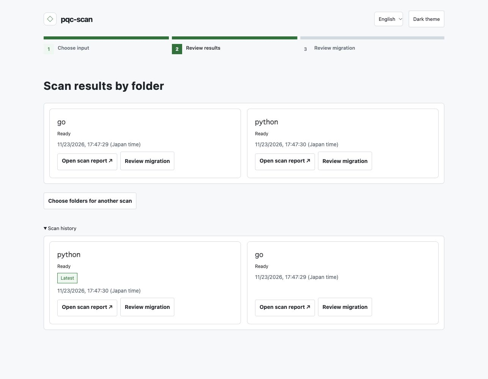
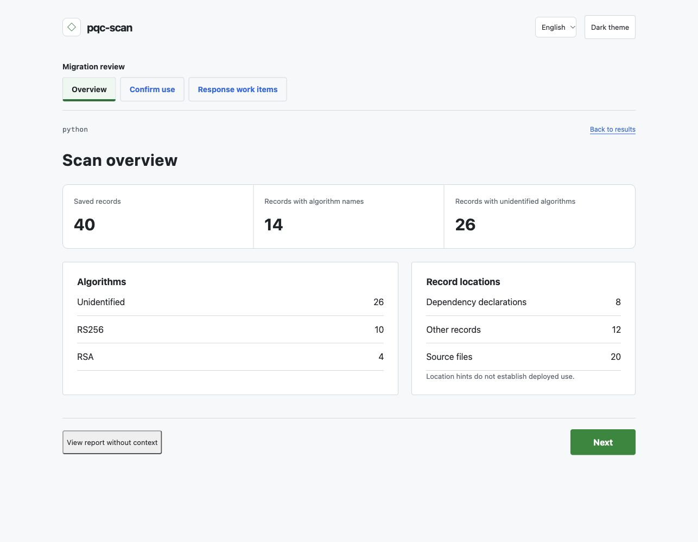
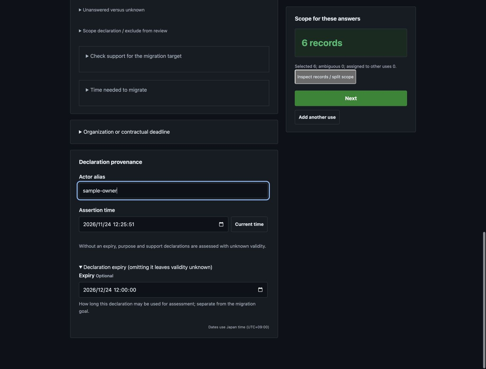
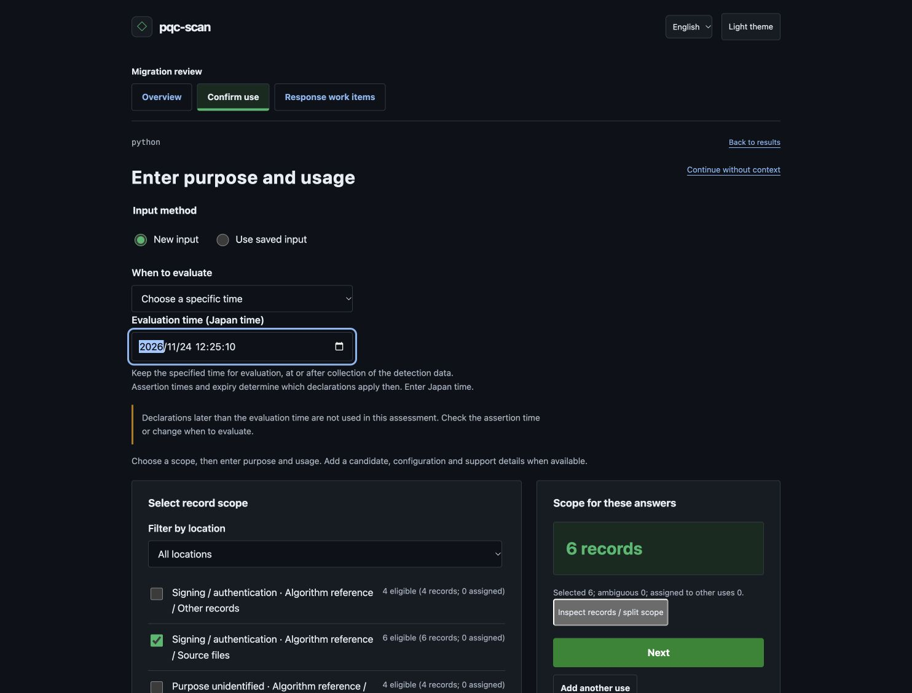
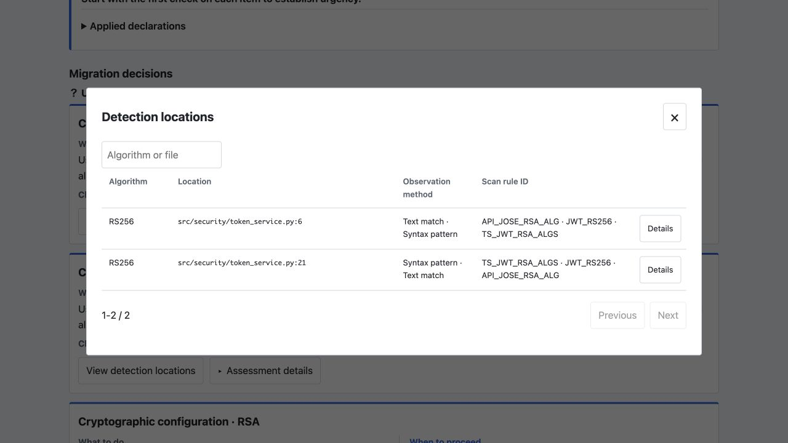

# Scanning repositories

[日本語](SCANNING.ja.md) · [README](https://github.com/wakaken/pqc-scan/blob/develop/README.md)

This guide covers v0.4.0 static scanning. See the [release notes](../releases/v0.4.0.md) for changes between versions.

Use this guide after the first scan when you need to select outputs, change CI exit behavior or understand incomplete inspection. See [report interpretation](REPORTS.md) for inventory and policy output, and [supported inputs](https://github.com/wakaken/pqc-scan/blob/develop/docs/user/COVERAGE.md) for format-specific limits.

## Contents

- [Command and options](#command)
- [GitHub Actions](#github-actions)
- [Running from source](#from-source)
- [Inspection diagnostics](#diagnostics)
- [Illustrated browser scan and migration workflow](#web-migration-walkthrough)
- [Input, saving and reassessment details](#migration-input-details)
- [Exclude test code](#exclude-test-code)
- [Custom excluded paths](#custom-exclusions)

<a id="command"></a>

## Command and options

```bash
pqc-scan scan <path> [--format json|html|md|sarif|all] [--lang en|ja] [--out-dir ./pqc-report] [--rules-dir ./rules] [--fail-on high|critical] [--threads N] [--max-file-size-mib N] [--diagnostics] [--require-complete] [--include-non-scannable] [--exclude-tests] [--cyclonedx-17] [--inventory-json] [--repository-scope ID] [--policy-profile migration-review-v1] [--assessment-context PATH]
pqc-scan rules list [--rules-dir ./rules]
pqc-scan rules show <rule-id> [--rules-dir ./rules]
pqc-scan diff <before-inventory> <after-inventory> --repository-scope ID --out-dir DIR
```

Defaults are `--format all`, `--lang en`, `--out-dir ./pqc-report`, `--rules-dir ./rules` and `--threads 0` (automatic thread selection). No finding threshold or completeness gate is enabled by default. Paths are resolved from the current working directory.

`--repository-scope` requires `--inventory-json`; `--policy-profile` also requires it. `--assessment-context` requires an explicit policy profile. Use `pqc-scan scan --help` for the complete option list.

Add `--cyclonedx-17` to write separate CycloneDX 1.7 inventories. The [report guide](REPORTS.md#cyclonedx)
explains these documents and the completeness limits of [inventory comparison](REPORTS.md#diff).

### File size limit

`--max-file-size-mib N` selects a per-file limit of 1–64 MiB (whole numbers; default 2). For example, `pqc-scan scan . --max-file-size-mib 16 --threads 1 --diagnostics` includes files up to 16 MiB. One MiB is 1,048,576 bytes. The configured value appears in the diagnostic/inventory scope; files above it remain explicitly excluded. Other ignore/type/test policies and detector work limits still apply. A larger read limit does not guarantee complete parsing; inspect diagnostics. More selected data and parallel workers can increase time and peak memory.

`serve --max-file-size-mib N` supplies the initial value in the folder picker. The “File size limit (MB)” field can change it for the next batch; all folders in that batch use its captured value. The control is locked while scanning. No saved report or history is rewritten by changing it. The picker’s MB label also represents 1,048,576 bytes per unit. The field accepts integers 1–64; empty or invalid values show an error and disable scan submission.

### Output destination safety

On Unix (including macOS and Linux), report writers reject symbolic links in the
output directory path and existing symbolic-link or non-regular-file destinations.
The root-controlled macOS aliases `/tmp`, `/var` and `/etc` remain usable; links
inside them receive the same checks. Use the physical path for other directory
aliases. This applies to scan, inventory, assessment, diagnostics, CycloneDX, diff
and probe reports.

Missing directories are created, and existing regular reports can be overwritten.
You need write permission for the destination. A failed run can leave a partial set
of output files. Store reports where others cannot modify them.

### Recommended usage from your product repository

When running `pqc-scan` inside your own product repository (not inside the `pqc-scan` repo), use an **absolute path** for `--rules-dir`.

```bash
pqc-scan scan . --format all --out-dir /path/to/reports/product-scan --rules-dir /path/to/pqc-scan/rules
```

### Common Commands

```bash
# Full report set

pqc-scan scan . --format all --out-dir /path/to/reports/product-scan --rules-dir /path/to/pqc-scan/rules

# SARIF format (for GitHub Code Scanning)

pqc-scan scan . --format sarif --out-dir /path/to/reports/product-scan --rules-dir /path/to/pqc-scan/rules

# CI failure gate

pqc-scan scan . --fail-on high --out-dir /path/to/reports/product-scan --rules-dir /path/to/pqc-scan/rules

# Inspect one rule in detail

pqc-scan rules show JWT_RS256 --rules-dir /path/to/pqc-scan/rules
```

<a id="github-actions"></a>

## GitHub Actions

For a CI scan of your product, generate SARIF with `--format sarif` and choose `--fail-on high|critical` if findings should fail the job. Add `--require-complete` only if incomplete inspection must also fail; its exit 3 takes precedence over the finding threshold. The selected scope and unsupported formats still matter.

Choose failure gates for your own product and retain the original reports for review.

<a id="from-source"></a>

## Running from source

If you do not want to install yet, you can run directly from source:

```bash
cargo run --manifest-path /path/to/pqc-scan/crates/pqc_scan_cli/Cargo.toml --bin pqc-scan -- scan /path/to/your-product --format all --out-dir /path/to/reports/product-scan --rules-dir /path/to/pqc-scan/rules
```

<a id="diagnostics"></a>

## Inspection diagnostics

Zero findings does not mean every selected input was inspected. Read failures and detector errors retain other findings.
When inspection is partial, failed or unknown, the CLI prints a warning to stderr. A separate scope note explains that ignored or otherwise unenumerated files may exist; it is not itself an inspection failure.
CLI HTML/Markdown also display inspection status and counters. Detailed safe
reasons appear with `--diagnostics`; language selection changes human copy only.

### Save diagnostics and optionally fail CI

Use `--diagnostics` to investigate inspection gaps, and `--require-complete` to make incomplete inspection fail a CI job.
Either option can be used independently.

| Option | Behavior |
|---|---|
| `--diagnostics` | Adds `diagnostics.json` in `--out-dir`, recording scope, counters and safe reason codes |
| `--require-complete` | Returns exit 3 if inspection is not known to be complete, after writing the requested reports |

To select both:

```bash
pqc-scan scan . --diagnostics --require-complete --out-dir /path/to/reports/product-scan --rules-dir /path/to/pqc-scan/rules
```

`diagnostics.json` also contains `schema_version: "1"` and generation time. It omits file contents and arbitrary detector/I/O error text.
`--format all` does not enable it; the six legacy filenames and machine schemas stay unchanged. `--lang` affects HTML/Markdown only.

Read exit codes as follows:

| Code | Meaning |
|---|---|
| 0 | Successful execution; not proof of complete inspection or security |
| 1 | An operational error, such as setup or output failure |
| 2 | The severity threshold selected by `--fail-on` was reached |
| 3 | `--require-complete` was selected and inspection was not known to be complete |

If several conditions apply, precedence is 1, then 3, then 2. Requesting diagnostics alone does not enable the completeness exit gate.

### What “complete” covers

Completeness applies only within the declared scope after Git ignore settings, default exclusions and the size limit.
A valid scope with no target files can complete; this says nothing about cryptography outside that scope.
`Complete` means the supported patterns or formats were inspected, not general symbol resolution, runtime use or discovery of every key format.

Distinguish file selection from completed analysis. `scanned_files` means files selected by the walker.
Diagnostics separately count selected, read-ok, read-failed, analyzed, partial, analysis-failed, unsupported, not-applicable and unknown files.
Enumerated policy exclusions and enumeration failures are separate; the ignore-hidden population remains unknown.

### When inspection reaches a processing limit

Available findings are retained when processing limits prevent complete inspection.
Review the diagnostic reason, then split the scan scope or inspect the affected files directly.

### Parsing errors and unsupported formats

Syntax errors retain available findings and mark inspection as incomplete.
Binary inputs, unsupported source languages and absence of applicable rules are outside that detector's scope.

For certificates, malformed input, unknown key attributes or mixed unsupported blocks yield `detector_partial`; unsupported containers yield `detector_unsupported`.
Detecting a container does not prove its contents were inspected. A parsed certificate that matches no rule need not produce a finding.

Dependency inspection distinguishes valid empty input, malformed supported input, partial success, unsupported versions and resource limits.
Supported structured subsets can report completion; unrelated files are not applicable. Go modules, Maven POM, requirements and Ruby declarations/locks can complete within their explicitly parsed subsets. Literal Gemfile/gemspec dependency calls use bounded Ruby syntax inspection, including selected local gemspec references. Dynamic or unsupported declarations remain incomplete; Gradle lexical fallbacks remain `detector_not_reported`.
Completion is not full package-manager validation or proof of installation.

The `--require-complete` exit-code contract is unchanged, but actual returned codes depend on parser outcomes and supported scope.
See [dependency declarations and resolution evidence](https://github.com/wakaken/pqc-scan/blob/develop/docs/architecture/DEPENDENCY-PROVENANCE.md) for format-specific details.

## Including normally excluded binary formats

`scan` excludes known media/archive/compiled-data extensions and otherwise non-text binary inputs before selecting files. These exclusions are counted separately from unfinished checks. `--include-non-scannable` restores their inclusion for forensic/custom-detector runs; it does not add parsers for those formats and can increase “not applicable” counts. Existing directory, Markdown, Git-ignore and size policies still apply. Cryptographic container extensions are retained by default even when unsupported, so their inspection gaps remain visible. Full exclusion paths remain in diagnostic JSON, while human diagnostics show counts and at most three examples per reason.

<a id="reference-positions"></a>

### Check finding locations

Use the reported file and position to inspect the original source or configuration.
A detected reference does not establish the algorithm used at runtime.

## Local web scanning

Start the server with `--root` pointing to a directory containing your target folders
and `--rules-dir` pointing to your retained rules.

```bash
pqc-scan serve --root /path/to/projects --rules-dir /path/to/pqc-scan/rules
```

Select folders in the opened browser and choose **Scan selected folders**.
In ordinary mode, one folder opens its report automatically; multiple folders show
separate result cards. Keep the page open until completion, then stop the server
with **Ctrl+C** in the terminal.

Follow illustrated steps 1–8 below. Folder navigation, startup options and limits
are collected under [Web scan controls and limits](#web-scan-details).

### Optional migration context and reassessment

Add `--migration` at startup to enter purpose and usage information and continue to migration review.
For a scan report alone, use ordinary `serve` above and follow steps 1–2 to select folders and open the report.

```console
pqc-scan serve --migration --root /path/to/projects --rules-dir /path/to/pqc-scan/rules
```

<a id="web-migration-walkthrough"></a>

The walkthrough uses public samples from the source repository (`examples/go` and `examples/python`), which are not included in the binary bundle. Apply the same steps to your own folders. Counts and entered values describe this example only. Screenshots were captured with v0.4.0.

#### 1. Select folders and scan

Open the complete session URL printed at startup. Check one or more folders, review the selected list, then choose **Scan selected folders**. This example selects the public `go` and `python` samples.

Tests are included by default. Choose **Exclude test code** or change the per-file size limit when needed. A progress dialog opens during processing; **Cancel remaining scans** stops only folders not yet submitted.


#### 2. Open the intended result

Check the folder name on each result card. **Open scan report ↗** opens its findings in a new tab; **Review migration** opens that folder’s migration workflow. Choose `python` in this example.

**Scan history** offers the same actions. History belongs to this server session and does not persist across restarts. Ordinary `serve` automatically opens the scan report for a single selected folder.



#### 3. Review the overview

In **Overview**, inspect record counts, identified algorithms and recorded locations. These describe saved detections, not a count of deployed uses.

Choose **Next** to enter context. If no context is known, choose **View report without context** to inspect the investigation items.



#### 4. Enter scope, purpose and usage

Choose **New input** and check the exact records covered by your answer. This example selects the six signature/authentication source records, names the use `jwt-demo`, and selects **JWT** and **In use**. Check the affected record count; use **Inspect records / split scope** to separate exceptions.

Answer only what you know. **Unanswered** means no claim; **Unknown** explicitly records uncertainty. Personal/organization mode changes input guidance, not urgency. Add candidate settings, support or sourced deadlines when relevant.


#### 5. Check assertion dates and prepare the report

Answers need an actor alias and assertion time. Expand the claim-expiry details to enter how long that information remains valid. `sample-owner` and the dates shown are demonstration values; use the actual reviewer and confirmation/expiry dates.

Omitting expiry leaves validity unknown. This expiry is separate from migration deadline and goal month. Normally leave **When to evaluate** at **Current time when preparing items**. For a past situation, choose **a specific time** and enter Japan time, at or after collection of the detection data. The page warns about assertions later than the selected evaluation time; they will not apply then. Choose **Next** to apply the input and generate the report. Opening **Response work items** alone does not generate it; use **Prepare review items** in that view.



This example shows the warning when a declaration is later than a chosen evaluation time. Return to current-time evaluation for normal use.



#### 6. Read migration decisions

Check the conclusion, evaluation time, and each card’s **What to do** and **When to proceed**. This sparse-input example still needs effective algorithm/settings facts and shows undetermined urgency. Entering a purpose alone does not guarantee a three-step plan or readiness.

Eligible migration plans show current-use discovery, compatibility testing and staged rollout. Urgent investigations stay visible; when use-specific workflows exist, remaining checks are grouped under **Other checks**. See the [report guide](REPORTS.md#saved-assessment) for schedules and decision conditions.


#### 7. Inspect locations and original findings

Choose **View detection locations** and search by algorithm or filename. **Details** shows detection methods, matched rules, reasons and applied declarations. Equivalent records at the same location share the view.

When the same local job has the original scan report, **Open scan finding** links in details lead to it. Imported evidence and standalone HTML without that report have no such links.



#### 8. Save reports and reusable input

**Save input (JSON)** shows retrieval status and explains failures. After download starts, check your browser’s download location for `migration-context.json`. Retry from the current result if retrieval fails.

At the top, **Save report (HTML)** saves the readable report and **Save input (JSON)** saves reusable context declarations. **Save assessment data** at the bottom saves the complete evaluation, not reusable context.

For reassessment, retain the same job’s `scan.inventory.v1.json` alongside context. The original input remains in a per-job subdirectory under the private `pqc-scan-web-*` directory printed in the terminal. Choose **Load saved results** for that inventory, then **Use saved input** on the context screen for its matching context. Review evaluation time and prepare the report again. Preserve original inventory bytes: even reformatting changes its binding.

After **Edit use**, regenerate and save fresh HTML/input JSON. Stop the server with **Ctrl+C** in the terminal.


<a id="web-scan-details"></a>

<a id="startup-options-and-access-boundary"></a>

### Web scan controls and limits

Use the [eight illustrated steps](#web-migration-walkthrough) above for the main
workflow. This reference covers alternate controls and what to check when processing stops.

#### Startup options and access

| Option | Default and use |
|---|---|
| `--root` | Current directory. Navigation stays inside this boundary; symlinks are hidden. Restart to change it |
| `--port` | `8787`; use `--port 0` for an available port |
| `--threads` | `4` |
| `--no-open` | Print the startup URL without opening a browser |

The server listens only on `127.0.0.1`. If it does not open, copy the complete
session URL from the terminal. Do not replace the host with `localhost` or use a
URL whose path is only `/`. Keep the session URL private.

#### Folder selection and display settings

| Goal | Control or behavior |
|---|---|
| Select or deselect | Click a row or checkbox; selection survives folder navigation |
| Review selection | Check exact paths in the selected-folder list. Remove individual entries or use **Clear selection** |
| Open a folder | Double-click opens and selects; **›** opens without selecting |
| Navigate | Use **Back**, **Forward** or the path above the list. Clicking the current path selects/deselects that directory, including `--root` |
| Use the keyboard | Up/Down moves focus, Space toggles selection, Enter opens a folder and Alt+Up goes to its parent |
| Change scan conditions | **Scan settings** changes test exclusion and file-size limits, not rule sets, severity thresholds or network probing |
| Change language/theme | Choose Japanese/English and Light/Dark. Choices carry between results and reports |

Nothing is preselected. `--root` defines the navigation boundary; choose scan
targets separately. No OS folder dialog or folder upload is used. Theme is applied
before rendering even when browser storage is unavailable. Offline reports retain
language/theme controls but omit the live-session return link.

#### Queue limits and processing

| Item | Limit or behavior |
|---|---|
| Folder listing | Up to 1,000 subfolders; omitted entries are counted |
| Selection/session | Up to 20 folders and 20 jobs per session, including saved-result imports. Selection beyond remaining capacity is rejected before starting; remaining capacity is not displayed continuously |
| Execution order | One scan at a time, in selection order. Parent/child selections are scanned separately |
| Progress | Shows folder, queue position and finding/inspection/aggregation/report-writing phases. Other actions and Escape are blocked during processing |
| Inspection counts | Include read/inspection failures, not just successful files; they are not remaining-time estimates |
| Cancellation | **Cancel remaining scans** stops unsubmitted folders. The active scan finishes and its result stays in history |

See [interrupted processing](#web-recovery) for failures, connection loss and closing the page.

#### Open and retain results

| Need | Action or location |
|---|---|
| Per-folder results | Open the completed card's scan report in a new tab, or proceed to migration review when available |
| Earlier results | Start/results history is newest first, showing project/import name, request time in Japan time and status. Unknown historical names/times are labelled |
| Return to the same result | **Back to results** does not rescan. New report tabs carry language/theme while preserving this page's input |
| Scan output | The same CLI analysis writes seven `--format all` files plus `diagnostics.json` under the private `pqc-scan-web-*` directory printed in the terminal |
| Downloads/offline reading | Fetch corresponding filenames under the report URL. Keep `report.html` and `report.rules.html` together |

History belongs only to the current server session. Check report-generation
success and inspection completeness separately; scanner errors are not zero findings.

Source contents are not served, and source/reports are not uploaded. Build scripts
and package commands are not run. A folder containing session output cannot be selected.

<a id="migration-input-details"></a>

### Input, saving and reassessment details

| Need | Guide |
|---|---|
| Enter purpose/usage for the first time | [Steps 4–5](#4-enter-scope-purpose-and-usage) above |
| Reuse saved results/input | The [four illustrated reassessment steps](SAVED-EVIDENCE.md#browser-save) |
| Read decisions, schedules and next actions | [Migration report guide](REPORTS.md#saved-assessment) |

The following reference covers changes to scope and answers. Saved findings are
processed within the local session; preparation, review and saving continue with steps 4–8 above.

#### Scope and individual edits

1. Select a scope using observed purpose, role and folder/file hints. Filter by first-level folder if needed. Test-folder labels describe paths, not verified test-only use.
2. Check eligible counts, indistinguishable records and records assigned to other uses in the summary.
3. Choose **Next** to apply answers to the displayed exact scope and generate the report. No extra confirmation checkbox is required; separate uses remain separate systems when saved.

| Control | Behavior or condition |
|---|---|
| **Inspect records / split scope** | Algorithm/filename search, role filters and 20-record pages |
| **Edit individually** | Saves a record-specific exception; later shared edits do not change it |
| **Restore shared context** | Removes the exception and restores current shared settings |
| Multiple uses | Up to 4096 records across 256 uses; overflow rejects rather than partially applying |
| Personal/organization setting | Guidance only; does not change criticality. Company/department names are unnecessary |

Counts are not quality or urgency scores. Groups are editing conveniences, not
organization defaults. Unsaved answers are not assessed; reload loses drafts and
groups. Use **Save migration context** to retain declarations.

<details>
<summary>Indistinguishable records and individual answers</summary>

Records that cannot be uniquely identified within saved input cannot receive
claims. Adding ordinary answers does not resolve this detection limitation.
Repeated source references with unique, consistent saved positions can be selected explicitly.

Location filtering changes categories/counts to that exact scope. Eligible counts
exclude indistinguishable and already assigned records.

</details>

#### Unanswered, unknown and out of scope

| Answer | Meaning and display behavior |
|---|---|
| Unanswered | Omits a claim; defaults may be inherited |
| Unknown | Explicit uncertainty; can override an inherited known value |
| False | A negative answer, distinct from unknown and out of scope |
| Out of scope | Hides other migration questions and omits those answers from generated context, retaining drafts for restoration. Purpose-dependent questions behave the same way |

Unanswered/unknown alone do not determine urgency. Scope exclusion is neither
deletion nor proof of safety; technical concerns remain in the report.

#### Candidate settings and support

| Action | What to check |
|---|---|
| Choose a candidate/configuration | Choose an algorithm, then a key-size/configuration preset or **Other (enter manually)**. Presets name standard settings, not recommended deployments |
| Answer support questions | Answers concern the selected purpose/algorithm/configuration. If these change, answer support again before saving |
| Inspect provenance | Selected settings and claim provenance remain in context and assessment evidence |

Custom configuration validity is not verified. Claims do not establish correct
implementation, protocol compatibility or verified deployment. Older context
without configuration retains generic support meaning; importing known support
from another claim scope into a new configuration is rejected.

<a id="cancellation-and-planning-inputs"></a>

<a id="follow-up-report-usability"></a>

#### Assertion and evaluation times

| Time/planning field | What to enter | Effect on assessment |
|---|---|---|
| Assertion time | When information was confirmed; actor alias required. **Current time** fills it in | Assertions after evaluation time show a warning and are not used as active claims |
| Evaluation time | Normally the time items are prepared; choose a specific time for a past review | The chosen value is retained. Continuing without context still shows known concerns and missing information |
| Claim expiry | Optional detail field | Never generated. Omitting it leaves purpose/support claims with unknown validity; entered answers and active assessment claims differ |
| Migration duration | Years/months and a calendar anchor in Japan time | Converts to exact days/seconds, up to 315,576,000 seconds. Later evaluation-time edits do not change a saved estimate |
| Goal month | Planning information in `YYYY-MM`, years 0001–9999 | No day/timezone conversion; does not set policy/contract deadlines or affect urgency/readiness |
| Organization/contractual deadline | Scoped deadline, policy/contract basis and non-secret issuer/document/edition/clause identifiers | Separate from goal month; can affect urgency together with duration. No deadline, omitted answer and explicit uncertainty stay distinct |

Input/review times use Japan time. Serialization includes whole seconds and an
explicit offset, preserving exact UTC/seconds in JSON. Explicitly choosing duration
or goal month clears the other field; existing imported formats/meaning remain
unchanged. Work items show applicable deadlines in Japan time and duration in days/hours.

<details>
<summary>Converting years/months to an exact duration</summary>

The initial anchor is the evaluation date. Months are added to that date and month
ends are clamped to the destination month's end. A month is not assumed to be 30
days; exact days/seconds are shown. Saved/imported seconds remain unchanged.
Claim expiry is separate from migration deadlines; check each independently.

</details>

<a id="import-saved-input"></a>

<a id="edit-delete-and-restore-uses"></a>

#### Work items and saved files

| Goal | Action or saved content |
|---|---|
| Prepare items | **Next** validates input against the selected records and evaluates. Opening **Response work items** alone does not start generation; use **Prepare review items**. No rescan/outbound connection occurs |
| Inspect evidence | **View detection locations** shows 20 at a time; choose one for methods and reasons. **Details** combines matching findings/decisions at the same file/line and retains matched rules |
| Edit use | Returns with retained input; regenerate after changes |
| Delete/restore a use | Deletion removes individual settings too. **Undo** restores while this page remains open. Remove a conflicting use before restoring records reassigned elsewhere |
| Save viewable HTML | **Save report (HTML)** exports standalone bilingual HTML with the current initial language/theme |
| Reuse answers | **Save input (JSON)** also works with CLI `assess` using the same saved bytes and evaluation time |
| Import results/answers | `scan.inventory.v1.json`: up to 32 MiB; context: up to 1 MiB. Retains all supported fields, defaults, references and provenance. Imported input is read-only; edit/reimport the original file to change it |
| Locate output | Session `migration/` stores HTML/Markdown/JSON and, when supplied, `migration-context.json`. Only completed files can be opened |

Editing, deleting or restoring invalidates the displayed report without deleting
saved files. Save new HTML and input JSON after changes. Selecting another scan
resets bindings and requires review. See [illustrated reassessment](SAVED-EVIDENCE.md#browser-save)
for file roles and import operations.

<details>
<summary>Work-item counts and report names</summary>

Decisions combine when system, purpose/role, statuses, reasons, missing facts,
actions, blockers and candidate-support semantics agree. Counts vary, including
zero; aggregation does not imply completed migration. Record counts and distinct
recorded locations differ, and repeated detections are not independent uses or vulnerabilities.

Web HTML uses the selected relative scope as its display label. CLI
`assess --report-label "Project / scope"` sets a non-secret HTML name (up to 256
UTF-8 bytes, no control characters). See the [report guide](REPORTS.md#saved-assessment)
and [saved-results guide](SAVED-EVIDENCE.md) for interpretation and offline limits.

</details>

<a id="web-recovery"></a>

<a id="generation-and-failure-handling"></a>

#### Interrupted processing or closing the page

| Situation | Behavior and next check |
|---|---|
| Individual scan fails | Records failure and continues with the next folder. Retry the failed target when needed |
| Start fails or is uncertain | Stops remaining requests without automatic resend |
| Connection loss | Keeps the progress dialog until server state can be checked |
| Reload/close with pending folders | Pending requests are lost; active scanning and saved results remain |
| Migration generation | Modal/spinner shows loading, evaluation, format preparation and saving. Actual file counts appear during writes only; no guessed percentage. Evaluation cannot be cancelled after starting |
| Migration generation fails | Retains input, does not show a completed result and permits retry |
| Saving fails | Some output files may remain; check completed files and their location |

<a id="exclude-test-code"></a>

### Exclude test code

Include tests for a complete inventory: they can reveal algorithms and compatibility
requirements. To focus on product migration candidates, use `--exclude-tests` or
**Exclude test code**, below **Clear selection** in the browser. The setting is
fixed at scan start for every selected folder.

```bash
pqc-scan scan . --exclude-tests --diagnostics --out-dir /path/to/reports/product-only --rules-dir /path/to/pqc-scan/rules
```

| Category | Excluded relative paths/names (case-sensitive) |
|---|---|
| Directories | `test/`, `tests/`, `__test__/`, `__tests__/`, `spec/`, `specs/`, `testsuite/`, `test-suite/`, `test-framework/` |
| Python/Go/Ruby | `test_*.py`, `*_test.py`, `tests.py`, `*_test.go`, `*_test.rb`, `*_spec.rb` |
| JavaScript/TypeScript | `*.test.{js,jsx,ts,tsx,mjs,cjs,mts,cts}`, `*.spec.{js,jsx,ts,tsx,mjs,cjs,mts,cts}` |
| Java/Rust filenames | `*Test.java`, `*Tests.java`, `tests.rs` |

Names above the selected root and the root's own role are not inferred. Unusual
test names may remain; remaining findings are not proven production uses. Root
dependency manifests stay selected. Applied conditions are recorded in inspection
scope, `diagnostics.json` and native inventory. Do not directly compare different scopes.

<details>
<summary>Rust inline tests and retained matches</summary>

For valid Rust, exact source matches entirely within explicit `#[cfg(test)]` items
or `#[test]` functions are omitted. Retain mixed `cfg(any(test, ...))`, custom
macros, functions where imports/globs or unresolved attribute macros may alter
`test`, and matches with unresolved positions or normalized/masked text. Nested
`#[cfg(test)]` inside an unresolved outer attribute macro is retained too. Mixed
files remain analyzed without lower file counts; source context may include adjacent tests.

</details>

<a id="custom-exclusions"></a>

### Custom excluded paths

Place a UTF-8, Gitignore-style `.pqcignore` at the selected folder root. It applies
to CLI and browser scans; multiple folders each use their own root's policy.
This example excludes custom validation files while keeping one control:

```gitignore
/integration-fixtures/*
!/integration-fixtures/production-control.rs
```

| Condition | Behavior |
|---|---|
| Policy scope | Selected root only. Ancestor/nested `.pqcignore` is not inherited; the policy itself is excluded from scanning |
| Invalid policy/read failure | Fails the scan without exposing policy text; symlink policies are not followed |
| Negation patterns | Cannot restore Git-ignored files, default exclusions or `--exclude-tests` matches |
| Mixed-file exclusion | Also excludes that file's product code |
| Recording | Scope records policy use; enumerated excluded files are counted |
| Default `target`/`docs` exclusions | Relative to the selected root; same-named ancestors outside it do not discard the whole project |
